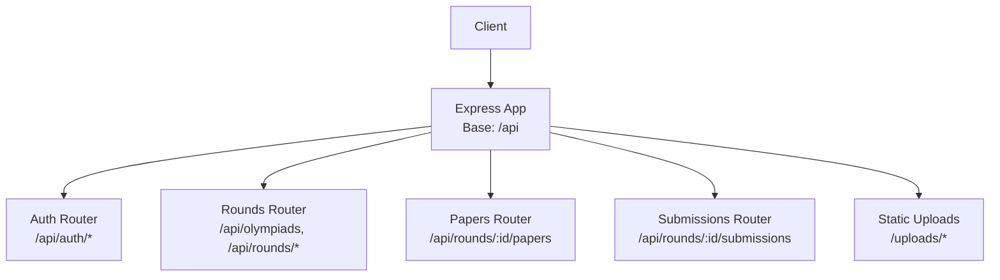
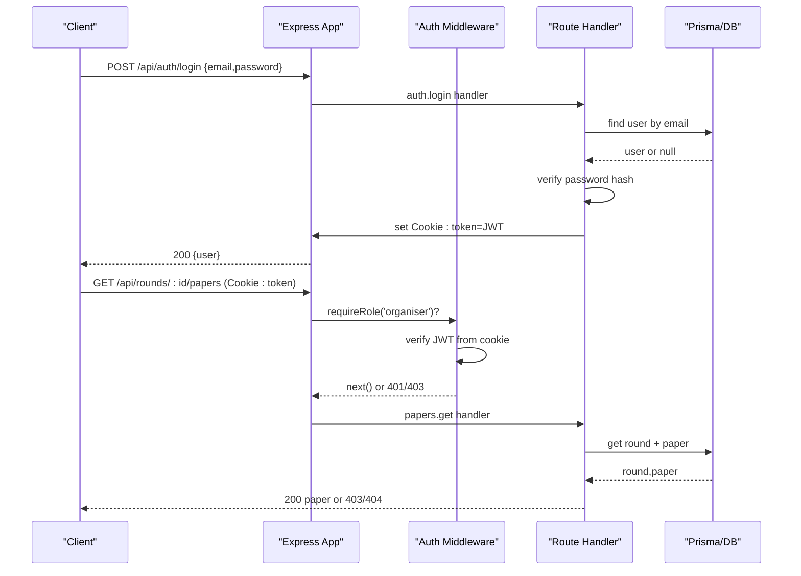
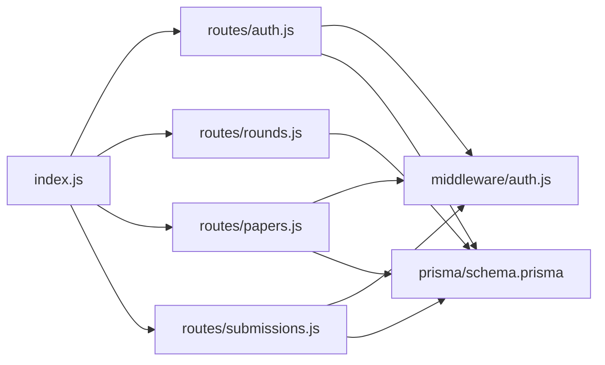

# API Reference

<cite>
**Referenced Files in This Document**
- [index.js](file://backend/src/index.js)
- [auth.js](file://backend/src/routes/auth.js)
- [rounds.js](file://backend/src/routes/rounds.js)
- [papers.js](file://backend/src/routes/papers.js)
- [submissions.js](file://backend/src/routes/submissions.js)
- [auth middleware](file://backend/src/middleware/auth.js)
- [schema.prisma](file://backend/prisma/schema.prisma)
- [README.md](file://backend/README.md)
</cite>

## Table of Contents
1. [Introduction](#introduction)
2. [Project Structure](#project-structure)
3. [Core Components](#core-components)
4. [Architecture Overview](#architecture-overview)
5. [Detailed Component Analysis](#detailed-component-analysis)
6. [Dependency Analysis](#dependency-analysis)
7. [Performance Considerations](#performance-considerations)
8. [Troubleshooting Guide](#troubleshooting-guide)
9. [Conclusion](#conclusion)

## Introduction
This document provides a comprehensive REST API reference for the Olympiad Portal backend. It covers authentication, rounds, papers, and submissions endpoints with HTTP methods, URL patterns, request/response schemas, authentication requirements, error codes, and validation rules. It also includes examples, security considerations, and debugging guidance for integration.

## Project Structure
The backend is an Express application that mounts routers under a common base path. The server sets up CORS, cookie parsing, JSON parsing, static file serving for uploads, and registers route modules.

**Diagram sources**
- [index.js:14-32](file://backend/src/index.js#L14-L32)
- [index.js:26-32](file://backend/src/index.js#L26-L32)

**Section sources**
- [index.js:1-43](file://backend/src/index.js#L1-L43)

## Core Components
- Authentication: JWT-based session via cookies; role-based access control (educator, organiser).
- Rounds: CRUD for Olympiads and Rounds; listing entrants and submissions per round.
- Papers: Upload paper and memo files with optional memo answers; controlled download based on round state.
- Submissions: Submit answers with idempotency key; automatic scoring when memo answers are present; email receipt.

**Section sources**
- [auth.js:22-151](file://backend/src/routes/auth.js#L22-L151)
- [rounds.js:6-115](file://backend/src/routes/rounds.js#L6-L115)
- [papers.js:25-98](file://backend/src/routes/papers.js#L25-L98)
- [submissions.js:8-86](file://backend/src/routes/submissions.js#L8-L86)
- [auth middleware:5-32](file://backend/src/middleware/auth.js#L5-L32)

## Architecture Overview
The API uses cookie-based JWT authentication. Protected routes validate the token from cookies and enforce roles. Data persistence is handled by Prisma against PostgreSQL. File uploads are stored locally under /uploads/papers and served statically.

**Diagram sources**
- [auth.js:73-97](file://backend/src/routes/auth.js#L73-L97)
- [auth middleware:5-32](file://backend/src/middleware/auth.js#L5-L32)
- [papers.js:70-98](file://backend/src/routes/papers.js#L70-L98)
- [index.js:14-32](file://backend/src/index.js#L14-L32)

## Detailed Component Analysis

### Authentication
- Base path: /api
- Endpoints:
  - POST /api/auth/register
    - Purpose: Create a new educator account and log in.
    - Request body:
      - email: string, required
      - password: string, required
      - name: string, required
      - schoolName: string, required
    - Success response: 201 with user object including id, email, role, name, school.
    - Errors:
      - 400: Missing fields
      - 409: Email already exists
    - Notes: Creates or reuses a School by name; sets HttpOnly cookie with JWT valid for 7 days.

  - POST /api/auth/login
    - Purpose: Authenticate and set session cookie.
    - Request body:
      - email: string, required
      - password: string, required
    - Success response: 200 with user object (id, email, role).
    - Errors:
      - 400: Missing fields
      - 401: Invalid credentials

  - POST /api/auth/reset-password
    - Purpose: Change current password.
    - Auth: Required (cookie JWT).
    - Request body:
      - currentPassword: string, required
      - newPassword: string, required
    - Success response: 200 message.
    - Errors:
      - 401: Not authenticated or invalid current password
      - 400: Missing fields
      - 404: User not found

  - POST /api/auth/logout
    - Purpose: Clear session cookie.
    - Response: 200 message.

  - GET /api/auth/me
    - Purpose: Get current user info.
    - Auth: Required.
    - Success response: 200 with user object (id, email, role).
    - Errors:
      - 401: Not authenticated
      - 404: User not found

  - DELETE /api/auth/account
    - Purpose: Delete current user account.
    - Auth: Required.
    - Success response: 200 message.
    - Errors:
      - 401: Not authenticated
      - 404: User not found

- Security:
  - Token stored in HttpOnly cookie; secure flag enabled in production; SameSite lax.
  - Role-based middleware enforces educator/organiser permissions where applicable.

**Section sources**
- [auth.js:22-151](file://backend/src/routes/auth.js#L22-L151)
- [auth middleware:5-32](file://backend/src/middleware/auth.js#L5-L32)

### Rounds and Olympiads
- Base path: /api
- Endpoints:
  - POST /api/olympiads
    - Purpose: Create an Olympiad.
    - Request body:
      - name: string, required
      - timezone: string, required
    - Success response: 201 with created Olympiad.
    - Errors:
      - 400: Missing fields
      - 500: Server error

  - GET /api/olympiads
    - Purpose: List all Olympiads sorted by name ascending.
    - Success response: 200 array of Olympiads.
    - Errors:
      - 500: Server error

  - POST /api/rounds
    - Purpose: Create a Round within an Olympiad.
    - Request body:
      - olympiadId: string, required
      - name: string, required
      - openTime: ISO datetime string, required
      - closeTime: ISO datetime string, required
    - Validation: closeTime must be after openTime.
    - Success response: 201 with created Round.
    - Errors:
      - 400: Missing fields or invalid time range
      - 500: Server error

  - GET /api/rounds
    - Purpose: List all Rounds sorted by openTime ascending.
    - Success response: 200 array of Rounds.
    - Errors:
      - 500: Server error

  - GET /api/rounds/:id
    - Purpose: Retrieve a specific Round.
    - Path param: id: string, required
    - Success response: 200 Round object.
    - Errors:
      - 404: Round not found
      - 500: Server error

  - GET /api/olympiads/:id/rounds
    - Purpose: List Rounds for a specific Olympiad.
    - Path param: id: string, required
    - Success response: 200 array of Rounds.
    - Errors:
      - 500: Server error

  - GET /api/rounds/:id/entrants
    - Purpose: List Entrants registered for a Round.
    - Path param: id: string, required
    - Success response: 200 array of Entrant objects.
    - Errors:
      - 500: Server error

  - GET /api/rounds/:id/submissions
    - Purpose: List Submissions for a Round, including results if available.
    - Path param: id: string, required
    - Success response: 200 array of Submission objects with included result.
    - Errors:
      - 500: Server error

**Section sources**
- [rounds.js:6-115](file://backend/src/routes/rounds.js#L6-L115)

### Papers
- Base path: /api
- Endpoints:
  - POST /api/rounds/:id/papers
    - Purpose: Upload a Paper and Memo PDF for a Round, optionally with memo answers.
    - Auth: Requires organiser role.
    - Content-Type: multipart/form-data
    - Fields:
      - paper: file, required
      - memo: file, required
      - memoAnswers: JSON string, optional; must be valid JSON if provided
    - Success response: 201 with Paper object containing fileUrl and memoUrl.
    - Errors:
      - 400: Missing files or invalid memoAnswers JSON
      - 403: Not authorised (not organiser)
      - 500: Server error

  - GET /api/rounds/:id/papers
    - Purpose: Download the Paper for a Round when allowed.
    - Path param: id: string, required
    - Access rule: Allowed only when round state is open or released.
    - Success response: 200 Paper object with fileUrl.
    - Errors:
      - 403: Round not in open or released state
      - 404: Round not found or no paper uploaded
      - 500: Server error

- Storage:
  - Files saved to /uploads/papers with unique filenames.
  - Served statically at /uploads/* via Express static middleware.

**Section sources**
- [papers.js:25-98](file://backend/src/routes/papers.js#L25-L98)
- [index.js:26-27](file://backend/src/index.js#L26-L27)

### Submissions
- Base path: /api
- Endpoints:
  - POST /api/rounds/:id/submissions
    - Purpose: Submit answers for a Round’s paper.
    - Auth: Requires educator role.
    - Request body:
      - roundId: inferred from path
      - entrantId: string, required
      - answers: JSON object mapping question IDs to answers, required
      - idempotencyKey: string, required; ensures duplicate submissions are ignored
    - Validation:
      - Round must exist and be in open state.
    - Behavior:
      - If the associated Paper has memoAnswers, the system auto-scores and creates a Result with score percentage.
      - Sends an email receipt to the requester using their email.
    - Success response: 201 with submission and result (if auto-scored).
    - Idempotency:
      - On duplicate idempotencyKey, returns 200 with existing submission and its result.
    - Errors:
      - 400: Missing fields
      - 403: Not authorised (not educator) or round not open
      - 404: Round not found
      - 500: Server error

**Section sources**
- [submissions.js:8-86](file://backend/src/routes/submissions.js#L8-L86)

## Dependency Analysis
- Routing:
  - All routers mounted under /api in index.js.
  - Static assets served under /uploads.
- Authentication:
  - requireAuth reads JWT from cookie; requireRole checks role.
- Data models:
  - Prisma schema defines relationships between Olympiad, Round, Paper, Submission, Result, User, Educator, School, Entrant, RoundEntrant.

**Diagram sources**
- [index.js:29-32](file://backend/src/index.js#L29-L32)
- [auth middleware:5-32](file://backend/src/middleware/auth.js#L5-L32)
- [schema.prisma:11-108](file://backend/prisma/schema.prisma#L11-L108)

**Section sources**
- [index.js:14-32](file://backend/src/index.js#L14-L32)
- [schema.prisma:11-108](file://backend/prisma/schema.prisma#L11-L108)

## Performance Considerations
- Pagination: Not implemented in current endpoints. For large datasets (e.g., rounds, submissions), consider adding query parameters like page, limit, and offset to reduce payload size.
- Filtering: No filtering beyond basic queries. Consider adding filters (e.g., by state, date ranges) for rounds and submissions.
- Rate limiting: Not configured. Implement rate limiting (e.g., per IP or per user) to protect endpoints, especially login and submissions.
- File uploads: Multer stores files on disk; ensure adequate storage capacity and consider CDN or object storage for scalability.
- Auto-scoring: Immediate scoring occurs when memo answers exist; keep memoAnswers minimal to avoid heavy payloads.

[No sources needed since this section provides general guidance]

## Troubleshooting Guide
- Authentication issues:
  - Ensure cookies are sent with requests (credentials: true in fetch/XHR).
  - Verify JWT_SECRET environment variable matches between login and protected routes.
  - Check cookie attributes (HttpOnly, Secure, SameSite) and browser settings.

- Common errors:
  - 400 Bad Request: Missing or invalid fields; check request body schema.
  - 401 Unauthorized: Missing or invalid token; re-login or refresh token.
  - 403 Forbidden: Insufficient role; ensure user has required role (educator/organiser).
  - 404 Not Found: Resource does not exist; verify IDs.
  - 409 Conflict: Duplicate registration; use different email.
  - 500 Internal Server Error: Server-side failure; check logs and database connectivity.

- Submissions idempotency:
  - Use a stable idempotencyKey per logical submission to prevent duplicates.
  - Duplicate keys return existing submission without creating a new one.

- Paper downloads:
  - Ensure round state is open or released before attempting to download.
  - Confirm paper was uploaded successfully.

**Section sources**
- [auth.js:22-151](file://backend/src/routes/auth.js#L22-L151)
- [rounds.js:6-115](file://backend/src/routes/rounds.js#L6-L115)
- [papers.js:25-98](file://backend/src/routes/papers.js#L25-L98)
- [submissions.js:8-86](file://backend/src/routes/submissions.js#L8-L86)
- [auth middleware:5-32](file://backend/src/middleware/auth.js#L5-L32)

## Conclusion
The Olympiad Portal API provides robust endpoints for managing Olympiads, Rounds, Papers, and Submissions with secure authentication and role-based access. While pagination and rate limiting are not currently implemented, the API is well-structured for extension. Consumers should handle authentication via cookies, respect role restrictions, and leverage idempotency keys for reliable submissions.

[No sources needed since this section summarizes without analyzing specific files]