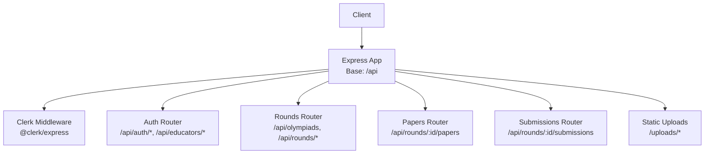
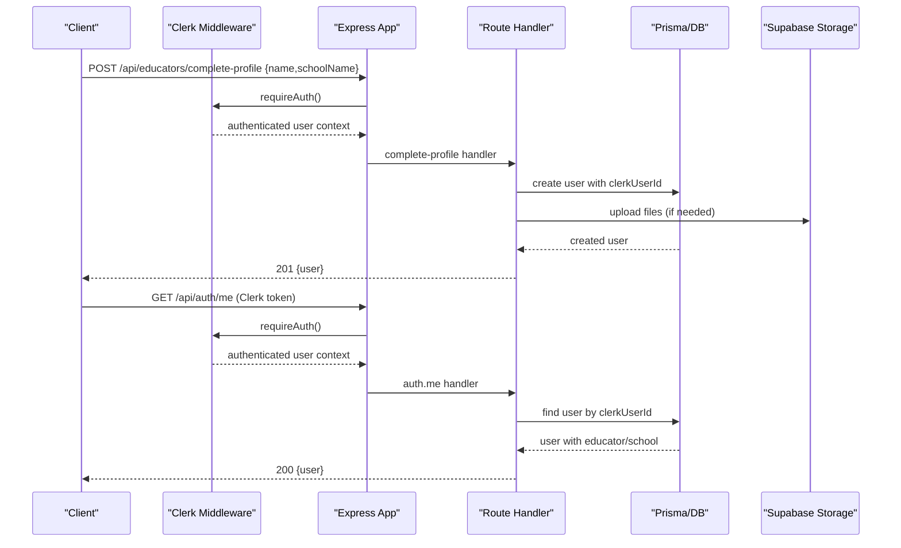
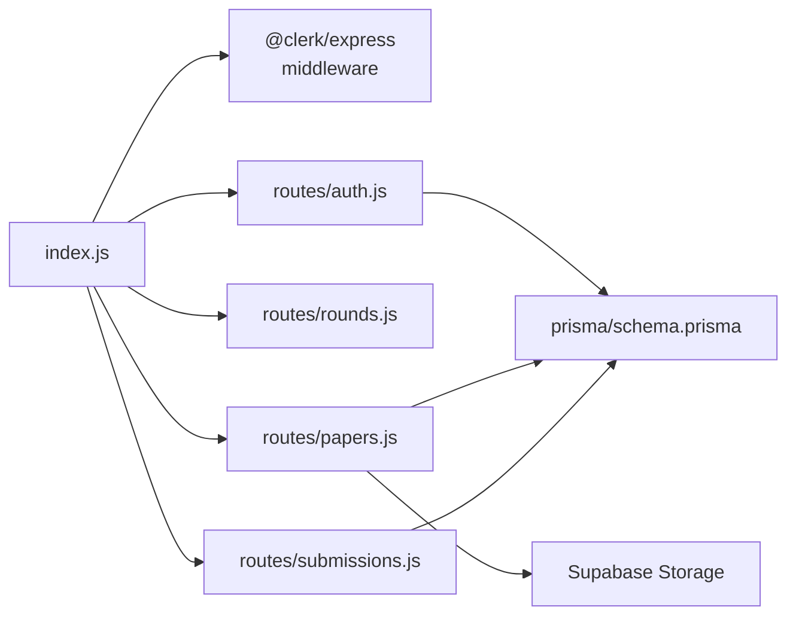

# API Reference

<cite>
**Referenced Files in This Document**
- [index.js](file://backend/src/index.js)
- [auth.js](file://backend/src/routes/auth.js)
- [rounds.js](file://backend/src/routes/rounds.js)
- [papers.js](file://backend/src/routes/papers.js)
- [submissions.js](file://backend/src/routes/submissions.js)
- [schema.prisma](file://backend/prisma/schema.prisma)
- [email.js](file://backend/src/lib/email.js)
</cite>

## Update Summary
**Changes Made**
- Replaced traditional JWT-based authentication with Clerk integration
- Removed /auth/register, /auth/login, and /auth/reset-password endpoints
- Added new /educators/complete-profile endpoint for post-signup profile completion
- Enhanced /auth/me endpoint to return comprehensive user information including school data
- Updated authentication flow to use Clerk's authentication middleware
- Modified file storage to use Supabase instead of local disk storage

## Table of Contents
1. [Introduction](#introduction)
2. [Project Structure](#project-structure)
3. [Core Components](#core-components)
4. [Architecture Overview](#architecture-overview)
5. [Detailed Component Analysis](#detailed-component-analysis)
6. [Dependency Analysis](#dependency-analysis)
7. [Performance Considerations](#performance-considerations)
8. [Troubleshooting Guide](#troubleshooting-guide)
9. [Conclusion](#conclusion)

## Introduction
This document provides a comprehensive REST API reference for the Olympiad Portal backend. It covers authentication using Clerk integration, rounds, papers, and submissions endpoints with HTTP methods, URL patterns, request/response schemas, authentication requirements, error codes, and validation rules. The API features Clerk-based authentication, enhanced error handling, and robust security measures for reliable integration.

## Project Structure
The backend is an Express application that mounts routers under a common base path. The server sets up CORS, cookie parsing, JSON parsing, Clerk middleware, static file serving for uploads, and registers route modules with comprehensive error handling.

**Diagram sources**
- [index.js:16-30](file://backend/src/index.js#L16-L30)

**Section sources**
- [index.js:1-41](file://backend/src/index.js#L1-L41)

## Core Components
- **Authentication**: Clerk-based authentication with session management; role-based access control (educator, organiser) with enhanced validation
- **Rounds**: CRUD for Olympiads and Rounds; listing entrants and submissions per round with improved error handling
- **Papers**: Upload paper and memo files to Supabase storage; controlled download based on round state with comprehensive validation
- **Submissions**: Submit answers with idempotency key; automatic scoring when memo answers are present; email receipt with robust error handling

**Section sources**
- [auth.js:6-101](file://backend/src/routes/auth.js#L6-L101)
- [rounds.js:6-116](file://backend/src/routes/rounds.js#L6-L116)
- [papers.js:42-113](file://backend/src/routes/papers.js#L42-L113)
- [submissions.js:8-93](file://backend/src/routes/submissions.js#L8-L93)

## Architecture Overview
The API uses Clerk-based authentication with enhanced security validation. Protected routes validate tokens from Clerk and enforce roles with detailed error responses. Data persistence is handled by Prisma against PostgreSQL with comprehensive error handling. File uploads are stored in Supabase storage and served via public URLs.

**Diagram sources**
- [auth.js:9-59](file://backend/src/routes/auth.js#L9-L59)
- [auth.js:62-83](file://backend/src/routes/auth.js#L62-L83)
- [index.js:24-30](file://backend/src/index.js#L24-L30)

## Detailed Component Analysis

### Authentication
- Base path: /api
- Authentication Method: Clerk-based with @clerk/express middleware
- Endpoints:
  - POST /api/educators/complete-profile
    - Purpose: Complete user profile after Clerk signup by adding app-specific data (name, school).
    - Auth: Required (Clerk authentication).
    - Request body:
      - name: string, required
      - schoolName: string, required
    - Success response: 201 with user object including id, email, role, name, school.
    - Errors:
      - 400: Missing fields or no email found on Clerk account
      - 409: Profile already completed for this account
    - Notes: Creates or reuses School by name; automatically retrieves email from Clerk account.

  - GET /api/auth/me
    - Purpose: Get current user info with enhanced details including school information.
    - Auth: Required (Clerk authentication).
    - Success response: 200 with user object (id, email, role, name, school).
    - Errors:
      - 401: Not authenticated
      - 404: User not found

  - DELETE /api/auth/account
    - Purpose: Delete current user account from both application database and Clerk.
    - Auth: Required (Clerk authentication).
    - Success response: 200 message.
    - Errors:
      - 401: Not authenticated
      - 404: User not found

- Security:
  - Clerk handles authentication and session management
  - Role-based middleware enforces educator/organiser permissions where applicable
  - Enhanced validation and error handling throughout

**Updated** Replaced traditional JWT authentication with Clerk integration; removed registration/login endpoints; added profile completion workflow.

**Section sources**
- [auth.js:6-101](file://backend/src/routes/auth.js#L6-L101)

### Rounds and Olympiads
- Base path: /api
- Endpoints:
  - POST /api/olympiads
    - Purpose: Create an Olympiad.
    - Request body:
      - name: string, required
      - timezone: string, required
    - Success response: 201 with created Olympiad.
    - Errors:
      - 400: Missing fields with descriptive error message
      - 500: Server error with logging

  - GET /api/olympiads
    - Purpose: List all Olympiads sorted by name ascending.
    - Success response: 200 array of Olympiads.
    - Errors:
      - 500: Server error with logging

  - POST /api/rounds
    - Purpose: Create a Round within an Olympiad.
    - Request body:
      - olympiadId: string, required
      - name: string, required
      - openTime: ISO datetime string, required
      - closeTime: ISO datetime string, required
    - Validation: closeTime must be after openTime.
    - Success response: 201 with created Round.
    - Errors:
      - 400: Missing fields or invalid time range with descriptive error message
      - 500: Server error with logging

  - GET /api/rounds
    - Purpose: List all Rounds sorted by openTime ascending.
    - Success response: 200 array of Rounds.
    - Errors:
      - 500: Server error with logging

  - GET /api/rounds/:id
    - Purpose: Retrieve a specific Round.
    - Path param: id: string, required
    - Success response: 200 Round object.
    - Errors:
      - 404: Round not found
      - 500: Server error with logging

  - GET /api/olympiads/:id/rounds
    - Purpose: List Rounds for a specific Olympiad.
    - Path param: id: string, required
    - Success response: 200 array of Rounds.
    - Errors:
      - 500: Server error with logging

  - GET /api/rounds/:id/entrants
    - Purpose: List Entrants registered for a Round.
    - Path param: id: string, required
    - Success response: 200 array of Entrant objects.
    - Errors:
      - 500: Server error with logging

  - GET /api/rounds/:id/submissions
    - Purpose: List Submissions for a Round, including results if available.
    - Path param: id: string, required
    - Success response: 200 array of Submission objects with included result.
    - Errors:
      - 500: Server error with logging

**Section sources**
- [rounds.js:6-116](file://backend/src/routes/rounds.js#L6-L116)

### Papers
- Base path: /api
- Endpoints:
  - POST /api/rounds/:id/papers
    - Purpose: Upload a Paper and Memo PDF for a Round to Supabase storage, optionally with memo answers.
    - Auth: Requires organiser role.
    - Content-Type: multipart/form-data
    - Fields:
      - paper: file, required
      - memo: file, required
      - memoAnswers: JSON string, optional; must be valid JSON if provided
    - Success response: 201 with Paper object containing fileUrl and memoUrl.
    - Errors:
      - 400: Missing files or invalid memoAnswers JSON with descriptive error message
      - 403: Not authorised (not organiser)
      - 500: Server error with logging

  - GET /api/rounds/:id/papers
    - Purpose: Download the Paper for a Round when allowed.
    - Path param: id: string, required
    - Access rule: Allowed only when round state is open or released.
    - Success response: 200 Paper object with fileUrl.
    - Errors:
      - 403: Round not in open or released state with descriptive error message
      - 404: Round not found or no paper uploaded
      - 500: Server error with logging

- Storage:
  - Files uploaded to Supabase storage with unique filenames
  - Public URLs returned for direct access
  - No local file storage used

**Updated** Migrated from local disk storage to Supabase storage with enhanced error handling and improved logging for file operations.

**Section sources**
- [papers.js:42-113](file://backend/src/routes/papers.js#L42-L113)

### Submissions
- Base path: /api
- Endpoints:
  - POST /api/rounds/:id/submissions
    - Purpose: Submit answers for a Round's paper.
    - Auth: Requires educator role.
    - Request body:
      - roundId: inferred from path
      - entrantId: string, required
      - answers: JSON object mapping question IDs to answers, required
      - idempotencyKey: string, required; ensures duplicate submissions are ignored
    - Validation:
      - Round must exist and be in open state.
    - Behavior:
      - If the associated Paper has memoAnswers, the system auto-scores and creates a Result with score percentage.
      - Sends an email receipt to the requester using their email.
    - Success response: 201 with submission and result (if auto-scored).
    - Idempotency:
      - On duplicate idempotencyKey, returns 200 with existing submission and its result.
    - Errors:
      - 400: Missing fields with descriptive error message
      - 403: Not authorised (not educator) or round not open with descriptive error message
      - 404: Round not found
      - 500: Server error with logging

**Section sources**
- [submissions.js:8-93](file://backend/src/routes/submissions.js#L8-L93)

## Dependency Analysis
- Routing:
  - All routers mounted under /api in index.js.
  - Clerk middleware applied globally for authentication.
  - Static assets served under /uploads.
- Authentication:
  - Clerk middleware handles authentication and user context
  - Role-based middleware enforces educator/organiser permissions
- Data models:
  - Prisma schema defines relationships between Olympiad, Round, Paper, Submission, Result, User, Educator, School, Entrant, RoundEntrant.
  - User model now includes clerkUserId for Clerk integration.

**Diagram sources**
- [index.js:24-30](file://backend/src/index.js#L24-L30)
- [papers.js:8-29](file://backend/src/routes/papers.js#L8-L29)
- [schema.prisma:31-39](file://backend/prisma/schema.prisma#L31-L39)

**Section sources**
- [index.js:16-30](file://backend/src/index.js#L16-L30)
- [schema.prisma:31-39](file://backend/prisma/schema.prisma#L31-L39)

## Performance Considerations
- Pagination: Not implemented in current endpoints. For large datasets (e.g., rounds, submissions), consider adding query parameters like page, limit, and offset to reduce payload size.
- Filtering: No filtering beyond basic queries. Consider adding filters (e.g., by state, date ranges) for rounds and submissions.
- Rate limiting: Not configured. Implement rate limiting (e.g., per IP or per user) to protect endpoints, especially submissions.
- File uploads: Files are now stored in Supabase storage instead of local disk; ensure adequate storage capacity and consider CDN for scalability.
- Auto-scoring: Immediate scoring occurs when memo answers exist; keep memoAnswers minimal to avoid heavy payloads.
- Error handling: Enhanced error handling reduces unnecessary processing and improves response times.

## Troubleshooting Guide
- Authentication issues:
  - Ensure Clerk authentication is properly configured in the frontend
  - Verify Clerk environment variables are set correctly
  - Check that the Clerk middleware is properly initialized
  - Use the /api/auth/me endpoint to verify authentication status

- Common errors:
  - 400 Bad Request: Missing or invalid fields with descriptive error messages; check request body schema.
  - 401 Unauthorized: Missing or invalid Clerk token; ensure proper authentication setup.
  - 403 Forbidden: Insufficient role with specific role requirement; ensure user has required role (educator/organiser).
  - 404 Not Found: Resource does not exist; verify IDs.
  - 409 Conflict: Duplicate registration or profile completion; use different email or check existing profiles.
  - 500 Internal Server Error: Server-side failure with detailed logging; check logs and database connectivity.

- Profile completion:
  - Users must complete their profile after Clerk signup using /api/educators/complete-profile
  - Ensure name and schoolName are provided during profile completion
  - Email is automatically retrieved from Clerk account

- Paper downloads:
  - Ensure round state is open or released before attempting to download
  - Confirm paper was uploaded successfully to Supabase
  - Verify Supabase storage configuration and bucket permissions

- Enhanced logging:
  - Database errors are logged with console.error for debugging
  - Email sending failures are captured and logged without breaking the submission flow
  - File upload errors provide detailed feedback for troubleshooting

**Updated** Updated troubleshooting guidance for Clerk-based authentication and Supabase storage integration.

**Section sources**
- [auth.js:6-101](file://backend/src/routes/auth.js#L6-L101)
- [rounds.js:6-116](file://backend/src/routes/rounds.js#L6-L116)
- [papers.js:42-113](file://backend/src/routes/papers.js#L42-L113)
- [submissions.js:8-93](file://backend/src/routes/submissions.js#L8-L93)
- [email.js:5-23](file://backend/src/lib/email.js#L5-L23)

## Conclusion
The Olympiad Portal API has been significantly updated to use Clerk-based authentication instead of traditional JWT authentication. The new authentication flow provides enhanced security through Clerk's managed authentication while maintaining the same API structure for rounds, papers, and submissions. The migration to Supabase storage improves scalability and reliability for file management. The API now offers robust endpoints for managing Olympiads, Rounds, Papers, and Submissions with enhanced security, comprehensive error handling, and improved logging capabilities. Consumers should integrate with Clerk for authentication, use the new profile completion workflow, and leverage the enhanced error messages for effective debugging. While pagination and rate limiting are not currently implemented, the API is well-structured for extension and maintains backward compatibility for core functionality.