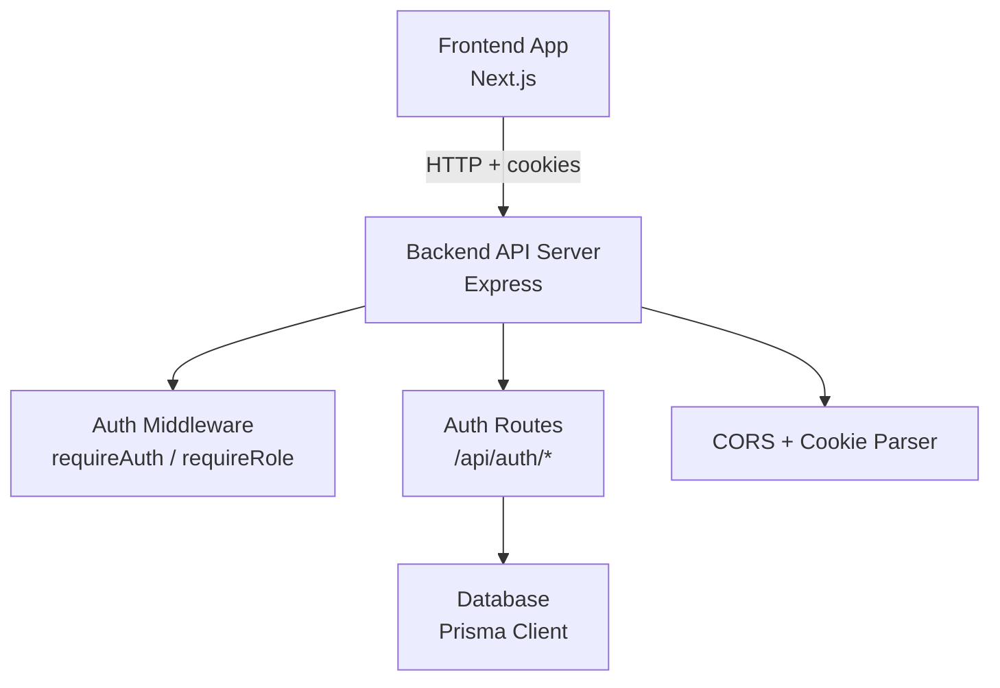
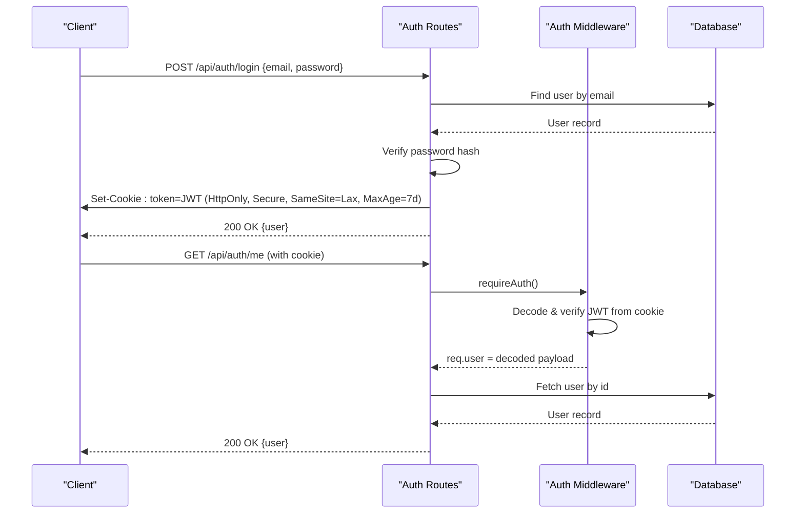
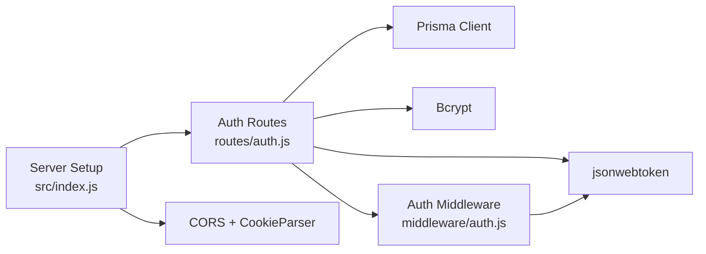

# Authentication API

<cite>
**Referenced Files in This Document**
- [auth.js](file://backend/src/routes/auth.js)
- [auth.js](file://backend/src/middleware/auth.js)
- [index.js](file://backend/src/index.js)
- [schema.prisma](file://backend/prisma/schema.prisma)
- [api.js](file://frontend/src/lib/api.js)
- [page.js](file://frontend/src/app/login/page.js)
- [page.js](file://frontend/src/app/register/page.js)
</cite>

## Table of Contents
1. [Introduction](#introduction)
2. [Project Structure](#project-structure)
3. [Core Components](#core-components)
4. [Architecture Overview](#architecture-overview)
5. [Detailed Component Analysis](#detailed-component-analysis)
6. [Dependency Analysis](#dependency-analysis)
7. [Performance Considerations](#performance-considerations)
8. [Troubleshooting Guide](#troubleshooting-guide)
9. [Conclusion](#conclusion)
10. [Appendices](#appendices)

## Introduction
This document provides comprehensive API documentation for the authentication endpoints used by the Olympiad Portal. It covers user registration, login, logout, password reset, and account management. For each endpoint, it specifies HTTP methods, URL patterns, request body schemas with validation rules, response formats, and authentication requirements. It also explains the cookie-based authentication flow using JWT tokens, security considerations, error handling patterns, and guidance for client-side implementation.

## Project Structure
The authentication system is implemented on the backend using Express routes and middleware, with a Prisma-managed PostgreSQL database. The frontend uses a shared API client that automatically includes credentials (cookies) for cross-origin requests.

**Diagram sources**
- [index.js:16-32](file://backend/src/index.js#L16-L32)
- [auth.js:1-35](file://backend/src/middleware/auth.js#L1-L35)
- [auth.js:22-151](file://backend/src/routes/auth.js#L22-L151)

**Section sources**
- [index.js:1-43](file://backend/src/index.js#L1-L43)
- [schema.prisma:31-57](file://backend/prisma/schema.prisma#L31-L57)

## Core Components
- Authentication routes handle user lifecycle operations: register, login, reset password, get current user, delete account, and logout.
- Middleware validates JWT tokens from cookies and enforces role-based access where needed.
- Database models define users, schools, and educator relationships.
- Frontend API client sends requests with credentials included to support cookie-based sessions.

Key responsibilities:
- Register: create user and school if needed, set auth cookie, return user info.
- Login: verify credentials, set auth cookie, return user info.
- Reset Password: requires authentication; verifies current password and updates hash.
- Get Current User: returns minimal user profile.
- Delete Account: removes user record after verification.
- Logout: clears auth cookie.

**Section sources**
- [auth.js:22-151](file://backend/src/routes/auth.js#L22-L151)
- [auth.js:5-32](file://backend/src/middleware/auth.js#L5-L32)
- [schema.prisma:31-57](file://backend/prisma/schema.prisma#L31-L57)
- [api.js:17-45](file://frontend/src/lib/api.js#L17-L45)

## Architecture Overview
The authentication flow uses HTTP-only cookies to store JWT tokens. On successful login or registration, the server sets a secure, HttpOnly cookie named token with a 7-day expiration. Protected endpoints use middleware to decode and validate this cookie on each request.

**Diagram sources**
- [auth.js:73-97](file://backend/src/routes/auth.js#L73-L97)
- [auth.js:133-138](file://backend/src/routes/auth.js#L133-L138)
- [auth.js:5-20](file://backend/src/middleware/auth.js#L5-L20)

## Detailed Component Analysis

### Endpoints

#### POST /api/auth/register
- Purpose: Create a new educator account and authenticate immediately.
- Request Body:
  - email: string, required, must be unique.
  - password: string, required.
  - name: string, required.
  - schoolName: string, required; creates or reuses a School record.
- Validation Rules:
  - All fields are required.
  - Email uniqueness enforced by database constraint.
- Response:
  - 201 Created: { user: { id, email, role, name, school } }
  - 400 Bad Request: { error: message } when fields missing.
  - 409 Conflict: { error: "An account with this email already exists" }.
- Authentication: Not required.
- Notes:
  - Sets an HttpOnly, Secure (in production), SameSite=Lax cookie named token with 7-day expiry.
  - Role is fixed to 'educator'.

Example Success Flow:
- Client sends POST /api/auth/register with required fields.
- Server creates user and school if needed, signs JWT, sets cookie, returns user object.

Example Error Scenarios:
- Missing fields: 400 with descriptive error.
- Duplicate email: 409 conflict.

**Section sources**
- [auth.js:22-71](file://backend/src/routes/auth.js#L22-L71)
- [schema.prisma:31-57](file://backend/prisma/schema.prisma#L31-L57)

#### POST /api/auth/login
- Purpose: Authenticate a user and establish session via cookie.
- Request Body:
  - email: string, required.
  - password: string, required.
- Validation Rules:
  - Both fields required.
- Response:
  - 200 OK: { user: { id, email, role } }
  - 400 Bad Request: { error: "email and password are required" }
  - 401 Unauthorized: { error: "Invalid email or password" }
- Authentication: Not required.
- Notes:
  - Sets an HttpOnly, Secure (in production), SameSite=Lax cookie named token with 7-day expiry.

Example Success Flow:
- Client sends POST /api/auth/login with email and password.
- Server verifies credentials, signs JWT, sets cookie, returns user object.

Example Error Scenarios:
- Missing fields: 400.
- Invalid credentials: 401.

**Section sources**
- [auth.js:73-97](file://backend/src/routes/auth.js#L73-L97)

#### POST /api/auth/reset-password
- Purpose: Update authenticated user’s password.
- Request Body:
  - currentPassword: string, required.
  - newPassword: string, required.
- Validation Rules:
  - Both fields required.
- Response:
  - 200 OK: { message: "Password updated successfully" }
  - 400 Bad Request: { error: "currentPassword and newPassword are required" }
  - 401 Unauthorized: { error: "Current password is incorrect" }
  - 404 Not Found: { error: "User not found" }
- Authentication: Required (via cookie).
- Notes:
  - Verifies current password before updating hash.

Example Success Flow:
- Client sends POST /api/auth/reset-password with current and new passwords.
- Server verifies current password, updates hash, responds success.

Example Error Scenarios:
- Missing fields: 400.
- Incorrect current password: 401.
- User not found: 404.

**Section sources**
- [auth.js:99-125](file://backend/src/routes/auth.js#L99-L125)

#### GET /api/auth/me
- Purpose: Retrieve current authenticated user’s minimal profile.
- Response:
  - 200 OK: { user: { id, email, role } }
  - 401 Unauthorized: { error: "Not authenticated" } or { error: "Invalid or expired token" }
  - 404 Not Found: { error: "User not found" }
- Authentication: Required (via cookie).

Example Success Flow:
- Client sends GET /api/auth/me with cookie.
- Server decodes JWT, fetches user, returns profile.

Example Error Scenarios:
- Missing or invalid token: 401.
- User not found: 404.

**Section sources**
- [auth.js:133-138](file://backend/src/routes/auth.js#L133-L138)
- [auth.js:5-20](file://backend/src/middleware/auth.js#L5-L20)

#### DELETE /api/auth/account
- Purpose: Delete the authenticated user’s account.
- Response:
  - 200 OK: { message: "Account deleted successfully" }
  - 401 Unauthorized: { error: "Not authenticated" } or { error: "Invalid or expired token" }
  - 404 Not Found: { error: "User not found" }
- Authentication: Required (via cookie).

Example Success Flow:
- Client sends DELETE /api/auth/account with cookie.
- Server deletes user record and responds success.

Example Error Scenarios:
- Missing or invalid token: 401.
- User not found: 404.

**Section sources**
- [auth.js:140-149](file://backend/src/routes/auth.js#L140-L149)
- [auth.js:5-20](file://backend/src/middleware/auth.js#L5-L20)

#### POST /api/auth/logout
- Purpose: Terminate session by clearing the auth cookie.
- Response:
  - 200 OK: { message: "Logged out successfully" }
- Authentication: Not required (clears cookie regardless).

Example Success Flow:
- Client sends POST /api/auth/logout.
- Server clears token cookie and responds success.

**Section sources**
- [auth.js:127-131](file://backend/src/routes/auth.js#L127-L131)

### Authentication Middleware
- requireAuth:
  - Reads token from cookies.
  - Decodes and verifies JWT using environment secret.
  - Attaches decoded payload to req.user.
  - Returns 401 if token missing or invalid/expired.
- requireRole(role):
  - Composes requireAuth plus a role check.
  - Returns 403 if user role does not match required role.

Security notes:
- Token stored in HttpOnly, Secure (production), SameSite=Lax cookie.
- Expiration set to 7 days.
- CORS configured to allow credentials from specified origin.

**Section sources**
- [auth.js:5-32](file://backend/src/middleware/auth.js#L5-L32)
- [index.js:16-24](file://backend/src/index.js#L16-L24)

### Data Models
- User: id, name, email (unique), passwordHash, role, createdAt.
- School: id, name, timezone, educators, entrants.
- Educator: links User to School with userId and schoolId.

These models underpin registration and profile retrieval.

**Section sources**
- [schema.prisma:31-57](file://backend/prisma/schema.prisma#L31-L57)

## Dependency Analysis
The authentication subsystem depends on:
- Express router for route definitions.
- JSON Web Token library for signing and verifying tokens.
- Bcrypt for password hashing.
- Prisma Client for database operations.
- Cookie parser for reading/writing cookies.
- CORS middleware for cross-origin requests with credentials.

**Diagram sources**
- [auth.js:1-5](file://backend/src/routes/auth.js#L1-L5)
- [auth.js:5-32](file://backend/src/middleware/auth.js#L5-L32)
- [index.js:16-32](file://backend/src/index.js#L16-L32)

**Section sources**
- [package.json:19-32](file://backend/package.json#L19-L32)
- [index.js:16-32](file://backend/src/index.js#L16-L32)

## Performance Considerations
- Password hashing uses bcrypt with salt rounds; ensure appropriate configuration for performance vs security trade-offs.
- JWT signing and verification are lightweight; consider rotating secrets and monitoring token size.
- Database queries are simple lookups by email/id; indexes on email and id are beneficial.
- Cookie-based sessions avoid repeated token parsing in headers; ensure proper cache-control and CDN behavior for protected resources.

[No sources needed since this section provides general guidance]

## Troubleshooting Guide
Common issues and resolutions:
- 401 Not authenticated:
  - Ensure cookies are sent with requests (credentials: include).
  - Verify CORS allows credentials and correct origin.
  - Check JWT_SECRET matches between sign and verify.
- 401 Invalid or expired token:
  - Token may have expired; refresh by logging in again.
  - Validate cookie presence and domain/path settings.
- 400 Bad Request:
  - Confirm all required fields are present and correctly typed.
- 409 Conflict:
  - Registration fails due to duplicate email; prompt user to log in instead.
- 404 Not Found:
  - User lookup failed; ensure user exists and IDs are valid.

Client-side tips:
- Use the shared API client which automatically includes credentials and handles non-JSON responses.
- Handle ApiError instances to display meaningful messages to users.
- Redirect based on user role after login using provided helper.

**Section sources**
- [api.js:17-45](file://frontend/src/lib/api.js#L17-L45)
- [auth.js:5-20](file://backend/src/middleware/auth.js#L5-L20)
- [auth.js:22-151](file://backend/src/routes/auth.js#L22-L151)

## Conclusion
The authentication API provides a complete lifecycle for educator accounts with secure cookie-based sessions using JWTs. Endpoints enforce input validation, protect sensitive operations with middleware, and follow consistent error patterns. Clients should rely on the shared API client to manage credentials and errors, and implement role-based navigation after successful authentication.

[No sources needed since this section summarizes without analyzing specific files]

## Appendices

### Security Considerations
- Cookies:
  - HttpOnly prevents client-side script access.
  - Secure flag ensures HTTPS transmission in production.
  - SameSite=Lax mitigates CSRF risks while allowing top-level navigations.
- Tokens:
  - JWT contains userId and role; keep payloads minimal.
  - Secret rotation recommended periodically.
- CORS:
  - Credentials enabled only for trusted origins.
- Passwords:
  - Stored as hashed values; never log or expose raw passwords.

[No sources needed since this section provides general guidance]

### Rate Limiting
- No explicit rate limiting is implemented in the authentication routes.
- Recommendation: Add rate limiting at the application or reverse proxy layer to mitigate brute-force attempts on login and registration endpoints.

[No sources needed since this section provides general guidance]

### Client-Side Implementation Guidance
- Use the shared API client to send requests with credentials included.
- After login, navigate to role-appropriate dashboards using the provided helper.
- On logout, call the logout endpoint to clear the cookie.
- Handle network errors and API errors gracefully, showing user-friendly messages.

**Section sources**
- [api.js:114-139](file://frontend/src/lib/api.js#L114-L139)
- [page.js:25-41](file://frontend/src/app/login/page.js#L25-L41)
- [page.js:30-49](file://frontend/src/app/register/page.js#L30-L49)