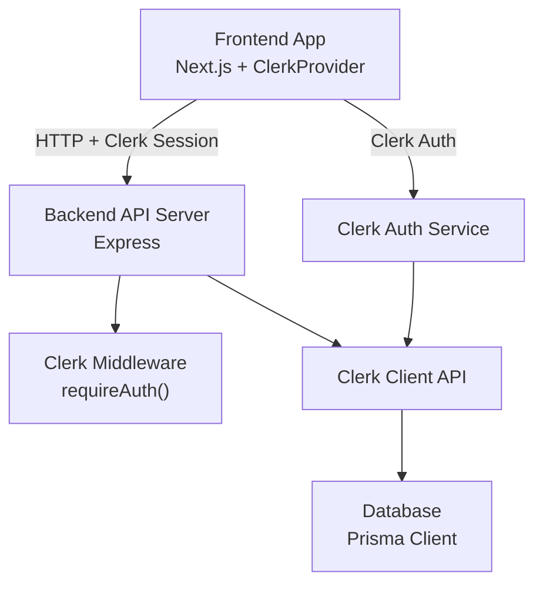
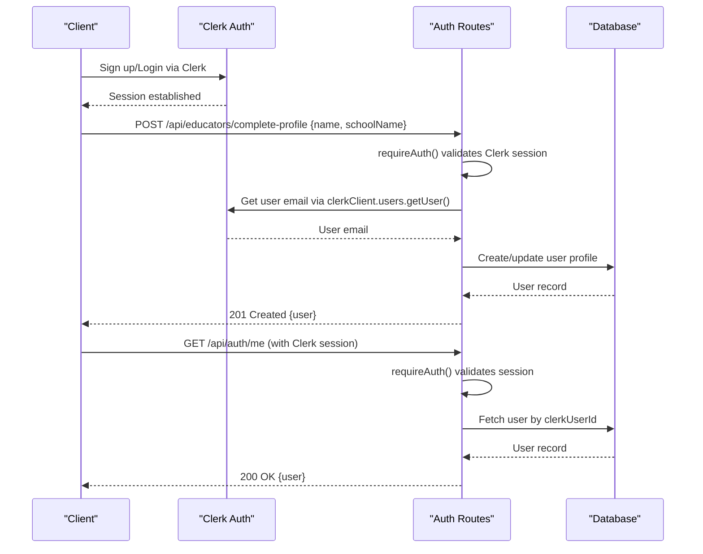
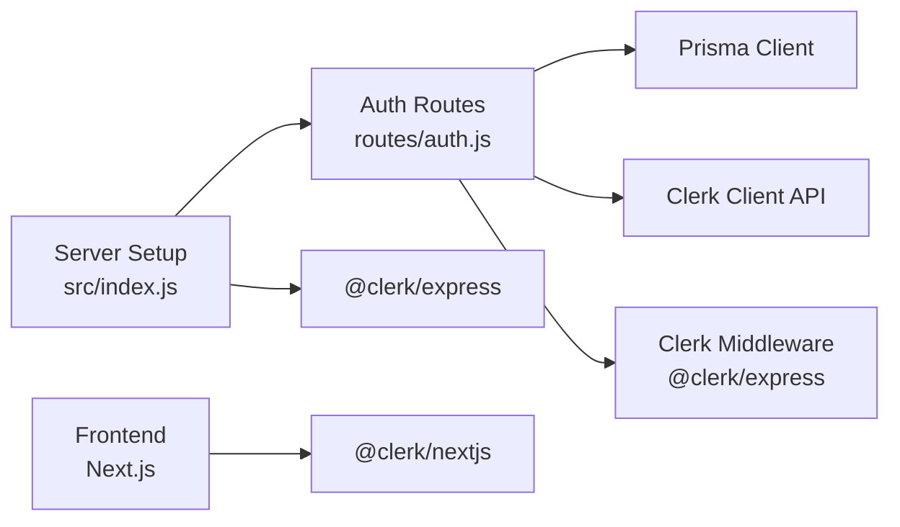

# Authentication API

<cite>
**Referenced Files in This Document**
- [auth.js](file://backend/src/routes/auth.js)
- [index.js](file://backend/src/index.js)
- [schema.prisma](file://backend/prisma/schema.prisma)
- [middleware.js](file://frontend/src/middleware.js)
- [layout.js](file://frontend/src/app/layout.js)
- [auth.test.js](file://backend/src/routes/auth.test.js)
</cite>

## Update Summary
**Changes Made**
- Complete migration from custom JWT-based authentication to Clerk authentication system
- Removed all references to deprecated endpoints: /api/auth/register, /api/auth/login, /api/auth/reset-password, /api/auth/logout
- Added documentation for new Clerk-based authentication flow
- Updated educator profile completion endpoint at /api/educators/complete-profile
- Replaced JWT middleware with Clerk's requireAuth middleware
- Updated database schema to use clerkUserId instead of email/password fields

## Table of Contents
1. [Introduction](#introduction)
2. [Project Structure](#project-structure)
3. [Core Components](#core-components)
4. [Architecture Overview](#architecture-overview)
5. [Detailed Component Analysis](#detailed-component-analysis)
6. [Dependency Analysis](#dependency-analysis)
7. [Performance Considerations](#performance-considerations)
8. [Troubleshooting Guide](#troubleshooting-guide)
9. [Conclusion](#conclusion)
10. [Appendices](#appendices)

## Introduction
This document provides comprehensive API documentation for the authentication endpoints used by the Olympiad Portal. The system has been completely migrated from custom JWT-based authentication to Clerk authentication service. It covers user registration through Clerk, educator profile completion, account management, and session handling. For each endpoint, it specifies HTTP methods, URL patterns, request body schemas with validation rules, response formats, and authentication requirements using Clerk's authentication middleware.

## Project Structure
The authentication system now uses Clerk for identity management with Express routes handling application-specific logic. The frontend integrates Clerk via Next.js middleware and provider components, while the backend uses @clerk/express for server-side authentication.

**Diagram sources**
- [index.js:11-24](file://backend/src/index.js#L11-L24)
- [auth.js:4-9](file://backend/src/routes/auth.js#L4-L9)
- [layout.js:1-34](file://frontend/src/app/layout.js#L1-L34)
- [middleware.js:1-11](file://frontend/src/middleware.js#L1-L11)

**Section sources**
- [index.js:1-41](file://backend/src/index.js#L1-L41)
- [schema.prisma:31-56](file://backend/prisma/schema.prisma#L31-L56)

## Core Components
- Clerk authentication handles user registration, login, and session management
- Educator profile completion endpoint links Clerk users to application-specific data
- Clerk middleware validates sessions and provides authenticated user context
- Database models store application-specific user data linked to Clerk user IDs
- Frontend uses Clerk Provider and middleware for client-side authentication

Key responsibilities:
- Profile Completion: link Clerk user to app-specific data (name, school) after signup
- Get Current User: retrieve application user profile based on Clerk user ID
- Delete Account: remove both application user and Clerk account
- Session Management: handled entirely by Clerk authentication

**Section sources**
- [auth.js:6-59](file://backend/src/routes/auth.js#L6-L59)
- [auth.js:61-83](file://backend/src/routes/auth.js#L61-L83)
- [auth.js:85-99](file://backend/src/routes/auth.js#L85-L99)
- [schema.prisma:31-56](file://backend/prisma/schema.prisma#L31-L56)

## Architecture Overview
The authentication flow now uses Clerk for identity management. Users authenticate through Clerk's hosted UI or SDK, which manages sessions and tokens. The backend uses Clerk's middleware to validate sessions and access user information via the Clerk client API.

**Diagram sources**
- [auth.js:9-59](file://backend/src/routes/auth.js#L9-L59)
- [auth.js:62-83](file://backend/src/routes/auth.js#L62-L83)
- [index.js:24-30](file://backend/src/index.js#L24-L30)

## Detailed Component Analysis

### Endpoints

#### POST /api/educators/complete-profile
- Purpose: Link a Clerk-authenticated user to application-specific data (name, school) after initial signup
- Request Body:
  - name: string, required; user's display name
  - schoolName: string, required; name of the school to associate with the user
- Validation Rules:
  - Both fields are required
  - Email is retrieved from Clerk account, not provided in request
  - Prevents duplicate profile completion for same Clerk user
- Response:
  - 201 Created: { user: { id, email, role, name, school } }
  - 400 Bad Request: { error: "name and schoolName are required" } or { error: "No email found on Clerk account" }
  - 409 Conflict: { error: "Profile already completed for this account" }
- Authentication: Required (via Clerk session)
- Notes:
  - Creates school if it doesn't exist with timezone 'Africa/Johannesburg'
  - Automatically retrieves email from Clerk user account
  - Sets user role to 'educator'

Example Success Flow:
- User signs up via Clerk, then calls this endpoint with name and schoolName
- Server creates or reuses school, creates user profile, returns complete user object

Example Error Scenarios:
- Missing fields: 400 with descriptive error
- Duplicate profile: 409 conflict
- No email in Clerk account: 400 error

**Section sources**
- [auth.js:6-59](file://backend/src/routes/auth.js#L6-L59)
- [auth.test.js:51-133](file://backend/src/routes/auth.test.js#L51-L133)

#### GET /api/auth/me
- Purpose: Retrieve current authenticated user's complete profile including school information
- Response:
  - 200 OK: { user: { id, email, role, name, school } }
  - 404 Not Found: { error: "User not found" }
- Authentication: Required (via Clerk session)
- Notes:
  - Returns null for school if user is not associated with any school
  - Includes full user profile with educator relationship

Example Success Flow:
- Client sends GET /api/auth/me with valid Clerk session
- Server validates session, fetches user by clerkUserId, returns complete profile

Example Error Scenarios:
- User not found: 404 (no application user linked to Clerk account)

**Section sources**
- [auth.js:61-83](file://backend/src/routes/auth.js#L61-L83)
- [auth.test.js:135-156](file://backend/src/routes/auth.test.js#L135-L156)

#### DELETE /api/auth/account
- Purpose: Delete the authenticated user's application account and corresponding Clerk account
- Response:
  - 200 OK: { message: "Account deleted successfully" }
  - 404 Not Found: { error: "User not found" }
- Authentication: Required (via Clerk session)
- Notes:
  - Deletes both application user record and Clerk user account
  - Ensures complete account removal from both systems

Example Success Flow:
- Client sends DELETE /api/auth/account with valid Clerk session
- Server deletes application user and calls Clerk deleteUser API
- Responds with success message

Example Error Scenarios:
- User not found: 404 (no application user linked to Clerk account)

**Section sources**
- [auth.js:85-99](file://backend/src/routes/auth.js#L85-L99)
- [auth.test.js:158-176](file://backend/src/routes/auth.test.js#L158-L176)

### Authentication Middleware
- requireAuth(): Clerk's built-in middleware that validates Clerk sessions
- Provides req.auth() function to access Clerk user information
- Automatically handles session validation and token verification
- Integrates with Clerk's distributed session management

Security notes:
- Sessions managed by Clerk with secure cookie handling
- No custom JWT tokens or secrets to manage
- Automatic session expiration and refresh handled by Clerk
- Cross-origin requests supported via Clerk's CORS configuration

**Section sources**
- [index.js:11-24](file://backend/src/index.js#L11-L24)
- [auth.js:4-9](file://backend/src/routes/auth.js#L4-L9)

### Data Models
- User: id, clerkUserId (unique), email (unique), role, createdAt, name
- School: id, name, timezone, createdAt, educators, entrants
- Educator: links User to School with userId and schoolId

These models support the Clerk integration by storing application-specific data linked to Clerk user IDs.

**Section sources**
- [schema.prisma:31-56](file://backend/prisma/schema.prisma#L31-L56)

## Dependency Analysis
The authentication subsystem now depends on:
- @clerk/express for server-side Clerk integration
- @clerk/nextjs for frontend Clerk integration
- Prisma Client for database operations
- Express router for route definitions

**Diagram sources**
- [auth.js:1-4](file://backend/src/routes/auth.js#L1-L4)
- [index.js:11-24](file://backend/src/index.js#L11-L24)
- [layout.js:1-34](file://frontend/src/app/layout.js#L1-L34)

**Section sources**
- [index.js:1-41](file://backend/src/index.js#L1-L41)

## Performance Considerations
- Clerk handles authentication performance and scalability
- Database queries optimized for clerkUserId lookups
- Minimal server-side processing for authentication flows
- Clerk's global CDN ensures fast authentication responses
- Application-specific data cached appropriately

## Troubleshooting Guide
Common issues and resolutions:
- 401 Unauthorized:
  - Ensure Clerk session is active and properly configured
  - Check Clerk environment variables are set correctly
  - Verify Clerk middleware is properly mounted in Express
- 404 User not found:
  - User may not have completed profile setup
  - Check if application user exists for the Clerk user ID
- 409 Conflict:
  - Profile already completed for this Clerk account
  - User should be redirected to dashboard instead of completing profile again
- Network errors:
  - Verify Clerk API connectivity and rate limits
  - Check CORS configuration for cross-origin requests

Client-side tips:
- Use Clerk's React hooks for authentication state management
- Handle Clerk's built-in error states and loading states
- Implement proper redirects based on authentication status
- Use Clerk's built-in sign-up and sign-in components

**Section sources**
- [auth.test.js:51-176](file://backend/src/routes/auth.test.js#L51-L176)

## Conclusion
The authentication system has been successfully migrated from custom JWT implementation to Clerk authentication service. This migration provides enhanced security, reduced maintenance overhead, and improved user experience through Clerk's professional authentication infrastructure. The remaining endpoints handle application-specific user data management while leveraging Clerk for core authentication functionality.

## Appendices

### Security Considerations
- Clerk handles all authentication security concerns including password hashing, session management, and token validation
- Application-specific data stored separately from authentication credentials
- Clerk's security best practices automatically applied to all authentication flows
- No custom authentication code to maintain or audit

### Rate Limiting
- Clerk provides built-in rate limiting for authentication endpoints
- Application endpoints can implement additional rate limiting as needed
- Monitor Clerk usage metrics for authentication patterns

### Client-Side Implementation Guidance
- Use ClerkProvider component to wrap the application
- Implement Clerk middleware for server-side protection
- Use Clerk's React hooks for authentication state and user management
- Leverage Clerk's built-in sign-up and sign-in components
- Handle profile completion flow after initial Clerk authentication

**Section sources**
- [layout.js:1-47](file://frontend/src/app/layout.js#L1-L47)
- [middleware.js:1-11](file://frontend/src/middleware.js#L1-L11)