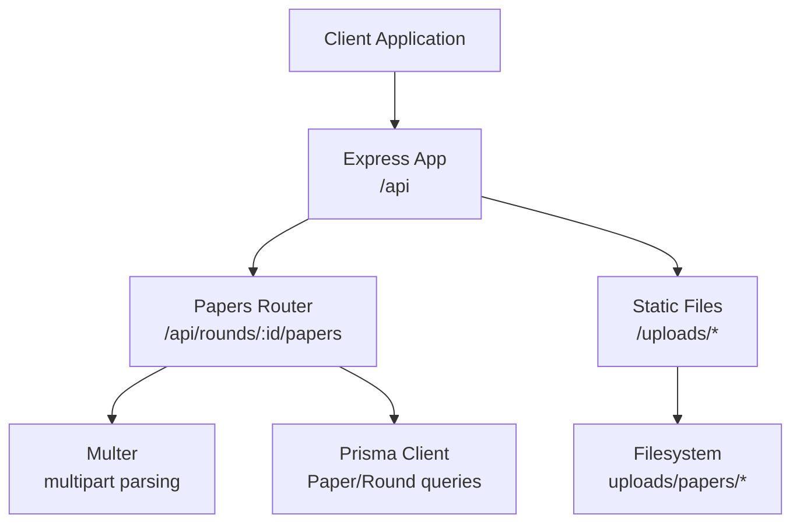
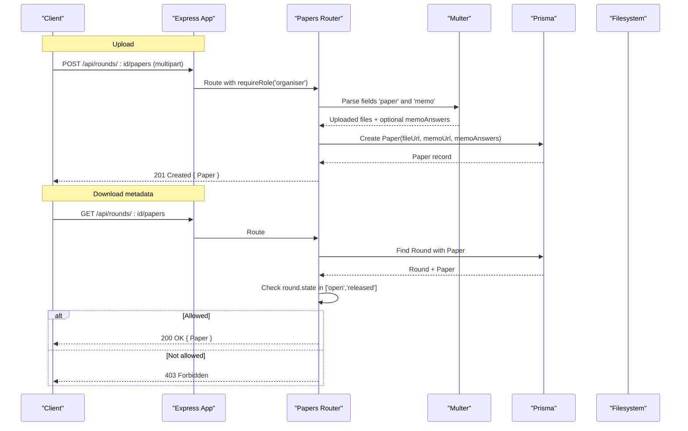
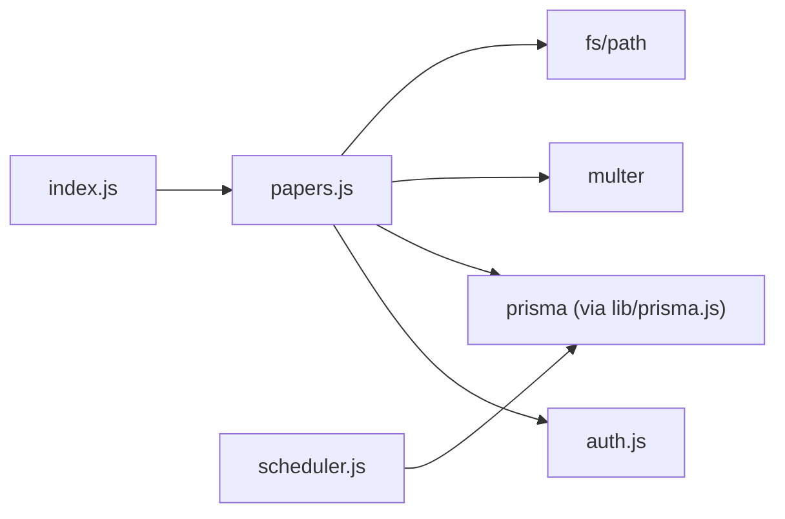

# Papers API

<cite>
**Referenced Files in This Document**
- [papers.js](file://backend/src/routes/papers.js)
- [auth.js](file://backend/src/middleware/auth.js)
- [index.js](file://backend/src/index.js)
- [schema.prisma](file://backend/prisma/schema.prisma)
- [scheduler.js](file://backend/src/scheduler.js)
- [api.js](file://frontend/src/lib/api.js)
- [papers.test.js](file://backend/src/routes/papers.test.js)
</cite>

## Table of Contents
1. [Introduction](#introduction)
2. [Project Structure](#project-structure)
3. [Core Components](#core-components)
4. [Architecture Overview](#architecture-overview)
5. [Detailed Component Analysis](#detailed-component-analysis)
6. [Dependency Analysis](#dependency-analysis)
7. [Performance Considerations](#performance-considerations)
8. [Troubleshooting Guide](#troubleshooting-guide)
9. [Conclusion](#conclusion)
10. [Appendices](#appendices)

## Introduction
This document provides comprehensive API documentation for paper management endpoints that allow authorised organisers to upload examination papers and memo answer keys, and for clients to retrieve paper metadata when a round is in an allowed state. It covers HTTP methods, URL patterns, file upload formats, request/response schemas, authentication and authorization requirements, access controls based on round states, download mechanisms, validation rules, storage handling, and security considerations. It also includes client implementation guidance for uploading and downloading files.

## Project Structure
The backend exposes REST endpoints under /api. The paper-related routes are mounted at /api/rounds/:id/papers. File uploads are handled with multipart/form-data using multer and stored on disk under the uploads directory. A static middleware serves uploaded files from /uploads.

**Diagram sources**
- [index.js:14-32](file://backend/src/index.js#L14-L32)
- [papers.js:1-23](file://backend/src/routes/papers.js#L1-L23)
- [papers.js:25-96](file://backend/src/routes/papers.js#L25-L96)

**Section sources**
- [index.js:14-32](file://backend/src/index.js#L14-L32)
- [papers.js:1-23](file://backend/src/routes/papers.js#L1-L23)

## Core Components
- Papers router: defines POST to create a paper record (with memo answers) and GET to return paper metadata when allowed by round state.
- Authentication middleware: validates JWT cookie and enforces role-based access (organiser only for uploads).
- Storage: multer writes files to a dedicated directory; filenames include a timestamp prefix to avoid collisions.
- Data model: Paper stores fileUrl, memoUrl, optional memoAnswers JSON, and links to Round.

Key responsibilities:
- Upload endpoint requires organiser role and both paper and memo files.
- Download endpoint returns paper metadata only if the round is open or released; otherwise it denies access.
- Memo answers are optional and must be valid JSON if provided.

**Section sources**
- [papers.js:25-96](file://backend/src/routes/papers.js#L25-L96)
- [auth.js:5-31](file://backend/src/middleware/auth.js#L5-L31)
- [schema.prisma:69-77](file://backend/prisma/schema.prisma#L69-L77)

## Architecture Overview
The end-to-end flow for uploads and downloads involves authentication, multipart parsing, file system storage, database persistence, and conditional access control based on round lifecycle managed by a scheduler.

**Diagram sources**
- [papers.js:25-96](file://backend/src/routes/papers.js#L25-L96)
- [auth.js:22-31](file://backend/src/middleware/auth.js#L22-L31)
- [index.js:27-32](file://backend/src/index.js#L27-L32)

## Detailed Component Analysis

### Endpoint: Upload Paper and Memo Answer Key
- Method: POST
- URL: /api/rounds/:id/papers
- Authentication: Required (JWT cookie)
- Authorization: Role = organiser
- Content-Type: multipart/form-data
- Form fields:
  - paper: required file (single)
  - memo: required file (single)
  - memoAnswers: optional field containing a JSON string representing memo answer key mapping
- Request schema:
  - Fields:
    - paper: File
    - memo: File
    - memoAnswers: string (JSON), optional
- Response schema:
  - 201 Created: Paper object including id, roundId, fileUrl, memoUrl, memoAnswers, uploadedAt
  - 400 Bad Request: Missing required files or invalid memoAnswers JSON
  - 401 Unauthorized: Missing or invalid JWT
  - 403 Forbidden: User not an organiser
  - 500 Internal Server Error: Database write failure

Validation and behavior:
- Both paper and memo files must be present; otherwise 400 error.
- memoAnswers is parsed as JSON; invalid JSON results in 400 error.
- Files are saved to disk with a unique filename derived from timestamp and original name.
- fileUrl and memoUrl are stored as relative paths under /uploads/papers/.
- No explicit file size limits or MIME type checks are enforced in code.

Access control:
- Enforced via requireRole('organiser').

Download mechanism:
- After upload, clients can fetch paper metadata via GET /api/rounds/:id/papers when allowed by round state.
- Actual file bytes are served by static middleware at /uploads/papers/<filename>.

Example usage (client):
- See frontend API client method for constructing FormData and posting to /api/rounds/:id/papers.

**Section sources**
- [papers.js:25-67](file://backend/src/routes/papers.js#L25-L67)
- [auth.js:22-31](file://backend/src/middleware/auth.js#L22-L31)
- [index.js:27-27](file://backend/src/index.js#L27-L27)
- [api.js:78-112](file://frontend/src/lib/api.js#L78-L112)
- [papers.test.js:52-141](file://backend/src/routes/papers.test.js#L52-L141)

### Endpoint: Get Paper Metadata
- Method: GET
- URL: /api/rounds/:id/papers
- Authentication: Not required for this endpoint
- Authorization: None
- Response schema:
  - 200 OK: Paper object (includes fileUrl, memoUrl, memoAnswers, etc.)
  - 404 Not Found: Round not found or no paper uploaded for the round
  - 403 Forbidden: Round is not in an allowed state for download

Round state rules:
- Download is allowed only when round.state is 'open' or 'released'.
- If round is 'scheduled' or 'closed', the endpoint returns 403 with an explanatory message.

Notes:
- This endpoint returns metadata only; actual file content is accessed via the static file server at /uploads/papers/<filename>.

**Section sources**
- [papers.js:70-96](file://backend/src/routes/papers.js#L70-L96)
- [papers.test.js:144-206](file://backend/src/routes/papers.test.js#L144-L206)

### Round Lifecycle and Time-Based Access
- Rounds transition automatically between states based on openTime and closeTime using a scheduler.
- Transitions:
  - scheduled → open when openTime has passed
  - open → closed when closeTime has passed
- The paper download endpoint respects these transitions, allowing access only in open or released states.

Operational implications:
- Clients should handle 403 responses gracefully and retry or inform users when rounds are not yet open or already closed.
- Ensure timezones are handled correctly; internal comparisons use UTC.

**Section sources**
- [scheduler.js:4-23](file://backend/src/scheduler.js#L4-L23)
- [papers.js:70-96](file://backend/src/routes/papers.js#L70-L96)

### Data Model and Storage
- Paper model:
  - id: unique identifier
  - roundId: unique per round
  - fileUrl: path to exam paper file
  - memoUrl: path to memo answer key file
  - uploadedAt: timestamp
  - memoAnswers: optional JSON structure storing answer key mappings
- Storage:
  - Files are written to the filesystem under uploads/papers.
  - Filenames include a timestamp prefix to ensure uniqueness.
  - Static serving is enabled at /uploads so clients can directly access files once metadata is retrieved.

Security considerations:
- Only authorised organisers can upload files.
- Public clients cannot directly access memo files unless they know the exact URL; consider additional protection for memo files in production.
- No input sanitization or virus scanning is implemented in code.

**Section sources**
- [schema.prisma:69-77](file://backend/prisma/schema.prisma#L69-L77)
- [papers.js:15-23](file://backend/src/routes/papers.js#L15-L23)
- [index.js:27-27](file://backend/src/index.js#L27-L27)

## Dependency Analysis
- Papers router depends on:
  - Express router and multer for multipart handling
  - Auth middleware for role enforcement
  - Prisma client for database operations
  - Node fs/path for file system interactions
- Index app wires routers and static file serving.
- Scheduler updates round states which indirectly affect paper download availability.

**Diagram sources**
- [papers.js:1-7](file://backend/src/routes/papers.js#L1-L7)
- [index.js:8-12](file://backend/src/index.js#L8-L12)
- [scheduler.js:1-3](file://backend/src/scheduler.js#L1-L3)

**Section sources**
- [papers.js:1-7](file://backend/src/routes/papers.js#L1-L7)
- [index.js:8-12](file://backend/src/index.js#L8-L12)
- [scheduler.js:1-3](file://backend/src/scheduler.js#L1-L3)

## Performance Considerations
- File uploads:
  - No size limits configured; large files may impact memory and disk space. Consider adding size restrictions and streaming for very large files.
  - Filename generation uses timestamps; ensure adequate entropy if high concurrency is expected.
- Database writes:
  - Single row insert per upload; minimal overhead.
- Static file serving:
  - Serving files directly from disk is efficient; consider CDN or object storage for scale.
- Round state checks:
  - Lightweight query per GET request; caching could reduce repeated lookups if needed.

[No sources needed since this section provides general guidance]

## Troubleshooting Guide
Common errors and causes:
- 400 Bad Request:
  - Missing paper or memo files during upload.
  - Invalid memoAnswers JSON string.
- 401 Unauthorized:
  - Missing or invalid JWT cookie.
- 403 Forbidden:
  - User lacks organiser role for upload.
  - Round not in 'open' or 'released' state for download.
- 404 Not Found:
  - Round does not exist.
  - No paper uploaded for the round when attempting to download.
- 500 Internal Server Error:
  - Database write failure during upload.

Debugging tips:
- Verify cookies and CORS settings when testing from a browser.
- Inspect multipart form fields and file attachments in client requests.
- Check server logs for JSON parse errors or database exceptions.

**Section sources**
- [papers.test.js:52-141](file://backend/src/routes/papers.test.js#L52-L141)
- [papers.test.js:144-206](file://backend/src/routes/papers.test.js#L144-L206)
- [auth.js:5-19](file://backend/src/middleware/auth.js#L5-L19)

## Conclusion
The Papers API provides secure, role-gated upload of examination papers and memo answer keys, along with controlled retrieval of paper metadata based on round lifecycle states. While functional, production deployments should add file size and type validation, memo file protection, and robust error handling to meet security and reliability requirements.

[No sources needed since this section summarizes without analyzing specific files]

## Appendices

### API Reference Summary

- Upload Paper and Memo Answer Key
  - Method: POST
  - URL: /api/rounds/:id/papers
  - Auth: JWT cookie required
  - Role: organiser
  - Content-Type: multipart/form-data
  - Fields:
    - paper: File (required)
    - memo: File (required)
    - memoAnswers: string (optional, JSON)
  - Responses:
    - 201 Created: Paper object
    - 400 Bad Request: Validation error
    - 401 Unauthorized: Auth error
    - 403 Forbidden: Role error
    - 500 Internal Server Error: DB error

- Get Paper Metadata
  - Method: GET
  - URL: /api/rounds/:id/papers
  - Auth: Not required
  - Responses:
    - 200 OK: Paper object
    - 403 Forbidden: Round not in allowed state
    - 404 Not Found: Round missing or no paper uploaded

- File Download
  - Method: GET
  - URL: /uploads/papers/<filename>
  - Notes: Served statically; ensure correct filename from Paper.fileUrl or Paper.memoUrl.

### Client Implementation Guidance
- Use FormData to attach paper and memo files.
- Include credentials (cookies) for authenticated requests.
- Handle errors according to status codes and user messages.
- For downloads, first call GET /api/rounds/:id/papers to obtain file URLs, then fetch files from /uploads/papers/<filename>.

**Section sources**
- [api.js:78-112](file://frontend/src/lib/api.js#L78-L112)
- [papers.js:25-96](file://backend/src/routes/papers.js#L25-L96)
- [index.js:27-27](file://backend/src/index.js#L27-L27)