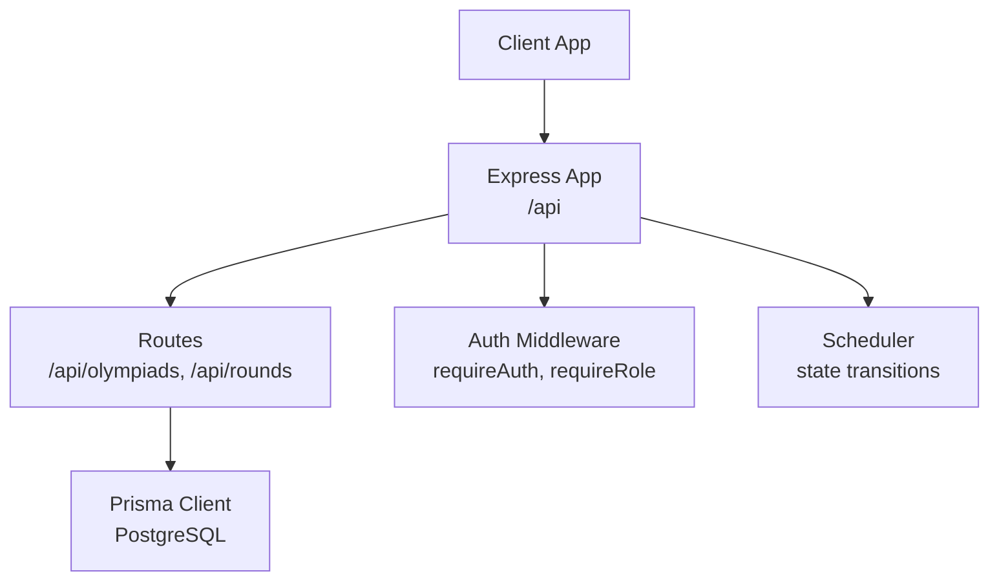
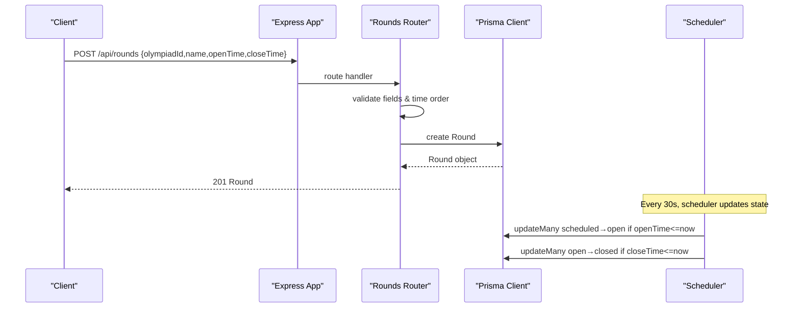
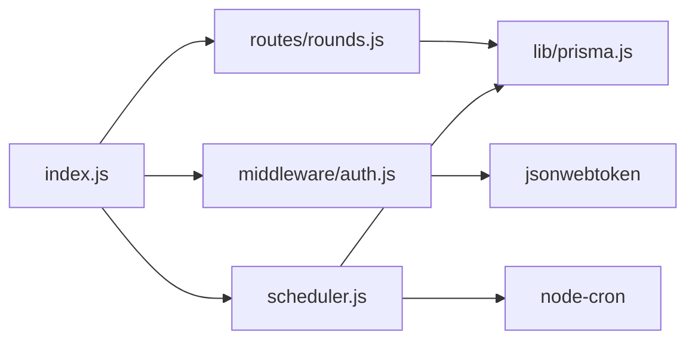

# Rounds API

<cite>
**Referenced Files in This Document**
- [rounds.js](file://backend/src/routes/rounds.js)
- [schema.prisma](file://backend/prisma/schema.prisma)
- [auth.js](file://backend/src/middleware/auth.js)
- [index.js](file://backend/src/index.js)
- [api-reference.md](file://documents/docs/api-reference.md)
- [scheduler.js](file://backend/src/scheduler.js)
- [round-lifecycle.md](file://documents/docs/round-lifecycle.md)
- [types.js](file://shared/types.js)
</cite>

## Table of Contents
1. [Introduction](#introduction)
2. [Project Structure](#project-structure)
3. [Core Components](#core-components)
4. [Architecture Overview](#architecture-overview)
5. [Detailed Component Analysis](#detailed-component-analysis)
6. [Dependency Analysis](#dependency-analysis)
7. [Performance Considerations](#performance-considerations)
8. [Troubleshooting Guide](#troubleshooting-guide)
9. [Conclusion](#conclusion)
10. [Appendices](#appendices)

## Introduction
This document provides detailed API documentation for round management endpoints that support creating, reading, and managing olympiad rounds, including participant enrollment and state management. It covers HTTP methods, URL patterns, request/response schemas, authentication and authorization requirements, business logic constraints, filtering/pagination/search capabilities (as implemented), role-based access control, and integration guidance.

## Project Structure
The backend exposes REST endpoints under the /api prefix. The routes module defines endpoints for Olympiads and Rounds, including listing and retrieving rounds, fetching entrants and submissions per round. Authentication is handled via a JWT middleware that validates tokens from cookies and enforces roles. A background scheduler transitions round states based on openTime and closeTime.



**Diagram sources**
- [index.js:14-32](file://backend/src/index.js#L14-L32)
- [rounds.js:1-116](file://backend/src/routes/rounds.js#L1-L116)
- [auth.js:1-35](file://backend/src/middleware/auth.js#L1-L35)
- [scheduler.js:1-29](file://backend/src/scheduler.js#L1-L29)

**Section sources**
- [index.js:14-32](file://backend/src/index.js#L14-L32)
- [rounds.js:1-116](file://backend/src/routes/rounds.js#L1-L116)

## Core Components
- Routes: Define endpoints for Olympiads and Rounds, including CRUD-like operations for listing and retrieving data, and related resources like entrants and submissions.
- Data Model: Prisma schema defines entities such as Olympiad, Round, Entrant, Submission, Result, Paper, and RoundEntrant with relationships and constraints.
- Authentication: JWT-based auth reads token from cookies, decodes it, attaches user info to request, and supports role checks.
- Scheduler: Background job runs every 30 seconds to transition rounds between scheduled → open → closed based on timestamps.

Key responsibilities:
- Validate inputs and enforce business rules (e.g., closeTime after openTime).
- Provide read-only endpoints for rounds, entrants, and submissions.
- Expose endpoints for creating Olympiads and Rounds.
- Enforce role-based access where required by other modules (e.g., papers/submissions).

**Section sources**
- [schema.prisma:11-109](file://backend/prisma/schema.prisma#L11-L109)
- [auth.js:5-32](file://backend/src/middleware/auth.js#L5-L32)
- [scheduler.js:4-26](file://backend/src/scheduler.js#L4-L26)
- [rounds.js:6-113](file://backend/src/routes/rounds.js#L6-L113)

## Architecture Overview
The API follows a layered structure:
- Express app mounts routers under /api.
- Routes interact with Prisma to query/update database models.
- Auth middleware protects endpoints requiring authentication and role checks.
- Scheduler updates round state automatically based on time windows.



**Diagram sources**
- [rounds.js:32-51](file://backend/src/routes/rounds.js#L32-L51)
- [scheduler.js:4-26](file://backend/src/scheduler.js#L4-L26)

**Section sources**
- [index.js:29-32](file://backend/src/index.js#L29-L32)
- [rounds.js:32-87](file://backend/src/routes/rounds.js#L32-L87)
- [scheduler.js:4-26](file://backend/src/scheduler.js#L4-L26)

## Detailed Component Analysis

### Authentication and Authorization
- Token source: Cookie named token.
- Validation: JWT verification using environment secret; invalid/expired tokens return 401.
- Role enforcement: A reusable guard requires a specific role; missing or incorrect role returns 403.
- Usage: Other modules (papers, submissions) use these guards to restrict access.

Notes:
- Current round routes do not apply auth guards directly; protected operations are documented in the API reference for papers and submissions.

**Section sources**
- [auth.js:5-32](file://backend/src/middleware/auth.js#L5-L32)
- [api-reference.md:102-137](file://documents/docs/api-reference.md#L102-L137)

### Round Lifecycle and State Management
States and transitions:
- Scheduled: Default state when created; paper not visible, no submissions accepted.
- Open: After openTime; paper downloadable, submissions accepted.
- Closed: After closeTime; no new submissions, marking finalizes.
- Released: Results published to schools (documented in types and lifecycle docs).

Transition mechanism:
- Scheduler runs every 30 seconds, updating rounds based on current UTC time vs stored openTime/closeTime.

Important constraints:
- All times are UTC; comparisons are done in UTC.
- No manual state changes via API; transitions are automatic.

**Section sources**
- [round-lifecycle.md:9-30](file://documents/docs/round-lifecycle.md#L9-L30)
- [scheduler.js:4-26](file://backend/src/scheduler.js#L4-L26)
- [types.js:8-16](file://shared/types.js#L8-L16)

### Endpoints Reference

#### Create Olympiad
- Method: POST
- URL: /api/olympiads
- Auth: None (per current implementation)
- Request body:
  - name: string (required)
  - timezone: string (required)
- Response (201): Olympiad object with id, name, timezone
- Errors:
  - 400: Missing required fields
  - 500: Database error

**Section sources**
- [rounds.js:6-18](file://backend/src/routes/rounds.js#L6-L18)
- [api-reference.md:142-163](file://documents/docs/api-reference.md#L142-L163)

#### List Olympiads
- Method: GET
- URL: /api/olympiads
- Auth: None
- Query params: None
- Response (200): Array of Olympiad objects sorted by name ascending
- Errors:
  - 500: Database error

**Section sources**
- [rounds.js:20-30](file://backend/src/routes/rounds.js#L20-L30)
- [api-reference.md:166-179](file://documents/docs/api-reference.md#L166-L179)

#### Create Round
- Method: POST
- URL: /api/rounds
- Auth: None (per current implementation)
- Request body:
  - olympiadId: string (required)
  - name: string (required)
  - openTime: ISO datetime string (required)
  - closeTime: ISO datetime string (required)
- Business rules:
  - closeTime must be after openTime
- Response (201): Round object with id, olympiadId, name, openTime, closeTime, state (defaults to scheduled)
- Errors:
  - 400: Missing fields or invalid time order
  - 500: Database error

**Section sources**
- [rounds.js:32-51](file://backend/src/routes/rounds.js#L32-L51)
- [api-reference.md:182-210](file://documents/docs/api-reference.md#L182-L210)

#### List All Rounds
- Method: GET
- URL: /api/rounds
- Auth: None
- Query params: None
- Response (200): Array of Round objects sorted by openTime ascending
- Errors:
  - 500: Database error

**Section sources**
- [rounds.js:53-63](file://backend/src/routes/rounds.js#L53-L63)
- [api-reference.md:213-217](file://documents/docs/api-reference.md#L213-L217)

#### Get Round by ID
- Method: GET
- URL: /api/rounds/:id
- Auth: None
- Path param: id (string)
- Response (200): Round object
- Errors:
  - 404: Round not found
  - 500: Database error

**Section sources**
- [rounds.js:65-74](file://backend/src/routes/rounds.js#L65-L74)
- [api-reference.md:220-226](file://documents/docs/api-reference.md#L220-L226)

#### List Rounds by Olympiad
- Method: GET
- URL: /api/olympiads/:id/rounds
- Auth: None
- Path param: id (string)
- Response (200): Array of Round objects filtered by olympiadId, sorted by openTime ascending
- Errors:
  - 500: Database error

**Section sources**
- [rounds.js:76-87](file://backend/src/routes/rounds.js#L76-L87)
- [api-reference.md:229-233](file://documents/docs/api-reference.md#L229-L233)

#### List Entrants for a Round
- Method: GET
- URL: /api/rounds/:id/entrants
- Auth: None (per current implementation)
- Path param: id (string)
- Response (200): Array of Entrant objects associated with the round
- Errors:
  - 500: Database error

Notes:
- Documentation indicates this endpoint powers educator workflows for submitting marks; ensure appropriate access controls at the application layer if needed.

**Section sources**
- [rounds.js:89-100](file://backend/src/routes/rounds.js#L89-L100)
- [api-reference.md:262-276](file://documents/docs/api-reference.md#L262-L276)

#### List Submissions for a Round
- Method: GET
- URL: /api/rounds/:id/submissions
- Auth: None (per current implementation)
- Path param: id (string)
- Response (200): Array of Submission objects with included result
- Errors:
  - 500: Database error

**Section sources**
- [rounds.js:102-113](file://backend/src/routes/rounds.js#L102-L113)

### Participant Enrollment Workflow
- Registration:
  - Endpoint: POST /api/rounds/:id/entrants
  - Body: { entrantId: string }
  - Response (201): RoundEntrant object with id, roundId, entrantId, registeredAt
  - Errors:
    - 400: Missing entrantId
    - 409: Duplicate registration (unique constraint on roundId + entrantId)
- Listing enrolled participants:
  - Endpoint: GET /api/rounds/:id/entrants
  - Returns list of Entrant objects for the round

Constraints:
- Unique constraint ensures an entrant cannot register twice for the same round.

**Section sources**
- [schema.prisma:99-108](file://backend/prisma/schema.prisma#L99-L108)
- [api-reference.md:236-259](file://documents/docs/api-reference.md#L236-L259)

### Submission Workflow
- Submit answers:
  - Endpoint: POST /api/rounds/:id/submissions
  - Auth: Requires authenticated educator role
  - Body:
    - entrantId: string
    - answers: object mapping question IDs to answers
    - idempotencyKey: string (client-generated unique key per submission attempt)
  - Response (201):
    - submission: Submission object
    - result: Result object or null if automarking not available
  - Idempotency: Repeating the same idempotencyKey returns original submission/result with 200
  - Errors:
    - 400: Missing fields
    - 403: Round not open
    - 404: Round not found

Notes:
- Scores may be marked immediately but released only after round closes.

**Section sources**
- [api-reference.md:102-137](file://documents/docs/api-reference.md#L102-L137)

### Filtering, Pagination, and Search
- Current implementation:
  - Sorting: Rounds are returned sorted by openTime ascending; Olympiads sorted by name ascending.
  - Filtering: Rounds can be filtered by olympiadId via /api/olympiads/:id/rounds.
  - Pagination/Search: Not implemented in current routes.

Recommendations:
- Add query parameters for pagination (page, limit) and search (name, state) as needed.
- Apply consistent sorting and filtering across endpoints for usability.

**Section sources**
- [rounds.js:20-30](file://backend/src/routes/rounds.js#L20-L30)
- [rounds.js:53-63](file://backend/src/routes/rounds.js#L53-L63)
- [rounds.js:76-87](file://backend/src/routes/rounds.js#L76-L87)

### Role-Based Access Control
- Roles:
  - Educator: Can submit answers for rounds (requires auth and role check).
  - Organizer: Can upload papers and memos for rounds (requires auth and role check).
  - Student: Not represented in current schema; participation flows through Entrant model.
- Enforcement:
  - Use requireRole('educator') or requireRole('organiser') on relevant endpoints.
  - Ensure client sends valid JWT in cookie for protected routes.

Integration guidance:
- Frontend should store JWT securely and include cookies with requests.
- Backend middleware validates token and role before allowing sensitive operations.

**Section sources**
- [auth.js:5-32](file://backend/src/middleware/auth.js#L5-L32)
- [api-reference.md:102-137](file://documents/docs/api-reference.md#L102-L137)
- [api-reference.md:64-88](file://documents/docs/api-reference.md#L64-L88)

### Error Handling and Status Codes
- Common errors:
  - 400: Validation failures (missing fields, invalid time order)
  - 401: Not authenticated (invalid/expired token)
  - 403: Insufficient role
  - 404: Resource not found
  - 409: Conflict (duplicate registration)
  - 500: Internal server error (database issues)

Best practices:
- Return consistent JSON error shapes with descriptive messages.
- Log server-side errors for debugging while avoiding leaking internals to clients.

**Section sources**
- [rounds.js:6-113](file://backend/src/routes/rounds.js#L6-L113)
- [auth.js:5-32](file://backend/src/middleware/auth.js#L5-L32)
- [api-reference.md:142-276](file://documents/docs/api-reference.md#L142-L276)

## Dependency Analysis
- Routes depend on Prisma client for data access.
- Auth middleware depends on JWT library and environment secret.
- Scheduler depends on node-cron and Prisma client.
- Index mounts routers and enables CORS and cookie parsing.



**Diagram sources**
- [rounds.js:1-3](file://backend/src/routes/rounds.js#L1-L3)
- [auth.js:1-3](file://backend/src/middleware/auth.js#L1-L3)
- [scheduler.js:1-3](file://backend/src/scheduler.js#L1-L3)
- [index.js:1-12](file://backend/src/index.js#L1-L12)

**Section sources**
- [index.js:14-32](file://backend/src/index.js#L14-L32)
- [rounds.js:1-116](file://backend/src/routes/rounds.js#L1-L116)
- [auth.js:1-35](file://backend/src/middleware/auth.js#L1-L35)
- [scheduler.js:1-29](file://backend/src/scheduler.js#L1-L29)

## Performance Considerations
- Timezone handling: All timestamps are UTC; avoid local-time conversions in API logic to prevent inconsistencies.
- Polling interval: Scheduler ticks every 30 seconds; acceptable delay for state transitions given project scale.
- Query optimization: Use selective includes and filters to reduce payload size (e.g., include only necessary relations).
- Idempotency: Submission endpoint uses idempotency keys to prevent duplicates and improve reliability under retries.

[No sources needed since this section provides general guidance]

## Troubleshooting Guide
Common issues and resolutions:
- 401 Not authenticated:
  - Ensure JWT is present in cookies and valid.
  - Verify JWT_SECRET matches server configuration.
- 403 Forbidden:
  - Check user role against required role for the endpoint.
- 400 Bad Request:
  - Validate required fields and time ordering (closeTime > openTime).
- 404 Not Found:
  - Confirm resource IDs exist in the database.
- 409 Conflict:
  - Avoid duplicate registrations for the same round.
- 500 Internal Server Error:
  - Inspect server logs for database or runtime errors.

Operational tips:
- Monitor scheduler logs for state transition events.
- Use test suites to validate endpoint behavior under various conditions.

**Section sources**
- [auth.js:5-32](file://backend/src/middleware/auth.js#L5-L32)
- [rounds.js:6-113](file://backend/src/routes/rounds.js#L6-L113)
- [scheduler.js:4-26](file://backend/src/scheduler.js#L4-L26)

## Conclusion
The Rounds API provides essential endpoints to manage olympiad rounds, including creation, listing, retrieval, and related resources like entrants and submissions. Round state transitions are automated via a scheduler, ensuring consistent lifecycle management. Authentication and role-based access control protect sensitive operations. While filtering and pagination are limited in the current implementation, the foundation supports future enhancements. Integrators should adhere to the documented schemas, handle errors appropriately, and respect role constraints for secure and reliable usage.

[No sources needed since this section summarizes without analyzing specific files]

## Appendices

### Data Models Overview
```mermaid
erDiagram
OLYMPIAD {
string id PK
string name
string timezone
}
ROUND {
string id PK
string olympiadId FK
string name
datetime openTime
datetime closeTime
string state
}
ENTRANT {
string id PK
string schoolId FK
string name
string grade
}
SUBMISSION {
string id PK
string roundId FK
string entrantId FK
json answers
string idempotencyKey UK
datetime submittedAt
}
RESULT {
string id PK
string submissionId UK FK
float score
datetime releasedAt
}
PAPER {
string id PK
string roundId UK FK
string fileUrl
string memoUrl
datetime uploadedAt
json memoAnswers
}
ROUND_ENTRANT {
string id PK
string roundId FK
string entrantId FK
datetime registeredAt
}
OLYMPIAD ||--o{ ROUND : "has many"
ROUND ||--o{ ROUND_ENTRANT : "has many"
ROUND ||--o{ SUBMISSION : "has many"
ROUND ||--o| PAPER : "has one"
ENTRANT ||--o{ ROUND_ENTRANT : "registered for"
ENTRANT ||--o{ SUBMISSION : "submits"
SUBMISSION ||--o| RESULT : "has one"
```

**Diagram sources**
- [schema.prisma:11-109](file://backend/prisma/schema.prisma#L11-L109)