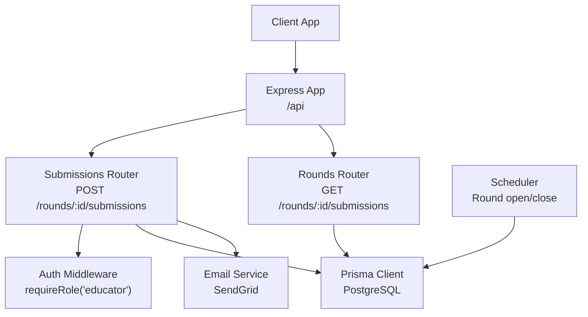
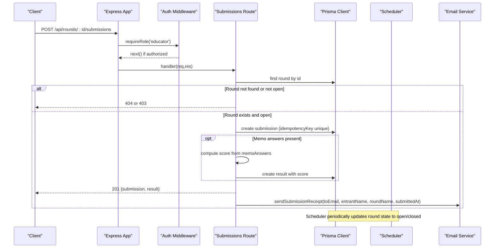
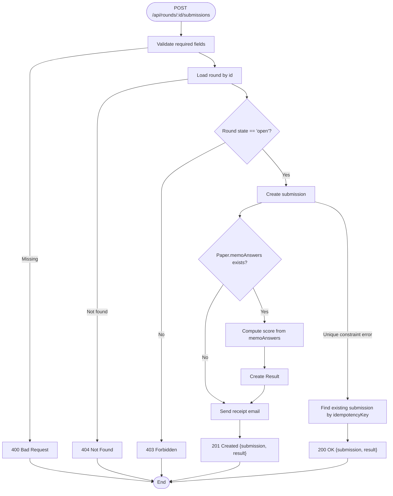
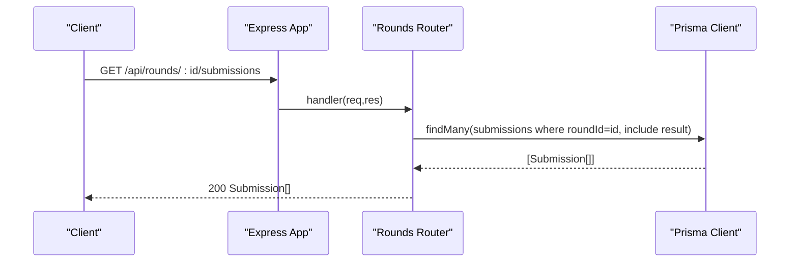
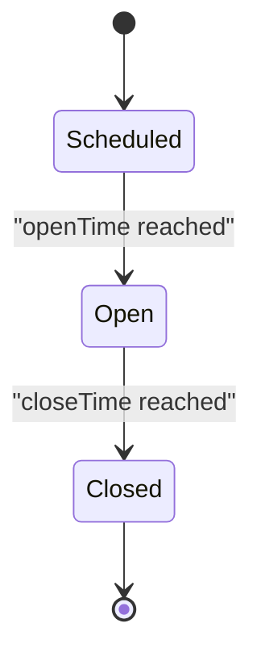
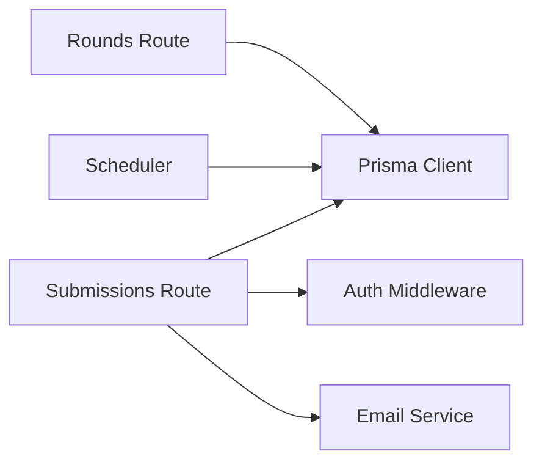

# Submissions API

<cite>
**Referenced Files in This Document**
- [submissions.js](file://backend/src/routes/submissions.js)
- [rounds.js](file://backend/src/routes/rounds.js)
- [auth.js](file://backend/src/middleware/auth.js)
- [email.js](file://backend/src/lib/email.js)
- [index.js](file://backend/src/index.js)
- [schema.prisma](file://backend/prisma/schema.prisma)
- [scheduler.js](file://backend/src/scheduler.js)
- [types.js](file://shared/types.js)
</cite>

## Table of Contents
1. [Introduction](#introduction)
2. [Project Structure](#project-structure)
3. [Core Components](#core-components)
4. [Architecture Overview](#architecture-overview)
5. [Detailed Component Analysis](#detailed-component-analysis)
6. [Dependency Analysis](#dependency-analysis)
7. [Performance Considerations](#performance-considerations)
8. [Troubleshooting Guide](#troubleshooting-guide)
9. [Conclusion](#conclusion)
10. [Appendices](#appendices)

## Introduction
This document provides detailed API documentation for submission management endpoints used to submit answers, retrieve submissions, and manage result processing within the Olympiad Portal backend. It covers HTTP methods, URL patterns, request/response schemas, idempotency handling, validation rules, error handling, and client-side best practices for robust submission workflows.

## Project Structure
The submission system is implemented as Express routes under the backend service:
- Submission creation endpoint resides in the submissions router.
- Submission listing endpoint resides in the rounds router.
- Authentication and role-based access control are enforced via middleware.
- Email receipts are sent asynchronously after successful submission.
- Round lifecycle (open/closed) is managed by a scheduler that updates round state based on time windows.



**Diagram sources**
- [index.js:29-32](file://backend/src/index.js#L29-L32)
- [submissions.js:9-86](file://backend/src/routes/submissions.js#L9-L86)
- [rounds.js:102-113](file://backend/src/routes/rounds.js#L102-L113)
- [auth.js:22-32](file://backend/src/middleware/auth.js#L22-L32)
- [email.js:5-20](file://backend/src/lib/email.js#L5-L20)
- [scheduler.js:4-23](file://backend/src/scheduler.js#L4-L23)

**Section sources**
- [index.js:29-32](file://backend/src/index.js#L29-L32)
- [submissions.js:9-86](file://backend/src/routes/submissions.js#L9-L86)
- [rounds.js:102-113](file://backend/src/routes/rounds.js#L102-L113)
- [auth.js:22-32](file://backend/src/middleware/auth.js#L22-L32)
- [email.js:5-20](file://backend/src/lib/email.js#L5-L20)
- [scheduler.js:4-23](file://backend/src/scheduler.js#L4-L23)

## Core Components
- Submissions Router: Handles answer submission with validation, idempotency, and optional auto-scoring when memo answers exist.
- Rounds Router: Provides listing of submissions per round, including associated results.
- Auth Middleware: Enforces authentication and educator-only access for submission creation.
- Email Service: Sends submission receipt emails to the requesting educator.
- Scheduler: Automatically transitions rounds between scheduled/open/closed states based on configured times.

Key data models involved:
- Round: Represents an exam period with state and timing constraints.
- Paper: Optional memoAnswers JSON used for instant scoring.
- Submission: Stores entrant answers and an idempotency key.
- Result: Stores computed score linked to a submission.

**Section sources**
- [submissions.js:9-86](file://backend/src/routes/submissions.js#L9-L86)
- [rounds.js:102-113](file://backend/src/routes/rounds.js#L102-L113)
- [auth.js:22-32](file://backend/src/middleware/auth.js#L22-L32)
- [email.js:5-20](file://backend/src/lib/email.js#L5-L20)
- [scheduler.js:4-23](file://backend/src/scheduler.js#L4-L23)
- [schema.prisma:18-29](file://backend/prisma/schema.prisma#L18-L29)
- [schema.prisma:69-77](file://backend/prisma/schema.prisma#L69-L77)
- [schema.prisma:79-97](file://backend/prisma/schema.prisma#L79-L97)

## Architecture Overview
The submission workflow integrates request validation, authorization, persistence, optional scoring, and email notification. A scheduler ensures rounds are only accepting submissions during their open window.



**Diagram sources**
- [submissions.js:9-86](file://backend/src/routes/submissions.js#L9-L86)
- [auth.js:22-32](file://backend/src/middleware/auth.js#L22-L32)
- [email.js:5-20](file://backend/src/lib/email.js#L5-L20)
- [scheduler.js:4-23](file://backend/src/scheduler.js#L4-L23)

## Detailed Component Analysis

### Endpoint: Submit Answer
- Method: POST
- URL: /api/rounds/:id/submissions
- Authorization: Requires educator role via cookie token verification.
- Request body schema:
  - entrantId: string (required)
  - answers: object mapping question identifiers to answer values (required)
  - idempotencyKey: string (required; must be unique per submission)
- Validation rules:
  - All three fields must be present; otherwise returns 400 with an error message.
  - Round must exist; otherwise returns 404.
  - Round must be in open state; otherwise returns 403 with current state.
- Idempotency handling:
  - The database enforces uniqueness on idempotencyKey.
  - On duplicate key conflict, the server returns the existing submission and its result with status 200 (not 201).
- Processing logic:
  - Creates a submission record.
  - If the round’s paper includes memoAnswers, computes score as percentage of correct answers and creates a Result linked to the submission.
  - Sends a submission receipt email to the requesting educator with entrant name and round details.
- Response schema:
  - Success (201): { submission: Submission, result: Result|null }
  - Duplicate (200): { submission: Submission, result: Result|null }
  - Error responses:
    - 400: Missing required fields
    - 403: Unauthorized or round not open
    - 404: Round not found
    - 500: Unexpected server error
- Notes:
  - Scoring is performed synchronously at submission time when memo answers are available.
  - Email sending is fire-and-forget; failures are logged but do not affect response.



**Diagram sources**
- [submissions.js:9-86](file://backend/src/routes/submissions.js#L9-L86)

**Section sources**
- [submissions.js:9-86](file://backend/src/routes/submissions.js#L9-L86)
- [auth.js:22-32](file://backend/src/middleware/auth.js#L22-L32)
- [email.js:5-20](file://backend/src/lib/email.js#L5-L20)
- [schema.prisma:79-97](file://backend/prisma/schema.prisma#L79-L97)

### Endpoint: List Submissions for a Round
- Method: GET
- URL: /api/rounds/:id/submissions
- Authorization: No explicit role guard in this route; ensure appropriate access control at gateway or application layer if needed.
- Path parameters:
  - id: string (round identifier)
- Response schema:
  - Array of Submission objects, each optionally including a related Result.
- Behavior:
  - Returns all submissions for the specified round, including any associated results.
  - Errors return 500 with an error message on unexpected failures.



**Diagram sources**
- [rounds.js:102-113](file://backend/src/routes/rounds.js#L102-L113)

**Section sources**
- [rounds.js:102-113](file://backend/src/routes/rounds.js#L102-L113)

### Data Models and Relationships
- Round: Contains timing and state; determines whether submissions are accepted.
- Paper: Optional memoAnswers JSON used for instant scoring.
- Submission: Stores answers and idempotencyKey; linked to Round and Entrant.
- Result: Stores score and optional release timestamp; linked to Submission.

```mermaid
erDiagram
ROUND {
string id PK
string olympiadId FK
string name
datetime openTime
datetime closeTime
string state
}
PAPER {
string id PK
string roundId UK FK
string fileUrl
string memoUrl
json memoAnswers
datetime uploadedAt
}
SUBMISSION {
string id PK
string roundId FK
string entrantId FK
json answers
string idempotencyKey UK
datetime submittedAt
}
RESULT {
string id PK
string submissionId UK FK
float score
datetime releasedAt
}
ROUND ||--o{ PAPER : "has"
ROUND ||--o{ SUBMISSION : "receives"
SUBMISSION ||--|| RESULT : "produces"
```

**Diagram sources**
- [schema.prisma:18-29](file://backend/prisma/schema.prisma#L18-L29)
- [schema.prisma:69-77](file://backend/prisma/schema.prisma#L69-L77)
- [schema.prisma:79-97](file://backend/prisma/schema.prisma#L79-L97)

**Section sources**
- [schema.prisma:18-29](file://backend/prisma/schema.prisma#L18-L29)
- [schema.prisma:69-77](file://backend/prisma/schema.prisma#L69-L77)
- [schema.prisma:79-97](file://backend/prisma/schema.prisma#L79-L97)

### Submission Lifecycle and Scoring Integration
- Lifecycle:
  - Round scheduling: Scheduler transitions rounds to open when openTime has passed and to closed when closeTime has passed.
  - Submission acceptance: Only allowed when round state is open.
  - Auto-scoring: If memoAnswers exist, score is computed immediately upon submission.
  - Result publication: Results are stored with scores; a releasedAt field exists for future release workflows.
- Scoring integration:
  - Scoring algorithm compares answers against memoAnswers and calculates percentage correctness.
  - Result creation is tied to the submission ID.



**Diagram sources**
- [scheduler.js:4-23](file://backend/src/scheduler.js#L4-L23)
- [schema.prisma:18-29](file://backend/prisma/schema.prisma#L18-L29)

**Section sources**
- [scheduler.js:4-23](file://backend/src/scheduler.js#L4-L23)
- [submissions.js:32-59](file://backend/src/routes/submissions.js#L32-L59)

## Dependency Analysis
- Submissions route depends on:
  - Prisma client for database operations.
  - Auth middleware for role enforcement.
  - Email service for notifications.
- Rounds route depends on:
  - Prisma client for querying submissions and results.
- Scheduler depends on:
  - Prisma client to update round states.



**Diagram sources**
- [submissions.js:1-5](file://backend/src/routes/submissions.js#L1-L5)
- [rounds.js:1-3](file://backend/src/routes/rounds.js#L1-L3)
- [scheduler.js:1-3](file://backend/src/scheduler.js#L1-L3)
- [auth.js:1-3](file://backend/src/middleware/auth.js#L1-L3)
- [email.js:1-3](file://backend/src/lib/email.js#L1-L3)

**Section sources**
- [submissions.js:1-5](file://backend/src/routes/submissions.js#L1-L5)
- [rounds.js:1-3](file://backend/src/routes/rounds.js#L1-L3)
- [scheduler.js:1-3](file://backend/src/scheduler.js#L1-L3)
- [auth.js:1-3](file://backend/src/middleware/auth.js#L1-L3)
- [email.js:1-3](file://backend/src/lib/email.js#L1-L3)

## Performance Considerations
- Idempotency via unique index on idempotencyKey prevents duplicate submissions and reduces redundant processing.
- Auto-scoring is synchronous; consider offloading complex scoring to background jobs if memoAnswer comparisons become expensive.
- Email sending is asynchronous and non-blocking; failures do not impact submission success.
- Listing submissions uses include to fetch related results; ensure indexes on roundId and submissionId for query performance.

[No sources needed since this section provides general guidance]

## Troubleshooting Guide
Common errors and recovery strategies:
- 400 Bad Request: Ensure all required fields (entrantId, answers, idempotencyKey) are provided.
- 403 Forbidden: Verify educator role and that the round is open.
- 404 Not Found: Confirm the round exists.
- 500 Internal Server Error: Investigate server logs; may indicate unexpected database or processing errors.
- Duplicate submission: Use idempotencyKey to prevent duplicates; on conflict, expect 200 with existing submission and result.

Client-side recommendations:
- Always generate a stable idempotencyKey per logical submission attempt.
- Implement retry with exponential backoff for transient network errors; avoid reusing the same idempotencyKey across retries unless you intend idempotent behavior.
- Handle both 201 (new submission) and 200 (duplicate) responses gracefully.
- For listing submissions, poll or use webhooks if available to refresh UI after submission.

**Section sources**
- [submissions.js:13-30](file://backend/src/routes/submissions.js#L13-L30)
- [submissions.js:75-85](file://backend/src/routes/submissions.js#L75-L85)
- [rounds.js:102-113](file://backend/src/routes/rounds.js#L102-L113)

## Conclusion
The Submissions API provides secure, validated, and idempotent answer submission with optional immediate scoring when memo answers are available. Submissions can be listed per round, including results. Robust error handling and asynchronous email notifications support reliable operation. Clients should implement idempotency keys, handle duplicate responses, and apply retry strategies for resilience.

[No sources needed since this section summarizes without analyzing specific files]

## Appendices

### Request/Response Examples
- Submit Answer (POST /api/rounds/:id/submissions)
  - Request body:
    - entrantId: string
    - answers: object mapping question IDs to answer values
    - idempotencyKey: string
  - Responses:
    - 201 Created: { submission: Submission, result: Result|null }
    - 200 OK (duplicate): { submission: Submission, result: Result|null }
    - 400 Bad Request: { error: string }
    - 403 Forbidden: { error: string }
    - 404 Not Found: { error: string }
    - 500 Internal Server Error: { error: string }
- List Submissions (GET /api/rounds/:id/submissions)
  - Response: Array of Submission objects with optional Result included.

[No sources needed since this section provides general guidance]