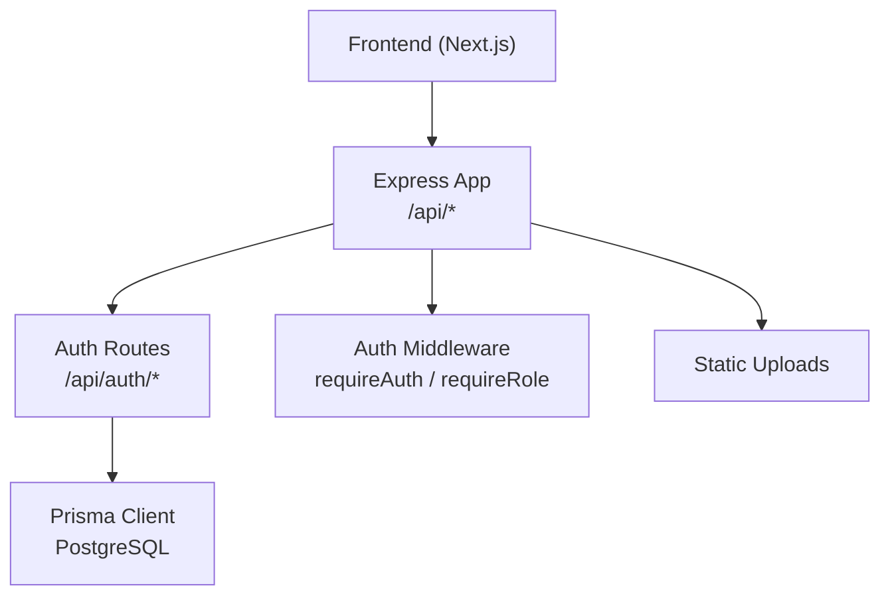
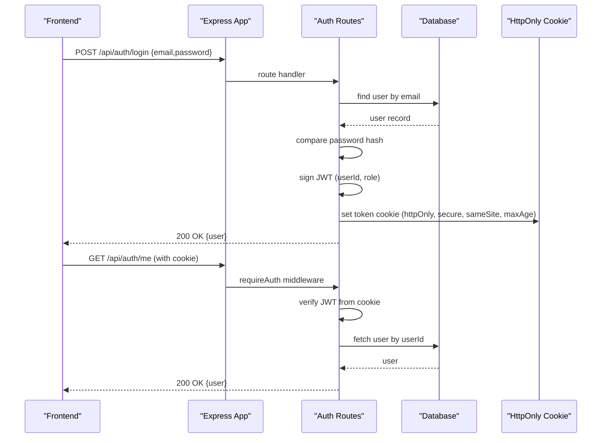
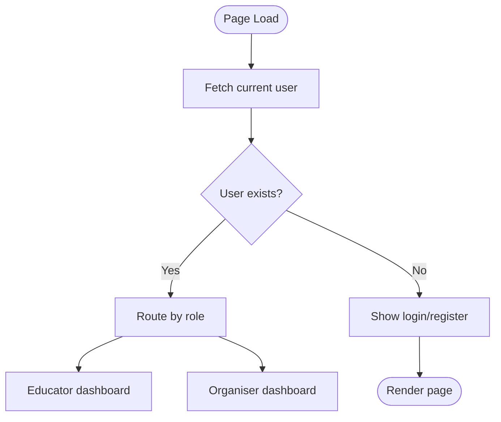
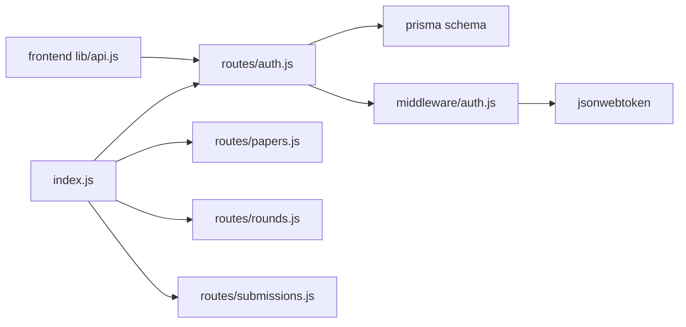

# Authentication & Authorization

<cite>
**Referenced Files in This Document**
- [backend/src/index.js](file://backend/src/index.js)
- [backend/src/routes/auth.js](file://backend/src/routes/auth.js)
- [backend/src/middleware/auth.js](file://backend/src/middleware/auth.js)
- [backend/prisma/schema.prisma](file://backend/prisma/schema.prisma)
- [frontend/src/lib/api.js](file://frontend/src/lib/api.js)
- [frontend/src/hooks/useAuthRedirect.js](file://frontend/src/hooks/useAuthRedirect.js)
- [frontend/src/hooks/useRequireRole.js](file://frontend/src/hooks/useRequireRole.js)
- [frontend/src/app/login/page.js](file://frontend/src/app/login/page.js)
- [frontend/src/app/register/page.js](file://frontend/src/app/register/page.js)
</cite>

## Table of Contents
1. Introduction
2. Project Structure
3. Core Components
4. Architecture Overview
5. Detailed Component Analysis
6. Dependency Analysis
7. Performance Considerations
8. Troubleshooting Guide
9. Conclusion
10. Appendices

## Introduction
This document explains the Olympiad Portal’s authentication and authorization system. It covers:
- JWT-based authentication flow: token generation, secure cookie storage, and validation middleware
- Role-based access control (RBAC) for educators and organisers with role checks
- Request interception via middleware and session management using cookies
- Security best practices, token refresh strategies, and protection against common vulnerabilities
- API endpoints for authentication operations, error handling patterns, and client-side integration examples
- Password hashing, input validation, and security headers implementation

## Project Structure
The authentication system spans backend routes, middleware, and frontend hooks/API utilities:
- Backend Express app wires CORS and cookie parsing before mounting routers
- Auth routes implement registration, login, password reset, logout, current user retrieval, and account deletion
- Middleware validates JWTs from cookies and enforces roles
- Frontend uses a shared API client that sends credentials with requests and redirects based on role

**Diagram sources**
- [backend/src/index.js:16-32](file://backend/src/index.js#L16-L32)
- [backend/src/routes/auth.js:22-151](file://backend/src/routes/auth.js#L22-L151)
- [backend/src/middleware/auth.js:5-32](file://backend/src/middleware/auth.js#L5-L32)
- [backend/prisma/schema.prisma:31-40](file://backend/prisma/schema.prisma#L31-L40)

**Section sources**
- [backend/src/index.js:1-43](file://backend/src/index.js#L1-L43)
- [backend/src/routes/auth.js:1-152](file://backend/src/routes/auth.js#L1-L152)
- [backend/src/middleware/auth.js:1-35](file://backend/src/middleware/auth.js#L1-L35)
- [backend/prisma/schema.prisma:1-109](file://backend/prisma/schema.prisma#L1-L109)

## Core Components
- JWT secret and token lifecycle managed via environment variables and JSON Web Token library
- Secure cookie configuration with httpOnly, secure (in production), sameSite, and expiration
- Password hashing with bcrypt and salt rounds
- Role-based middleware to enforce access control
- Frontend API client with credentials included and centralized error handling

Key responsibilities:
- Registration: validate inputs, hash password, create or find school, create user, sign JWT, set cookie
- Login: verify credentials, sign JWT, set cookie
- Protected endpoints: validate JWT from cookie, attach user to request, enforce roles
- Logout: clear cookie
- Current user: return minimal user info for client state

**Section sources**
- [backend/src/routes/auth.js:13-20](file://backend/src/routes/auth.js#L13-L20)
- [backend/src/routes/auth.js:23-71](file://backend/src/routes/auth.js#L23-L71)
- [backend/src/routes/auth.js:74-97](file://backend/src/routes/auth.js#L74-L97)
- [backend/src/middleware/auth.js:5-32](file://backend/src/middleware/auth.js#L5-L32)
- [frontend/src/lib/api.js:17-45](file://frontend/src/lib/api.js#L17-L45)

## Architecture Overview
The authentication flow uses HTTP-only cookies to carry JWTs between the Next.js frontend and Express backend. The backend validates tokens on protected routes and enforces roles.

**Diagram sources**
- [backend/src/routes/auth.js:74-97](file://backend/src/routes/auth.js#L74-L97)
- [backend/src/routes/auth.js:134-138](file://backend/src/routes/auth.js#L134-L138)
- [backend/src/middleware/auth.js:5-19](file://backend/src/middleware/auth.js#L5-L19)
- [backend/src/index.js:16-32](file://backend/src/index.js#L16-L32)

## Detailed Component Analysis

### JWT Generation and Secure Cookie Storage
- Tokens are signed with a secret from environment variables and include user identity and role
- Cookies are set with:
  - httpOnly to prevent client-side script access
  - secure flag enabled in production to restrict to HTTPS
  - sameSite lax to mitigate CSRF while allowing top-level navigations
  - maxAge set to one week
- On logout, the cookie is cleared server-side

Security notes:
- Avoid storing tokens in localStorage; rely on httpOnly cookies
- Ensure CORS allows credentials and origins are restricted
- Rotate secrets periodically and store them securely

**Section sources**
- [backend/src/routes/auth.js:9-20](file://backend/src/routes/auth.js#L9-L20)
- [backend/src/routes/auth.js:59-61](file://backend/src/routes/auth.js#L59-L61)
- [backend/src/routes/auth.js:91-93](file://backend/src/routes/auth.js#L91-L93)
- [backend/src/routes/auth.js:127-131](file://backend/src/routes/auth.js#L127-L131)
- [backend/src/index.js:16-24](file://backend/src/index.js#L16-L24)

### Authentication Middleware and Role-Based Access Control
- requireAuth extracts the token from cookies, verifies it, attaches decoded payload to req.user, and continues or returns 401
- requireRole composes requireAuth with an additional check that req.user.role matches the required role, returning 403 if not authorized
- Tests cover missing tokens, invalid/expired tokens, and role mismatches

Usage pattern:
- Apply requireAuth to protect endpoints that need any authenticated user
- Apply requireRole('organiser') or requireRole('educator') to restrict sensitive actions

**Section sources**
- [backend/src/middleware/auth.js:5-32](file://backend/src/middleware/auth.js#L5-L32)
- [backend/src/middleware/auth.test.js:11-55](file://backend/src/middleware/auth.test.js#L11-L55)
- [backend/src/middleware/auth.test.js:57-109](file://backend/src/middleware/auth.test.js#L57-L109)

### Password Hashing and Input Validation
- Passwords are hashed using bcrypt with configurable salt rounds
- Registration validates presence of required fields and uniqueness of email
- Login validates presence of fields and compares provided password against stored hash
- Password reset requires current password verification before updating

Validation strategy:
- Server-side validation ensures data integrity and prevents malformed payloads
- Consistent error messages for missing fields and invalid credentials

**Section sources**
- [backend/src/routes/auth.js:23-36](file://backend/src/routes/auth.js#L23-L36)
- [backend/src/routes/auth.js:74-89](file://backend/src/routes/auth.js#L74-L89)
- [backend/src/routes/auth.js:100-124](file://backend/src/routes/auth.js#L100-L124)

### Session Management
- Sessions are represented by JWTs stored in httpOnly cookies
- No server-side session store is used; statelessness relies on JWT contents
- Logout clears the cookie to end the session

Considerations:
- Short-lived tokens reduce risk window; consider refresh flows for long sessions
- Use secure cookie settings in production environments

**Section sources**
- [backend/src/routes/auth.js:13-20](file://backend/src/routes/auth.js#L13-L20)
- [backend/src/routes/auth.js:127-131](file://backend/src/routes/auth.js#L127-L131)

### Frontend Integration and Redirects
- Shared API client sets credentials: 'include' to send cookies automatically
- Login and register call auth endpoints and handle errors uniformly
- Hooks:
  - useRedirectIfAuthenticated: checks current user and redirects to role-appropriate dashboard
  - useRequireRole: guards pages by verifying user role and redirecting accordingly
- Dashboard routing maps roles to paths

**Diagram sources**
- [frontend/src/hooks/useAuthRedirect.js:13-28](file://frontend/src/hooks/useAuthRedirect.js#L13-L28)
- [frontend/src/hooks/useRequireRole.js:12-30](file://frontend/src/hooks/useRequireRole.js#L12-L30)
- [frontend/src/lib/api.js:128-145](file://frontend/src/lib/api.js#L128-L145)

**Section sources**
- [frontend/src/lib/api.js:17-45](file://frontend/src/lib/api.js#L17-L45)
- [frontend/src/lib/api.js:114-145](file://frontend/src/lib/api.js#L114-L145)
- [frontend/src/hooks/useAuthRedirect.js:1-32](file://frontend/src/hooks/useAuthRedirect.js#L1-L32)
- [frontend/src/hooks/useRequireRole.js:1-39](file://frontend/src/hooks/useRequireRole.js#L1-L39)
- [frontend/src/app/login/page.js:1-113](file://frontend/src/app/login/page.js#L1-L113)
- [frontend/src/app/register/page.js:1-139](file://frontend/src/app/register/page.js#L1-L139)

## Dependency Analysis
- Express app mounts routers after enabling CORS and cookie parsing
- Auth routes depend on Prisma for user and school queries and updates
- Middleware depends on JWT library for verification
- Frontend API client depends on environment variable for base URL and centralizes error handling

**Diagram sources**
- [backend/src/index.js:1-32](file://backend/src/index.js#L1-L32)
- [backend/src/routes/auth.js:1-6](file://backend/src/routes/auth.js#L1-L6)
- [backend/src/middleware/auth.js:1-3](file://backend/src/middleware/auth.js#L1-L3)
- [backend/prisma/schema.prisma:1-9](file://backend/prisma/schema.prisma#L1-L9)
- [frontend/src/lib/api.js:1-4](file://frontend/src/lib/api.js#L1-L4)

**Section sources**
- [backend/src/index.js:1-43](file://backend/src/index.js#L1-L43)
- [backend/src/routes/auth.js:1-152](file://backend/src/routes/auth.js#L1-L152)
- [backend/src/middleware/auth.js:1-35](file://backend/src/middleware/auth.js#L1-L35)
- [backend/prisma/schema.prisma:1-109](file://backend/prisma/schema.prisma#L1-L109)
- [frontend/src/lib/api.js:1-146](file://frontend/src/lib/api.js#L1-L146)

## Performance Considerations
- JWT verification is lightweight; avoid unnecessary database calls inside middleware
- Prefer short-lived tokens to minimize replay windows; implement refresh logic if needed
- Use efficient queries in auth routes (e.g., find by unique email)
- Cache frequently accessed user metadata at the edge if appropriate

[No sources needed since this section provides general guidance]

## Troubleshooting Guide
Common issues and resolutions:
- 401 Not authenticated: ensure cookies are sent with requests and CORS allows credentials
- 401 Invalid or expired token: verify JWT_SECRET matches and token has not expired; consider implementing refresh
- 403 Forbidden: confirm user role matches required role; adjust role assignments or endpoint guards
- Network errors: check API base URL and server availability; inspect browser console and network tab
- CORS failures: ensure origin includes frontend URL and credentials are allowed

Error handling patterns:
- Backend returns consistent JSON error objects with status codes
- Frontend wraps responses in ApiError with message and status for uniform handling

**Section sources**
- [backend/src/middleware/auth.js:5-19](file://backend/src/middleware/auth.js#L5-L19)
- [backend/src/routes/auth.js:23-36](file://backend/src/routes/auth.js#L23-L36)
- [backend/src/routes/auth.js:74-89](file://backend/src/routes/auth.js#L74-L89)
- [frontend/src/lib/api.js:17-45](file://frontend/src/lib/api.js#L17-L45)

## Conclusion
The Olympiad Portal implements a robust, stateless authentication system using JWTs stored in secure cookies. Role-based access control is enforced via middleware, ensuring only authorized users can access protected resources. The frontend integrates seamlessly with the backend through a shared API client that handles credentials and errors consistently. Following the recommended security practices and expanding role coverage will further strengthen the system.

[No sources needed since this section summarizes without analyzing specific files]

## Appendices

### API Endpoints Summary
- POST /api/auth/register
  - Purpose: Create educator account, hash password, create/find school, issue JWT, set cookie
  - Inputs: email, password, name, schoolName
  - Responses: 201 on success, 400 on validation errors, 409 on duplicate email
- POST /api/auth/login
  - Purpose: Authenticate user, issue JWT, set cookie
  - Inputs: email, password
  - Responses: 200 on success, 400 on validation errors, 401 on invalid credentials
- POST /api/auth/reset-password
  - Purpose: Change password for authenticated user
  - Inputs: currentPassword, newPassword
  - Responses: 200 on success, 400 on validation errors, 401 on wrong current password, 404 if user not found
- POST /api/auth/logout
  - Purpose: Clear authentication cookie
  - Responses: 200 on success
- GET /api/auth/me
  - Purpose: Retrieve current user info
  - Responses: 200 with user, 401 if unauthenticated, 404 if user not found
- DELETE /api/auth/account
  - Purpose: Delete current user account
  - Responses: 200 on success, 401 if unauthenticated, 404 if user not found

**Section sources**
- [backend/src/routes/auth.js:23-71](file://backend/src/routes/auth.js#L23-L71)
- [backend/src/routes/auth.js:74-97](file://backend/src/routes/auth.js#L74-L97)
- [backend/src/routes/auth.js:100-124](file://backend/src/routes/auth.js#L100-L124)
- [backend/src/routes/auth.js:127-131](file://backend/src/routes/auth.js#L127-L131)
- [backend/src/routes/auth.js:134-138](file://backend/src/routes/auth.js#L134-L138)
- [backend/src/routes/auth.js:140-149](file://backend/src/routes/auth.js#L140-L149)

### Security Best Practices
- Store JWT_SECRET in environment variables; never hardcode
- Use httpOnly, secure (production), sameSite cookies
- Enforce HTTPS in production
- Validate all inputs server-side; sanitize where applicable
- Implement rate limiting on auth endpoints to mitigate brute force
- Add security headers (e.g., HSTS, X-Content-Type-Options) at the web server or proxy layer
- Consider adding CSRF protection when using sameSite lax with credentials

[No sources needed since this section provides general guidance]

### Token Refresh Strategy (Recommended)
- Issue short-lived access tokens and longer-lived refresh tokens stored in httpOnly cookies
- Provide a dedicated endpoint to exchange refresh tokens for new access tokens
- Invalidate refresh tokens on logout or password change
- Monitor token usage and rotate secrets periodically

[No sources needed since this section provides general guidance]

### Data Model Notes
- User model stores hashed passwords and role
- School and Educator relationships support educator accounts tied to schools
- Roles currently supported in code: educator, organiser

**Section sources**
- [backend/prisma/schema.prisma:31-40](file://backend/prisma/schema.prisma#L31-L40)
- [backend/prisma/schema.prisma:42-57](file://backend/prisma/schema.prisma#L42-L57)