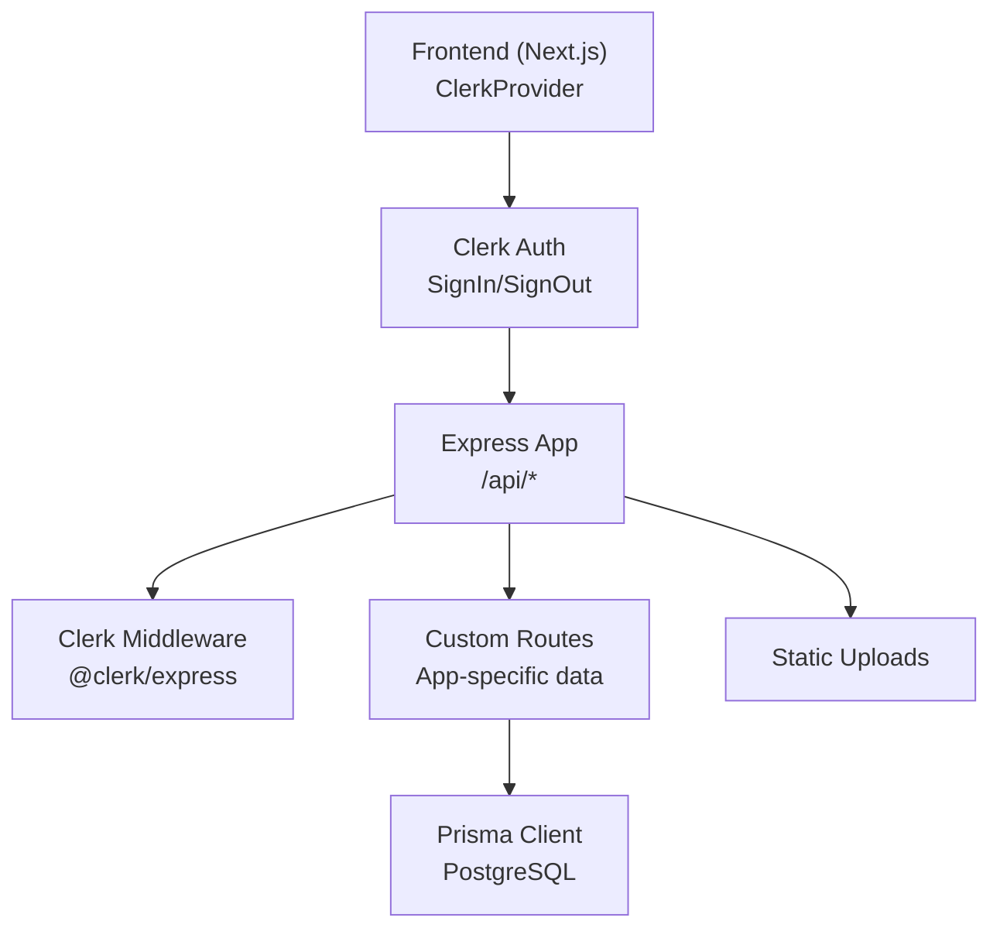
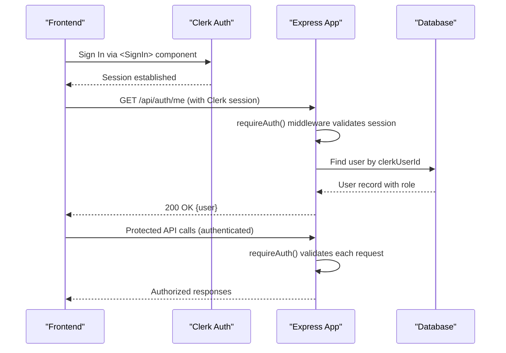
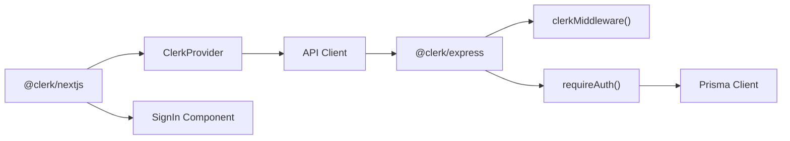

# Authentication & Authorization

<cite>
**Referenced Files in This Document**
- [frontend/src/app/layout.js](file://frontend/src/app/layout.js)
- [frontend/src/middleware.js](file://frontend/src/middleware.js)
- [frontend/src/app/login/page.js](file://frontend/src/app/login/page.js)
- [backend/src/index.js](file://backend/src/index.js)
- [backend/src/routes/auth.js](file://backend/src/routes/auth.js)
- [backend/src/middleware/auth.js](file://backend/src/middleware/auth.js)
- [backend/prisma/schema.prisma](file://backend/prisma/schema.prisma)
- [frontend/src/lib/api.js](file://frontend/src/lib/api.js)
- [frontend/src/hooks/useAuthRedirect.js](file://frontend/src/hooks/useAuthRedirect.js)
- [frontend/src/hooks/useRequireRole.js](file://frontend/src/hooks/useRequireRole.js)
</cite>

## Update Summary
**Changes Made**
- Complete migration from custom JWT-based authentication to Clerk managed authentication service
- Replaced manual JWT token management with Clerk's <ClerkProvider>, <SignIn> components, and middleware
- Updated backend to use @clerk/express for authentication middleware
- Simplified frontend authentication flow using Clerk's React hooks and components
- Removed custom password hashing and JWT generation logic
- Maintained role-based access control while leveraging Clerk's session management

## Table of Contents
1. Introduction
2. Project Structure
3. Core Components
4. Architecture Overview
5. Detailed Component Analysis
6. Dependency Analysis
7. Performance Considerations
8. Troubleshooting Guide
9. Conclusion
10. Appendices

## Introduction
This document explains the Olympiad Portal's authentication and authorization system after migrating from custom JWT-based authentication to Clerk managed authentication service. The system now leverages Clerk's comprehensive authentication platform for:
- User registration and login via Clerk's <SignIn> component
- Session management through Clerk's secure cookies and tokens
- Role-based access control (RBAC) for educators and organizers
- Request interception via Clerk middleware and custom role checks
- Secure API communication with Clerk-managed sessions
- Account management including profile completion and deletion

## Project Structure
The authentication system now spans Clerk integration points across both frontend and backend:
- Frontend uses ClerkProvider wrapper and Clerk's SignIn component for user authentication
- Backend integrates @clerk/express middleware for request authentication
- Custom routes handle app-specific user data synchronization with Clerk accounts
- Middleware enforces role-based access control using Clerk's authenticated requests

**Diagram sources**
- [frontend/src/app/layout.js:34-44](file://frontend/src/app/layout.js#L34-L44)
- [frontend/src/middleware.js:1-11](file://frontend/src/middleware.js#L1-L11)
- [backend/src/index.js:24-30](file://backend/src/index.js#L24-L30)
- [backend/src/routes/auth.js:4-101](file://backend/src/routes/auth.js#L4-L101)

**Section sources**
- [frontend/src/app/layout.js:1-47](file://frontend/src/app/layout.js#L1-L47)
- [frontend/src/middleware.js:1-11](file://frontend/src/middleware.js#L1-L11)
- [backend/src/index.js:1-41](file://backend/src/index.js#L1-L41)
- [backend/src/routes/auth.js:1-102](file://backend/src/routes/auth.js#L1-L102)

## Core Components
- ClerkProvider wraps the entire application to provide authentication context
- Clerk's SignIn component handles user registration and login flows
- @clerk/express middleware validates sessions on backend requests
- Custom routes manage app-specific user data synchronized with Clerk accounts
- Role-based middleware enforces access control based on user roles stored in database

Key responsibilities:
- **Authentication**: Clerk handles user registration, login, password management, and session lifecycle
- **Profile Completion**: Users complete their profile by providing name and school information
- **Data Synchronization**: App-specific user data is linked to Clerk user IDs
- **Role Management**: Roles are stored in the database and enforced via middleware
- **Session Management**: Clerk manages secure sessions and tokens automatically

**Section sources**
- [frontend/src/app/layout.js:34-44](file://frontend/src/app/layout.js#L34-L44)
- [frontend/src/app/login/page.js:5-73](file://frontend/src/app/login/page.js#L5-L73)
- [backend/src/routes/auth.js:9-59](file://backend/src/routes/auth.js#L9-L59)
- [backend/src/index.js:24](file://backend/src/index.js#L24)

## Architecture Overview
The authentication flow now uses Clerk as the central authentication provider, with the application handling only app-specific user data and business logic.

**Diagram sources**
- [frontend/src/app/login/page.js:21-46](file://frontend/src/app/login/page.js#L21-L46)
- [backend/src/routes/auth.js:62-83](file://backend/src/routes/auth.js#L62-L83)
- [backend/src/index.js:24](file://backend/src/index.js#L24)

## Detailed Component Analysis

### Clerk Provider and Frontend Integration
- ClerkProvider wraps the entire Next.js application to provide authentication context
- SignIn component handles user registration and login with customizable UI
- useAuth hook provides access to authentication state and methods like getToken()
- Automatic session management eliminates manual token handling
- Redirect logic handles post-login navigation based on user roles

Security benefits:
- No manual JWT token storage or management
- Secure session handling by Clerk's infrastructure
- Built-in protection against common authentication vulnerabilities
- Centralized security updates through Clerk's platform

**Section sources**
- [frontend/src/app/layout.js:34-44](file://frontend/src/app/layout.js#L34-L44)
- [frontend/src/app/login/page.js:21-73](file://frontend/src/app/login/page.js#L21-L73)
- [frontend/src/middleware.js:1-11](file://frontend/src/middleware.js#L1-L11)

### Backend Clerk Integration and Middleware
- @clerk/express middleware validates Clerk sessions on all protected routes
- requireAuth() function extracts Clerk user ID from validated sessions
- Custom routes handle app-specific user data synchronization
- Database stores app-specific information linked to Clerk user IDs
- Session validation occurs at the middleware level before route handlers execute

Backend improvements:
- Eliminated custom JWT secret management
- Removed manual token verification logic
- Leveraged Clerk's secure session handling
- Simplified authentication flow while maintaining security

**Section sources**
- [backend/src/index.js:24](file://backend/src/index.js#L24)
- [backend/src/routes/auth.js:4-10](file://backend/src/routes/auth.js#L4-L10)
- [backend/src/routes/auth.js:62-83](file://backend/src/routes/auth.js#L62-L83)

### Profile Completion and Data Synchronization
- Users must complete their profile after signing up via Clerk
- Profile completion endpoint collects name and school information
- Email is retrieved directly from Clerk account during profile setup
- App-specific user records are created and linked to Clerk user IDs
- School creation ensures unique educational institutions in the system

User flow:
1. User signs up via Clerk's SignIn component
2. Application redirects to profile completion page
3. User provides name and selects school
4. System creates app-specific user record linked to Clerk account
5. User gains access to role-appropriate dashboard

**Section sources**
- [backend/src/routes/auth.js:9-59](file://backend/src/routes/auth.js#L9-L59)

### Role-Based Access Control
- Roles are stored in the database alongside Clerk user IDs
- Middleware validates user authentication via Clerk sessions
- Role checks ensure users can only access appropriate resources
- Educational users get educator role, organizers get organizer role
- Dashboard routing directs users to role-appropriate interfaces

Access control implementation:
- requireAuth() middleware validates Clerk sessions
- Custom role checking logic verifies user permissions
- Frontend hooks redirect unauthorized users appropriately
- Protected routes return 401/403 errors for unauthenticated/unauthorized access

**Section sources**
- [backend/src/routes/auth.js:37-48](file://backend/src/routes/auth.js#L37-L48)
- [frontend/src/hooks/useRequireRole.js:7-39](file://frontend/src/hooks/useRequireRole.js#L7-L39)

### Session Management and Security
- Clerk manages secure sessions automatically without manual token handling
- Sessions are stored in secure, httpOnly cookies managed by Clerk
- Token refresh and expiration handled transparently by Clerk
- Logout functionality clears Clerk sessions and redirects appropriately
- Cross-origin requests include credentials automatically when configured

Security enhancements:
- No custom JWT secret management required
- Centralized security updates through Clerk's platform
- Built-in protection against common authentication attacks
- Secure session handling by enterprise-grade authentication provider

**Section sources**
- [frontend/src/app/login/page.js:27-46](file://frontend/src/app/login/page.js#L27-L46)
- [backend/src/routes/auth.js:86-99](file://backend/src/routes/auth.js#L86-L99)

### Frontend Hooks and Navigation
- useRedirectIfAuthenticated prevents showing login pages to already authenticated users
- useRequireRole guards pages by verifying user roles and redirecting accordingly
- Dashboard routing maps user roles to appropriate interface paths
- Error handling provides consistent user feedback for authentication failures

Navigation flow:
- Unauthenticated users are redirected to login page
- Authenticated users are redirected to role-appropriate dashboards
- Unauthorized access attempts result in appropriate redirects
- Loading states prevent flash of content during authentication checks

**Section sources**
- [frontend/src/hooks/useAuthRedirect.js:9-32](file://frontend/src/hooks/useAuthRedirect.js#L9-L32)
- [frontend/src/hooks/useRequireRole.js:7-39](file://frontend/src/hooks/useRequireRole.js#L7-L39)
- [frontend/src/lib/api.js:141-145](file://frontend/src/lib/api.js#L141-L145)

## Dependency Analysis
- Frontend depends on @clerk/nextjs for React components and hooks
- Backend depends on @clerk/express for Express middleware
- Database schema includes clerkUserId field linking to Clerk accounts
- Prisma client manages app-specific user data separate from Clerk accounts
- Environment variables configure Clerk integration for both frontend and backend

**Diagram sources**
- [frontend/src/app/layout.js:1](file://frontend/src/app/layout.js#L1)
- [frontend/src/app/login/page.js:5](file://frontend/src/app/login/page.js#L5)
- [backend/src/index.js:11](file://backend/src/index.js#L11)
- [backend/src/routes/auth.js:4](file://backend/src/routes/auth.js#L4)

**Section sources**
- [frontend/src/app/layout.js:1-47](file://frontend/src/app/layout.js#L1-L47)
- [backend/src/index.js:1-41](file://backend/src/index.js#L1-L41)
- [backend/src/routes/auth.js:1-102](file://backend/src/routes/auth.js#L1-L102)

## Performance Considerations
- Clerk handles authentication performance optimization and caching
- Reduced server load by offloading authentication to Clerk's infrastructure
- Minimal database queries for authentication-related operations
- Efficient user data retrieval using Clerk user IDs as primary keys
- Stateless authentication reduces server memory requirements

Performance benefits:
- No custom JWT verification overhead
- Centralized authentication performance optimization
- Reduced bandwidth for authentication-related network requests
- Faster page loads due to simplified authentication logic

[No sources needed since this section provides general guidance]

## Troubleshooting Guide
Common issues and resolutions:
- **Clerk configuration errors**: Verify NEXT_PUBLIC_CLERK_PUBLISHABLE_KEY and CLERK_SECRET_KEY environment variables
- **Session validation failures**: Ensure Clerk middleware is properly configured in both frontend and backend
- **Profile completion issues**: Check that /educators/complete-profile endpoint is accessible and returns proper responses
- **Role-based access problems**: Verify user roles are correctly set in the database and middleware is functioning
- **Cross-origin request failures**: Configure CORS settings to allow requests from the frontend domain

Error handling patterns:
- Clerk provides standardized error responses for authentication failures
- Custom error handling maintains consistent user experience across the application
- Logging captures authentication-related errors for debugging purposes
- Graceful fallbacks handle edge cases in authentication flow

**Section sources**
- [frontend/src/app/login/page.js:35-42](file://frontend/src/app/login/page.js#L35-L42)
- [backend/src/routes/auth.js:13-20](file://backend/src/routes/auth.js#L13-L20)
- [backend/src/routes/auth.js:70-72](file://backend/src/routes/auth.js#L70-L72)

## Conclusion
The migration to Clerk managed authentication has significantly simplified the authentication system while enhancing security and reducing maintenance overhead. The application now leverages Clerk's enterprise-grade authentication infrastructure for user management, session handling, and security, while focusing on business logic for educational olympiad management. The role-based access control system continues to function effectively with the new authentication provider, ensuring appropriate access levels for educators and organizers.

## Appendices

### Updated API Endpoints Summary
- POST /educators/complete-profile
  - Purpose: Complete user profile with name and school information
  - Requires: Valid Clerk session
  - Inputs: name, schoolName
  - Responses: 201 on success, 400 on validation errors, 409 if profile already completed
- GET /auth/me
  - Purpose: Retrieve current user information linked to Clerk account
  - Requires: Valid Clerk session
  - Responses: 200 with user data, 401 if unauthenticated, 404 if user not found
- DELETE /auth/account
  - Purpose: Delete user account from both application and Clerk
  - Requires: Valid Clerk session
  - Responses: 200 on success, 401 if unauthenticated, 404 if user not found

**Section sources**
- [backend/src/routes/auth.js:9-59](file://backend/src/routes/auth.js#L9-L59)
- [backend/src/routes/auth.js:62-83](file://backend/src/routes/auth.js#L62-L83)
- [backend/src/routes/auth.js:86-99](file://backend/src/routes/auth.js#L86-L99)

### Clerk Configuration Requirements
- Frontend: NEXT_PUBLIC_CLERK_PUBLISHABLE_KEY environment variable
- Backend: CLERK_SECRET_KEY environment variable
- Both environments must have matching Clerk project configuration
- Domain configuration must include both development and production URLs
- Webhook endpoints may be configured for user events and account changes

Security considerations:
- Never commit Clerk secrets to version control
- Use environment-specific configuration for different deployment stages
- Monitor Clerk dashboard for authentication metrics and security alerts
- Implement proper error handling for Clerk API failures

[No sources needed since this section provides general guidance]

### Migration Benefits
- **Reduced complexity**: Eliminated custom JWT token management and password hashing logic
- **Enhanced security**: Leverage enterprise-grade authentication infrastructure
- **Improved maintainability**: Centralized authentication updates through Clerk platform
- **Better user experience**: Professional login/registration flows with built-in features
- **Scalability**: Cloud-based authentication scales automatically with user demand

Future considerations:
- Monitor Clerk usage and costs as user base grows
- Plan for potential migration away from Clerk if needed
- Implement proper logging and monitoring for authentication events
- Consider additional Clerk features like multi-factor authentication

[No sources needed since this section provides general guidance]

### Data Model Notes
- User model now includes clerkUserId field linking to Clerk accounts
- Password fields removed as authentication is handled by Clerk
- Role field remains in database for application-level access control
- Educator relationships maintained for school-based organization
- Name field stores display name provided during profile completion

Database schema changes:
- Added clerkUserId column to users table
- Removed password_hash column from users table
- Maintained existing role and relationship structures
- Preserved backward compatibility where possible

**Section sources**
- [backend/prisma/schema.prisma:31-40](file://backend/prisma/schema.prisma#L31-L40)
- [backend/prisma/schema.prisma:42-57](file://backend/prisma/schema.prisma#L42-L57)