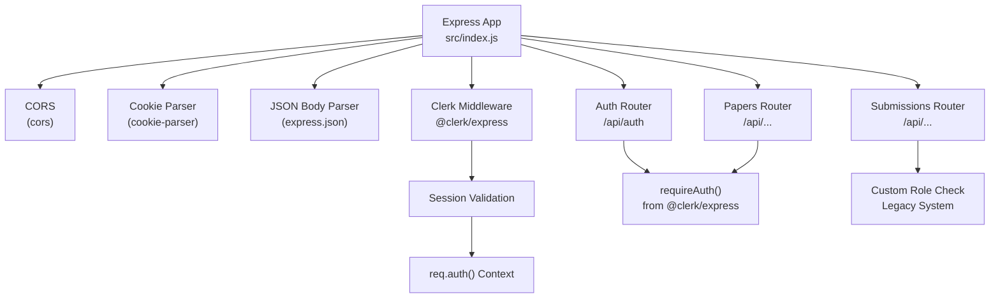
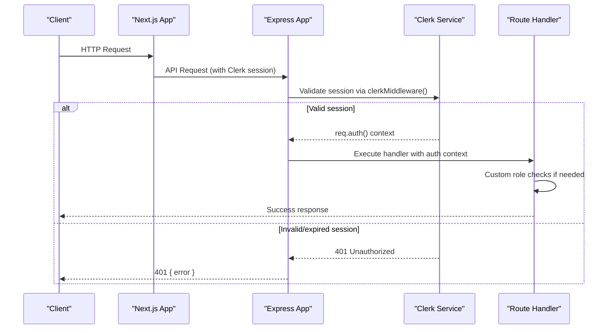
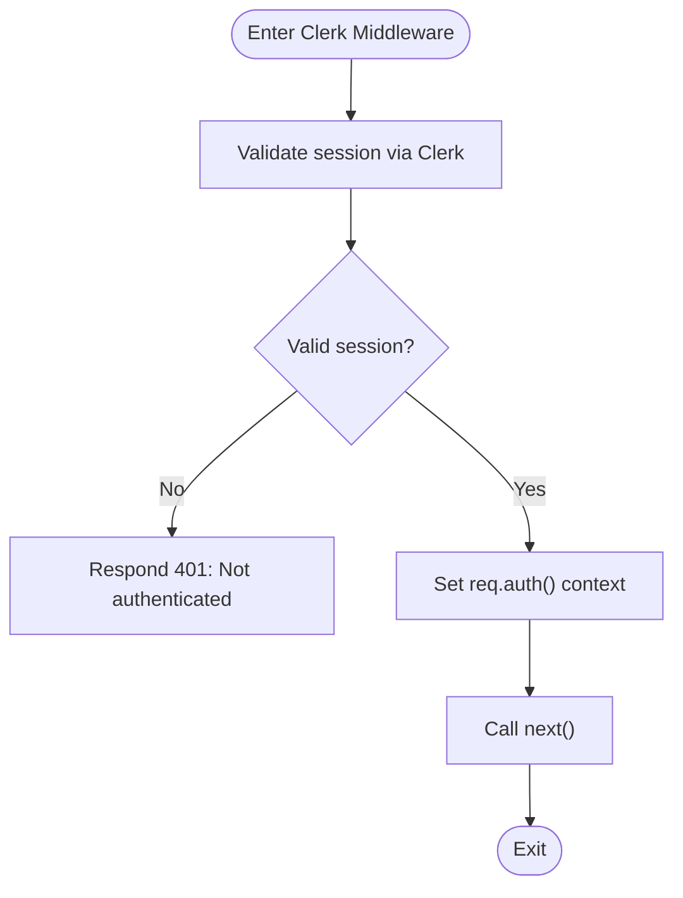
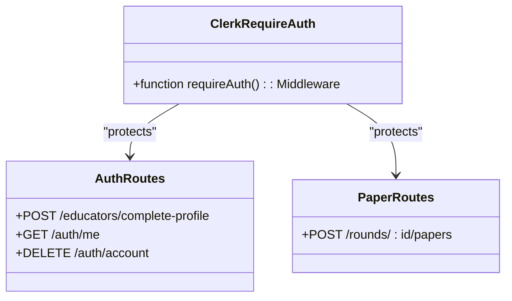
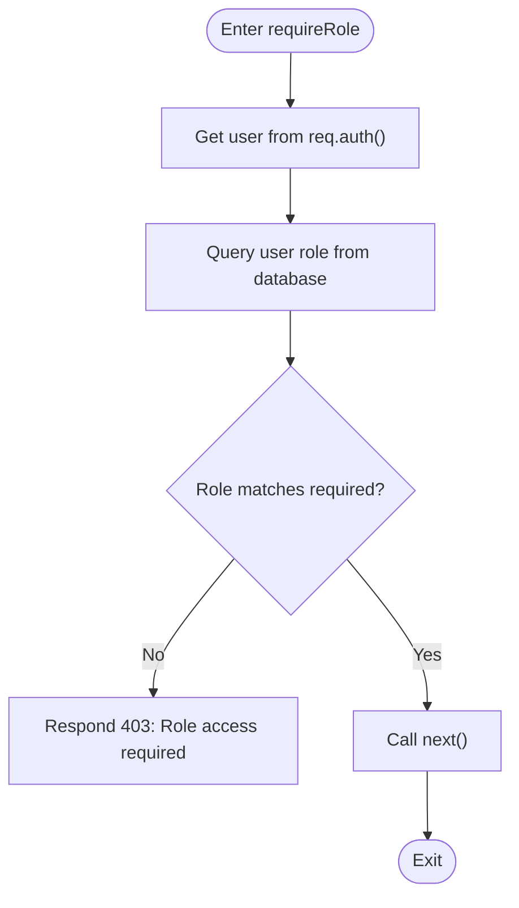
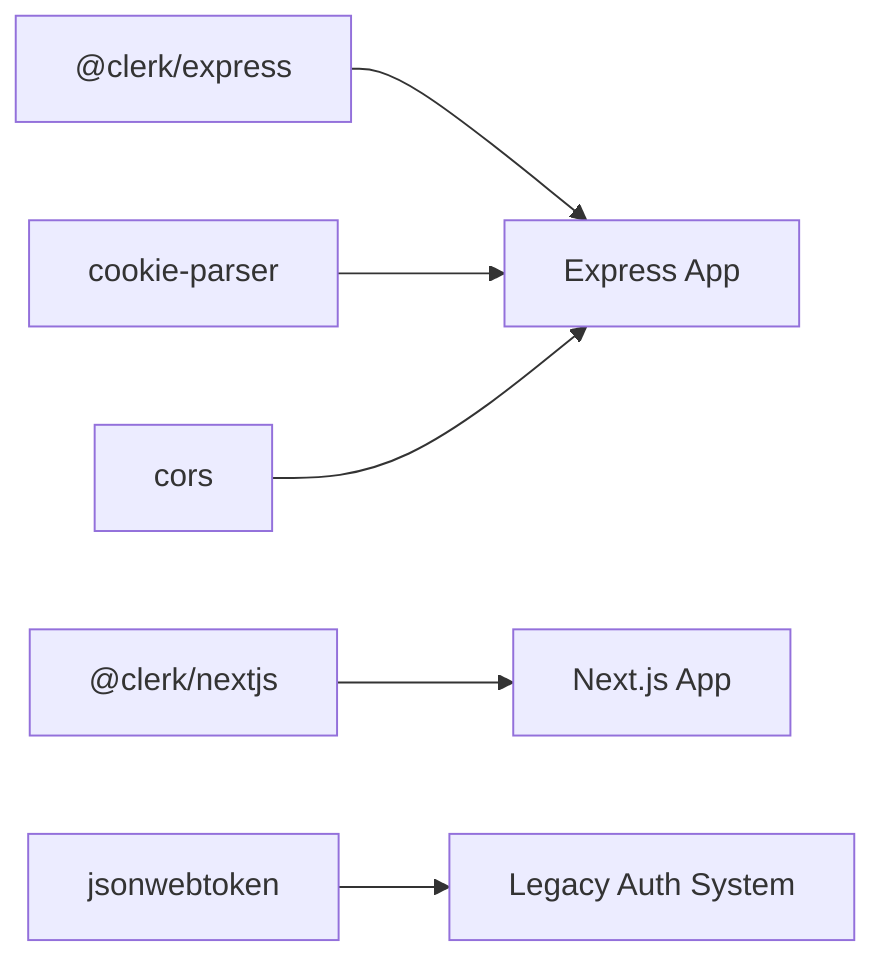

# Authentication Middleware

<cite>
**Referenced Files in This Document**
- [index.js](file://backend/src/index.js)
- [auth.js (routes)](file://backend/src/routes/auth.js)
- [papers.js](file://backend/src/routes/papers.js)
- [submissions.js](file://backend/src/routes/submissions.js)
- [middleware.js](file://frontend/src/middleware.js)
- [package.json](file://backend/package.json)
- [test-setup.js](file://backend/src/test-setup.js)
- [auth.test.js](file://backend/src/routes/auth.test.js)
</cite>

## Update Summary
**Changes Made**
- Complete migration from custom JWT-based authentication to Clerk's managed authentication service
- Replaced cookie-based token validation with Clerk's session management via `clerkMiddleware()`
- Updated all routes to use Clerk's `requireAuth()` middleware instead of custom JWT validation
- Integrated Clerk's Next.js middleware for frontend route protection
- Added comprehensive test infrastructure with Clerk mocking and environment variables
- Maintained backward compatibility for legacy role-based access control where needed

## Table of Contents
1. [Introduction](#introduction)
2. [Project Structure](#project-structure)
3. [Core Components](#core-components)
4. [Architecture Overview](#architecture-overview)
5. [Detailed Component Analysis](#detailed-component-analysis)
6. [Dependency Analysis](#dependency-analysis)
7. [Performance Considerations](#performance-considerations)
8. [Troubleshooting Guide](#troubleshooting-guide)
9. [Conclusion](#conclusion)
10. [Appendices](#appendices)

## Introduction
This document explains the Express.js authentication middleware implementation using Clerk's built-in authentication system. The application has successfully migrated from custom JWT-based cookie validation to Clerk's managed authentication service, providing enhanced security, simplified session management, and reduced maintenance overhead. The middleware chain pattern ensures consistent authentication across all protected routes, with role-based access control maintained through database-driven checks.

## Project Structure
The backend is an Express application that integrates Clerk's authentication middleware globally, providing session management and user context to all routes. The frontend uses Clerk's Next.js middleware for client-side route protection.

**Diagram sources**
- [index.js:16-30](file://backend/src/index.js#L16-L30)
- [auth.js (routes):4-9](file://backend/src/routes/auth.js#L4-L9)
- [papers.js:4-46](file://backend/src/routes/papers.js#L4-L46)
- [submissions.js:3-9](file://backend/src/routes/submissions.js#L3-L9)

**Section sources**
- [index.js:1-41](file://backend/src/index.js#L1-L41)

## Core Components
- **Clerk Middleware**: Global middleware that validates sessions and provides `req.auth()` context to all routes
- **requireAuth()**: Route-level middleware from @clerk/express that ensures authenticated requests
- **Custom Role Checking**: Legacy role-based access control system still used in specific routes
- **Frontend Middleware**: Clerk's Next.js middleware for client-side route protection

Key behaviors:
- Session source: Clerk-managed cookies and tokens
- User context: `req.auth()` provides authenticated user information including `userId`
- Error responses: Standardized 401/403 responses for unauthorized/unauthorized access
- Role management: Database-driven role checking for legacy endpoints

**Section sources**
- [index.js:11-24](file://backend/src/index.js#L11-L24)
- [auth.js (routes):4-9](file://backend/src/routes/auth.js#L4-L9)
- [papers.js:4-46](file://backend/src/routes/papers.js#L4-L46)

## Architecture Overview
The authentication flow integrates Clerk's managed authentication service with Express middleware. The global Clerk middleware handles session validation, while individual routes use `requireAuth()` for additional protection.

**Diagram sources**
- [index.js:11-24](file://backend/src/index.js#L11-L24)
- [auth.js (routes):9-10](file://backend/src/routes/auth.js#L9-L10)
- [papers.js:45-46](file://backend/src/routes/papers.js#L45-L46)

## Detailed Component Analysis

### Clerk Middleware Integration
Responsibilities:
- Global session validation for all incoming requests
- Provides `req.auth()` context with authenticated user information
- Handles token verification and session management
- Integrates with Clerk's authentication service

Integration points:
- Mounted globally in Express app before routers
- Used by individual routes via `requireAuth()` function
- Provides user context through `req.auth()` method

**Diagram sources**
- [index.js:11-24](file://backend/src/index.js#L11-L24)

**Section sources**
- [index.js:11-24](file://backend/src/index.js#L11-L24)

### Route-Level Authentication
Responsibilities:
- Ensures specific routes require authentication
- Uses Clerk's `requireAuth()` middleware function
- Provides consistent error handling for unauthenticated requests
- Works alongside custom role checking systems

Usage patterns:
- Applied to protected API endpoints
- Used with spread operator for middleware arrays
- Compatible with existing role-based access control

**Diagram sources**
- [auth.js (routes):9-99](file://backend/src/routes/auth.js#L9-L99)
- [papers.js:43-83](file://backend/src/routes/papers.js#L43-L83)

**Section sources**
- [auth.js (routes):9-99](file://backend/src/routes/auth.js#L9-L99)
- [papers.js:43-83](file://backend/src/routes/papers.js#L43-L83)

### Legacy Role-Based Access Control
Responsibilities:
- Maintains backward compatibility for existing role checks
- Uses database-driven role validation
- Provides custom middleware for specific business logic
- Bridges between Clerk authentication and legacy role system

Implementation:
- Custom `requireRole` middleware in legacy auth module
- Database queries to validate user roles
- Returns appropriate error codes for unauthorized access

**Diagram sources**
- [submissions.js:3-9](file://backend/src/routes/submissions.js#L3-L9)

**Section sources**
- [submissions.js:3-9](file://backend/src/routes/submissions.js#L3-L9)

### Frontend Middleware Configuration
Responsibilities:
- Configures Clerk's Next.js middleware for client-side authentication
- Sets up route matching patterns for authentication
- Protects frontend routes from unauthorized access

Configuration:
- Uses `clerkMiddleware()` for global authentication
- Configures matcher patterns for API and static assets
- Handles authentication redirects and session management

**Section sources**
- [middleware.js:1-11](file://frontend/src/middleware.js#L1-L11)

### Applying Authentication to Routes
Protected endpoints demonstrate how to apply Clerk authentication:
- Educational profile completion uses `requireAuth()` for authenticated users
- User profile endpoints use `requireAuth()` for data access
- Paper upload uses `requireAuth()` combined with custom role checking
- Submission creation uses legacy role-based access control

Examples:
- POST /api/educators/complete-profile: requires authentication
- GET /api/auth/me: requires authentication  
- DELETE /api/auth/account: requires authentication
- POST /api/rounds/:id/papers: requires authentication + organiser role
- POST /api/rounds/:id/submissions: requires educator role (legacy system)

**Section sources**
- [auth.js (routes):9-99](file://backend/src/routes/auth.js#L9-L99)
- [papers.js:43-83](file://backend/src/routes/papers.js#L43-L83)
- [submissions.js:9-90](file://backend/src/routes/submissions.js#L9-L90)

## Dependency Analysis
External dependencies relevant to authentication:
- @clerk/express: Clerk's Express middleware for server-side authentication
- @clerk/nextjs: Clerk's Next.js integration for client-side authentication
- jsonwebtoken: Still present but not actively used in main authentication flow
- cookie-parser: For parsing cookies in Express middleware
- cors: Enabling cross-origin requests with credentials

**Diagram sources**
- [package.json:19-34](file://backend/package.json#L19-L34)

**Section sources**
- [package.json:19-34](file://backend/package.json#L19-L34)

## Performance Considerations
- Clerk's managed authentication reduces server load by offloading token validation
- Global middleware setup minimizes per-request overhead
- Session caching improves performance for repeated requests
- Avoid unnecessary database calls in authentication middleware
- Use Clerk's built-in rate limiting and security features

## Troubleshooting Guide
Common issues and resolutions:
- **Session validation errors**: Verify Clerk environment variables and network connectivity
- **Authentication failures**: Check browser cookies and Clerk dashboard for session status
- **Role mismatches**: Ensure user roles are properly set in the database
- **CORS issues**: Configure allowed origins in both Clerk dashboard and server CORS settings

Testing strategies:
- Use Clerk's testing utilities for unit tests
- Mock `req.auth()` for route-level testing
- Test authentication flows with real Clerk sessions in integration tests
- Verify role-based access control with different user types

**Section sources**
- [auth.test.js:1-177](file://backend/src/routes/auth.test.js#L1-L177)

## Conclusion
The authentication system has successfully migrated from custom JWT validation to Clerk's managed authentication service. This provides enhanced security, simplified session management, and reduced maintenance overhead. The hybrid approach maintains backward compatibility while gradually transitioning to the new system. Routes can be protected using Clerk's `requireAuth()` middleware, with custom role checking available for legacy functionality.

## Appendices

### How to Apply Authentication to New Routes
- For any route requiring authentication, add `requireAuth()` from `@clerk/express` before the handler
- For role-specific routes, combine `requireAuth()` with custom role checking middleware
- Ensure Clerk middleware is configured globally in the Express app
- Use `req.auth()` to access authenticated user information in route handlers

**Section sources**
- [auth.js (routes):9-99](file://backend/src/routes/auth.js#L9-L99)
- [papers.js:43-83](file://backend/src/routes/papers.js#L43-L83)
- [submissions.js:9-90](file://backend/src/routes/submissions.js#L9-L90)

### Extending the Middleware
- Create custom middleware that works alongside Clerk's authentication
- Add additional claims checks by inspecting `req.auth()` after Clerk authentication
- Implement custom role guards by combining Clerk auth with database queries
- Centralize error formatting by wrapping responses consistently

### Migration Notes
- Old JWT-based authentication is still present but not actively used in main routes
- Legacy `requireRole` middleware maintains backward compatibility
- Environment variables for Clerk should be configured instead of JWT_SECRET
- Frontend uses Clerk's Next.js middleware for client-side protection
- Testing infrastructure includes Clerk mocking and environment variable setup

**Section sources**
- [index.js:11-24](file://backend/src/index.js#L11-L24)
- [middleware.js:1-11](file://frontend/src/middleware.js#L1-L11)
- [test-setup.js:1-10](file://backend/src/test-setup.js#L1-L10)

### Environment Configuration
Required environment variables for Clerk authentication:
- `CLERK_SECRET_KEY`: Clerk secret key for server-side authentication
- `PORT`: Server port (defaults to 5000)
- `DATABASE_URL`: Database connection string
- `SUPABASE_*`: Supabase configuration for file storage

Test environment variables are automatically set in `test-setup.js` for development and testing purposes.

**Section sources**
- [test-setup.js:1-10](file://backend/src/test-setup.js#L1-L10)