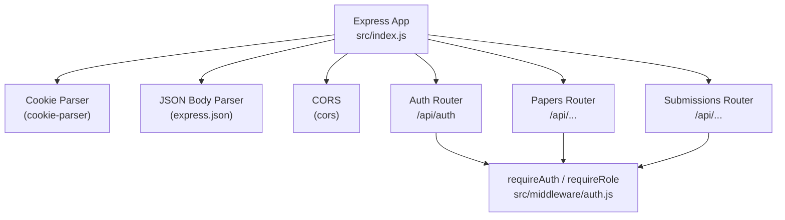
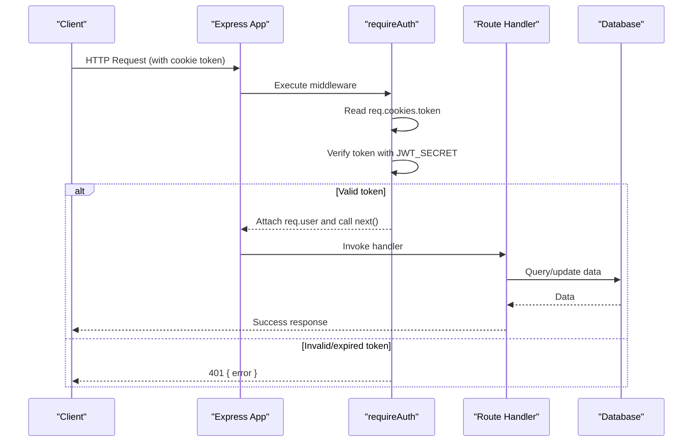
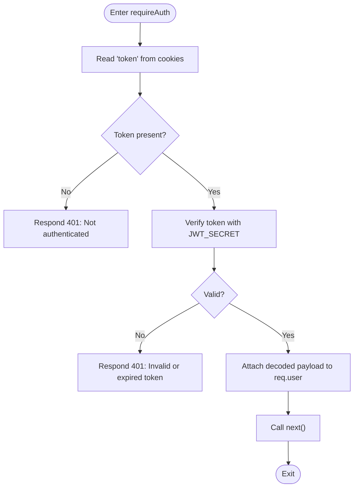
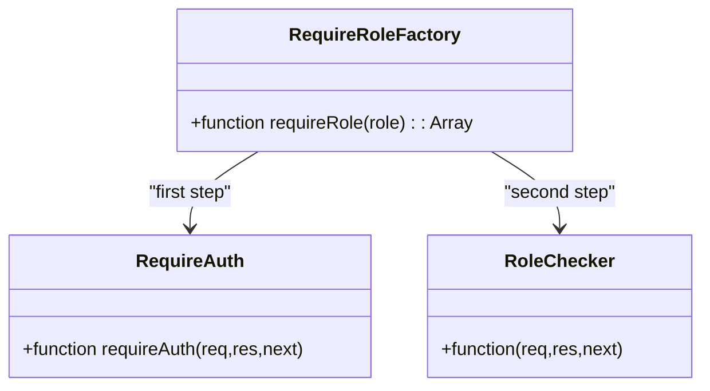
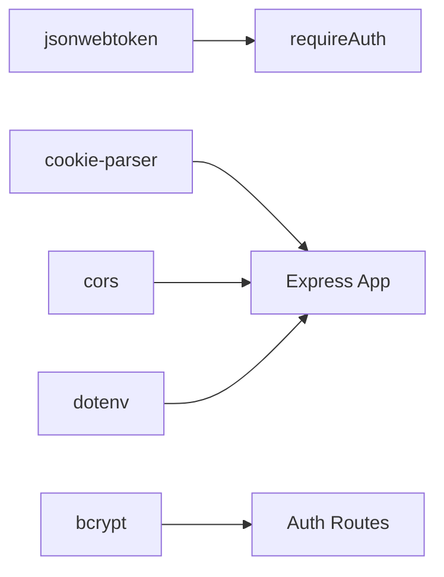

# Authentication Middleware

<cite>
**Referenced Files in This Document**
- [auth.js](file://backend/src/middleware/auth.js)
- [auth.test.js](file://backend/src/middleware/auth.test.js)
- [auth.js (routes)](file://backend/src/routes/auth.js)
- [index.js](file://backend/src/index.js)
- [papers.js](file://backend/src/routes/papers.js)
- [submissions.js](file://backend/src/routes/submissions.js)
- [package.json](file://backend/package.json)
</cite>

## Table of Contents
1. [Introduction](#introduction)
2. [Project Structure](#project-structure)
3. [Core Components](#core-components)
4. [Architecture Overview](#architecture-overview)
5. [Detailed Component Analysis](#detailed-component-analysis)
6. [Dependency Analysis](#dependency-analysis)
7. [Performance Considerations](#performance-considerations)
8. [Troubleshooting Guide](#troubleshooting-guide)
9. [Conclusion](#conclusion)
10. [Appendices](#appendices)

## Introduction
This document explains the Express.js authentication middleware implementation used to protect routes with JWT-based cookies. It focuses on the requireAuth function that validates tokens from cookies, decodes user information, and attaches it to the request object. It also covers the middleware chain pattern, error handling for invalid or expired tokens, integration with the Express request lifecycle, applying authentication to routes, consistent error handling, and extending the middleware for custom needs. Examples include protecting different route types, testing middleware behavior, and debugging common issues.

## Project Structure
The backend is an Express application that:
- Parses cookies and JSON bodies globally
- Mounts routers under /api
- Uses middleware to enforce authentication and authorization on specific routes

**Diagram sources**
- [index.js:16-32](file://backend/src/index.js#L16-L32)
- [auth.js:1-34](file://backend/src/middleware/auth.js#L1-L34)
- [auth.js (routes):1-152](file://backend/src/routes/auth.js#L1-L152)
- [papers.js:1-99](file://backend/src/routes/papers.js#L1-L99)
- [submissions.js:1-89](file://backend/src/routes/submissions.js#L1-L89)

**Section sources**
- [index.js:1-43](file://backend/src/index.js#L1-L43)

## Core Components
- requireAuth: Extracts token from cookies, verifies it using a secret, attaches decoded payload to req.user, and continues the chain if valid. Returns 401 for missing or invalid/expired tokens.
- requireRole(role): Returns a two-step middleware array that first enforces authentication via requireAuth, then checks that req.user.role matches the required role. Returns 403 when roles do not match.

Key behaviors:
- Token source: cookie named "token"
- Secret source: environment variable JWT_SECRET
- Error responses: standardized JSON errors with appropriate HTTP status codes
- User context: decoded token payload attached as req.user

**Section sources**
- [auth.js:1-34](file://backend/src/middleware/auth.js#L1-L34)

## Architecture Overview
The authentication flow integrates with the Express request lifecycle through middleware functions executed before route handlers. The app sets up global parsing and CORS, then mounts routers. Protected routes use requireAuth or requireRole to gate access.

**Diagram sources**
- [auth.js:5-20](file://backend/src/middleware/auth.js#L5-L20)
- [index.js:16-32](file://backend/src/index.js#L16-L32)

## Detailed Component Analysis

### requireAuth Middleware
Responsibilities:
- Extract token from req.cookies.token
- Validate token against JWT_SECRET
- On success: attach decoded payload to req.user and proceed
- On failure: respond with 401 and a JSON error

Error handling:
- Missing token: 401 Not authenticated
- Invalid/expired token: 401 Invalid or expired token
- Logs error details for debugging

Integration points:
- Used directly on protected routes
- Composed within requireRole for role-based protection

**Diagram sources**
- [auth.js:5-20](file://backend/src/middleware/auth.js#L5-L20)

**Section sources**
- [auth.js:5-20](file://backend/src/middleware/auth.js#L5-L20)

### requireRole Middleware Factory
Responsibilities:
- Return an array of two middleware functions
- First: requireAuth to ensure identity
- Second: check req.user.role equals the required role
- Respond with 403 when role does not match

Usage patterns:
- Spread into route definitions to enforce role-based access control
- Works with any route that requires a specific role

**Diagram sources**
- [auth.js:22-32](file://backend/src/middleware/auth.js#L22-L32)

**Section sources**
- [auth.js:22-32](file://backend/src/middleware/auth.js#L22-L32)

### Applying Authentication to Routes
Protected endpoints demonstrate how to apply authentication and authorization:
- Password reset and profile endpoints use requireAuth to ensure the requester is authenticated
- Paper upload uses requireRole('organiser') to restrict to organizers
- Submission creation uses requireRole('educator') to restrict to educators

Examples:
- POST /api/auth/reset-password: requires authentication
- GET /api/auth/me: requires authentication
- DELETE /api/auth/account: requires authentication
- POST /api/rounds/:id/papers: requires organiser role
- POST /api/rounds/:id/submissions: requires educator role

**Section sources**
- [auth.js (routes):99-149](file://backend/src/routes/auth.js#L99-L149)
- [papers.js:25-68](file://backend/src/routes/papers.js#L25-L68)
- [submissions.js:8-86](file://backend/src/routes/submissions.js#L8-L86)

### Cookie Handling and Security
- Tokens are set as httpOnly cookies to reduce XSS risk
- secure flag is enabled in production to enforce HTTPS
- sameSite lax helps mitigate CSRF while allowing top-level navigation
- maxAge set to one week for token lifetime

**Section sources**
- [auth.js (routes):13-20](file://backend/src/routes/auth.js#L13-L20)

### Global Setup and Request Lifecycle
- CORS configured to allow credentials from the frontend origin
- cookieParser enables reading cookies in middleware
- express.json parses incoming JSON payloads
- Routers mounted under /api provide namespacing

**Section sources**
- [index.js:16-32](file://backend/src/index.js#L16-L32)

## Dependency Analysis
External dependencies relevant to authentication:
- jsonwebtoken: signing and verifying JWTs
- cookie-parser: parsing cookies from requests
- cors: enabling cross-origin requests with credentials
- bcrypt: hashing passwords during registration/login
- dotenv: loading environment variables (e.g., JWT_SECRET)

**Diagram sources**
- [package.json:19-31](file://backend/package.json#L19-L31)
- [auth.js:1-3](file://backend/src/middleware/auth.js#L1-L3)
- [auth.js (routes):1-11](file://backend/src/routes/auth.js#L1-L11)
- [index.js:1-6](file://backend/src/index.js#L1-L6)

**Section sources**
- [package.json:19-31](file://backend/package.json#L19-L31)

## Performance Considerations
- JWT verification is CPU-bound; keep payloads small to minimize processing time
- Avoid unnecessary database calls inside middleware; only verify tokens there
- Use environment-specific settings (e.g., secure cookies in production) to avoid overhead in development
- Ensure logging is minimal in hot paths to prevent I/O bottlenecks

[No sources needed since this section provides general guidance]

## Troubleshooting Guide
Common issues and resolutions:
- Missing token: Ensure the client sends requests with credentials and includes the cookie. Verify CORS allows credentials and correct origin.
- Invalid/expired token: Confirm JWT_SECRET matches between server and token issuer. Check token expiration and re-authenticate if necessary.
- Role mismatches: Ensure the token contains the expected role claim and that the route requires the correct role.
- Debugging: Inspect console logs for token verification errors and validate cookie presence in network inspector.

Testing strategies:
- Unit tests verify:
  - 401 when no token is present
  - 401 when jwt.verify throws
  - Successful path sets req.user and calls next
  - requireRole returns an array and enforces role checks
- Integration tests can assert endpoint responses with and without valid cookies

**Section sources**
- [auth.test.js:11-55](file://backend/src/middleware/auth.test.js#L11-L55)
- [auth.test.js:57-109](file://backend/src/middleware/auth.test.js#L57-L109)

## Conclusion
The authentication middleware provides a clear, composable way to protect Express routes using JWTs stored in cookies. requireAuth handles token validation and user context attachment, while requireRole extends protection with role-based access control. Consistent error handling and robust testing ensure reliability across different route types. By following the patterns shown here, you can confidently secure your API endpoints and extend authentication logic as needed.

## Appendices

### How to Apply Authentication to New Routes
- For any route requiring authentication, add requireAuth before the handler
- For role-specific routes, use ...requireRole('roleName') to spread the middleware array
- Ensure cookies are sent with credentials from the client side

**Section sources**
- [papers.js:25-33](file://backend/src/routes/papers.js#L25-L33)
- [submissions.js:8-10](file://backend/src/routes/submissions.js#L8-L10)
- [auth.js (routes):99-149](file://backend/src/routes/auth.js#L99-L149)

### Extending the Middleware
- Add additional claims checks by inspecting req.user after requireAuth
- Create new role guards by composing requireAuth with custom checks
- Centralize error formatting by wrapping responses consistently

[No sources needed since this section provides general guidance]