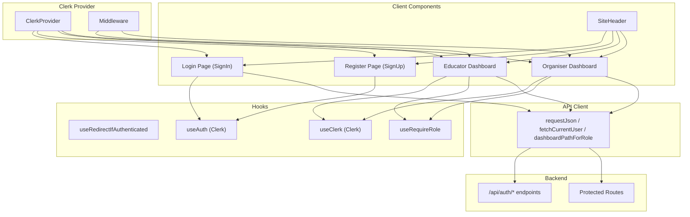
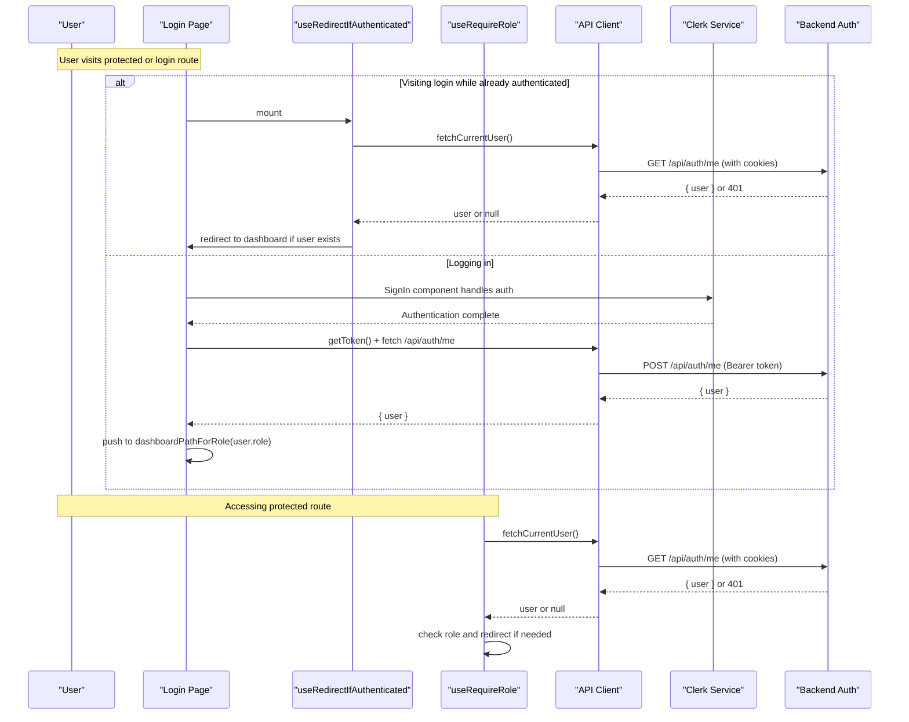
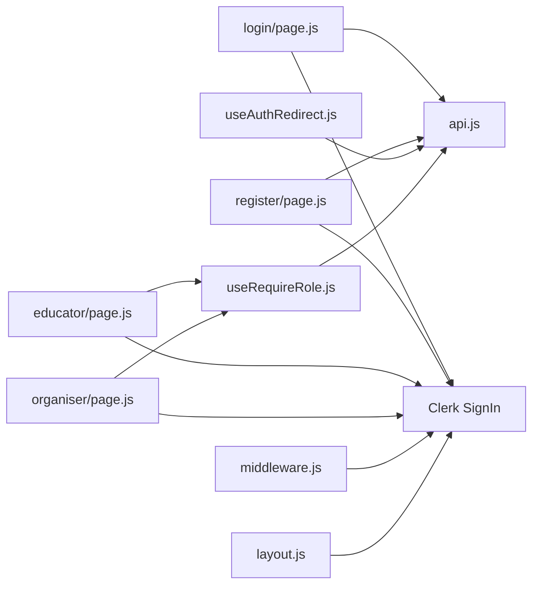

# Client-Side Authentication Handling

<cite>
**Referenced Files in This Document**
- [useAuthRedirect.js](file://frontend/src/hooks/useAuthRedirect.js)
- [useRequireRole.js](file://frontend/src/hooks/useRequireRole.js)
- [api.js](file://frontend/src/lib/api.js)
- [login/page.js](file://frontend/src/app/login/page.js)
- [register/page.js](file://frontend/src/app/register/page.js)
- [educator/page.js](file://frontend/src/app/educator/page.js)
- [organiser/page.js](file://frontend/src/app/organiser/page.js)
- [SiteHeader.js](file://frontend/src/components/SiteHeader.js)
- [middleware.js](file://frontend/src/middleware.js)
- [layout.js](file://frontend/src/app/layout.js)
</cite>

## Update Summary
**Changes Made**
- Updated authentication architecture to use Clerk's React components and hooks instead of manual session management
- Replaced custom login/register pages with Clerk's SignIn and SignUp components
- Integrated Clerk middleware for server-side authentication protection
- Updated protected dashboards to use Clerk's signOut functionality
- Modified API client to work with Clerk's token-based authentication
- Added Clerk provider configuration in the root layout

## Table of Contents
1. [Introduction](#introduction)
2. [Project Structure](#project-structure)
3. [Core Components](#core-components)
4. [Architecture Overview](#architecture-overview)
5. [Detailed Component Analysis](#detailed-component-analysis)
6. [Dependency Analysis](#dependency-analysis)
7. [Performance Considerations](#performance-considerations)
8. [Troubleshooting Guide](#troubleshooting-guide)
9. [Conclusion](#conclusion)

## Introduction
This document explains how the Next.js frontend handles client-side authentication using Clerk's authentication service, including:
- Clerk's SignIn and SignUp components that handle user authentication flows
- The useAuthRedirect hook that prevents authenticated users from seeing login pages and redirects them to their role-based dashboard
- The useRequireRole hook that protects routes by verifying the current user's identity and role
- The API client integration that works with Clerk's tokens for authenticated requests
- How authentication state is managed across components using Clerk's hooks and context
- Session persistence through Clerk's built-in session management
- Logout functionality using Clerk's signOut method

**Updated** The authentication system now leverages Clerk's comprehensive authentication service instead of manual session management, providing enhanced security features, social login support, and simplified authentication flows.

## Project Structure
The authentication flow spans several key areas:
- Clerk provider setup in the root layout
- Middleware for server-side authentication protection
- Login and register pages using Clerk's SignIn and SignUp components
- Protected dashboards that enforce roles and provide logout
- Site header that adjusts navigation based on public vs private routes
- Hooks for route-level auth checks: useAuthRedirect and useRequireRole

**Diagram sources**
- [layout.js:1-47](file://frontend/src/app/layout.js#L1-L47)
- [middleware.js:1-11](file://frontend/src/middleware.js#L1-L11)
- [login/page.js:1-78](file://frontend/src/app/login/page.js#L1-L78)
- [register/page.js:1-178](file://frontend/src/app/register/page.js#L1-L178)
- [educator/page.js:1-86](file://frontend/src/app/educator/page.js#L1-L86)
- [organiser/page.js:1-104](file://frontend/src/app/organiser/page.js#L1-L104)
- [useAuthRedirect.js:1-32](file://frontend/src/hooks/useAuthRedirect.js#L1-L32)
- [useRequireRole.js:1-39](file://frontend/src/hooks/useRequireRole.js#L1-L39)
- [api.js:1-146](file://frontend/src/lib/api.js#L1-L146)
- [SiteHeader.js:1-52](file://frontend/src/components/SiteHeader.js#L1-L52)

**Section sources**
- [layout.js:1-47](file://frontend/src/app/layout.js#L1-L47)
- [middleware.js:1-11](file://frontend/src/middleware.js#L1-L11)
- [login/page.js:1-78](file://frontend/src/app/login/page.js#L1-L78)
- [register/page.js:1-178](file://frontend/src/app/register/page.js#L1-L178)
- [educator/page.js:1-86](file://frontend/src/app/educator/page.js#L1-L86)
- [organiser/page.js:1-104](file://frontend/src/app/organiser/page.js#L1-L104)
- [useAuthRedirect.js:1-32](file://frontend/src/hooks/useAuthRedirect.js#L1-L32)
- [useRequireRole.js:1-39](file://frontend/src/hooks/useRequireRole.js#L1-L39)
- [api.js:1-146](file://frontend/src/lib/api.js#L1-L146)
- [SiteHeader.js:1-52](file://frontend/src/components/SiteHeader.js#L1-L52)

## Core Components
- **ClerkProvider**: Wraps the entire application to provide authentication context and utilities throughout the component tree
- **Clerk Middleware**: Server-side middleware that protects routes and manages authentication sessions
- **SignIn Component**: Handles user login with email/password and other authentication methods
- **SignUp Component**: Handles user registration with profile completion workflow
- **useAuth Hook**: Provides access to authentication state, user data, and token management
- **useClerk Hook**: Provides access to Clerk instance for actions like signOut
- **useRedirectIfAuthenticated**: Prevents already-authenticated users from accessing login or landing pages by redirecting them to the appropriate dashboard based on their role
- **useRequireRole**: Protects role-specific routes by verifying the current user and their role
- **API Client**: Centralized request helper that works with Clerk's tokens for authenticated requests

**Updated** The authentication system now relies on Clerk's comprehensive authentication service, eliminating the need for manual session management while providing enhanced security and user experience features.

**Section sources**
- [layout.js:1-47](file://frontend/src/app/layout.js#L1-L47)
- [middleware.js:1-11](file://frontend/src/middleware.js#L1-L11)
- [login/page.js:1-78](file://frontend/src/app/login/page.js#L1-L78)
- [register/page.js:1-178](file://frontend/src/app/register/page.js#L1-L178)
- [useAuthRedirect.js:1-32](file://frontend/src/hooks/useAuthRedirect.js#L1-L32)
- [useRequireRole.js:1-39](file://frontend/src/hooks/useRequireRole.js#L1-L39)
- [api.js:1-146](file://frontend/src/lib/api.js#L1-L146)

## Architecture Overview
Authentication now leverages Clerk's authentication service with a hybrid approach:
- Clerk handles user authentication, session management, and token generation
- Backend APIs validate Clerk tokens for protected routes
- Frontend uses Clerk's hooks and components for seamless authentication UI
- Role-based access control is enforced through backend validation of Clerk user data

**Diagram sources**
- [login/page.js:1-78](file://frontend/src/app/login/page.js#L1-L78)
- [useAuthRedirect.js:1-32](file://frontend/src/hooks/useAuthRedirect.js#L1-L32)
- [useRequireRole.js:1-39](file://frontend/src/hooks/useRequireRole.js#L1-L39)
- [api.js:1-146](file://frontend/src/lib/api.js#L1-L146)

## Detailed Component Analysis

### Clerk Provider and Middleware
**Updated** The application now uses Clerk's authentication service for all authentication needs.

**ClerkProvider Setup:**
- Root layout wraps the entire application with ClerkProvider
- Provides authentication context to all child components
- Manages global authentication state and user sessions

**Middleware Configuration:**
- Server-side middleware protects routes and validates authentication
- Configured to match all routes except static assets
- Integrates with Clerk's authentication system

**Section sources**
- [layout.js:1-47](file://frontend/src/app/layout.js#L1-L47)
- [middleware.js:1-11](file://frontend/src/middleware.js#L1-L11)

### Login Page with Clerk SignIn
**Updated** The login page now uses Clerk's SignIn component instead of manual form handling.

Key features:
- Uses `<SignIn>` component with routing configuration
- Handles loading states with `isLoaded` flag
- Redirects authenticated users to appropriate dashboard
- Displays error messages during authentication process
- Integrates with backend to verify user roles after Clerk authentication

**Section sources**
- [login/page.js:1-78](file://frontend/src/app/login/page.js#L1-L78)

### Register Page with Clerk SignUp
**Updated** The registration page now uses Clerk's SignUp component with custom profile completion.

Key features:
- Uses `<SignUp>` component with routing configuration
- Conditional rendering based on authentication state
- Custom profile completion form for educators
- Token-based API calls for profile completion
- Success/error state management

**Section sources**
- [register/page.js:1-178](file://frontend/src/app/register/page.js#L1-L178)

### useRedirectIfAuthenticated
Purpose:
- On mount, checks if there is an active session by calling fetchCurrentUser
- If a user is found, immediately replaces the current route with the appropriate dashboard based on role
- Returns a boolean checking flag to prevent rendering content until the session check completes

Behavior:
- Uses router.replace to avoid stacking history entries
- Guards against stale updates with a cancelled flag in cleanup

Usage:
- Typically used on login or landing pages to bounce authenticated users away

**Section sources**
- [useAuthRedirect.js:1-32](file://frontend/src/hooks/useAuthRedirect.js#L1-L32)

### useRequireRole
Purpose:
- Protects role-specific routes by verifying the current user and their role
- Redirects unauthenticated users to /login and misrouted users to their correct dashboard

Behavior:
- Calls fetchCurrentUser on mount
- Stores the fetched user and a checking flag
- Provides a simple interface for components to wait for auth before rendering protected UI

Usage:
- Used in educator and organiser dashboards to ensure only authorized users can view content

**Section sources**
- [useRequireRole.js:1-39](file://frontend/src/hooks/useRequireRole.js#L1-L39)
- [educator/page.js:1-86](file://frontend/src/app/educator/page.js#L1-L86)
- [organiser/page.js:1-104](file://frontend/src/app/organiser/page.js#L1-L104)

### API Client (api.js)
Key responsibilities:
- Centralizes HTTP requests with credentials: include so cookies are automatically attached to every request
- Normalizes errors into a typed ApiError with message and status
- Handles network failures, non-JSON responses, and non-2xx status codes consistently
- Exposes authentication-related functions: fetchCurrentUser, and helpers like dashboardPathForRole

**Updated** The API client now works alongside Clerk's authentication system, with some pages using Clerk tokens directly for specific API calls.

Automatic token attachment:
- Credentials: include ensures the browser sends session cookies with each request
- Some pages also use Clerk's getToken() for direct token-based authentication

Error handling:
- Network errors throw ApiError with status 0 and a descriptive message
- Non-2xx responses throw ApiError with the response status and either a server-provided error message or a generic fallback

Response interceptors:
- There are no global response interceptors; instead, requestJson centralizes error handling for all JSON requests

Local storage usage:
- Not used for authentication tokens. Session persistence is handled by Clerk and cookie-based authentication

**Section sources**
- [api.js:1-146](file://frontend/src/lib/api.js#L1-L146)

### Protected Dashboards (Educator and Organiser)
**Updated** Both dashboards now use Clerk's authentication system for logout functionality.

Protection:
- Both dashboards use useRequireRole to ensure the current user is authenticated and has the required role

User session management:
- Display the current user's email and role after successful auth
- Provide a logout button that uses Clerk's signOut method and navigates to /login

Data loading:
- Fetch data (e.g., rounds) after auth check completes, with loading, empty, ready, and error states

**Section sources**
- [educator/page.js:1-86](file://frontend/src/app/educator/page.js#L1-L86)
- [organiser/page.js:1-104](file://frontend/src/app/organiser/page.js#L1-L104)

### SiteHeader
Behavior:
- Determines if the current path is public (/ , /login, /register) and renders different navigation accordingly
- Does not perform authentication checks itself; relies on hooks in protected pages

**Section sources**
- [SiteHeader.js:1-52](file://frontend/src/components/SiteHeader.js#L1-L52)

## Dependency Analysis
High-level dependencies:
- Login and register pages depend on Clerk's SignIn and SignUp components
- Protected dashboards depend on useRequireRole and Clerk's signOut method
- Hooks depend on api.fetchCurrentUser and dashboardPathForRole
- All API calls go through requestJson which sets credentials: include
- Clerk middleware protects server-side routes

**Diagram sources**
- [login/page.js:1-78](file://frontend/src/app/login/page.js#L1-L78)
- [register/page.js:1-178](file://frontend/src/app/register/page.js#L1-L178)
- [educator/page.js:1-86](file://frontend/src/app/educator/page.js#L1-L86)
- [organiser/page.js:1-104](file://frontend/src/app/organiser/page.js#L1-L104)
- [useAuthRedirect.js:1-32](file://frontend/src/hooks/useAuthRedirect.js#L1-L32)
- [useRequireRole.js:1-39](file://frontend/src/hooks/useRequireRole.js#L1-L39)
- [api.js:1-146](file://frontend/src/lib/api.js#L1-L146)
- [middleware.js:1-11](file://frontend/src/middleware.js#L1-L11)
- [layout.js:1-47](file://frontend/src/app/layout.js#L1-L47)

**Section sources**
- [login/page.js:1-78](file://frontend/src/app/login/page.js#L1-L78)
- [register/page.js:1-178](file://frontend/src/app/register/page.js#L1-L178)
- [educator/page.js:1-86](file://frontend/src/app/educator/page.js#L1-L86)
- [organiser/page.js:1-104](file://frontend/src/app/organiser/page.js#L1-L104)
- [useAuthRedirect.js:1-32](file://frontend/src/hooks/useAuthRedirect.js#L1-L32)
- [useRequireRole.js:1-39](file://frontend/src/hooks/useRequireRole.js#L1-L39)
- [api.js:1-146](file://frontend/src/lib/api.js#L1-L146)
- [middleware.js:1-11](file://frontend/src/middleware.js#L1-L11)
- [layout.js:1-47](file://frontend/src/app/layout.js#L1-L47)

## Performance Considerations
- Minimize redundant auth checks: useRedirectIfAuthenticated and useRequireRole call fetchCurrentUser once per mount. Avoid re-mounting these hooks unnecessarily
- Prefer router.replace for redirects to avoid unnecessary history entries
- Keep protected pages lightweight during auth check; render a simple loading indicator until checking resolves
- Ensure the backend responds quickly to /api/auth/me to reduce perceived latency on protected routes
- Clerk's client-side caching reduces network requests for authentication state
- Clerk's SignIn/SignUp components are optimized for performance and user experience

## Troubleshooting Guide
Common issues and where to look:
- Network errors when calling API:
  - requestJson wraps network failures in ApiError with status 0. Check console logs and verify the backend URL and availability
  - See [api.js:17-45](file://frontend/src/lib/api.js#L17-L45)
- Non-2xx responses:
  - requestJson throws ApiError with the response status and either a server error message or a generic message. Inspect the status and message to diagnose
  - See [api.js:39-44](file://frontend/src/lib/api.js#L39-L44)
- Unauthenticated access:
  - useRequireRole redirects to /login if fetchCurrentUser returns null. Verify that cookies are being sent (credentials: include) and that the backend session is valid
  - See [useRequireRole.js:12-30](file://frontend/src/hooks/useRequireRole.js#L12-L30)
- Already authenticated users stuck on login:
  - useRedirectIfAuthenticated should redirect to the correct dashboard. Confirm fetchCurrentUser resolves with a user object and dashboardPathForRole maps roles correctly
  - See [useAuthRedirect.js:13-28](file://frontend/src/hooks/useAuthRedirect.js#L13-L28)
- Clerk authentication issues:
  - Check ClerkProvider configuration in layout.js
  - Verify middleware configuration in middleware.js
  - Ensure environment variables are properly set for Clerk
- Logout not working:
  - Ensure Clerk's signOut method is called and redirectUrl is properly configured
  - See [educator/page.js:40-42](file://frontend/src/app/educator/page.js#L40-L42)

**Section sources**
- [api.js:17-45](file://frontend/src/lib/api.js#L17-L45)
- [useRequireRole.js:12-30](file://frontend/src/hooks/useRequireRole.js#L12-L30)
- [useAuthRedirect.js:13-28](file://frontend/src/hooks/useAuthRedirect.js#L13-L28)
- [educator/page.js:40-42](file://frontend/src/app/educator/page.js#L40-L42)
- [layout.js:1-47](file://frontend/src/app/layout.js#L1-L47)
- [middleware.js:1-11](file://frontend/src/middleware.js#L1-L11)

## Conclusion
The frontend now implements a robust, Clerk-powered authentication model:
- Clerk's SignIn and SignUp components handle user authentication flows with enhanced security features
- ClerkProvider and middleware provide comprehensive authentication context and server-side protection
- useRedirectIfAuthenticated prevents authenticated users from accessing login pages and redirects them appropriately
- useRequireRole protects role-specific routes by validating the current session and role
- The API client works alongside Clerk's authentication system for secure API communication
- Protected dashboards manage user session display and provide logout functionality using Clerk's signOut method
- Session persistence is handled by Clerk's built-in session management, eliminating the need for manual token storage

**Updated** This migration to Clerk provides enhanced security, improved user experience, and reduced maintenance overhead while maintaining the existing role-based access control structure. The system now supports additional authentication methods and features provided by Clerk's platform.

[No sources needed since this section summarizes without analyzing specific files]