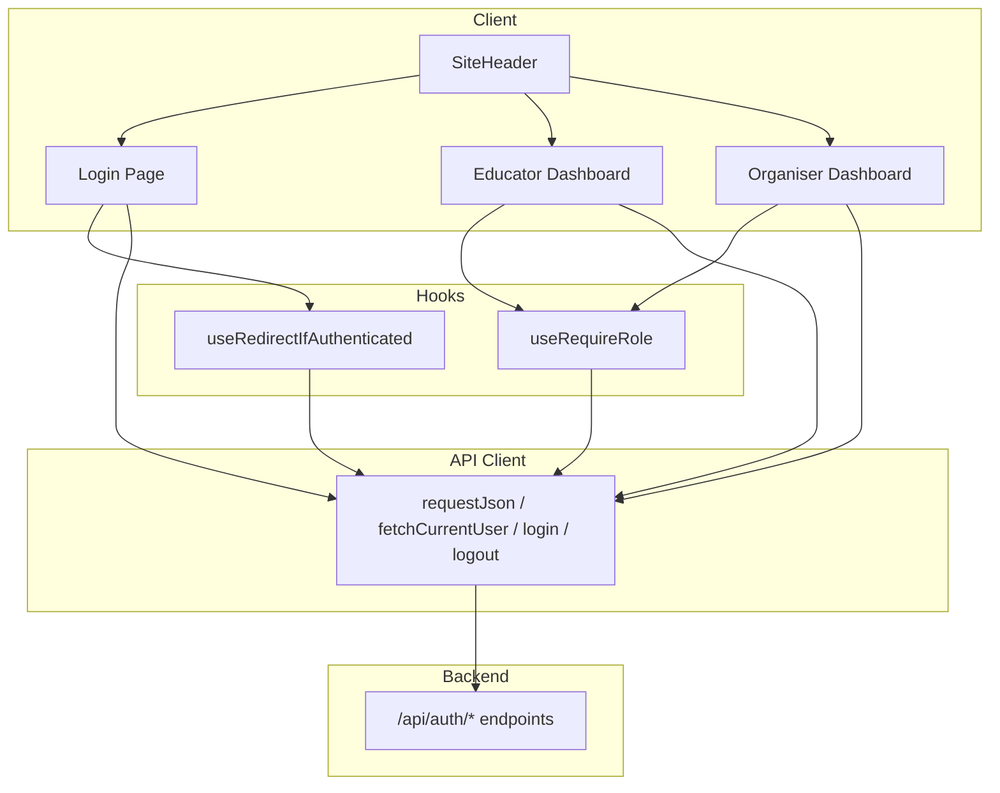
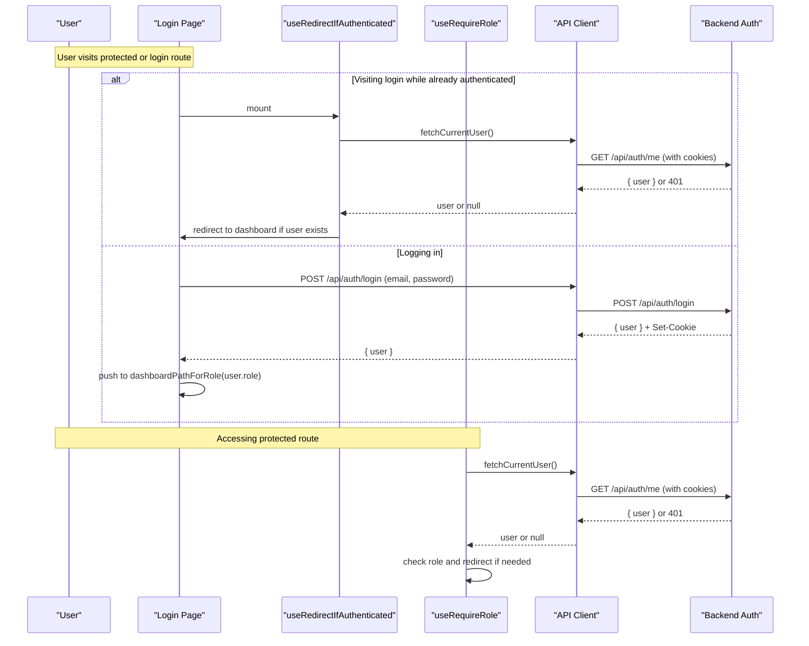
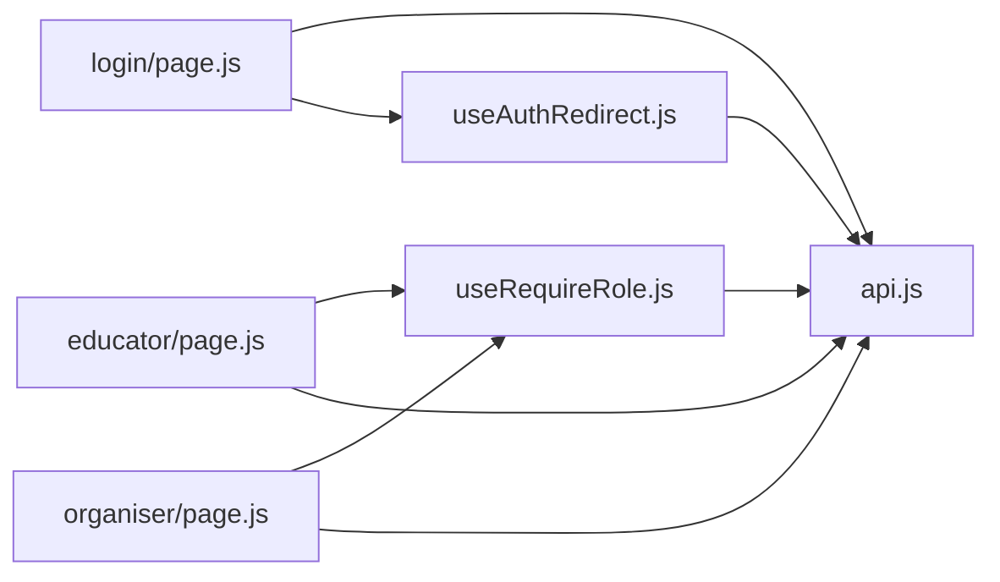

# Client-Side Authentication Handling

<cite>
**Referenced Files in This Document**
- [useAuthRedirect.js](file://frontend/src/hooks/useAuthRedirect.js)
- [useRequireRole.js](file://frontend/src/hooks/useRequireRole.js)
- [api.js](file://frontend/src/lib/api.js)
- [login/page.js](file://frontend/src/app/login/page.js)
- [educator/page.js](file://frontend/src/app/educator/page.js)
- [organiser/page.js](file://frontend/src/app/organiser/page.js)
- [SiteHeader.js](file://frontend/src/components/SiteHeader.js)
</cite>

## Table of Contents
1. [Introduction](#introduction)
2. [Project Structure](#project-structure)
3. [Core Components](#core-components)
4. [Architecture Overview](#architecture-overview)
5. [Detailed Component Analysis](#detailed-component-analysis)
6. [Dependency Analysis](#dependency-analysis)
7. [Performance Considerations](#performance-considerations)
8. [Troubleshooting Guide](#troubleshooting-guide)
9. [Conclusion](#conclusion)

## Introduction
This document explains how the Next.js frontend handles client-side authentication, including:
- The useAuthRedirect hook that prevents authenticated users from seeing login pages and redirects them to their role-based dashboard.
- The useRequireRole hook that protects routes by verifying the current user’s identity and role.
- The API client integration that performs authenticated requests using session cookies, with consistent error handling for network issues and non-2xx responses.
- How authentication state is managed across components, how logout works, and how to protect routes and handle errors in React components.

Note: Session persistence is handled via HTTP-only cookies through the browser’s cookie store (credentials: include). There is no local storage usage for tokens in this codebase.

## Project Structure
The authentication flow spans a few key areas:
- Hooks for route-level auth checks: useAuthRedirect and useRequireRole
- API client for all HTTP calls: api.js
- Login page that triggers authentication and redirects on success
- Protected dashboards that enforce roles and provide logout
- Site header that adjusts navigation based on public vs private routes

**Diagram sources**
- [login/page.js:1-113](file://frontend/src/app/login/page.js#L1-L113)
- [educator/page.js:1-87](file://frontend/src/app/educator/page.js#L1-L87)
- [organiser/page.js:1-105](file://frontend/src/app/organiser/page.js#L1-L105)
- [useAuthRedirect.js:1-32](file://frontend/src/hooks/useAuthRedirect.js#L1-L32)
- [useRequireRole.js:1-39](file://frontend/src/hooks/useRequireRole.js#L1-L39)
- [api.js:1-146](file://frontend/src/lib/api.js#L1-L146)
- [SiteHeader.js:1-52](file://frontend/src/components/SiteHeader.js#L1-L52)

**Section sources**
- [login/page.js:1-113](file://frontend/src/app/login/page.js#L1-L113)
- [educator/page.js:1-87](file://frontend/src/app/educator/page.js#L1-L87)
- [organiser/page.js:1-105](file://frontend/src/app/organiser/page.js#L1-L105)
- [useAuthRedirect.js:1-32](file://frontend/src/hooks/useAuthRedirect.js#L1-L32)
- [useRequireRole.js:1-39](file://frontend/src/hooks/useRequireRole.js#L1-L39)
- [api.js:1-146](file://frontend/src/lib/api.js#L1-L146)
- [SiteHeader.js:1-52](file://frontend/src/components/SiteHeader.js#L1-L52)

## Core Components
- useRedirectIfAuthenticated: Prevents already-authenticated users from accessing login or landing pages by redirecting them to the appropriate dashboard based on their role. It returns a checking flag to avoid rendering until the current session is verified.
- useRequireRole: Protects role-specific routes by fetching the current user and ensuring they have the required role; otherwise, it redirects to the correct dashboard or login.
- API client: Centralized request helper that sets credentials: include so cookies are sent automatically, parses JSON responses, and throws a typed ApiError for both network failures and non-2xx responses. It exposes login, logout, fetchCurrentUser, and utility functions like dashboardPathForRole.
- Login page: Validates input, calls login, and navigates to the role-based dashboard on success. Displays field and server errors.
- Protected dashboards: Use useRequireRole to guard access, display user info, list rounds, and provide logout functionality.
- SiteHeader: Adjusts visible links based on whether the current path is public or private.

**Section sources**
- [useAuthRedirect.js:1-32](file://frontend/src/hooks/useAuthRedirect.js#L1-L32)
- [useRequireRole.js:1-39](file://frontend/src/hooks/useRequireRole.js#L1-L39)
- [api.js:1-146](file://frontend/src/lib/api.js#L1-L146)
- [login/page.js:1-113](file://frontend/src/app/login/page.js#L1-L113)
- [educator/page.js:1-87](file://frontend/src/app/educator/page.js#L1-L87)
- [organiser/page.js:1-105](file://frontend/src/app/organiser/page.js#L1-L105)
- [SiteHeader.js:1-52](file://frontend/src/components/SiteHeader.js#L1-L52)

## Architecture Overview
Authentication relies on session cookies maintained by the browser. All API calls include credentials: include, so the backend can validate sessions per request. Hooks call fetchCurrentUser to determine if a user is logged in and what role they have, then redirect accordingly.

**Diagram sources**
- [login/page.js:1-113](file://frontend/src/app/login/page.js#L1-L113)
- [useAuthRedirect.js:1-32](file://frontend/src/hooks/useAuthRedirect.js#L1-L32)
- [useRequireRole.js:1-39](file://frontend/src/hooks/useRequireRole.js#L1-L39)
- [api.js:1-146](file://frontend/src/lib/api.js#L1-L146)

## Detailed Component Analysis

### useRedirectIfAuthenticated
Purpose:
- On mount, checks if there is an active session by calling fetchCurrentUser.
- If a user is found, immediately replaces the current route with the appropriate dashboard based on role.
- Returns a boolean checking flag to prevent rendering content until the session check completes.

Behavior:
- Uses router.replace to avoid stacking history entries.
- Guards against stale updates with a cancelled flag in cleanup.

Usage:
- Typically used on login or landing pages to bounce authenticated users away.

**Section sources**
- [useAuthRedirect.js:1-32](file://frontend/src/hooks/useAuthRedirect.js#L1-L32)

### useRequireRole
Purpose:
- Protects role-specific routes by verifying the current user and their role.
- Redirects unauthenticated users to /login and misrouted users to their correct dashboard.

Behavior:
- Calls fetchCurrentUser on mount.
- Stores the fetched user and a checking flag.
- Provides a simple interface for components to wait for auth before rendering protected UI.

Usage:
- Used in educator and organiser dashboards to ensure only authorized users can view content.

**Section sources**
- [useRequireRole.js:1-39](file://frontend/src/hooks/useRequireRole.js#L1-L39)
- [educator/page.js:1-87](file://frontend/src/app/educator/page.js#L1-L87)
- [organiser/page.js:1-105](file://frontend/src/app/organiser/page.js#L1-L105)

### API Client (api.js)
Key responsibilities:
- Centralizes HTTP requests with credentials: include so cookies are automatically attached to every request.
- Normalizes errors into a typed ApiError with message and status.
- Handles network failures, non-JSON responses, and non-2xx status codes consistently.
- Exposes authentication-related functions: login, logout, fetchCurrentUser, and helpers like dashboardPathForRole.

Automatic token attachment:
- Credentials: include ensures the browser sends session cookies with each request. No manual token headers are set.

Error handling:
- Network errors throw ApiError with status 0 and a descriptive message.
- Non-2xx responses throw ApiError with the response status and either a server-provided error message or a generic fallback.

Response interceptors:
- There are no global response interceptors; instead, requestJson centralizes error handling for all JSON requests.

Logout:
- Calls POST /api/auth/logout to invalidate the session on the server side. After logout, clients typically navigate to /login.

Local storage usage:
- Not used for authentication tokens. Session persistence is cookie-based.

**Section sources**
- [api.js:1-146](file://frontend/src/lib/api.js#L1-L146)

### Login Page
Flow:
- Validates email and password fields locally.
- Calls login to authenticate with the backend.
- On success, navigates to the role-based dashboard using dashboardPathForRole.
- On failure, displays a user-friendly error message.

Session persistence:
- Relies on server-set cookies; no client-side token storage.

**Section sources**
- [login/page.js:1-113](file://frontend/src/app/login/page.js#L1-L113)
- [api.js:121-139](file://frontend/src/lib/api.js#L121-L139)

### Protected Dashboards (Educator and Organiser)
Protection:
- Both dashboards use useRequireRole to ensure the current user is authenticated and has the required role.

User session management:
- Display the current user’s email and role after successful auth.
- Provide a logout button that calls logout and navigates to /login.

Data loading:
- Fetch data (e.g., rounds) after auth check completes, with loading, empty, ready, and error states.

**Section sources**
- [educator/page.js:1-87](file://frontend/src/app/educator/page.js#L1-L87)
- [organiser/page.js:1-105](file://frontend/src/app/organiser/page.js#L1-L105)

### SiteHeader
Behavior:
- Determines if the current path is public (/ , /login, /register) and renders different navigation accordingly.
- Does not perform authentication checks itself; relies on hooks in protected pages.

**Section sources**
- [SiteHeader.js:1-52](file://frontend/src/components/SiteHeader.js#L1-L52)

## Dependency Analysis
High-level dependencies:
- Login page depends on api.login and useRedirectIfAuthenticated.
- Protected dashboards depend on useRequireRole and api.logout.
- Hooks depend on api.fetchCurrentUser and dashboardPathForRole.
- All API calls go through requestJson which sets credentials: include.

**Diagram sources**
- [login/page.js:1-113](file://frontend/src/app/login/page.js#L1-L113)
- [educator/page.js:1-87](file://frontend/src/app/educator/page.js#L1-L87)
- [organiser/page.js:1-105](file://frontend/src/app/organiser/page.js#L1-L105)
- [useAuthRedirect.js:1-32](file://frontend/src/hooks/useAuthRedirect.js#L1-L32)
- [useRequireRole.js:1-39](file://frontend/src/hooks/useRequireRole.js#L1-L39)
- [api.js:1-146](file://frontend/src/lib/api.js#L1-L146)

**Section sources**
- [login/page.js:1-113](file://frontend/src/app/login/page.js#L1-L113)
- [educator/page.js:1-87](file://frontend/src/app/educator/page.js#L1-L87)
- [organiser/page.js:1-105](file://frontend/src/app/organiser/page.js#L1-L105)
- [useAuthRedirect.js:1-32](file://frontend/src/hooks/useAuthRedirect.js#L1-L32)
- [useRequireRole.js:1-39](file://frontend/src/hooks/useRequireRole.js#L1-L39)
- [api.js:1-146](file://frontend/src/lib/api.js#L1-L146)

## Performance Considerations
- Minimize redundant auth checks: useRedirectIfAuthenticated and useRequireRole call fetchCurrentUser once per mount. Avoid re-mounting these hooks unnecessarily.
- Prefer router.replace for redirects to avoid unnecessary history entries.
- Keep protected pages lightweight during auth check; render a simple loading indicator until checking resolves.
- Ensure the backend responds quickly to /api/auth/me to reduce perceived latency on protected routes.

[No sources needed since this section provides general guidance]

## Troubleshooting Guide
Common issues and where to look:
- Network errors when calling API:
  - requestJson wraps network failures in ApiError with status 0. Check console logs and verify the backend URL and availability.
  - See [api.js:17-45](file://frontend/src/lib/api.js#L17-L45)
- Non-2xx responses:
  - requestJson throws ApiError with the response status and either a server error message or a generic message. Inspect the status and message to diagnose.
  - See [api.js:39-44](file://frontend/src/lib/api.js#L39-L44)
- Unauthenticated access:
  - useRequireRole redirects to /login if fetchCurrentUser returns null. Verify that cookies are being sent (credentials: include) and that the backend session is valid.
  - See [useRequireRole.js:12-30](file://frontend/src/hooks/useRequireRole.js#L12-L30)
- Already authenticated users stuck on login:
  - useRedirectIfAuthenticated should redirect to the correct dashboard. Confirm fetchCurrentUser resolves with a user object and dashboardPathForRole maps roles correctly.
  - See [useAuthRedirect.js:13-28](file://frontend/src/hooks/useAuthRedirect.js#L13-L28)
- Logout not working:
  - Ensure logout calls POST /api/auth/logout and that the client navigates to /login afterward.
  - See [api.js:137-139](file://frontend/src/lib/api.js#L137-L139)

**Section sources**
- [api.js:17-45](file://frontend/src/lib/api.js#L17-L45)
- [useRequireRole.js:12-30](file://frontend/src/hooks/useRequireRole.js#L12-L30)
- [useAuthRedirect.js:13-28](file://frontend/src/hooks/useAuthRedirect.js#L13-L28)
- [api.js:137-139](file://frontend/src/lib/api.js#L137-L139)

## Conclusion
The frontend implements a clean, cookie-based authentication model:
- useRedirectIfAuthenticated prevents authenticated users from accessing login pages and redirects them appropriately.
- useRequireRole protects role-specific routes by validating the current session and role.
- The API client centralizes authenticated requests with automatic cookie inclusion and consistent error handling.
- Protected dashboards manage user session display and provide logout functionality.
- There is no local storage usage for tokens; session persistence is entirely cookie-driven.

This design keeps authentication logic centralized, reduces duplication, and makes it straightforward to add new protected routes by composing useRequireRole.

[No sources needed since this section summarizes without analyzing specific files]