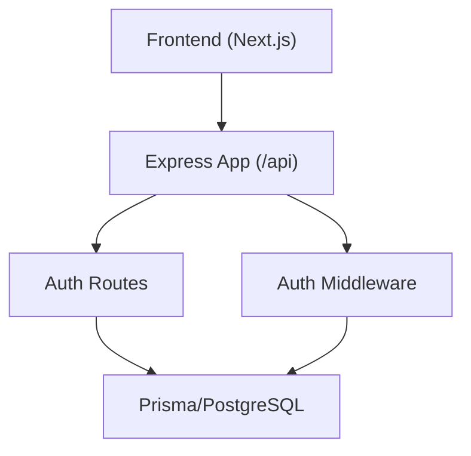
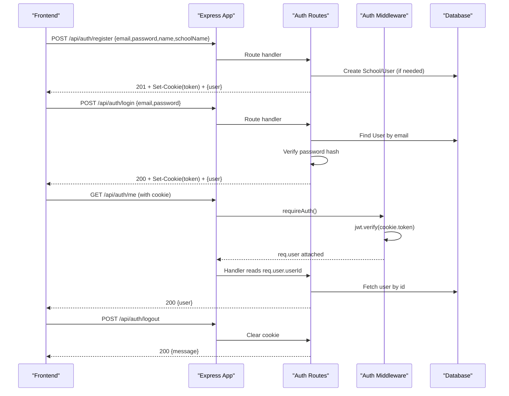
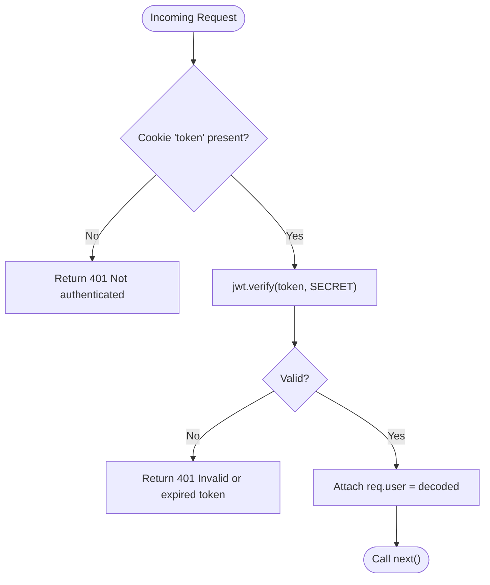
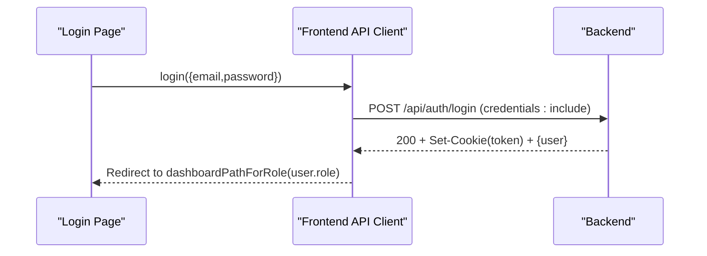
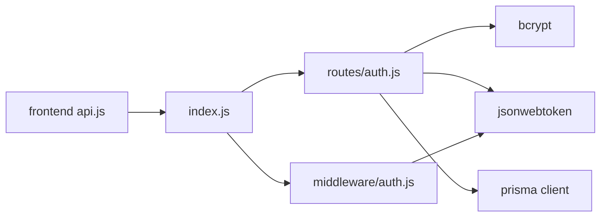
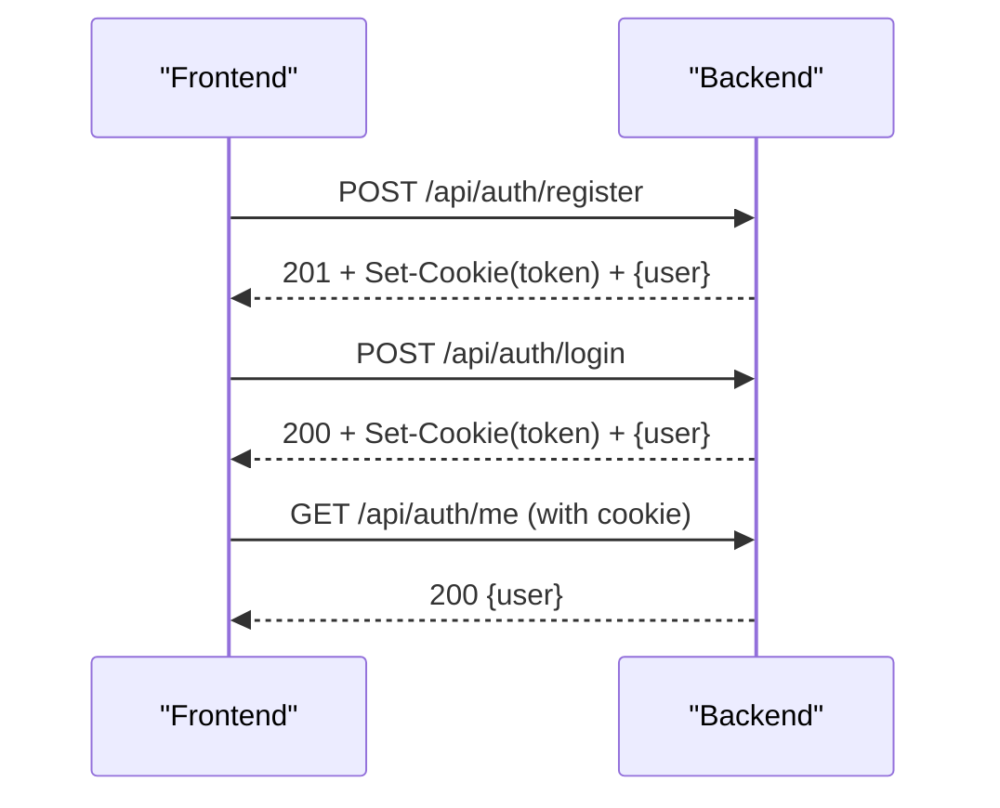

# JWT Authentication Flow

<cite>
**Referenced Files in This Document**
- [backend/src/routes/auth.js](file://backend/src/routes/auth.js)
- [backend/src/middleware/auth.js](file://backend/src/middleware/auth.js)
- [backend/src/index.js](file://backend/src/index.js)
- [frontend/src/lib/api.js](file://frontend/src/lib/api.js)
- [frontend/src/app/login/page.js](file://frontend/src/app/login/page.js)
- [frontend/src/app/register/page.js](file://frontend/src/app/register/page.js)
- [frontend/src/hooks/useAuthRedirect.js](file://frontend/src/hooks/useAuthRedirect.js)
- [backend/prisma/schema.prisma](file://backend/prisma/schema.prisma)
</cite>

## Table of Contents
1. [Introduction](#introduction)
2. [Project Structure](#project-structure)
3. [Core Components](#core-components)
4. [Architecture Overview](#architecture-overview)
5. [Detailed Component Analysis](#detailed-component-analysis)
6. [Dependency Analysis](#dependency-analysis)
7. [Performance Considerations](#performance-considerations)
8. [Troubleshooting Guide](#troubleshooting-guide)
9. [Conclusion](#conclusion)
10. [Appendices](#appendices)

## Introduction
This document explains the complete JWT authentication lifecycle in the Olympiad Portal, covering user registration, login, secure cookie-based token storage, and request-time validation middleware. It details the endpoints, request/response schemas, error handling patterns, and security considerations such as XSS and CSRF protections. It also provides guidance on token refresh strategies and illustrates successful flows with diagrams.

## Project Structure
The authentication system spans backend routes, middleware, and frontend API utilities:
- Backend Express app mounts CORS, cookie parsing, JSON parsing, and registers routers under /api.
- Auth routes implement registration, login, logout, current user retrieval, password reset, and account deletion.
- Middleware validates JWTs from cookies and enforces roles.
- Frontend uses a shared API client that sends credentials with requests to automatically include cookies.



**Diagram sources**
- [backend/src/index.js:16-32](file://backend/src/index.js#L16-L32)
- [backend/src/routes/auth.js:22-149](file://backend/src/routes/auth.js#L22-L149)
- [backend/src/middleware/auth.js:5-31](file://backend/src/middleware/auth.js#L5-L31)
- [backend/prisma/schema.prisma:31-57](file://backend/prisma/schema.prisma#L31-L57)

**Section sources**
- [backend/src/index.js:1-43](file://backend/src/index.js#L1-L43)
- [backend/src/routes/auth.js:1-152](file://backend/src/routes/auth.js#L1-L152)
- [backend/src/middleware/auth.js:1-35](file://backend/src/middleware/auth.js#L1-L35)
- [frontend/src/lib/api.js:1-146](file://frontend/src/lib/api.js#L1-L146)

## Core Components
- Authentication routes handle user lifecycle and issue tokens via HTTP-only cookies.
- Middleware verifies tokens on protected routes and attaches user context.
- Frontend API client includes credentials so cookies are sent automatically.

Key responsibilities:
- Registration: validate input, hash password, create user and school if needed, sign JWT, set cookie, return user info.
- Login: validate credentials, sign JWT, set cookie, return user info.
- Logout: clear cookie.
- Current user: verify token, fetch user, return minimal profile.
- Password reset: require auth, verify current password, update to new hashed password.
- Account deletion: require auth, delete user.

Security highlights:
- Tokens stored in httpOnly cookies to prevent XSS access.
- Cookie is secure in production and sameSite lax for cross-site safety.
- CORS configured with credentials enabled for same-origin or allowed origins.

**Section sources**
- [backend/src/routes/auth.js:13-20](file://backend/src/routes/auth.js#L13-L20)
- [backend/src/routes/auth.js:22-149](file://backend/src/routes/auth.js#L22-L149)
- [backend/src/middleware/auth.js:5-31](file://backend/src/middleware/auth.js#L5-L31)
- [backend/src/index.js:16-24](file://backend/src/index.js#L16-L24)
- [frontend/src/lib/api.js:17-45](file://frontend/src/lib/api.js#L17-L45)

## Architecture Overview
The authentication flow uses short-lived JWTs signed with a server-side secret and delivered via secure cookies. Protected endpoints rely on middleware to decode and validate tokens from cookies.



**Diagram sources**
- [backend/src/routes/auth.js:22-149](file://backend/src/routes/auth.js#L22-L149)
- [backend/src/middleware/auth.js:5-31](file://backend/src/middleware/auth.js#L5-L31)
- [backend/src/index.js:16-32](file://backend/src/index.js#L16-L32)

## Detailed Component Analysis

### Authentication Endpoints
- POST /api/auth/register
  - Request body: email, password, name, schoolName
  - Behavior: Validates fields; checks uniqueness; hashes password; creates or finds school; creates user with role educator; signs JWT; sets httpOnly cookie; returns 201 with user object
  - Errors: 400 missing fields; 409 duplicate email
- POST /api/auth/login
  - Request body: email, password
  - Behavior: Validates fields; finds user; compares password; signs JWT; sets httpOnly cookie; returns 200 with user object
  - Errors: 400 missing fields; 401 invalid credentials
- POST /api/auth/reset-password
  - Requires authentication
  - Request body: currentPassword, newPassword
  - Behavior: Verifies current password; updates to new hashed password
  - Errors: 400 missing fields; 401 wrong current password; 404 user not found
- POST /api/auth/logout
  - Behavior: Clears token cookie; returns success message
- GET /api/auth/me
  - Requires authentication
  - Behavior: Returns minimal user profile based on token
  - Errors: 401 unauthorized; 404 user not found
- DELETE /api/auth/account
  - Requires authentication
  - Behavior: Deletes user account
  - Errors: 401 unauthorized; 404 user not found

Request/Response Schemas
- Register request: { email: string, password: string, name: string, schoolName: string }
- Register response: { user: { id: string, email: string, role: string, name: string, school: string } }
- Login request: { email: string, password: string }
- Login response: { user: { id: string, email: string, role: string } }
- Reset password request: { currentPassword: string, newPassword: string }
- Reset password response: { message: string }
- Logout response: { message: string }
- Me response: { user: { id: string, email: string, role: string } }

Error Handling Patterns
- Validation errors return 400 with an error message
- Authentication failures return 401 with descriptive messages
- Authorization failures return 403 when role mismatch occurs
- Not found returns 404 for missing users
- Success responses use appropriate status codes (200, 201)

Security Considerations
- Tokens are stored in httpOnly cookies to mitigate XSS
- Cookie secure flag enabled in production
- SameSite lax reduces CSRF risk while allowing top-level navigation
- CORS configured with credentials enabled for trusted origins
- Passwords are hashed using bcrypt before storage

**Section sources**
- [backend/src/routes/auth.js:22-149](file://backend/src/routes/auth.js#L22-L149)
- [backend/src/middleware/auth.js:5-31](file://backend/src/middleware/auth.js#L5-L31)
- [backend/src/index.js:16-24](file://backend/src/index.js#L16-L24)

### Token Generation and Storage
- JWT payload contains userId and role
- Expiration set to 7 days
- Cookie options:
  - httpOnly: true prevents JavaScript access
  - secure: true in production ensures HTTPS-only transmission
  - sameSite: lax mitigates cross-site request risks
  - maxAge: 7 days
- Cookies are automatically included in subsequent requests due to browser behavior

**Section sources**
- [backend/src/routes/auth.js:13-20](file://backend/src/routes/auth.js#L13-L20)
- [backend/src/routes/auth.js:59-61](file://backend/src/routes/auth.js#L59-L61)
- [backend/src/routes/auth.js:91-93](file://backend/src/routes/auth.js#L91-L93)

### Token Validation Middleware
- Reads token from cookies
- Verifies signature and expiration using server secret
- Attaches decoded payload to req.user
- Rejects invalid or expired tokens with 401
- Role enforcement available via higher-order middleware



**Diagram sources**
- [backend/src/middleware/auth.js:5-20](file://backend/src/middleware/auth.js#L5-L20)

**Section sources**
- [backend/src/middleware/auth.js:5-31](file://backend/src/middleware/auth.js#L5-L31)

### Frontend Integration
- The API client sends credentials: include to ensure cookies are attached to all requests
- Login and register calls trigger backend to set cookies
- After login, the client navigates to role-based dashboard
- Current user check uses /api/auth/me to determine session state
- Logout clears session by calling /api/auth/logout



**Diagram sources**
- [frontend/src/app/login/page.js:25-40](file://frontend/src/app/login/page.js#L25-L40)
- [frontend/src/lib/api.js:121-126](file://frontend/src/lib/api.js#L121-L126)
- [backend/src/routes/auth.js:73-97](file://backend/src/routes/auth.js#L73-L97)

**Section sources**
- [frontend/src/lib/api.js:17-45](file://frontend/src/lib/api.js#L17-L45)
- [frontend/src/app/login/page.js:25-40](file://frontend/src/app/login/page.js#L25-L40)
- [frontend/src/hooks/useAuthRedirect.js:13-23](file://frontend/src/hooks/useAuthRedirect.js#L13-L23)

### Data Models and Relationships
- User model stores identity and role
- Educator links user to school
- School stores institution details
- These models support registration workflows where educators are associated with schools

```mermaid
erDiagram
USER {
string id PK
string email UK
string passwordHash
string role
datetime createdAt
}
SCHOOL {
string id PK
string name
string timezone
datetime createdAt
}
EDUCATOR {
string id PK
string userId UK FK
string schoolId FK
}
USER ||--o{ EDUCATOR : "has one"
SCHOOL ||--o{ EDUCATOR : "has many"
```

**Diagram sources**
- [backend/prisma/schema.prisma:31-57](file://backend/prisma/schema.prisma#L31-L57)

**Section sources**
- [backend/prisma/schema.prisma:31-57](file://backend/prisma/schema.prisma#L31-L57)

## Dependency Analysis
- Backend app depends on cors, cookie-parser, express.json, and route modules
- Auth routes depend on bcrypt for hashing, jsonwebtoken for signing, and Prisma for data access
- Middleware depends on jsonwebtoken for verification
- Frontend API client depends on fetch with credentials enabled



**Diagram sources**
- [backend/src/index.js:1-32](file://backend/src/index.js#L1-L32)
- [backend/src/routes/auth.js:1-5](file://backend/src/routes/auth.js#L1-L5)
- [backend/src/middleware/auth.js:1-2](file://backend/src/middleware/auth.js#L1-L2)
- [frontend/src/lib/api.js:17-27](file://frontend/src/lib/api.js#L17-L27)

**Section sources**
- [backend/src/index.js:1-43](file://backend/src/index.js#L1-L43)
- [backend/src/routes/auth.js:1-152](file://backend/src/routes/auth.js#L1-L152)
- [backend/src/middleware/auth.js:1-35](file://backend/src/middleware/auth.js#L1-L35)
- [frontend/src/lib/api.js:1-146](file://frontend/src/lib/api.js#L1-L146)

## Performance Considerations
- JWT verification is lightweight and performed per request; ensure secrets are loaded efficiently
- Avoid storing sensitive data in JWT payloads beyond necessary identifiers and roles
- Use short token lifetimes and consider refresh mechanisms to reduce exposure window
- Database queries should be optimized; only fetch required fields for user profiles
- Cookie size remains small; avoid large payloads

[No sources needed since this section provides general guidance]

## Troubleshooting Guide
Common issues and resolutions:
- 401 Not authenticated: Missing or invalid cookie token; ensure credentials are included and CORS allows credentials
- 401 Invalid or expired token: Token expired or malformed; re-authenticate or refresh token
- 403 Access required: Insufficient role; verify user role matches endpoint requirements
- 400 Validation errors: Missing required fields; ensure request body conforms to schema
- Network errors: Backend unreachable; verify server is running and accessible at expected URL

Debugging steps:
- Confirm cookie presence in browser developer tools
- Validate CORS settings allow origin and credentials
- Check environment variables for JWT_SECRET and database connection
- Review logs for token verification errors

**Section sources**
- [backend/src/middleware/auth.js:5-20](file://backend/src/middleware/auth.js#L5-L20)
- [backend/src/routes/auth.js:22-149](file://backend/src/routes/auth.js#L22-L149)
- [frontend/src/lib/api.js:17-45](file://frontend/src/lib/api.js#L17-L45)

## Conclusion
The Olympiad Portal implements a robust JWT authentication flow using secure HTTP-only cookies and strict middleware validation. Registration and login generate time-bound tokens containing user identity and role, which are validated on each protected request. The design emphasizes security through httpOnly cookies, production-only secure flags, and careful CORS configuration. For enhanced resilience, consider implementing token refresh strategies and additional CSRF protections.

[No sources needed since this section summarizes without analyzing specific files]

## Appendices

### Successful Authentication Flows
- Registration flow:
  - Frontend submits registration form
  - Backend validates inputs, hashes password, creates user and school if needed
  - Backend signs JWT and sets cookie
  - Frontend receives user info and can navigate to dashboard
- Login flow:
  - Frontend submits credentials
  - Backend verifies password and signs JWT
  - Backend sets cookie and returns user info
  - Frontend redirects based on role



**Diagram sources**
- [backend/src/routes/auth.js:22-149](file://backend/src/routes/auth.js#L22-L149)
- [frontend/src/lib/api.js:114-139](file://frontend/src/lib/api.js#L114-L139)

### Token Refresh Strategy Recommendations
- Implement a refresh endpoint that accepts a refresh token (stored securely, e.g., httpOnly cookie) and issues a new access token
- Rotate refresh tokens on each use to prevent reuse attacks
- Keep access tokens short-lived to minimize exposure
- Handle refresh failures gracefully by redirecting to login

[No sources needed since this section provides general guidance]

### Protection Against Common Vulnerabilities
- XSS: Mitigated by httpOnly cookies preventing JavaScript access to tokens
- CSRF: Mitigated by sameSite lax and requiring credentials; consider adding CSRF tokens for state-changing operations if needed
- Credential leakage: Ensure HTTPS in production and avoid logging sensitive data
- Token theft: Limit token lifetime and monitor for anomalies

[No sources needed since this section provides general guidance]