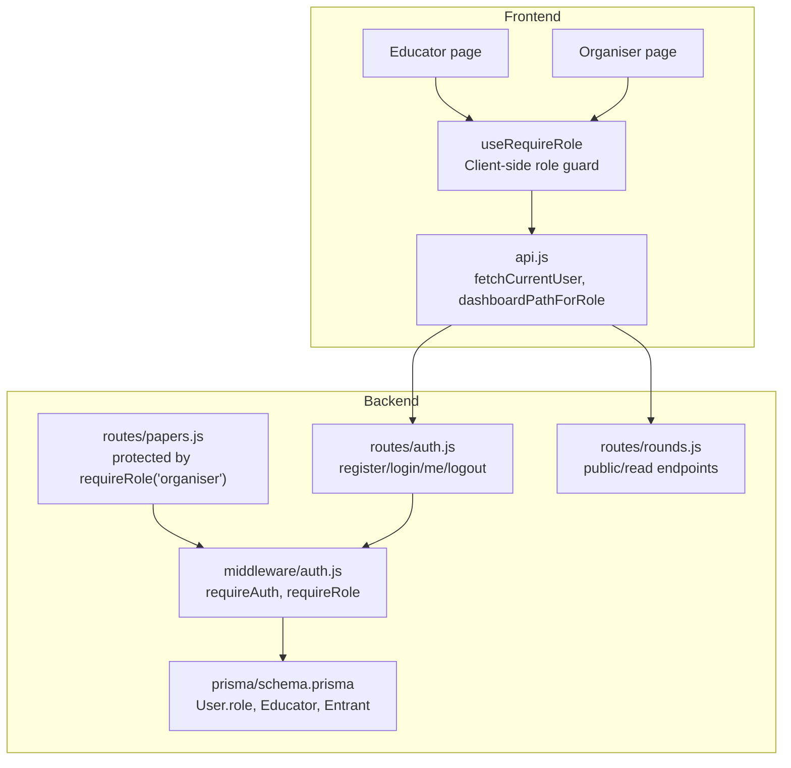
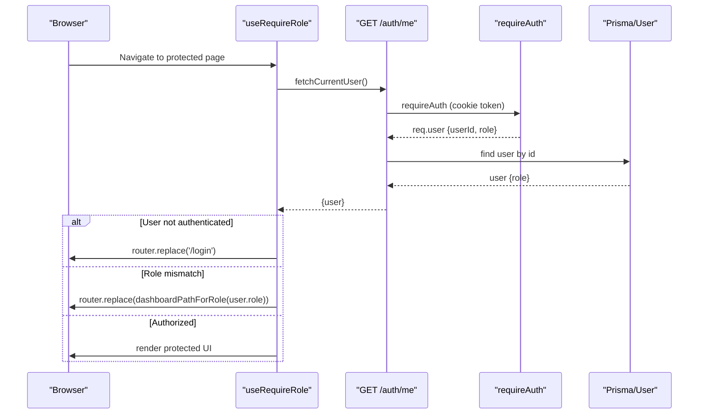
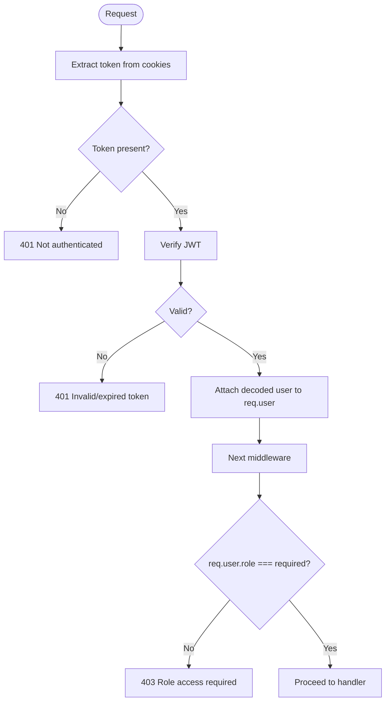
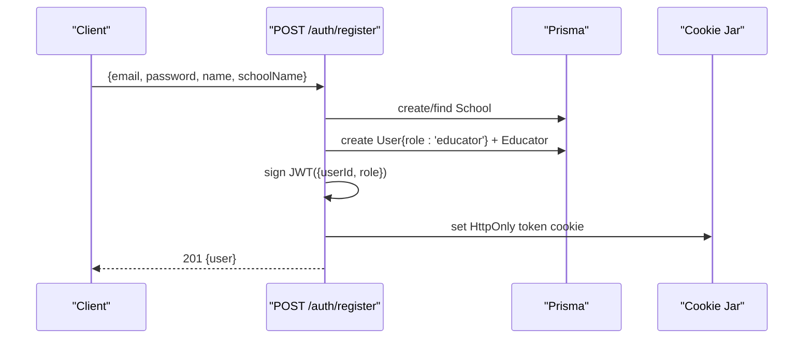
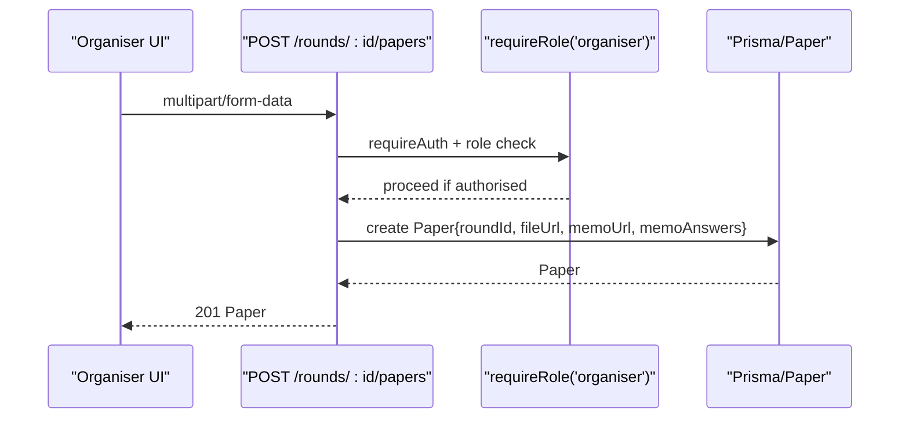
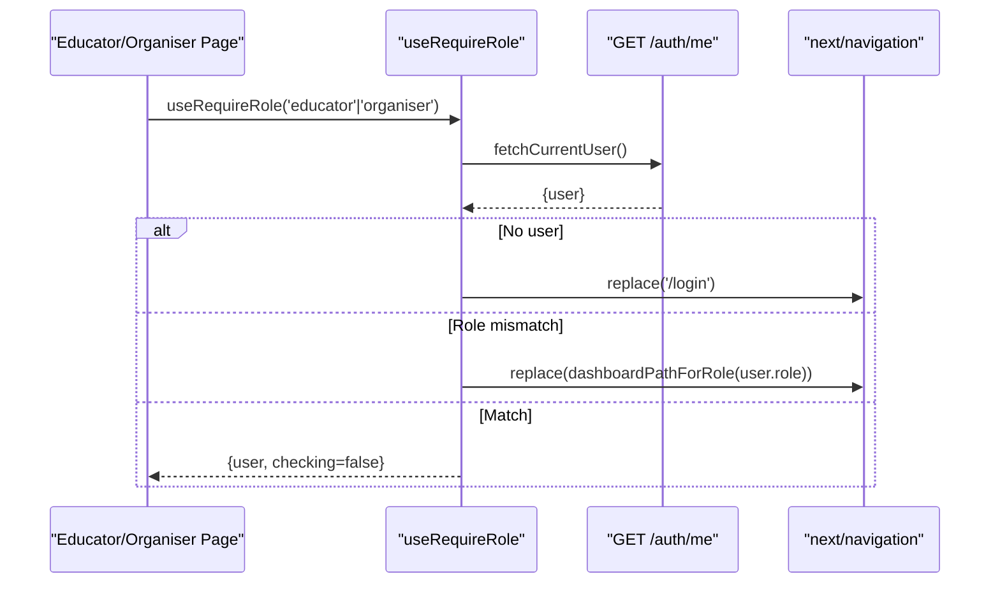
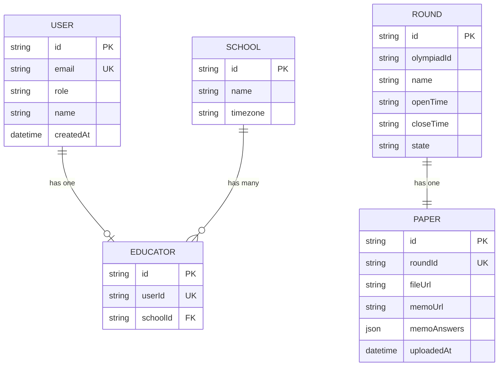
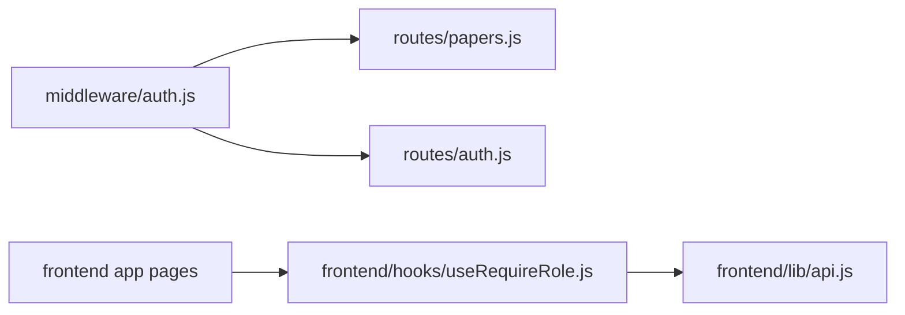

# Role-Based Access Control

<cite>
**Referenced Files in This Document**
- [auth.js](file://backend/src/middleware/auth.js)
- [auth.test.js](file://backend/src/middleware/auth.test.js)
- [auth.js](file://backend/src/routes/auth.js)
- [papers.js](file://backend/src/routes/papers.js)
- [rounds.js](file://backend/src/routes/rounds.js)
- [schema.prisma](file://backend/prisma/schema.prisma)
- [useRequireRole.js](file://frontend/src/hooks/useRequireRole.js)
- [useAuthRedirect.js](file://frontend/src/hooks/useAuthRedirect.js)
- [api.js](file://frontend/src/lib/api.js)
- [page.js (Educator)](file://frontend/src/app/educator/page.js)
- [page.js (Organiser)](file://frontend/src/app/organiser/page.js)
</cite>

## Table of Contents
1. Introduction
2. Project Structure
3. Core Components
4. Architecture Overview
5. Detailed Component Analysis
6. Dependency Analysis
7. Performance Considerations
8. Troubleshooting Guide
9. Conclusion
10. Appendices

## Introduction
This document explains the role-based access control (RBAC) system for educators, organisers, and students. It covers:
- The role hierarchy and permission model
- How roles are assigned during registration
- Backend authorization via requireRole middleware
- Frontend role checking with useRequireRole hook and navigation guards
- Examples of route protection and API endpoint checks
- Guidance on extending roles, inheritance patterns, permission scoping, and best practices for fine-grained access control

## Project Structure
The RBAC implementation spans backend middleware, routes, database schema, and frontend hooks/pages:
- Backend middleware enforces authentication and role checks
- Routes apply role guards to protected endpoints
- Database schema stores user roles and relationships
- Frontend hooks enforce client-side role checks and redirect users based on their role

**Diagram sources**
- [useRequireRole.js:7-37](file://frontend/src/hooks/useRequireRole.js#L7-L37)
- [api.js:128-145](file://frontend/src/lib/api.js#L128-L145)
- [auth.js:5-34](file://backend/src/middleware/auth.js#L5-L34)
- [auth.js:23-138](file://backend/src/routes/auth.js#L23-L138)
- [papers.js:25-67](file://backend/src/routes/papers.js#L25-L67)
- [schema.prisma:31-40](file://backend/prisma/schema.prisma#L31-L40)

**Section sources**
- [auth.js:5-34](file://backend/src/middleware/auth.js#L5-L34)
- [auth.js:23-138](file://backend/src/routes/auth.js#L23-L138)
- [papers.js:25-67](file://backend/src/routes/papers.js#L25-L67)
- [schema.prisma:31-40](file://backend/prisma/schema.prisma#L31-L40)
- [useRequireRole.js:7-37](file://frontend/src/hooks/useRequireRole.js#L7-L37)
- [api.js:128-145](file://frontend/src/lib/api.js#L128-L145)

## Core Components
- Backend authentication and authorization middleware:
  - requireAuth validates JWT from cookies and attaches decoded user to req.user
  - requireRole returns a two-middleware array that first authenticates, then checks req.user.role against the required role
- Registration and login routes:
  - POST /auth/register creates an educator account and sets a secure cookie token
  - POST /auth/login authenticates and issues a token cookie
  - GET /auth/me returns current user info including role
- Protected resource routes:
  - POST /rounds/:id/papers is guarded by requireRole('organiser')
- Frontend role guard:
  - useRequireRole fetches current user, redirects unauthenticated or mismatched-role users, and exposes user/checking state
- Navigation helpers:
  - dashboardPathForRole maps roles to dashboards (/educator, /organiser)

**Section sources**
- [auth.js:5-34](file://backend/src/middleware/auth.js#L5-L34)
- [auth.js:23-138](file://backend/src/routes/auth.js#L23-L138)
- [papers.js:25-67](file://backend/src/routes/papers.js#L25-L67)
- [useRequireRole.js:7-37](file://frontend/src/hooks/useRequireRole.js#L7-L37)
- [api.js:128-145](file://frontend/src/lib/api.js#L128-L145)

## Architecture Overview
The RBAC flow combines server-side JWT validation with role checks and client-side navigation guards.

**Diagram sources**
- [useRequireRole.js:12-35](file://frontend/src/hooks/useRequireRole.js#L12-L35)
- [api.js:128-135](file://frontend/src/lib/api.js#L128-L135)
- [auth.js:5-20](file://backend/src/middleware/auth.js#L5-L20)
- [auth.js:134-138](file://backend/src/routes/auth.js#L134-L138)

## Detailed Component Analysis

### Backend Authorization Middleware
- requireAuth:
  - Reads token from cookies
  - Verifies JWT using environment secret
  - Attaches decoded payload to req.user
  - Returns 401 if missing or invalid
- requireRole(role):
  - Returns an array of two middleware functions:
    - First: requireAuth
    - Second: compares req.user.role to required role; returns 403 if mismatch

**Diagram sources**
- [auth.js:5-34](file://backend/src/middleware/auth.js#L5-L34)

**Section sources**
- [auth.js:5-34](file://backend/src/middleware/auth.js#L5-L34)
- [auth.test.js:57-109](file://backend/src/middleware/auth.test.js#L57-L109)

### Registration and Role Assignment
- POST /auth/register:
  - Validates input fields
  - Creates school if needed
  - Creates user with role hardcoded to 'educator'
  - Creates associated Educator profile linked to School
  - Issues JWT with userId and role, sets HttpOnly cookie
- POST /auth/login:
  - Authenticates user and issues JWT cookie
- GET /auth/me:
  - Returns current user including role for client-side decisions

**Diagram sources**
- [auth.js:23-71](file://backend/src/routes/auth.js#L23-L71)

**Section sources**
- [auth.js:23-71](file://backend/src/routes/auth.js#L23-L71)
- [schema.prisma:31-57](file://backend/prisma/schema.prisma#L31-L57)

### Protected Route Example: Paper Upload
- POST /rounds/:id/papers:
  - Guarded by requireRole('organiser')
  - Requires both paper and memo files
  - Saves file URLs and optional memoAnswers to Paper record

**Diagram sources**
- [papers.js:25-67](file://backend/src/routes/papers.js#L25-L67)
- [auth.js:22-32](file://backend/src/middleware/auth.js#L22-L32)

**Section sources**
- [papers.js:25-67](file://backend/src/routes/papers.js#L25-L67)

### Frontend Role Checking and Navigation Guards
- useRequireRole(requiredRole):
  - Fetches current user via /auth/me
  - Redirects to /login if not authenticated
  - Redirects to role-appropriate dashboard if role mismatch
  - Exposes {user, checking} for components to render safely
- dashboardPathForRole:
  - Maps 'organiser' -> '/organiser', 'educator' -> '/educator', else '/login'
- Pages:
  - Educator and Organiser pages call useRequireRole to gate access and display content

**Diagram sources**
- [useRequireRole.js:7-37](file://frontend/src/hooks/useRequireRole.js#L7-L37)
- [api.js:128-145](file://frontend/src/lib/api.js#L128-L145)
- [page.js (Educator):9-11](file://frontend/src/app/educator/page.js#L9-L11)
- [page.js (Organiser):11-13](file://frontend/src/app/organiser/page.js#L11-L13)

**Section sources**
- [useRequireRole.js:7-37](file://frontend/src/hooks/useRequireRole.js#L7-L37)
- [api.js:128-145](file://frontend/src/lib/api.js#L128-L145)
- [page.js (Educator):9-11](file://frontend/src/app/educator/page.js#L9-L11)
- [page.js (Organiser):11-13](file://frontend/src/app/organiser/page.js#L11-L13)

### Data Model and Role Context
- User has a role field used for authorization decisions
- Educator and Entrant models provide context for ownership and participation
- Round state controls resource availability (e.g., paper downloads)

**Diagram sources**
- [schema.prisma:31-77](file://backend/prisma/schema.prisma#L31-L77)

**Section sources**
- [schema.prisma:31-77](file://backend/prisma/schema.prisma#L31-L77)

## Dependency Analysis
- Middleware dependency chain:
  - requireRole depends on requireAuth
  - Protected routes depend on requireRole
- Frontend dependencies:
  - useRequireRole depends on api.fetchCurrentUser and dashboardPathForRole
  - Pages depend on useRequireRole to gate rendering and navigation

**Diagram sources**
- [auth.js:5-34](file://backend/src/middleware/auth.js#L5-L34)
- [papers.js:25-67](file://backend/src/routes/papers.js#L25-L67)
- [auth.js:23-138](file://backend/src/routes/auth.js#L23-L138)
- [useRequireRole.js:7-37](file://frontend/src/hooks/useRequireRole.js#L7-L37)
- [api.js:128-145](file://frontend/src/lib/api.js#L128-L145)

**Section sources**
- [auth.js:5-34](file://backend/src/middleware/auth.js#L5-L34)
- [papers.js:25-67](file://backend/src/routes/papers.js#L25-L67)
- [auth.js:23-138](file://backend/src/routes/auth.js#L23-L138)
- [useRequireRole.js:7-37](file://frontend/src/hooks/useRequireRole.js#L7-L37)
- [api.js:128-145](file://frontend/src/lib/api.js#L128-L145)

## Performance Considerations
- Token verification cost:
  - Each protected request verifies JWT; ensure JWT_SECRET is stable and tokens are short-lived where appropriate
- Cookie handling:
  - HttpOnly, Secure, SameSite flags reduce XSS risk and improve security posture
- Frontend redirects:
  - useRequireRole performs a single network call per protected page; consider caching user session locally if needed, but keep it in sync with server auth state
- Resource gating:
  - Combine role checks with resource-level checks (e.g., round state) to avoid unnecessary processing

[No sources needed since this section provides general guidance]

## Troubleshooting Guide
Common issues and resolutions:
- 401 Not authenticated:
  - Missing or expired cookie token; verify login flow and cookie settings
- 401 Invalid or expired token:
  - JWT verification failed; check JWT_SECRET configuration and token expiry
- 403 Role access required:
  - User role does not match required role; confirm registration assigns expected role and update requireRole usage accordingly
- Frontend stuck on loading:
  - useRequireRole may be waiting for /auth/me; ensure API base URL and credentials are correct
- Dashboard redirection loops:
  - Ensure dashboardPathForRole returns correct paths and that pages do not re-trigger redirects unintentionally

**Section sources**
- [auth.js:5-20](file://backend/src/middleware/auth.js#L5-L20)
- [auth.js:22-32](file://backend/src/middleware/auth.js#L22-L32)
- [api.js:128-145](file://frontend/src/lib/api.js#L128-L145)

## Conclusion
The RBAC system uses a simple but effective model:
- Roles are stored on the User entity and enforced server-side via requireRole middleware
- Frontend uses useRequireRole to protect pages and navigate users appropriately
- Protected routes like paper uploads restrict access to organisers
To extend the system:
- Add new roles in registration and assign them consistently
- Create new requireRole checks for protected endpoints
- Update dashboardPathForRole and any UI guards to handle new roles
- For fine-grained permissions, add resource-level checks (e.g., ownership, round state) alongside role checks

[No sources needed since this section summarizes without analyzing specific files]

## Appendices

### Extending the System with New Roles
- Define role constants and update registration logic to accept or derive roles
- Add new requireRole checks to protected routes
- Update frontend routing and dashboard mapping
- Test with unit tests similar to existing requireRole tests

**Section sources**
- [auth.js:22-32](file://backend/src/middleware/auth.js#L22-L32)
- [auth.test.js:57-109](file://backend/src/middleware/auth.test.js#L57-L109)
- [api.js:141-145](file://frontend/src/lib/api.js#L141-L145)

### Role Inheritance Patterns
Current implementation uses exact role matching. To support inheritance:
- Introduce a roles array or capability tags on User
- Implement a helper to check if a user’s capabilities include required permissions
- Apply at middleware level to allow multiple roles or hierarchical permissions

[No sources needed since this section proposes conceptual enhancements]

### Permission Scoping and Fine-Grained Access Control
- Combine role checks with resource ownership:
  - e.g., only the creator of a round can upload its paper
- Use round state to gate actions:
  - e.g., papers downloadable only when round is open or released
- Scope data queries by user context:
  - e.g., educators see only rounds tied to their school

**Section sources**
- [papers.js:70-96](file://backend/src/routes/papers.js#L70-L96)
- [schema.prisma:31-77](file://backend/prisma/schema.prisma#L31-L77)