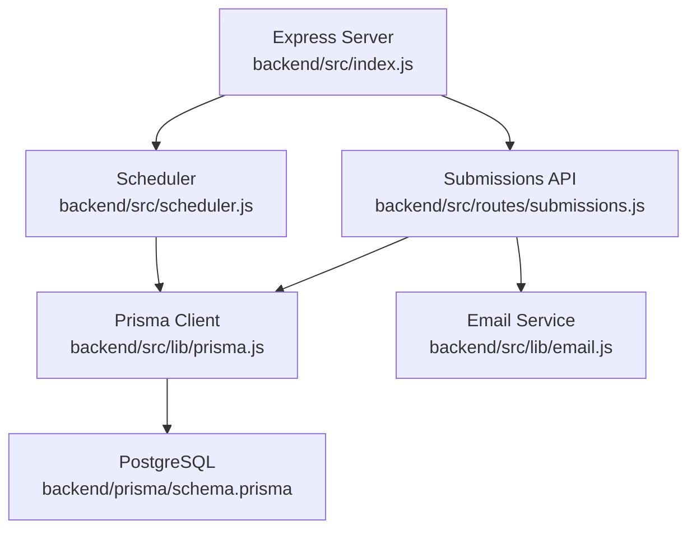
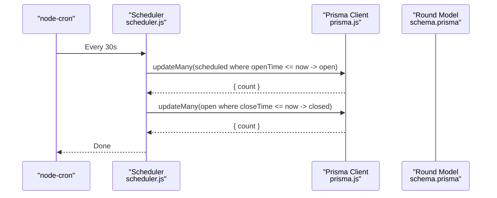
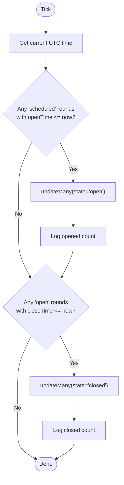
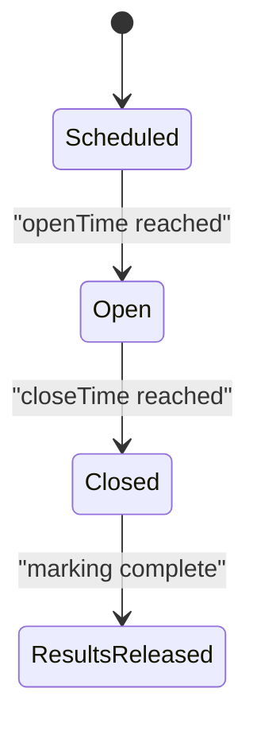
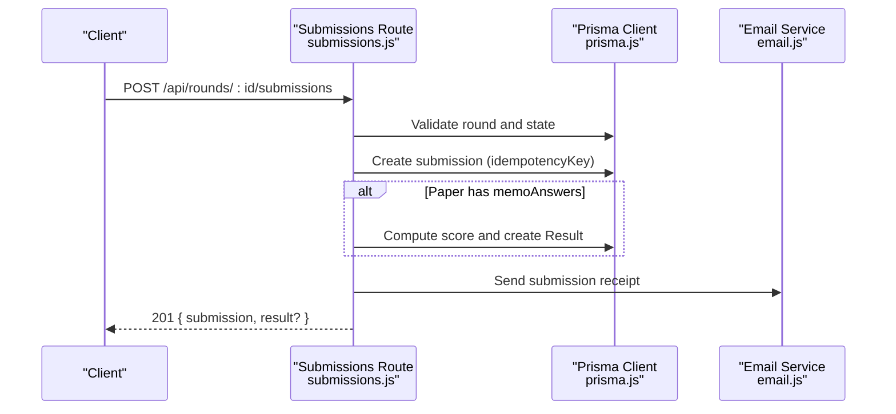
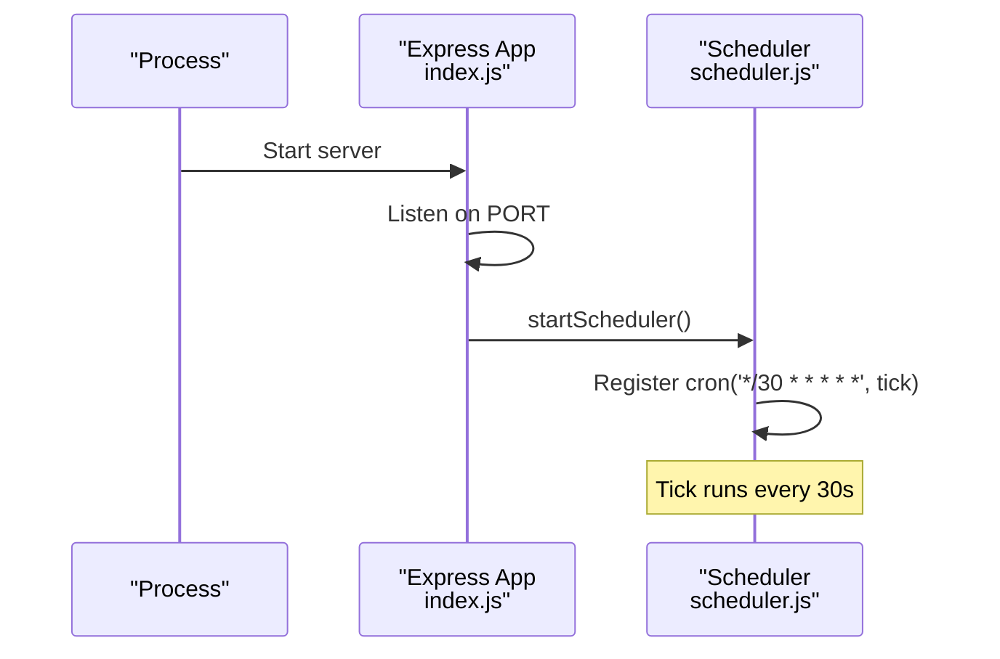
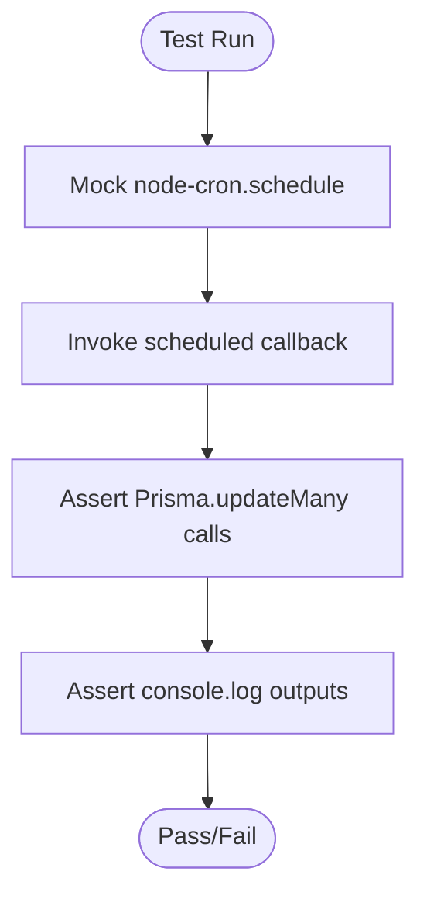
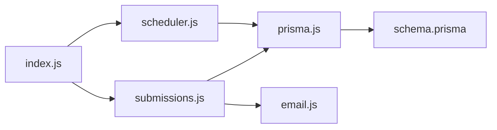

# Background Jobs & Scheduling

<cite>
**Referenced Files in This Document**
- [scheduler.js](file://backend/src/scheduler.js)
- [scheduler.test.js](file://backend/src/scheduler.test.js)
- [index.js](file://backend/src/index.js)
- [schema.prisma](file://backend/prisma/schema.prisma)
- [prisma.js](file://backend/src/lib/prisma.js)
- [email.js](file://backend/src/lib/email.js)
- [submissions.js](file://backend/src/routes/submissions.js)
- [round-lifecycle.md](file://documents/docs/round-lifecycle.md)
- [test-setup.js](file://backend/src/test-setup.js)
</cite>

## Table of Contents
1. [Introduction](#introduction)
2. [Project Structure](#project-structure)
3. [Core Components](#core-components)
4. [Architecture Overview](#architecture-overview)
5. [Detailed Component Analysis](#detailed-component-analysis)
6. [Dependency Analysis](#dependency-analysis)
7. [Performance Considerations](#performance-considerations)
8. [Troubleshooting Guide](#troubleshooting-guide)
9. [Conclusion](#conclusion)
10. [Appendices](#appendices)

## Introduction
This document explains the background jobs and scheduling system used by the Olympiad Portal to manage time-sensitive tasks, primarily round state transitions (scheduled → open → closed) and automated scoring for submissions. It covers how the scheduler is configured, how jobs are defined and executed, error handling and retry strategies, monitoring and logging, testing approaches with mocks, and scaling considerations for high-volume scenarios.

## Project Structure
The scheduling subsystem lives in the backend:
- The Express server starts the scheduler on boot.
- A cron-based job runs every 30 seconds to transition rounds based on openTime and closeTime.
- Automated scoring occurs at submission time when a memo answer key exists.
- Email receipts are sent asynchronously after submission.



**Diagram sources**
- [index.js:1-43](file://backend/src/index.js#L1-L43)
- [scheduler.js:1-29](file://backend/src/scheduler.js#L1-L29)
- [prisma.js:1-6](file://backend/src/lib/prisma.js#L1-L6)
- [schema.prisma:18-29](file://backend/prisma/schema.prisma#L18-L29)
- [submissions.js:1-76](file://backend/src/routes/submissions.js#L1-L76)
- [email.js:1-23](file://backend/src/lib/email.js#L1-L23)

**Section sources**
- [index.js:1-43](file://backend/src/index.js#L1-L43)
- [scheduler.js:1-29](file://backend/src/scheduler.js#L1-L29)
- [schema.prisma:18-29](file://backend/prisma/schema.prisma#L18-L29)
- [submissions.js:1-76](file://backend/src/routes/submissions.js#L1-L76)
- [email.js:1-23](file://backend/src/lib/email.js#L1-L23)

## Core Components
- Cron Scheduler: Uses node-cron to run a recurring task every 30 seconds that updates round states based on current time.
- Round State Machine: Rounds move from scheduled to open when openTime has passed, and from open to closed when closeTime has passed.
- Automated Scoring: When a paper includes memo answers, submissions are scored immediately upon creation.
- Email Receipts: After submission, an email receipt is sent to the requester.

Key responsibilities:
- Scheduler: Time-driven state transitions only; no manual intervention required.
- Submissions route: Validates input, enforces round state, persists submissions, automarks if possible, sends receipts.
- Email module: Sends receipts via SendGrid with graceful error logging.

**Section sources**
- [scheduler.js:1-29](file://backend/src/scheduler.js#L1-L29)
- [submissions.js:1-76](file://backend/src/routes/submissions.js#L1-L76)
- [email.js:1-23](file://backend/src/lib/email.js#L1-L23)
- [round-lifecycle.md:5-41](file://documents/docs/round-lifecycle.md#L5-L41)

## Architecture Overview
The system uses a polling model driven by a single cron job. There is no distributed job queue or message broker. All state transitions and scoring logic execute within the same process.



**Diagram sources**
- [scheduler.js:4-23](file://backend/src/scheduler.js#L4-L23)
- [prisma.js:1-6](file://backend/src/lib/prisma.js#L1-L6)
- [schema.prisma:18-29](file://backend/prisma/schema.prisma#L18-L29)

## Detailed Component Analysis

### Cron Scheduler
- Schedule expression: Runs every 30 seconds.
- Logic:
  - Opens all rounds in state scheduled whose openTime is less than or equal to the current time.
  - Closes all rounds in state open whose closeTime is less than or equal to the current time.
- Logging: Logs counts when any rounds are opened or closed.
- Startup: Logged when the scheduler starts.



**Diagram sources**
- [scheduler.js:4-23](file://backend/src/scheduler.js#L4-L23)

**Section sources**
- [scheduler.js:1-29](file://backend/src/scheduler.js#L1-L29)

### Round Lifecycle and State Transitions
- States: scheduled → open → closed → results released.
- Transition triggers:
  - scheduled → open when openTime has passed.
  - open → closed when closeTime has passed.
- Timezone policy: All comparisons use UTC timestamps stored in the database.



**Diagram sources**
- [round-lifecycle.md:11-21](file://documents/docs/round-lifecycle.md#L11-L21)
- [schema.prisma:18-29](file://backend/prisma/schema.prisma#L18-L29)

**Section sources**
- [round-lifecycle.md:5-41](file://documents/docs/round-lifecycle.md#L5-L41)
- [schema.prisma:18-29](file://backend/prisma/schema.prisma#L18-L29)

### Automated Scoring and Submission Flow
- Validation: Ensures required fields are present.
- Round gating: Only accepts submissions when round state is open.
- Persistence: Creates a submission record with idempotency protection.
- Automark: If the paper contains memo answers, scores are computed immediately and stored.
- Notification: Sends a submission receipt email asynchronously.



**Diagram sources**
- [submissions.js:8-76](file://backend/src/routes/submissions.js#L8-L76)
- [email.js:5-20](file://backend/src/lib/email.js#L5-L20)
- [prisma.js:1-6](file://backend/src/lib/prisma.js#L1-L6)

**Section sources**
- [submissions.js:1-76](file://backend/src/routes/submissions.js#L1-L76)
- [email.js:1-23](file://backend/src/lib/email.js#L1-L23)

### Job Queue Management, Error Handling, and Retry Mechanisms
- Current implementation: No explicit job queue or retry mechanism. The scheduler executes inline and relies on Prisma’s transactional guarantees for bulk updates.
- Error handling:
  - Scheduler logs counts but does not wrap operations in try/catch blocks.
  - Email sending wraps errors and logs them without throwing.
  - Submissions route handles duplicate key errors for idempotency and returns appropriate responses.
- Recommendations for production:
  - Introduce a resilient job queue (e.g., BullMQ, Redis-backed) for scoring and notifications.
  - Add exponential backoff retries for transient failures (network timeouts, rate limits).
  - Centralize structured logging and metrics collection.

**Section sources**
- [scheduler.js:4-23](file://backend/src/scheduler.js#L4-L23)
- [email.js:14-20](file://backend/src/lib/email.js#L14-L20)
- [submissions.js:32-76](file://backend/src/routes/submissions.js#L32-L76)

### Scheduler Configuration and Execution Patterns
- Cron expression: Every 30 seconds.
- Execution context: Single-process Node.js server started by index.js.
- Dependencies: Prisma client connected to PostgreSQL.
- Startup: Scheduler is initialized when the server starts listening.



**Diagram sources**
- [index.js:34-40](file://backend/src/index.js#L34-L40)
- [scheduler.js:4-23](file://backend/src/scheduler.js#L4-L23)

**Section sources**
- [index.js:1-43](file://backend/src/index.js#L1-L43)
- [scheduler.js:1-29](file://backend/src/scheduler.js#L1-L29)

### Monitoring and Logging Strategies
- Current logging:
  - Scheduler logs startup and counts when rounds are opened or closed.
  - Email service logs success and failure messages.
- Observability recommendations:
  - Replace console logs with structured logging (e.g., JSON logs with timestamps, levels, and context).
  - Emit metrics (counters, histograms) for:
    - Number of rounds opened/closed per tick.
    - Submission throughput and automark latency.
    - Email send success/failure rates.
  - Use health checks exposing scheduler uptime and last successful tick timestamp.

**Section sources**
- [scheduler.js:12-25](file://backend/src/scheduler.js#L12-L25)
- [email.js:14-19](file://backend/src/lib/email.js#L14-L19)

### Testing Approaches and Mock Implementations
- Unit tests:
  - Scheduler behavior is tested by mocking node-cron and Prisma.
  - Tests verify cron registration, startup log, and correct updateMany calls for opening and closing rounds.
  - Tests assert logging behavior for non-zero counts and absence of logs for zero counts.
- Test setup:
  - Environment variables for JWT and SendGrid are set before modules load.



**Diagram sources**
- [scheduler.test.js:17-111](file://backend/src/scheduler.test.js#L17-L111)
- [test-setup.js:1-4](file://backend/src/test-setup.js#L1-L4)

**Section sources**
- [scheduler.test.js:1-112](file://backend/src/scheduler.test.js#L1-L112)
- [test-setup.js:1-4](file://backend/src/test-setup.js#L1-L4)

### Scaling Considerations, Job Prioritization, and Resource Management
- Current limitations:
  - Single-process scheduler cannot scale horizontally without shared state and leader election.
  - Bulk updates run synchronously; heavy workloads may block subsequent ticks.
- Scaling options:
  - Horizontal scaling: Use a distributed scheduler (e.g., Kubernetes CronJobs) or a queue with worker pools to ensure exactly-once execution.
  - Database optimization: Ensure indexes on round.state, round.openTime, and round.closeTime to speed up updateMany queries.
  - Batch size control: Consider chunked updates to avoid long-running transactions under high contention.
- Prioritization:
  - Separate critical path tasks (state transitions) from lower-priority tasks (emails, reporting) using queues with priority levels.
- Resource management:
  - Enforce timeouts on external calls (email, storage).
  - Rate-limit outbound requests to third-party services.
  - Monitor memory and CPU usage; auto-scale workers based on queue depth.

[No sources needed since this section provides general guidance]

## Dependency Analysis
The scheduler depends on node-cron and Prisma. The Express app wires the scheduler into the application lifecycle. Submissions depend on Prisma and optionally trigger email sending.



**Diagram sources**
- [index.js:1-43](file://backend/src/index.js#L1-L43)
- [scheduler.js:1-29](file://backend/src/scheduler.js#L1-L29)
- [prisma.js:1-6](file://backend/src/lib/prisma.js#L1-L6)
- [schema.prisma:18-29](file://backend/prisma/schema.prisma#L18-L29)
- [submissions.js:1-76](file://backend/src/routes/submissions.js#L1-L76)
- [email.js:1-23](file://backend/src/lib/email.js#L1-L23)

**Section sources**
- [index.js:1-43](file://backend/src/index.js#L1-L43)
- [scheduler.js:1-29](file://backend/src/scheduler.js#L1-L29)
- [submissions.js:1-76](file://backend/src/routes/submissions.js#L1-L76)
- [email.js:1-23](file://backend/src/lib/email.js#L1-L23)

## Performance Considerations
- Polling interval: 30 seconds balances responsiveness and database load. For very large datasets, consider tuning this interval or switching to event-driven triggers.
- Query efficiency: Ensure proper indexing on state and time fields to minimize scan costs during updateMany operations.
- Idempotency: Submission endpoint uses idempotency keys to prevent duplicates; extend similar patterns to other background tasks.
- External dependencies: Email sending is fire-and-forget with error logging; consider queuing retries for reliability.

[No sources needed since this section provides general guidance]

## Troubleshooting Guide
Common issues and diagnostics:
- Rounds not transitioning:
  - Verify openTime/closeTime values are in UTC and correctly set.
  - Check scheduler logs for “Opened” or “Closed” messages.
  - Confirm database connectivity and Prisma client initialization.
- Emails not sent:
  - Check SENDGRID_API_KEY and SENDGRID_FROM_EMAIL configuration.
  - Review error logs for SendGrid failures.
- Duplicate submissions:
  - Ensure unique idempotencyKey is provided per submission attempt.
  - Inspect P2002 constraint errors handled in the submissions route.

**Section sources**
- [scheduler.js:12-25](file://backend/src/scheduler.js#L12-L25)
- [email.js:14-19](file://backend/src/lib/email.js#L14-L19)
- [submissions.js:32-76](file://backend/src/routes/submissions.js#L32-L76)

## Conclusion
The Olympiad Portal implements a simple, effective cron-based scheduler for round state transitions and integrates automated scoring at submission time. While sufficient for current scale, production deployments should adopt a robust job queue, structured logging, metrics, and horizontal scaling strategies to handle high-volume scenarios reliably.

[No sources needed since this section summarizes without analyzing specific files]

## Appendices

### Data Models Relevant to Scheduling and Scoring
```mermaid
erDiagram
ROUND {
string id PK
string olympiadId FK
string name
datetime openTime
datetime closeTime
string state
}
SUBMISSION {
string id PK
string roundId FK
string entrantId FK
json answers
string idempotencyKey UK
datetime submittedAt
}
RESULT {
string id PK
string submissionId UK FK
float score
datetime releasedAt
}
ROUND ||--o{ SUBMISSION : "has many"
SUBMISSION ||--o| RESULT : "has one"
```

**Diagram sources**
- [schema.prisma:18-29](file://backend/prisma/schema.prisma#L18-L29)
- [schema.prisma:79-97](file://backend/prisma/schema.prisma#L79-L97)