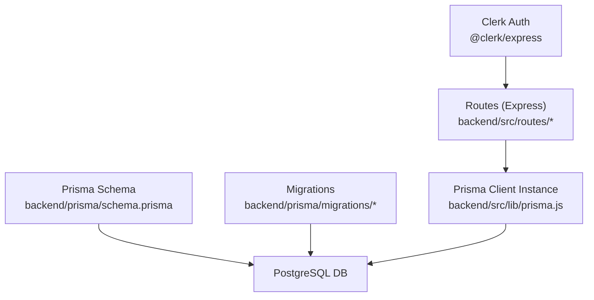
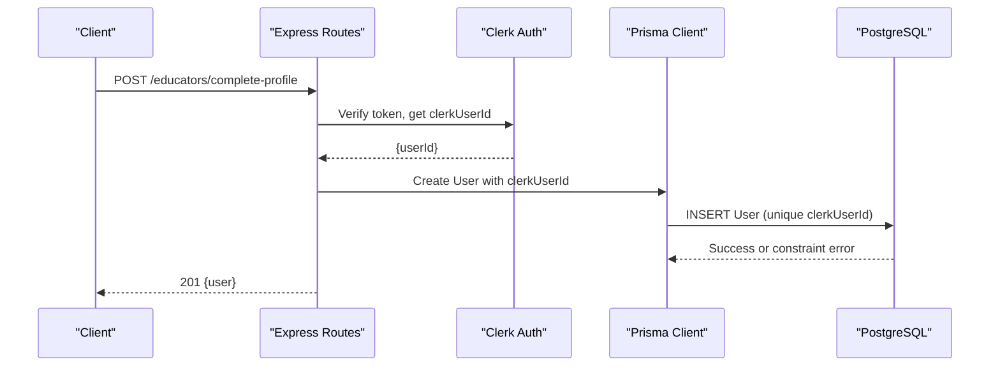
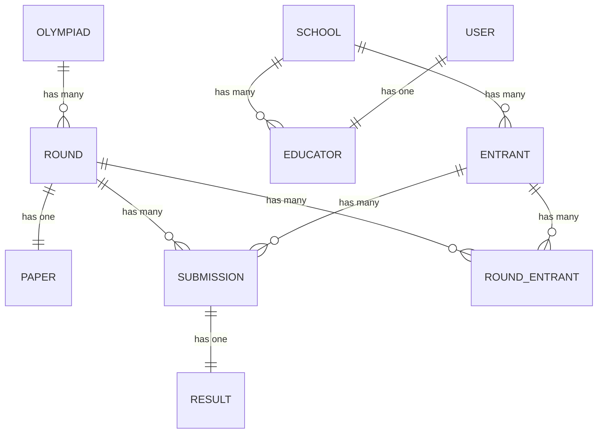
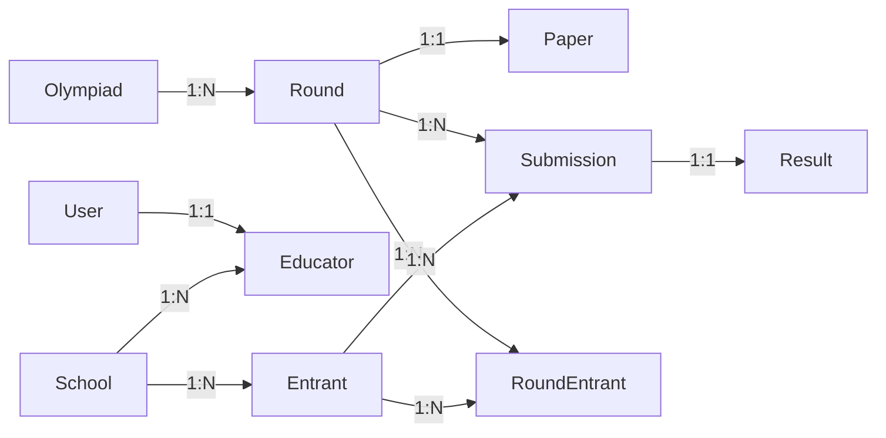

# Database Schema

<cite>
**Referenced Files in This Document**
- [schema.prisma](file://backend/prisma/schema.prisma)
- [20260806183319_init_round_olympiad/migration.sql](file://backend/prisma/migrations/20260806183319_init_round_olympiad/migration.sql)
- [20260806192201_add_remaining_tables/migration.sql](file://backend/prisma/migrations/20260806192201_add_remaining_tables/migration.sql)
- [20260811072329_add_memo_answers_to_paper/migration.sql](file://backend/prisma/migrations/20260811072329_add_memo_answers_to_paper/migration.sql)
- [20260815093922_add_round_entrant/migration.sql](file://backend/prisma/migrations/20260815093922_add_round_entrant/migration.sql)
- [20260818102056_add_name_to_user/migration.sql](file://backend/prisma/migrations/20260818102056_add_name_to_user/migration.sql)
- [20260822164203_clerk_migration_user_model/migration.sql](file://backend/prisma/migrations/20260822164203_clerk_migration_user_model/migration.sql)
- [prisma.js](file://backend/src/lib/prisma.js)
- [submissions.js](file://backend/src/routes/submissions.js)
- [papers.js](file://backend/src/routes/papers.js)
- [rounds.js](file://backend/src/routes/rounds.js)
- [auth.js](file://backend/src/routes/auth.js)
</cite>

## Update Summary
**Changes Made**
- Updated User model documentation to reflect Clerk authentication integration
- Removed references to passwordHash field and added clerkUserId as primary identifier
- Updated authentication flow documentation to show Clerk-based authentication
- Added new migration section for Clerk migration
- Updated data validation rules to reflect external password management

## Table of Contents
1. Introduction
2. Project Structure
3. Core Components
4. Architecture Overview
5. Detailed Component Analysis
6. Dependency Analysis
7. Performance Considerations
8. Troubleshooting Guide
9. Conclusion
10. Appendices

## Introduction
This document provides comprehensive database schema documentation for the Olympiad Portal using Prisma and PostgreSQL. It details all models, fields, data types, relationships, constraints, indexes, migration strategy, validation rules, referential integrity, performance considerations, and common query patterns via Prisma Client. The system now uses Clerk for authentication, eliminating local password management.

## Project Structure
The database schema is defined in a single Prisma schema file and evolved through versioned migrations. The backend uses a shared Prisma client instance to interact with the database across routes, with Clerk handling authentication externally.

**Diagram sources**
- [schema.prisma:1-108](file://backend/prisma/schema.prisma#L1-L108)
- [prisma.js:1-6](file://backend/src/lib/prisma.js#L1-L6)
- [auth.js:1-102](file://backend/src/routes/auth.js#L1-L102)

**Section sources**
- [schema.prisma:1-108](file://backend/prisma/schema.prisma#L1-L108)
- [prisma.js:1-6](file://backend/src/lib/prisma.js#L1-L6)

## Core Components
The database models represent the core entities of the Olympiad Portal:
- Olympiad: Represents an overall competition event.
- Round: A time-bound assessment within an Olympiad.
- User: System user account with role-based access, authenticated via Clerk.
- School: Institution associated with educators and entrants.
- Educator: Links a User to a School.
- Entrant: Student participant linked to a School.
- Paper: Assessment materials and memo answers for a Round.
- Submission: Participant's answers for a Round.
- Result: Score derived from a Submission.
- RoundEntrant: Many-to-many bridge between Round and Entrant.

Key relationships and constraints are enforced by Prisma relations and database foreign keys. Unique constraints ensure data integrity (e.g., unique email per User, unique clerkUserId, one Paper per Round, idempotent submissions).

**Section sources**
- [schema.prisma:11-108](file://backend/prisma/schema.prisma#L11-L108)
- [20260806192201_add_remaining_tables/migration.sql:1-109](file://backend/prisma/migrations/20260806192201_add_remaining_tables/migration.sql#L1-L109)

## Architecture Overview
The system follows a layered architecture with Clerk-based authentication:
- API Layer (Express routes) validates input and orchestrates business logic.
- Authentication Layer (Clerk middleware) handles user authentication and session management.
- Data Access Layer (Prisma Client) executes typed queries against PostgreSQL.
- Storage Layer (PostgreSQL) enforces schema, constraints, and indexes.

**Diagram sources**
- [auth.js:9-59](file://backend/src/routes/auth.js#L9-L59)
- [schema.prisma:31-39](file://backend/prisma/schema.prisma#L31-L39)
- [20260822164203_clerk_migration_user_model/migration.sql:1-15](file://backend/prisma/migrations/20260822164203_clerk_migration_user_model/migration.sql#L1-L15)

## Detailed Component Analysis

### Entity Relationship Diagram

**Diagram sources**
- [schema.prisma:11-108](file://backend/prisma/schema.prisma#L11-L108)
- [20260806183319_init_round_olympiad/migration.sql:1-24](file://backend/prisma/migrations/20260806183319_init_round_olympiad/migration.sql#L1-L24)
- [20260806192201_add_remaining_tables/migration.sql:1-109](file://backend/prisma/migrations/20260806192201_add_remaining_tables/migration.sql#L1-L109)
- [20260815093922_add_round_entrant/migration.sql:1-19](file://backend/prisma/migrations/20260815093922_add_round_entrant/migration.sql#L1-L19)

### Model Definitions and Relationships

- Olympiad
  - Fields: id (UUID PK), name (string), timezone (string)
  - Relations: One-to-many with Round
  - Constraints: Primary key on id

- Round
  - Fields: id (UUID PK), olympiadId (FK to Olympiad), name (string), openTime (datetime), closeTime (datetime), state (string default "scheduled")
  - Relations: Belongs to Olympiad; optional Paper; One-to-many Submissions; One-to-many RoundEntrant
  - Constraints: FK to Olympiad; cascade updates; restrict deletes

- User
  - Fields: id (UUID PK), clerkUserId (unique string), email (unique), role (string), createdAt (datetime), name (string)
  - Relations: One-to-one with Educator
  - Constraints: Unique clerkUserId and email; not null name after migration
  - **Updated**: Uses Clerk authentication instead of local password management

- School
  - Fields: id (UUID PK), name (string), timezone (string), createdAt (datetime)
  - Relations: One-to-many Educators; One-to-many Entrants
  - Constraints: Primary key on id

- Educator
  - Fields: id (UUID PK), userId (unique FK to User), schoolId (FK to School)
  - Relations: Belongs to User and School
  - Constraints: Unique userId; FKs with restrict delete/cascade update

- Entrant
  - Fields: id (UUID PK), schoolId (FK to School), name (string), grade (string)
  - Relations: Belongs to School; One-to-many Submissions; One-to-many RoundEntrant
  - Constraints: FK to School with restrict delete/cascade update

- Paper
  - Fields: id (UUID PK), roundId (unique FK to Round), fileUrl (string), memoUrl (string), uploadedAt (datetime), memoAnswers (JSON nullable)
  - Relations: Belongs to Round
  - Constraints: Unique roundId; FK to Round with restrict delete/cascade update

- Submission
  - Fields: id (UUID PK), roundId (FK to Round), entrantId (FK to Entrant), answers (JSON), idempotencyKey (unique), submittedAt (datetime)
  - Relations: Belongs to Round and Entrant; One-to-one Result
  - Constraints: FKs with restrict delete/cascade update; unique idempotencyKey

- Result
  - Fields: id (UUID PK), submissionId (unique FK to Submission), score (float), releasedAt (datetime nullable)
  - Relations: Belongs to Submission
  - Constraints: Unique submissionId; FK to Submission with restrict delete/cascade update

- RoundEntrant
  - Fields: id (UUID PK), roundId (FK to Round), entrantId (FK to Entrant), registeredAt (datetime)
  - Relations: Belongs to Round and Entrant
  - Constraints: Composite unique (roundId, entrantId); FKs with restrict delete/cascade update

**Section sources**
- [schema.prisma:11-108](file://backend/prisma/schema.prisma#L11-L108)
- [20260806183319_init_round_olympiad/migration.sql:1-24](file://backend/prisma/migrations/20260806183319_init_round_olympiad/migration.sql#L1-L24)
- [20260806192201_add_remaining_tables/migration.sql:1-109](file://backend/prisma/migrations/20260806192201_add_remaining_tables/migration.sql#L1-L109)
- [20260811072329_add_memo_answers_to_paper/migration.sql:1-3](file://backend/prisma/migrations/20260811072329_add_memo_answers_to_paper/migration.sql#L1-L3)
- [20260815093922_add_round_entrant/migration.sql:1-19](file://backend/prisma/migrations/20260815093922_add_round_entrant/migration.sql#L1-L19)
- [20260818102056_add_name_to_user/migration.sql:1-3](file://backend/prisma/migrations/20260818102056_add_name_to_user/migration.sql#L1-L3)
- [20260822164203_clerk_migration_user_model/migration.sql:1-15](file://backend/prisma/migrations/20260822164203_clerk_migration_user_model/migration.sql#L1-L15)

### Indexes and Constraints
- Primary Keys: All models use UUID primary keys.
- Unique Constraints:
  - User.clerkUserId (newly added for Clerk integration)
  - User.email
  - Educator.userId
  - Paper.roundId
  - Submission.idempotencyKey
  - Result.submissionId
  - RoundEntrant(roundId, entrantId) composite unique
- Foreign Keys:
  - Round.olympiadId -> Olympiad.id
  - Educator.userId -> User.id
  - Educator.schoolId -> School.id
  - Entrant.schoolId -> School.id
  - Paper.roundId -> Round.id
  - Submission.roundId -> Round.id
  - Submission.entrantId -> Entrant.id
  - Result.submissionId -> Submission.id
  - RoundEntrant.roundId -> Round.id
  - RoundEntrant.entrantId -> Entrant.id
- Default Values:
  - Round.state defaults to "scheduled"
  - Timestamps created at insertion where applicable

**Section sources**
- [20260806192201_add_remaining_tables/migration.sql:74-109](file://backend/prisma/migrations/20260806192201_add_remaining_tables/migration.sql#L74-L109)
- [20260815093922_add_round_entrant/migration.sql:11-19](file://backend/prisma/migrations/20260815093922_add_round_entrant/migration.sql#L11-L19)
- [20260822164203_clerk_migration_user_model/migration.sql:13-15](file://backend/prisma/migrations/20260822164203_clerk_migration_user_model/migration.sql#L13-L15)

### Migration Strategy and Version Management
- Migrations are stored under backend/prisma/migrations with descriptive timestamps and names.
- Evolution steps:
  - Initialize Olympiad and Round tables and their relationship.
  - Add remaining tables (User, School, Educator, Entrant, Paper, Submission, Result) and constraints.
  - Add memoAnswers JSON column to Paper.
  - Introduce RoundEntrant bridge table with composite unique index.
  - Add name column to User and backfill default values.
  - **New**: Migrate from passwordHash to clerkUserId for Clerk authentication integration.
- Versioning approach:
  - Each migration is a separate folder with SQL script.
  - Use Prisma migrate commands to apply changes consistently across environments.
  - Lock file ensures deterministic dependency resolution.

**Section sources**
- [20260806183319_init_round_olympiad/migration.sql:1-24](file://backend/prisma/migrations/20260806183319_init_round_olympiad/migration.sql#L1-L24)
- [20260806192201_add_remaining_tables/migration.sql:1-109](file://backend/prisma/migrations/20260806192201_add_remaining_tables/migration.sql#L1-L109)
- [20260811072329_add_memo_answers_to_paper/migration.sql:1-3](file://backend/prisma/migrations/20260811072329_add_memo_answers_to_paper/migration.sql#L1-L3)
- [20260815093922_add_round_entrant/migration.sql:1-19](file://backend/prisma/migrations/20260815093922_add_round_entrant/migration.sql#L1-L19)
- [20260818102056_add_name_to_user/migration.sql:1-3](file://backend/prisma/migrations/20260818102056_add_name_to_user/migration.sql#L1-L3)
- [20260822164203_clerk_migration_user_model/migration.sql:1-15](file://backend/prisma/migrations/20260822164203_clerk_migration_user_model/migration.sql#L1-L15)

### Data Validation Rules and Business Constraints
- Input validation in routes:
  - Required fields validated before DB writes (e.g., name/schoolName for educator profile completion; olympiadId/name/openTime/closeTime for rounds; entrantId/answers/idempotencyKey for submissions).
  - Time ordering enforced: closeTime must be after openTime when creating rounds.
  - Round state checks: submissions only accepted when round.state == "open".
  - Paper availability: downloadable only when round.state is "open" or "released".
- Referential integrity:
  - Enforced via foreign keys with RESTRICT on delete and CASCADE on update.
  - Unique constraints prevent duplicate emails, duplicate clerkUserId values, duplicate papers per round, duplicate results per submission, and duplicate round entrant registrations.
- Idempotency:
  - Submission creation uses a unique idempotencyKey to prevent duplicate submissions. Duplicate attempts return existing submission and result if present.
- **Updated**: Authentication now handled by Clerk - no local password validation required.

**Section sources**
- [auth.js:9-59](file://backend/src/routes/auth.js#L9-L59)
- [rounds.js:32-51](file://backend/src/routes/rounds.js#L32-L51)
- [submissions.js:8-86](file://backend/src/routes/submissions.js#L8-L86)
- [papers.js:25-99](file://backend/src/routes/papers.js#L25-L99)

### Query Optimization Patterns and Caching Strategies
- Query patterns observed:
  - Include related entities efficiently (e.g., include paper with round; include result with submission).
  - Filter by roundId and order by openTime for listing rounds.
  - Use findUnique for single-entity lookups by id, email, or clerkUserId.
- Index usage:
  - Unique indexes on clerkUserId, email, userId, roundId, idempotencyKey, submissionId, and composite (roundId, entrantId) accelerate lookups and enforce uniqueness.
- Caching recommendations:
  - Cache round metadata and paper URLs for open/released rounds to reduce repeated DB reads.
  - Cache user profile and role information per session/token payload.
  - Consider caching memoAnswers for auto-marking to avoid repeated JSON parsing and comparisons.
- Transactional safety:
  - For complex operations involving multiple writes (e.g., creating submission and result), wrap in transactions to ensure consistency.

[No sources needed since this section provides general guidance]

### Common Queries and Data Access Patterns Using Prisma Client
- Complete educator profile with Clerk authentication:
  - Extract clerkUserId from Clerk auth context; create User with clerkUserId, email from Clerk; create Educator linking User and School; include nested relations for response.
- Get current user profile:
  - Extract clerkUserId from Clerk auth context; find User by clerkUserId with included Educator and School relations.
- Create round with time bounds:
  - Validate openTime < closeTime; create Round with FK to Olympiad.
- Submit answers with idempotency:
  - Check round state; create Submission with unique idempotencyKey; if memoAnswers exist, compute score and create Result; handle duplicate key errors gracefully.
- Retrieve round and paper:
  - Fetch Round by id with included Paper; check round state to allow download; return paper record if available.
- List rounds and submissions:
  - Order rounds by openTime; list submissions for a round including results.

**Section sources**
- [auth.js:9-59](file://backend/src/routes/auth.js#L9-L59)
- [auth.js:62-83](file://backend/src/routes/auth.js#L62-L83)
- [rounds.js:32-87](file://backend/src/routes/rounds.js#L32-L87)
- [submissions.js:8-86](file://backend/src/routes/submissions.js#L8-L86)
- [papers.js:25-99](file://backend/src/routes/papers.js#L25-L99)

## Dependency Analysis
The database schema dependencies are modeled via Prisma relations and enforced by PostgreSQL foreign keys.

**Diagram sources**
- [schema.prisma:11-108](file://backend/prisma/schema.prisma#L11-L108)
- [20260806192201_add_remaining_tables/migration.sql:89-109](file://backend/prisma/migrations/20260806192201_add_remaining_tables/migration.sql#L89-L109)
- [20260815093922_add_round_entrant/migration.sql:14-19](file://backend/prisma/migrations/20260815093922_add_round_entrant/migration.sql#L14-L19)

**Section sources**
- [schema.prisma:11-108](file://backend/prisma/schema.prisma#L11-L108)
- [20260806192201_add_remaining_tables/migration.sql:89-109](file://backend/prisma/migrations/20260806192201_add_remaining_tables/migration.sql#L89-L109)
- [20260815093922_add_round_entrant/migration.sql:14-19](file://backend/prisma/migrations/20260815093922_add_round_entrant/migration.sql#L14-L19)

## Performance Considerations
- Use selective includes to avoid over-fetching related data.
- Leverage unique indexes for fast lookups (clerkUserId, email, roundId, idempotencyKey).
- Batch operations where possible to reduce round trips.
- Consider read replicas for heavy read workloads (e.g., listing rounds and papers).
- Monitor slow queries and add additional indexes if necessary (e.g., frequently filtered columns like round.state).
- Store large files externally and keep only URLs in the database to minimize storage overhead.
- **Updated**: Clerk authentication reduces database load by handling authentication separately.

[No sources needed since this section provides general guidance]

## Troubleshooting Guide
- Duplicate submission attempts:
  - Error code P2002 indicates unique constraint violation on idempotencyKey; return existing submission and result.
- Invalid memoAnswers JSON:
  - Parse errors should be caught and returned as 400 with clear messages.
- Round state restrictions:
  - Ensure round.state is "open" for submissions; otherwise return 403 with explanatory message.
- Missing resources:
  - Return 404 when round, paper, or user not found.
- Authentication and authorization:
  - Validate roles via Clerk middleware; ensure JWT token presence and validity.
- **Updated**: Clerk integration issues - verify clerkUserId exists and email retrieval works properly.

**Section sources**
- [submissions.js:75-85](file://backend/src/routes/submissions.js#L75-L85)
- [papers.js:43-50](file://backend/src/routes/papers.js#L43-L50)
- [submissions.js:26-30](file://backend/src/routes/submissions.js#L26-L30)
- [papers.js:79-93](file://backend/src/routes/papers.js#L79-L93)
- [auth.js:22-28](file://backend/src/routes/auth.js#L22-L28)

## Conclusion
The Olympiad Portal's database schema is well-structured with clear entity relationships, robust constraints, and thoughtful indexing. The migration to Clerk authentication eliminates local password management while maintaining secure user identification through clerkUserId. Migrations provide a controlled evolution path, while route-level validations and business rules enforce operational integrity. Following the recommended query patterns and caching strategies will help maintain performance as the system scales.

[No sources needed since this section summarizes without analyzing specific files]

## Appendices

### Appendix A: Field Reference Summary
- Olympiad: id (UUID PK), name (string), timezone (string)
- Round: id (UUID PK), olympiadId (FK), name (string), openTime (datetime), closeTime (datetime), state (string default "scheduled")
- User: id (UUID PK), clerkUserId (unique string), email (unique), role (string), createdAt (datetime), name (string)
- School: id (UUID PK), name (string), timezone (string), createdAt (datetime)
- Educator: id (UUID PK), userId (unique FK), schoolId (FK)
- Entrant: id (UUID PK), schoolId (FK), name (string), grade (string)
- Paper: id (UUID PK), roundId (unique FK), fileUrl (string), memoUrl (string), uploadedAt (datetime), memoAnswers (JSON nullable)
- Submission: id (UUID PK), roundId (FK), entrantId (FK), answers (JSON), idempotencyKey (unique), submittedAt (datetime)
- Result: id (UUID PK), submissionId (unique FK), score (float), releasedAt (datetime nullable)
- RoundEntrant: id (UUID PK), roundId (FK), entrantId (FK), registeredAt (datetime)

**Section sources**
- [schema.prisma:11-108](file://backend/prisma/schema.prisma#L11-L108)

### Appendix B: Example Prisma Client Usage Paths
- Educator profile completion with Clerk: [auth.js:9-59](file://backend/src/routes/auth.js#L9-L59)
- Get current user profile: [auth.js:62-83](file://backend/src/routes/auth.js#L62-L83)
- Round creation: [rounds.js:32-51](file://backend/src/routes/rounds.js#L32-L51)
- Submission with auto-marking: [submissions.js:8-86](file://backend/src/routes/submissions.js#L8-L86)
- Paper upload and retrieval: [papers.js:25-99](file://backend/src/routes/papers.js#L25-L99)
- Listing rounds and submissions: [rounds.js:53-113](file://backend/src/routes/rounds.js#L53-L113)

**Section sources**
- [auth.js:9-59](file://backend/src/routes/auth.js#L9-L59)
- [auth.js:62-83](file://backend/src/routes/auth.js#L62-L83)
- [rounds.js:32-113](file://backend/src/routes/rounds.js#L32-L113)
- [submissions.js:8-86](file://backend/src/routes/submissions.js#L8-L86)
- [papers.js:25-99](file://backend/src/routes/papers.js#L25-L99)