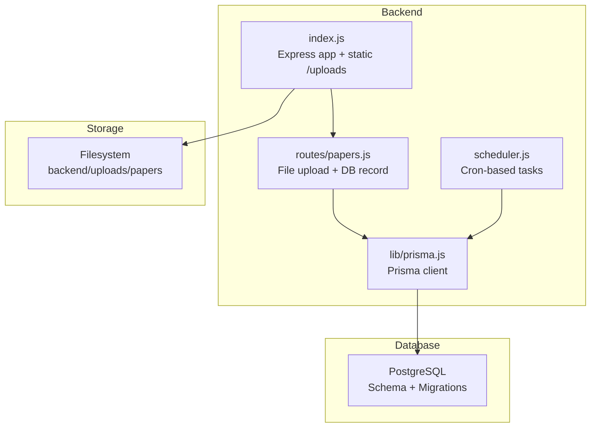
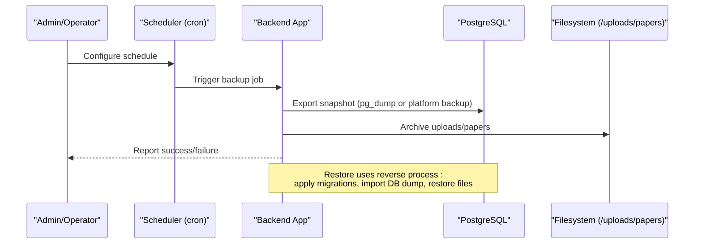
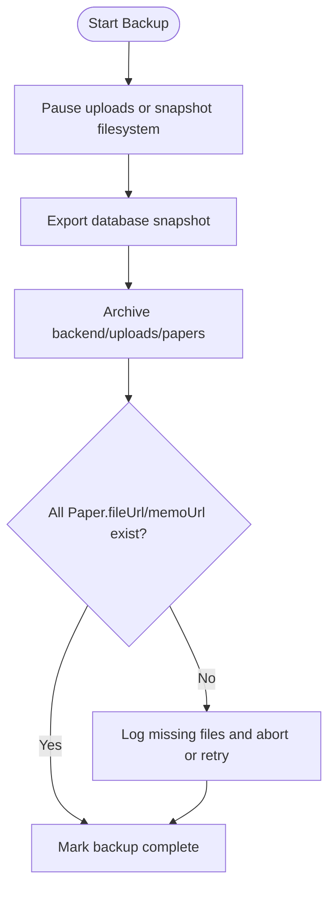
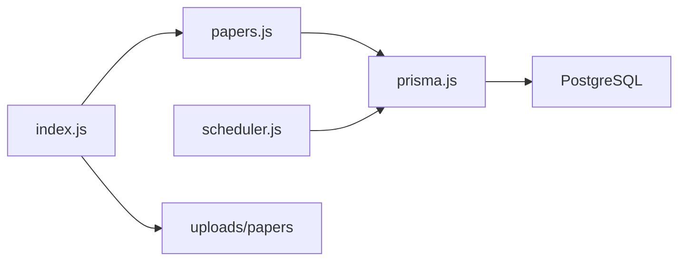

# Backup & Recovery

<cite>
**Referenced Files in This Document**
- [schema.prisma](file://backend/prisma/schema.prisma)
- [20260806183319_init_round_olympiad/migration.sql](file://backend/prisma/migrations/20260806183319_init_round_olympiad/migration.sql)
- [20260806192201_add_remaining_tables/migration.sql](file://backend/prisma/migrations/20260806192201_add_remaining_tables/migration.sql)
- [20260811072329_add_memo_answers_to_paper/migration.sql](file://backend/prisma/migrations/20260811072329_add_memo_answers_to_paper/migration.sql)
- [20260815093922_add_round_entrant/migration.sql](file://backend/prisma/migrations/20260815093922_add_round_entrant/migration.sql)
- [migration_lock.toml](file://backend/prisma/migrations/migration_lock.toml)
- [prisma.js](file://backend/src/lib/prisma.js)
- [index.js](file://backend/src/index.js)
- [papers.js](file://backend/src/routes/papers.js)
- [scheduler.js](file://backend/src/scheduler.js)
- [SKILL.md (Prisma Postgres)](file://backend/.agents/skills/prisma-postgres/SKILL.md)
</cite>

## Table of Contents
1. Introduction
2. Project Structure
3. Core Components
4. Architecture Overview
5. Detailed Component Analysis
6. Dependency Analysis
7. Performance Considerations
8. Troubleshooting Guide
9. Conclusion
10. Appendices

## Introduction
This document defines backup and recovery procedures for the Olympiad Portal with a focus on:
- Database backups using Prisma migrations and PostgreSQL capabilities
- Automated backup scheduling and retention policies
- File upload backups for paper documents and memo answers
- Disaster recovery planning, including restoration, rollback strategies, and business continuity
- Testing procedures for backup validation and recovery drills
- Data integrity verification and consistency checks during backup operations

The goal is to ensure that both structured data (PostgreSQL) and unstructured data (uploaded files) are protected and can be restored reliably under failure scenarios.

## Project Structure
Key areas relevant to backup and recovery:
- Database schema and migrations define the structure and evolution of the relational data
- The backend serves static uploads and persists file references in the database
- A scheduler runs periodic tasks; this pattern can be extended for automated backups
- Prisma Postgres skills reference platform-level backup commands available through Prisma’s managed service



**Diagram sources**
- [index.js:1-43](file://backend/src/index.js#L1-L43)
- [papers.js:1-99](file://backend/src/routes/papers.js#L1-L99)
- [prisma.js:1-6](file://backend/src/lib/prisma.js#L1-L6)
- [scheduler.js:1-29](file://backend/src/scheduler.js#L1-L29)

**Section sources**
- [index.js:1-43](file://backend/src/index.js#L1-L43)
- [papers.js:1-99](file://backend/src/routes/papers.js#L1-L99)
- [prisma.js:1-6](file://backend/src/lib/prisma.js#L1-L6)
- [scheduler.js:1-29](file://backend/src/scheduler.js#L1-L29)

## Core Components
- Database schema and models: Defines entities such as Olympiad, Round, Paper, Submission, Result, User, School, Educator, Entrant, RoundEntrant. These are versioned via Prisma migrations.
- File uploads: Papers and memos are stored on disk under backend/uploads/papers and referenced by URLs in the Paper model.
- Scheduler: A cron-based task runner that updates round states; provides a template for scheduling backups.
- Prisma Postgres skills: Reference platform-level backup listing and management commands for managed databases.

**Section sources**
- [schema.prisma:11-109](file://backend/prisma/schema.prisma#L11-L109)
- [papers.js:12-67](file://backend/src/routes/papers.js#L12-L67)
- [scheduler.js:4-26](file://backend/src/scheduler.js#L4-L26)
- [SKILL.md (Prisma Postgres):70-84](file://backend/.agents/skills/prisma-postgres/SKILL.md#L70-L84)

## Architecture Overview
Backup and recovery spans two domains:
- Database backups: Use Prisma-managed PostgreSQL backups where available, or native PostgreSQL tools, combined with migration scripts for schema reconstruction.
- File backups: Snapshot the uploads directory and maintain metadata consistency with the Paper table records.



[No sources needed since this diagram shows conceptual workflow, not actual code structure]

## Detailed Component Analysis

### Database Backup Strategy Using Prisma Migrations
- Schema versioning: All schema changes are captured in migration SQL files under prisma/migrations. These enable deterministic reconstruction of the database structure.
- Data snapshots: For production, use the managed database provider’s backup features referenced in the Prisma Postgres skill, or run pg_dump against the live database at consistent points in time.
- Migration-driven restore: To rebuild from scratch, apply migrations in order to reconstruct schema before importing data.

Operational notes:
- Keep migration_lock.toml under version control to pin the provider and avoid drift.
- Ensure DATABASE_URL is configured securely in your environment to allow CLI tools to connect when performing dumps/restores.

**Section sources**
- [20260806183319_init_round_olympiad/migration.sql:1-24](file://backend/prisma/migrations/20260806183319_init_round_olympiad/migration.sql#L1-L24)
- [20260806192201_add_remaining_tables/migration.sql:1-109](file://backend/prisma/migrations/20260806192201_add_remaining_tables/migration.sql#L1-L109)
- [20260811072329_add_memo_answers_to_paper/migration.sql:1-3](file://backend/prisma/migrations/20260811072329_add_memo_answers_to_paper/migration.sql#L1-L3)
- [20260815093922_add_round_entrant/migration.sql:1-19](file://backend/prisma/migrations/20260815093922_add_round_entrant/migration.sql#L1-L19)
- [migration_lock.toml:1-3](file://backend/prisma/migrations/migration_lock.toml#L1-L3)
- [SKILL.md (Prisma Postgres):70-84](file://backend/.agents/skills/prisma-postgres/SKILL.md#L70-L84)

### Automated Backup Scheduling and Retention Policies
- Scheduling: Extend the existing scheduler to run periodic backup jobs. The current scheduler demonstrates how to schedule recurring tasks using node-cron.
- Retention: Define a policy for keeping N daily, weekly, and monthly backups. Implement cleanup logic to remove older archives based on retention windows.
- Reliability: Add logging and alerting around backup success/failure.

Implementation guidance:
- Create a new scheduled task that triggers database export and filesystem archival.
- Integrate with external storage (e.g., object storage) for offsite copies.
- Enforce retention by scanning archive directories and deleting expired items.

**Section sources**
- [scheduler.js:1-29](file://backend/src/scheduler.js#L1-L29)

### File Upload Backup Procedures
- Storage location: Uploaded papers and memos are written to backend/uploads/papers and served statically via Express.
- Metadata: The Paper model stores fileUrl and memoUrl pointing to these files. Any backup must include both the files and the database records to maintain referential integrity.
- Procedure:
  - Stop writes temporarily or use a consistent snapshot approach to avoid partial uploads.
  - Archive the uploads/papers directory.
  - Capture a database snapshot.
  - Verify that every fileUrl/memoUrl in Paper exists in the archive.



[No sources needed since this diagram shows conceptual workflow, not actual code structure]

**Section sources**
- [papers.js:12-67](file://backend/src/routes/papers.js#L12-L67)
- [index.js:26-27](file://backend/src/index.js#L26-L27)
- [schema.prisma:69-77](file://backend/prisma/schema.prisma#L69-L77)

### Disaster Recovery Planning
- Restoration steps:
  - Rebuild schema using migrations.
  - Import the latest validated database snapshot.
  - Restore uploaded files to backend/uploads/papers.
  - Validate that all Paper.fileUrl and Paper.memoUrl resolve to existing files.
- Rollback strategy:
  - Maintain tagged backups per release or major change.
  - If a deployment causes issues, revert application code and restore the corresponding database snapshot and file set.
- Business continuity:
  - Keep backups in multiple locations (on-prem and cloud).
  - Define RTO/RPO targets and test regularly.
  - Document runbooks for common failure modes (data corruption, accidental deletion, provider outage).

**Section sources**
- [20260806192201_add_remaining_tables/migration.sql:1-109](file://backend/prisma/migrations/20260806192201_add_remaining_tables/migration.sql#L1-L109)
- [papers.js:12-67](file://backend/src/routes/papers.js#L12-L67)

### Testing Procedures for Backup Validation and Recovery Drills
- Unit tests: Validate that backup scripts correctly enumerate files and database rows.
- Integration tests: Perform end-to-end restore in an isolated environment and verify application functionality.
- Drills: Schedule periodic recovery drills to validate RTO/RPO and operator readiness.
- Checklists: Include steps to verify data integrity after restore (counts, checksums, sample queries).

[No sources needed since this section provides general guidance]

### Data Integrity Verification and Consistency Checks
- Database integrity:
  - After restore, run schema validation and key constraint checks.
  - Compare row counts for critical tables (Round, Paper, Submission, Result) against known baselines.
- File integrity:
  - Verify that each Paper.fileUrl and Paper.memoUrl points to an existing file in the restored uploads directory.
  - Optionally compute checksums during backup and compare on restore.
- Cross-checks:
  - Ensure no orphaned file references exist.
  - Confirm that submissions and results are linked to valid rounds and entrants.

**Section sources**
- [schema.prisma:69-97](file://backend/prisma/schema.prisma#L69-L97)
- [20260806192201_add_remaining_tables/migration.sql:41-109](file://backend/prisma/migrations/20260806192201_add_remaining_tables/migration.sql#L41-L109)

## Dependency Analysis
Backup and recovery depend on:
- Prisma client configuration for database connectivity
- Static file serving for uploads
- Scheduler for automation
- Migration scripts for schema reconstruction



**Diagram sources**
- [papers.js:1-99](file://backend/src/routes/papers.js#L1-L99)
- [prisma.js:1-6](file://backend/src/lib/prisma.js#L1-L6)
- [scheduler.js:1-29](file://backend/src/scheduler.js#L1-L29)
- [index.js:1-43](file://backend/src/index.js#L1-L43)

**Section sources**
- [papers.js:1-99](file://backend/src/routes/papers.js#L1-L99)
- [prisma.js:1-6](file://backend/src/lib/prisma.js#L1-L6)
- [scheduler.js:1-29](file://backend/src/scheduler.js#L1-L29)
- [index.js:1-43](file://backend/src/index.js#L1-L43)

## Performance Considerations
- Schedule backups during low-traffic windows to minimize impact.
- Use incremental backups if supported by your database provider to reduce load.
- Compress and offload backups to remote storage to free local disk space.
- Avoid running heavy backup jobs concurrently with peak submission periods.

[No sources needed since this section provides general guidance]

## Troubleshooting Guide
Common issues and mitigations:
- Missing uploads after restore:
  - Verify that Paper.fileUrl and Paper.memoUrl match restored filenames.
  - Re-run file inventory checks and re-upload any missing files.
- Database schema mismatch:
  - Apply all migrations in order and confirm schema matches expectations.
- Backup failures:
  - Inspect logs from the scheduler and backup jobs.
  - Ensure credentials and network access are correct for database and storage targets.
- Orphaned file references:
  - Identify Paper entries without corresponding files and remediate.

**Section sources**
- [papers.js:33-67](file://backend/src/routes/papers.js#L33-L67)
- [20260806192201_add_remaining_tables/migration.sql:41-109](file://backend/prisma/migrations/20260806192201_add_remaining_tables/migration.sql#L41-L109)

## Conclusion
A robust backup and recovery strategy for the Olympiad Portal combines:
- Version-controlled migrations for schema reconstruction
- Regular database snapshots leveraging Prisma-managed backups or native tools
- Filesystem archival of uploads/papers with metadata consistency checks
- Automated scheduling, retention policies, and regular recovery drills
- Clear runbooks and integrity verification to ensure reliable restoration

Adhering to these practices minimizes downtime and protects critical competition data.

## Appendices

### Appendix A: Key Data Models Relevant to Backups
```mermaid
erDiagram
ROUND {
string id PK
string name
datetime openTime
datetime closeTime
string state
}
PAPER {
string id PK
string roundId FK
string fileUrl
string memoUrl
datetime uploadedAt
json memoAnswers
}
SUBMISSION {
string id PK
string roundId FK
string entrantId FK
json answers
string idempotencyKey UK
datetime submittedAt
}
RESULT {
string id PK
string submissionId FK UK
float score
datetime releasedAt
}
ROUND ||--o{ PAPER : "has one"
ROUND ||--o{ SUBMISSION : "has many"
SUBMISSION ||--|| RESULT : "has one"
```

**Diagram sources**
- [schema.prisma:18-97](file://backend/prisma/schema.prisma#L18-L97)