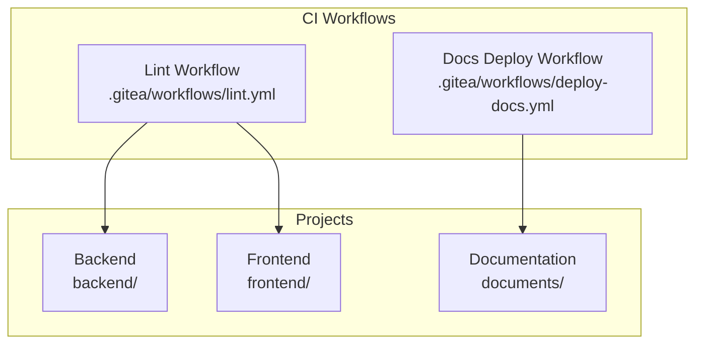
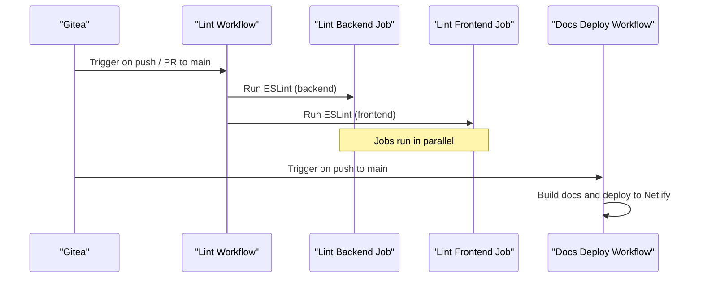
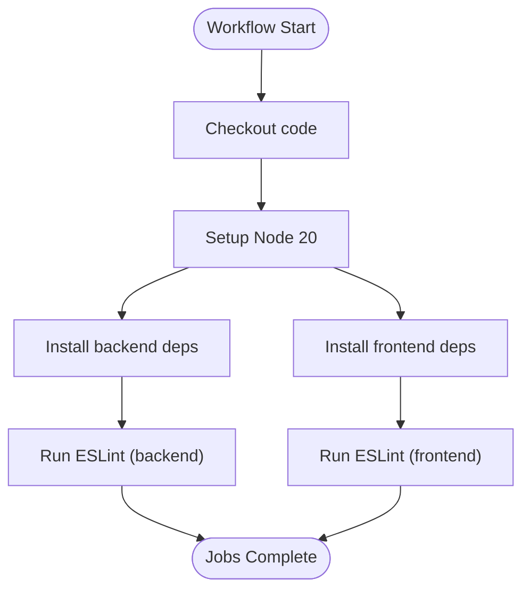
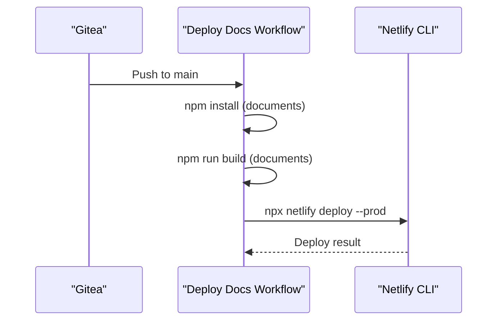
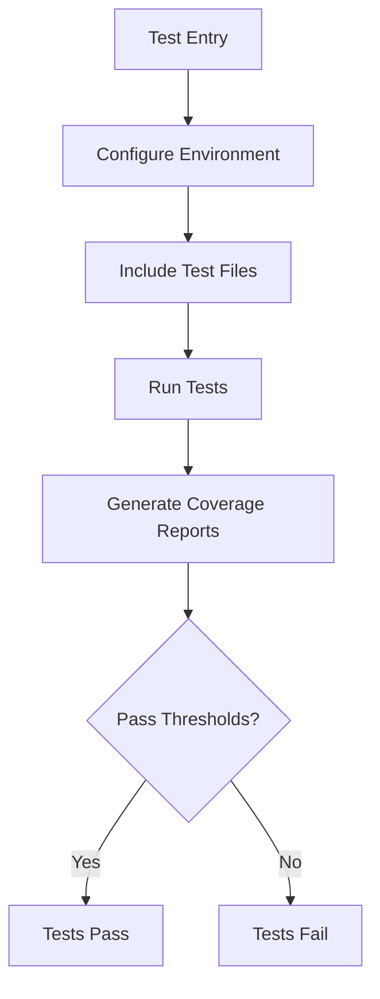
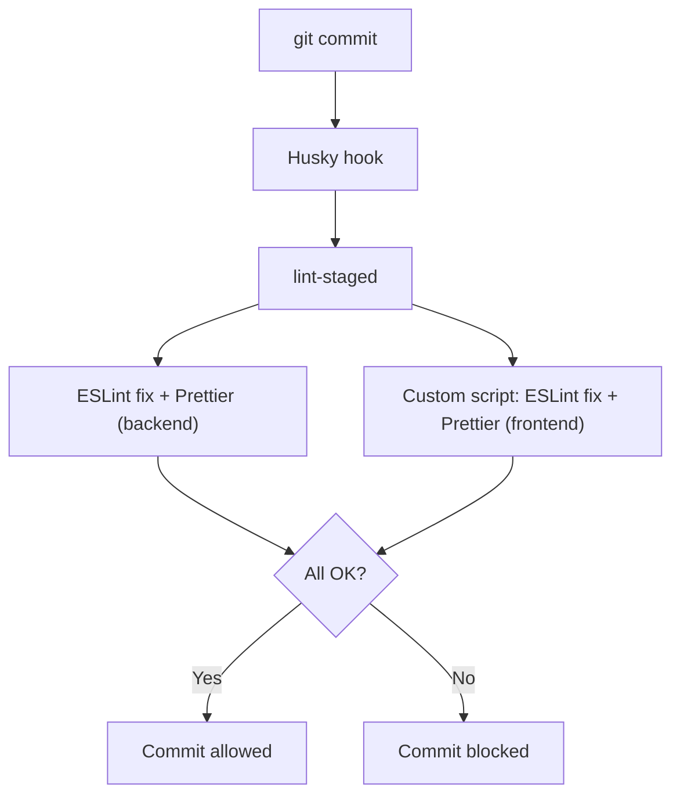
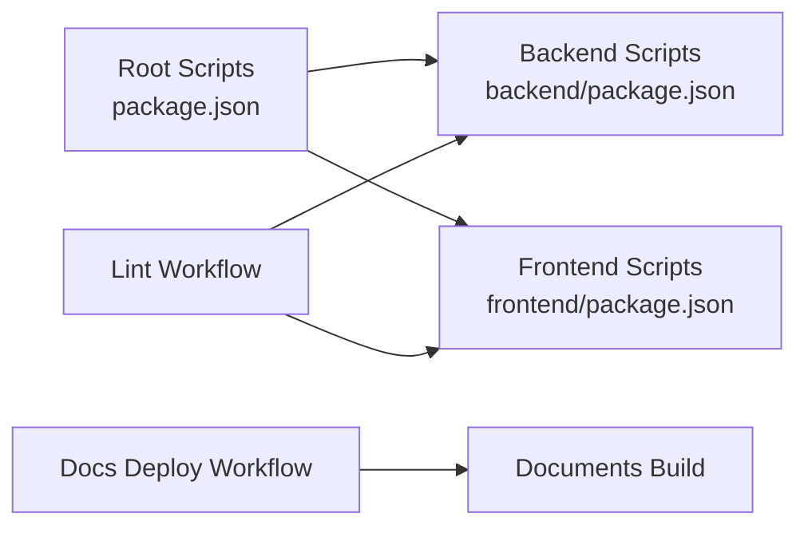

# CI/CD Pipelines

<cite>
**Referenced Files in This Document**
- [lint.yml](file://.gitea/workflows/lint.yml)
- [deploy-docs.yml](file://.gitea/workflows/deploy-docs.yml)
- [package.json (root)](file://package.json)
- [package.json (backend)](file://backend/package.json)
- [package.json (frontend)](file://frontend/package.json)
- [vitest.config.mjs (backend)](file://backend/vitest.config.mjs)
- [vitest.config.mjs (frontend)](file://frontend/vitest.config.mjs)
- [lint-frontend.js](file://scripts/lint-frontend.js)
- [.lintstagedrc.js](file://.lintstagedrc.js)
- [code_quality_tool.md](file://documents/docs/code_quality_tool.md)
</cite>

## Table of Contents
1. [Introduction](#introduction)
2. [Project Structure](#project-structure)
3. [Core Components](#core-components)
4. [Architecture Overview](#architecture-overview)
5. [Detailed Component Analysis](#detailed-component-analysis)
6. [Dependency Analysis](#dependency-analysis)
7. [Performance Considerations](#performance-considerations)
8. [Troubleshooting Guide](#troubleshooting-guide)
9. [Conclusion](#conclusion)
10. [Appendices](#appendices)

## Introduction
This document explains the Olympiad Portal’s CI/CD pipelines, focusing on:
- Linting for backend and frontend code
- Automated testing setup and configuration
- Code quality checks and pre-commit enforcement
- Documentation deployment workflow
- Environment variables and secrets management
- Job dependencies and execution order
- Troubleshooting common issues
- Performance optimization tips
- How to extend pipelines for additional tests or deployments

The repository uses Gitea Actions workflows located under `.gitea/workflows/`. The linting pipeline runs on all pushes and on pull requests targeting main. A separate workflow builds and deploys documentation to Netlify on pushes to main.

**Section sources**
- [lint.yml:1-46](file://.gitea/workflows/lint.yml#L1-L46)
- [deploy-docs.yml:1-26](file://.gitea/workflows/deploy-docs.yml#L1-L26)
- [code_quality_tool.md:26-31](file://documents/docs/code_quality_tool.md#L26-L31)

## Project Structure
At a high level, the CI/CD surface area includes:
- Linting workflow for backend and frontend
- Documentation build and deploy workflow
- Local tooling via package scripts and Husky + lint-staged

**Diagram sources**
- [lint.yml:1-46](file://.gitea/workflows/lint.yml#L1-L46)
- [deploy-docs.yml:1-26](file://.gitea/workflows/deploy-docs.yml#L1-L26)

**Section sources**
- [lint.yml:1-46](file://.gitea/workflows/lint.yml#L1-L46)
- [deploy-docs.yml:1-26](file://.gitea/workflows/deploy-docs.yml#L1-L26)

## Core Components
- Linting pipeline: Two parallel jobs run ESLint for backend and frontend using Node 20 and `npm ci`.
- Documentation deployment: Builds the docs site and deploys to Netlify using secrets for authentication and site identity.
- Testing configuration: Vitest is configured for both backend and frontend with coverage thresholds and environment settings.
- Pre-commit enforcement: Husky and lint-staged run local lint/formatting before commits.

Key behaviors:
- Backend lint uses an explicit config path; frontend lint uses default resolution.
- Frontend lint script also formats files when invoked by lint-staged.
- Docs deployment requires two secrets: NETLIFY_AUTH_TOKEN and NETLIFY_SITE_ID.

**Section sources**
- [lint.yml:10-46](file://.gitea/workflows/lint.yml#L10-L46)
- [deploy-docs.yml:14-26](file://.gitea/workflows/deploy-docs.yml#L14-L26)
- [vitest.config.mjs (backend):1-27](file://backend/vitest.config.mjs#L1-L27)
- [vitest.config.mjs (frontend):1-30](file://frontend/vitest.config.mjs#L1-L30)
- [.lintstagedrc.js:1-13](file://.lintstagedrc.js#L1-L13)
- [lint-frontend.js:1-9](file://scripts/lint-frontend.js#L1-L9)

## Architecture Overview
The CI system consists of independent workflows that are triggered by repository events. Each workflow defines one or more jobs that execute steps such as checkout, dependency installation, and running commands.

**Diagram sources**
- [lint.yml:1-46](file://.gitea/workflows/lint.yml#L1-L46)
- [deploy-docs.yml:1-26](file://.gitea/workflows/deploy-docs.yml#L1-L26)

## Detailed Component Analysis

### Linting Pipeline
- Triggers: All branches on push; pull requests targeting main.
- Jobs:
  - lint-backend: Sets up Node 20, installs backend dependencies, runs ESLint with the backend config.
  - lint-frontend: Sets up Node 20, installs frontend dependencies, runs ESLint for the frontend.
- Notes:
  - Uses `npm ci` for deterministic installs.
  - Backend explicitly passes the ESLint config path.
  - Frontend uses default ESLint resolution.

**Diagram sources**
- [lint.yml:10-46](file://.gitea/workflows/lint.yml#L10-L46)

**Section sources**
- [lint.yml:1-46](file://.gitea/workflows/lint.yml#L1-L46)

### Documentation Deployment Pipeline
- Trigger: Push to main branch.
- Steps:
  - Checkout code
  - Install dependencies in documents directory
  - Build docs
  - Deploy to Netlify using secrets for authentication and site ID
- Secrets required:
  - NETLIFY_AUTH_TOKEN
  - NETLIFY_SITE_ID

**Diagram sources**
- [deploy-docs.yml:1-26](file://.gitea/workflows/deploy-docs.yml#L1-L26)

**Section sources**
- [deploy-docs.yml:1-26](file://.gitea/workflows/deploy-docs.yml#L1-L26)

### Automated Testing Configuration
- Backend:
  - Test runner: Vitest with Node environment
  - Includes: `src/**/*.test.js`
  - Coverage: v8 provider with text, summary, HTML, and lcov reporters; thresholds set for lines, functions, branches, statements
- Frontend:
  - Test runner: Vitest with jsdom environment and React plugin
  - Includes: `src/**/*.test.{js,jsx}`
  - Coverage: v8 provider with same reporters; thresholds set; includes lib and hooks directories

**Diagram sources**
- [vitest.config.mjs (backend):1-27](file://backend/vitest.config.mjs#L1-L27)
- [vitest.config.mjs (frontend):1-30](file://frontend/vitest.config.mjs#L1-L30)

**Section sources**
- [vitest.config.mjs (backend):1-27](file://backend/vitest.config.mjs#L1-L27)
- [vitest.config.mjs (frontend):1-30](file://frontend/vitest.config.mjs#L1-L30)

### Pre-commit Enforcement
- Husky triggers lint-staged on commit.
- lint-staged maps staged files to:
  - Backend: ESLint fix and Prettier write
  - Frontend: Custom script that runs ESLint fix and Prettier write

**Diagram sources**
- [.lintstagedrc.js:1-13](file://.lintstagedrc.js#L1-L13)
- [lint-frontend.js:1-9](file://scripts/lint-frontend.js#L1-L9)

**Section sources**
- [.lintstagedrc.js:1-13](file://.lintstagedrc.js#L1-L13)
- [lint-frontend.js:1-9](file://scripts/lint-frontend.js#L1-L9)

## Dependency Analysis
- Workflow-level dependencies:
  - Lint jobs are independent and run in parallel.
  - Docs deploy job has no dependencies on lint jobs.
- Script-level dependencies:
  - Root package scripts orchestrate running tests across backend and frontend.
  - Backend and frontend have their own test and lint scripts.

**Diagram sources**
- [package.json (root):1-23](file://package.json#L1-L23)
- [package.json (backend):1-50](file://backend/package.json#L1-L50)
- [package.json (frontend):1-36](file://frontend/package.json#L1-L36)
- [lint.yml:1-46](file://.gitea/workflows/lint.yml#L1-L46)
- [deploy-docs.yml:1-26](file://.gitea/workflows/deploy-docs.yml#L1-L26)

**Section sources**
- [package.json (root):1-23](file://package.json#L1-L23)
- [package.json (backend):1-50](file://backend/package.json#L1-L50)
- [package.json (frontend):1-36](file://frontend/package.json#L1-L36)

## Performance Considerations
- Use `npm ci` instead of `npm install` in CI for faster, deterministic installs.
- Keep Node version pinned in workflows to avoid rebuilds due to version drift.
- Parallelize independent jobs (already done for backend/frontend lint).
- Cache dependencies where possible (e.g., Node modules cache) to reduce install times.
- Limit test scope in CI to only changed files if your tools support it.
- Avoid unnecessary logging during long-running steps to speed up output parsing.

[No sources needed since this section provides general guidance]

## Troubleshooting Guide
Common issues and resolutions:
- Runner availability:
  - The documentation notes that the Gitea instance must have a registered runner for workflows to execute. Ensure a runner is available and connected.
- Missing secrets:
  - Docs deployment requires NETLIFY_AUTH_TOKEN and NETLIFY_SITE_ID. Verify these secrets exist in the repository settings.
- Lint failures:
  - Backend uses an explicit ESLint config path; ensure the config exists and rules are consistent.
  - Frontend lint may be invoked via a custom script; confirm the script resolves paths correctly.
- Test environment mismatches:
  - Backend tests run in Node; frontend tests run in jsdom with React plugin. Ensure environment-specific mocks and globals are configured.
- Dependency install errors:
  - Use `npm ci` in CI to enforce lockfile consistency. If installs fail, check platform compatibility and Node version.

**Section sources**
- [code_quality_tool.md:26-31](file://documents/docs/code_quality_tool.md#L26-L31)
- [deploy-docs.yml:24-26](file://.gitea/workflows/deploy-docs.yml#L24-L26)
- [lint.yml:21-27](file://.gitea/workflows/lint.yml#L21-L27)
- [lint.yml:40-46](file://.gitea/workflows/lint.yml#L40-L46)
- [vitest.config.mjs (backend):1-27](file://backend/vitest.config.mjs#L1-L27)
- [vitest.config.mjs (frontend):1-30](file://frontend/vitest.config.mjs#L1-L30)

## Conclusion
The Olympiad Portal’s CI/CD currently focuses on:
- Linting backend and frontend code on every push and PR to main
- Building and deploying documentation to Netlify on main
- Configuring robust testing with Vitest and coverage thresholds locally

To mature the CI/CD further, consider adding automated testing and deployment steps for backend and frontend services, integrating caching, and expanding secret management for service credentials.

[No sources needed since this section summarizes without analyzing specific files]

## Appendices

### Extending the Pipelines
- Add automated testing to CI:
  - Create a new job in the lint workflow or a dedicated test workflow to run `npm run test` and `npm run test:coverage` in backend and frontend.
  - Leverage existing Vitest configurations for environment and coverage reporting.
- Add backend and frontend deployment:
  - Introduce deployment jobs that build artifacts and publish to your hosting platforms.
  - Use secrets for environment-specific credentials and URLs.
- Improve performance:
  - Add dependency caching for Node modules.
  - Split large jobs into smaller, focused tasks.
  - Use matrix builds for multiple Node versions if necessary.

[No sources needed since this section provides general guidance]