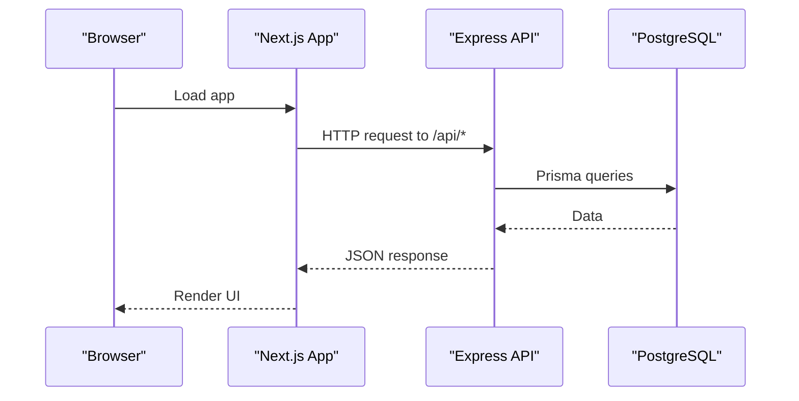
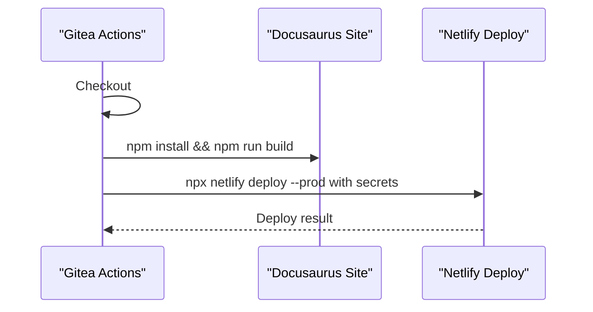
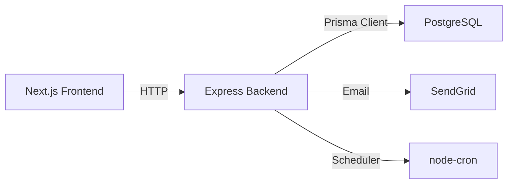

# Deployment & DevOps

<cite>
**Referenced Files in This Document**
- [deploy-docs.yml](file://.gitea/workflows/deploy-docs.yml)
- [lint.yml](file://.gitea/workflows/lint.yml)
- [package.json (backend)](file://backend/package.json)
- [package.json (frontend)](file://frontend/package.json)
- [index.js (backend)](file://backend/src/index.js)
- [schema.prisma](file://backend/prisma/schema.prisma)
- [vitest.config.mjs (backend)](file://backend/vitest.config.mjs)
- [vitest.config.mjs (frontend)](file://frontend/vitest.config.mjs)
- [next.config.mjs](file://frontend/next.config.mjs)
- [.gitignore (backend)](file://backend/.gitignore)
- [.gitignore (frontend)](file://frontend/.gitignore)
</cite>

## Table of Contents
1. Introduction
2. Project Structure
3. Core Components
4. Architecture Overview
5. Detailed Component Analysis
6. Dependency Analysis
7. Performance Considerations
8. Troubleshooting Guide
9. Conclusion
10. Appendices

## Introduction
This document provides comprehensive deployment and DevOps guidance for the Olympiad Portal, focusing on CI/CD configuration, environment management, secrets handling, deployment strategies, containerization considerations, infrastructure requirements, monitoring/logging, backup and disaster recovery, scaling, and security. It is grounded in the repository’s existing CI workflows, backend/frontend configurations, and database schema.

## Project Structure
The project is a monorepo with:
- Backend: Express API with Prisma and PostgreSQL
- Frontend: Next.js application
- Documentation site: Docusaurus deployed to Netlify via CI
- CI/CD: Gitea Actions for linting and docs deployment

```mermaid
graph TB
subgraph "CI"
L["Lint Job"]
D["Docs Deploy Job"]
end
subgraph "Runtime"
FE["Next.js Frontend"]
BE["Express Backend"]
DB["PostgreSQL"]
NETLIFY["Netlify (Docs)"]
end
L --> |"runs on push/PR"| FE
L --> |"runs on push/PR"| BE
D --> |"build + deploy"| NETLIFY
FE --> |"HTTP /api"* BE
BE --> |"Prisma client"| DB
```

**Diagram sources**
- [lint.yml:1-46](file://.gitea/workflows/lint.yml#L1-L46)
- [deploy-docs.yml:1-26](file://.gitea/workflows/deploy-docs.yml#L1-L26)
- [package.json (backend):1-50](file://backend/package.json#L1-L50)
- [package.json (frontend):1-36](file://frontend/package.json#L1-L36)
- [schema.prisma:6-9](file://backend/prisma/schema.prisma#L6-L9)

**Section sources**
- [lint.yml:1-46](file://.gitea/workflows/lint.yml#L1-L46)
- [deploy-docs.yml:1-26](file://.gitea/workflows/deploy-docs.yml#L1-L26)
- [package.json (backend):1-50](file://backend/package.json#L1-L50)
- [package.json (frontend):1-36](file://frontend/package.json#L1-L36)
- [schema.prisma:6-9](file://backend/prisma/schema.prisma#L6-L9)

## Core Components
- CI/CD Pipelines
  - Linting pipeline runs ESLint on both frontend and backend on pushes and pull requests targeting main.
  - Docs deployment pipeline builds the documentation site and deploys to Netlify using secrets.
- Backend Runtime
  - Express server loads environment variables at startup, serves static uploads, mounts API routes, starts a scheduler, and listens on a configurable port.
- Database
  - Prisma configured to connect to PostgreSQL using DATABASE_URL from environment.
- Testing
  - Vitest configured for backend and frontend with coverage thresholds and reporters.

**Section sources**
- [lint.yml:1-46](file://.gitea/workflows/lint.yml#L1-L46)
- [deploy-docs.yml:1-26](file://.gitea/workflows/deploy-docs.yml#L1-L26)
- [index.js:1-43](file://backend/src/index.js#L1-L43)
- [schema.prisma:6-9](file://backend/prisma/schema.prisma#L6-L9)
- [vitest.config.mjs (backend):1-28](file://backend/vitest.config.mjs#L1-L28)
- [vitest.config.mjs (frontend):1-31](file://frontend/vitest.config.mjs#L1-L31)

## Architecture Overview
High-level runtime architecture showing how components interact during development and production.



**Diagram sources**
- [index.js:16-32](file://backend/src/index.js#L16-L32)
- [schema.prisma:6-9](file://backend/prisma/schema.prisma#L6-L9)

## Detailed Component Analysis

### CI/CD Pipeline: Linting
- Triggers: On all pushes; on pull requests to main.
- Jobs:
  - Backend lint: installs dependencies and runs ESLint with the provided config.
  - Frontend lint: installs dependencies and runs ESLint.
- Node version pinned to 20 for consistency.


**Diagram sources**
- [lint.yml:1-46](file://.gitea/workflows/lint.yml#L1-L46)

**Section sources**
- [lint.yml:1-46](file://.gitea/workflows/lint.yml#L1-L46)

### CI/CD Pipeline: Docs Deployment
- Trigger: Push to main branch.
- Steps:
  - Checkout code.
  - Install docs dependencies.
  - Build docs site.
  - Deploy to Netlify using secrets for authentication and site ID.



**Diagram sources**
- [deploy-docs.yml:1-26](file://.gitea/workflows/deploy-docs.yml#L1-L26)

**Section sources**
- [deploy-docs.yml:1-26](file://.gitea/workflows/deploy-docs.yml#L1-L26)

### Environment Configuration Management
- Backend
  - Loads environment variables at startup via dotenv.
  - Exposes PORT with default fallback.
  - Serves static uploads under /uploads.
  - Mounts API routers under /api.
- Frontend
  - Uses Next.js build/start scripts.
  - No custom Next config overrides present.
- Secrets Handling
  - Docs deployment uses GitHub/Gitea secrets for Netlify auth token and site ID.
  - Ensure .env files are ignored by git (already configured).

Recommended environment variables for production:
- DATABASE_URL: PostgreSQL connection string used by Prisma.
- PORT: Backend listening port.
- CORS origin(s): Configure per environment if needed.
- Email service credentials: For SendGrid integration used by backend.
- JWT secret: For token signing/verification.
- Any third-party API keys required by backend services.

**Section sources**
- [index.js:1-43](file://backend/src/index.js#L1-L43)
- [package.json (backend):1-50](file://backend/package.json#L1-L50)
- [package.json (frontend):1-36](file://frontend/package.json#L1-L36)
- [deploy-docs.yml:14-26](file://.gitea/workflows/deploy-docs.yml#L14-L26)
- [.gitignore (backend):1-5](file://backend/.gitignore#L1-L5)
- [.gitignore (frontend):33-34](file://frontend/.gitignore#L33-L34)

### Deployment Strategies
- Development
  - Run backend locally with Node; ensure DATABASE_URL points to local or dev database.
  - Run frontend dev server; configure CORS to allow localhost origins.
- Preview/Staging
  - Use separate DATABASE_URL and email credentials.
  - Add a preview deployment job that builds and deploys frontend/backend to a staging host.
- Production
  - Pin Node version in runtime (e.g., Dockerfile or platform settings).
  - Set DATABASE_URL, PORT, and other secrets via platform secret store.
  - Run migrations before starting the app (see “Database Migrations” below).

**Section sources**
- [index.js:34-40](file://backend/src/index.js#L34-L40)
- [schema.prisma:6-9](file://backend/prisma/schema.prisma#L6-L9)

### Containerization Approach
- The repository does not include Dockerfiles or container orchestration manifests.
- Recommended approach:
  - Create a multi-stage Dockerfile for backend (Node 20) and frontend (Next.js).
  - Use a reverse proxy (e.g., Nginx/Traefik) to terminate TLS and route traffic to services.
  - Store secrets in platform secret stores (e.g., Kubernetes Secrets, cloud provider secret managers).
  - Use health checks and readiness probes for rolling updates.

[No sources needed since this section provides general guidance]

### Infrastructure Requirements
- PostgreSQL instance accessible from the backend runtime.
- Node.js 20 runtime for backend and frontend.
- Storage for uploaded papers (persistent volume or object storage).
- Optional: CDN for static assets and images.

**Section sources**
- [schema.prisma:6-9](file://backend/prisma/schema.prisma#L6-L9)
- [index.js:26-27](file://backend/src/index.js#L26-L27)

### Monitoring and Logging
- Application Logs
  - Backend logs via console output; integrate structured logging in production.
  - Capture stdout/stderr from containers/processes.
- Metrics and Health
  - Add health endpoints (/health) returning service status and dependency checks (e.g., DB connectivity).
  - Expose metrics endpoint (e.g., Prometheus) for CPU, memory, request rates, error rates.
- Error Tracking
  - Integrate an error tracking service (e.g., Sentry) in frontend and backend.
  - Centralize error logs with correlation IDs.
- Uptime and Alerts
  - Configure synthetic monitors and alerting rules for critical paths.

[No sources needed since this section provides general guidance]

### Backup and Recovery
- Database Backups
  - Schedule regular logical backups (e.g., pg_dump) for PostgreSQL.
  - Retain multiple generations and test restore procedures.
- File Backups
  - Back up uploaded papers directory regularly.
  - Prefer object storage with versioning for durability.
- Disaster Recovery
  - Document RTO/RPO targets.
  - Maintain runbooks for restoring DB and files in a new environment.
  - Test failover drills periodically.

[No sources needed since this section provides general guidance]

### Scaling Strategies
- Horizontal Scaling
  - Scale stateless backend instances behind a load balancer.
  - Use sticky sessions only if necessary; prefer stateless design.
- Database Scaling
  - Read replicas for read-heavy workloads.
  - Connection pooling and query optimization.
- Caching
  - Cache frequent reads (e.g., round metadata) with Redis or CDN where appropriate.
- Frontend Scaling
  - Serve static assets via CDN; leverage Next.js optimizations.

[No sources needed since this section provides general guidance]

### Security Considerations
- SSL/TLS
  - Terminate TLS at reverse proxy or platform edge; enforce HTTPS.
- Firewall Rules
  - Restrict inbound access to only required ports (e.g., 443).
  - Allow outbound to database and external APIs only.
- Access Controls
  - Use least-privilege service accounts for database access.
  - Rotate secrets regularly; use secret managers.
- CORS
  - Configure strict allowed origins per environment.
- Input Validation and Rate Limiting
  - Validate inputs server-side; apply rate limiting to protect APIs.

[No sources needed since this section provides general guidance]

## Dependency Analysis
Key runtime dependencies and their roles:
- Backend
  - Express: HTTP server and routing.
  - Prisma Client: Type-safe database access to PostgreSQL.
  - Authentication utilities: bcrypt, jsonwebtoken, passport.
  - Email: SendGrid integration.
  - Cron jobs: node-cron for scheduled tasks.
- Frontend
  - Next.js: Framework for rendering and serving the UI.
  - Testing and linting tooling via Vitest and ESLint.



**Diagram sources**
- [package.json (backend):19-32](file://backend/package.json#L19-L32)
- [package.json (frontend):15-19](file://frontend/package.json#L15-L19)
- [schema.prisma:6-9](file://backend/prisma/schema.prisma#L6-L9)

**Section sources**
- [package.json (backend):19-32](file://backend/package.json#L19-L32)
- [package.json (frontend):15-19](file://frontend/package.json#L15-L19)
- [schema.prisma:6-9](file://backend/prisma/schema.prisma#L6-L9)

## Performance Considerations
- Database
  - Use connection pooling and index frequently queried columns.
  - Avoid N+1 queries; batch operations where possible.
- Backend
  - Enable compression and caching headers for static assets.
  - Profile hot paths and optimize I/O-bound operations.
- Frontend
  - Leverage Next.js built-in optimizations (image optimization, code splitting).
  - Minimize bundle size and defer non-critical resources.
- CI
  - Cache npm dependencies to speed up pipelines.

[No sources needed since this section provides general guidance]

## Troubleshooting Guide
Common issues and resolutions:
- Missing Environment Variables
  - Ensure DATABASE_URL, PORT, and other required variables are set in the runtime environment.
  - Verify .env is ignored by git and secrets are injected by your platform.
- Database Connectivity
  - Confirm network access from backend to PostgreSQL.
  - Validate credentials and firewall rules.
- CORS Errors
  - Adjust CORS origin configuration to match frontend domain.
- Uploads Not Serving
  - Ensure /uploads path is mounted and files exist on disk or storage.
- Tests Failing in CI
  - Check Node version alignment and dependency installation steps.

**Section sources**
- [index.js:16-27](file://backend/src/index.js#L16-L27)
- [.gitignore (backend):1-5](file://backend/.gitignore#L1-L5)
- [lint.yml:16-27](file://.gitea/workflows/lint.yml#L16-L27)
- [vitest.config.mjs (backend):1-28](file://backend/vitest.config.mjs#L1-L28)

## Conclusion
The Olympiad Portal includes a solid foundation for CI/CD with linting and docs deployment. To reach production-grade reliability, add explicit deployment pipelines for frontend and backend, secure environment and secrets management, robust monitoring/logging, backup and disaster recovery processes, and clear scaling and security practices. The existing configurations provide a strong base to build upon.

## Appendices

### Database Migrations
- Use Prisma CLI to manage migrations against the PostgreSQL instance referenced by DATABASE_URL.
- In CI/CD, run migrations before starting the backend to ensure schema consistency.

**Section sources**
- [schema.prisma:6-9](file://backend/prisma/schema.prisma#L6-L9)

### Testing and Coverage
- Backend tests run with Vitest in Node environment; coverage thresholds enforced.
- Frontend tests run with Vitest in jsdom; coverage thresholds enforced.

**Section sources**
- [vitest.config.mjs (backend):1-28](file://backend/vitest.config.mjs#L1-L28)
- [vitest.config.mjs (frontend):1-31](file://frontend/vitest.config.mjs#L1-L31)