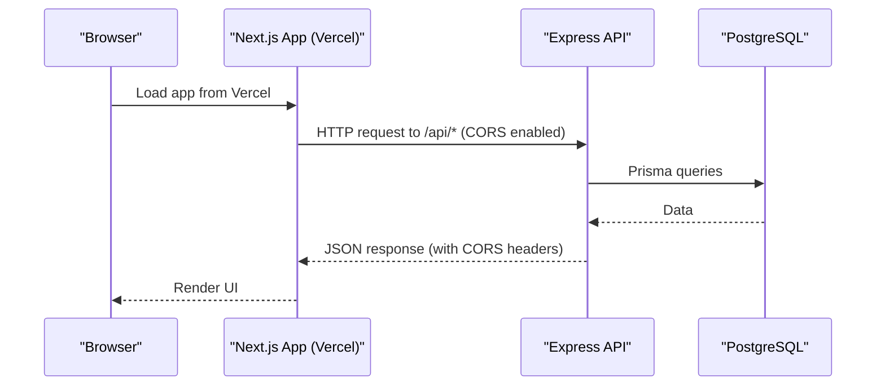
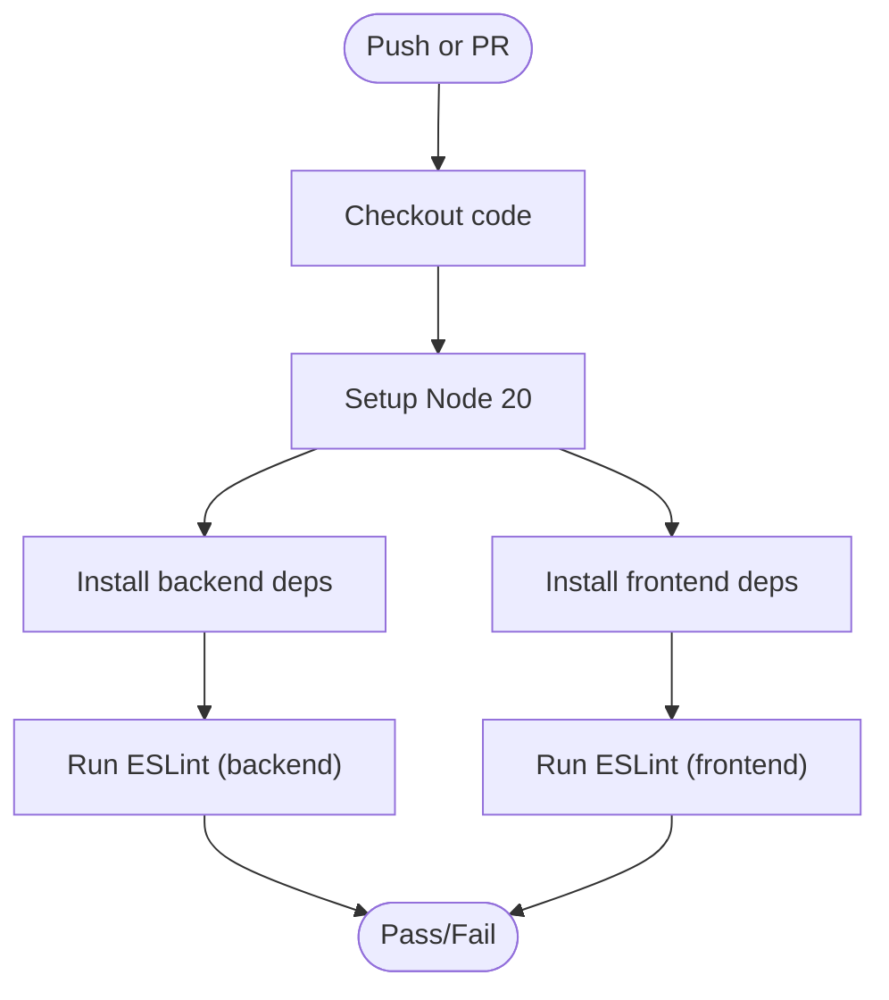
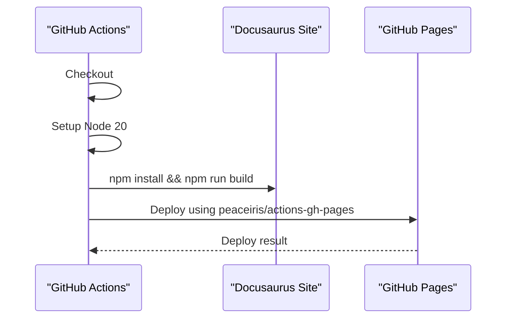
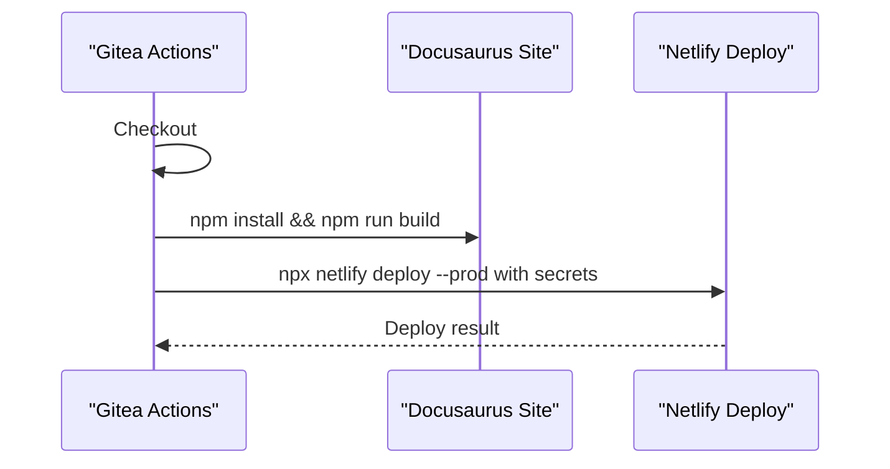
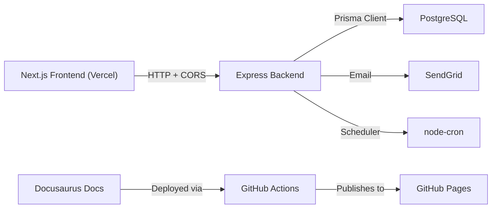

# Deployment & DevOps

<cite>
**Referenced Files in This Document**
- [deploy.yml](file://documents/.github/workflows/deploy.yml)
- [deploy-docs.yml](file://.gitea/workflows/deploy-docs.yml)
- [lint.yml](file://.gitea/workflows/lint.yml)
- [docusaurus.config.js](file://documents/docusaurus.config.js)
- [eslint.config.mjs (backend)](file://backend/eslint.config.mjs)
- [eslint.config.mjs (frontend)](file://frontend/eslint.config.mjs)
- [.gitignore](file://.gitignore)
- [.gitignore (documents)](file://documents/.gitignore)
- [package.json (backend)](file://backend/package.json)
- [package.json (frontend)](file://frontend/package.json)
- [index.js (backend)](file://backend/src/index.js)
- [api.js (frontend)](file://frontend/src/lib/api.js)
- [next.config.mjs](file://frontend/next.config.mjs)
- [project.json (vercel)](file://frontend/.vercel/project.json)
- [schema.prisma](file://backend/prisma/schema.prisma)
- [vitest.config.mjs (backend)](file://backend/vitest.config.mjs)
- [vitest.config.mjs (frontend)](file://frontend/vitest.config.mjs)
</cite>

## Update Summary
**Changes Made**
- Updated CORS configuration section to document multi-environment support including Vercel deployments
- Enhanced environment configuration management with specific Vercel deployment examples
- Added Vercel-specific deployment considerations and configuration
- Updated troubleshooting guide to address CORS issues with Vercel deployments
- Revised security considerations for cross-origin requests in distributed deployments

## Table of Contents
1. Introduction
2. Project Structure
3. Core Components
4. Architecture Overview
5. Detailed Component Analysis
6. Dependency Analysis
7. Performance Considerations
8. Troubleshooting Guide
9. Conclusion
10. Appendices

## Introduction
This document provides comprehensive deployment and DevOps guidance for the Olympiad Portal, focusing on CI/CD configuration, environment management, secrets handling, deployment strategies, containerization considerations, infrastructure requirements, monitoring/logging, backup and disaster recovery, scaling, and security. It is grounded in the repository's existing CI workflows, backend/frontend configurations, and database schema.

## Project Structure
The project is a monorepo with:
- Backend: Express API with Prisma and PostgreSQL
- Frontend: Next.js application deployed to Vercel
- Documentation site: Docusaurus deployed to GitHub Pages via GitHub Actions
- CI/CD: Gitea Actions for linting and GitHub Actions for docs deployment

```mermaid
graph TB
subgraph "CI/CD"
L["Lint Job"]
D["Docs Deploy Job"]
GP["GitHub Pages Deploy"]
V["Vercel Deploy"]
end
subgraph "Runtime"
FE["Next.js Frontend (Vercel)"]
BE["Express Backend"]
DB["PostgreSQL"]
GHPAGES["GitHub Pages (Docs)"]
end
L --> |"runs on push/PR"| FE
L --> |"runs on push/PR"| BE
D --> |"build + deploy"| GP
V --> |"deploy frontend"| FE
GP --> |"publishes to"| GHPAGES
FE --> |"HTTP /api"* BE
BE --> |"Prisma client"| DB
```

**Diagram sources**
- [lint.yml:1-46](file://.gitea/workflows/lint.yml#L1-L46)
- [deploy.yml:1-25](file://documents/.github/workflows/deploy.yml#L1-L25)
- [deploy-docs.yml:1-26](file://.gitea/workflows/deploy-docs.yml#L1-L26)
- [package.json (backend):1-50](file://backend/package.json#L1-L50)
- [package.json (frontend):1-36](file://frontend/package.json#L1-L36)
- [schema.prisma:6-9](file://backend/prisma/schema.prisma#L6-L9)

**Section sources**
- [lint.yml:1-46](file://.gitea/workflows/lint.yml#L1-L46)
- [deploy.yml:1-25](file://documents/.github/workflows/deploy.yml#L1-L25)
- [deploy-docs.yml:1-26](file://.gitea/workflows/deploy-docs.yml#L1-L26)
- [package.json (backend):1-50](file://backend/package.json#L1-L50)
- [package.json (frontend):1-36](file://frontend/package.json#L1-L36)
- [schema.prisma:6-9](file://backend/prisma/schema.prisma#L6-L9)

## Core Components
- CI/CD Pipelines
  - Linting pipeline runs ESLint on both frontend and backend on pushes and pull requests targeting main.
  - Documentation deployment pipeline builds the documentation site and deploys to GitHub Pages using GitHub Actions.
  - Legacy Netlify deployment workflow maintained for backward compatibility.
  - Vercel deployment configured for frontend with automatic deployments from Git pushes.
- Backend Runtime
  - Express server loads environment variables at startup, serves static uploads, mounts API routes, starts a scheduler, and listens on a configurable port.
  - Enhanced CORS configuration supporting multiple deployment environments including Vercel.
- Database
  - Prisma configured to connect to PostgreSQL using DATABASE_URL from environment.
- Testing
  - Vitest configured for backend and frontend with coverage thresholds and reporters.

**Section sources**
- [lint.yml:1-46](file://.gitea/workflows/lint.yml#L1-L46)
- [deploy.yml:1-25](file://documents/.github/workflows/deploy.yml#L1-L25)
- [deploy-docs.yml:1-26](file://.gitea/workflows/deploy-docs.yml#L1-L26)
- [index.js:1-42](file://backend/src/index.js#L1-L42)
- [schema.prisma:6-9](file://backend/prisma/schema.prisma#L6-L9)
- [vitest.config.mjs (backend):1-28](file://backend/vitest.config.mjs#L1-L28)
- [vitest.config.mjs (frontend):1-31](file://frontend/vitest.config.mjs#L1-L31)

## Architecture Overview
High-level runtime architecture showing how components interact during development and production, with emphasis on cross-origin communication between Vercel frontend and backend.



**Diagram sources**
- [index.js:16-22](file://backend/src/index.js#L16-L22)
- [api.js:3-27](file://frontend/src/lib/api.js#L3-L27)
- [schema.prisma:6-9](file://backend/prisma/schema.prisma#L6-L9)

## Detailed Component Analysis

### CI/CD Pipeline: Linting
- Triggers: On all pushes; on pull requests to main.
- Jobs:
  - Backend lint: installs dependencies and runs ESLint with the provided config.
  - Frontend lint: installs dependencies and runs ESLint.
- Node version pinned to 20 for consistency.



**Diagram sources**
- [lint.yml:1-46](file://.gitea/workflows/lint.yml#L1-L46)

**Section sources**
- [lint.yml:1-46](file://.gitea/workflows/lint.yml#L1-L46)

### CI/CD Pipeline: Documentation Deployment to GitHub Pages
- Trigger: Push to main branch.
- Steps:
  - Checkout code.
  - Setup Node.js 20 environment.
  - Install documentation dependencies.
  - Build documentation site.
  - Deploy to GitHub Pages using peaceiris/actions-gh-pages action.



**Diagram sources**
- [deploy.yml:1-25](file://documents/.github/workflows/deploy.yml#L1-L25)

**Section sources**
- [deploy.yml:1-25](file://documents/.github/workflows/deploy.yml#L1-L25)

### CI/CD Pipeline: Legacy Netlify Deployment
- Trigger: Push to main branch.
- Steps:
  - Checkout code.
  - Install documentation dependencies.
  - Build documentation site.
  - Deploy to Netlify using secrets for authentication and site ID.



**Diagram sources**
- [deploy-docs.yml:1-26](file://.gitea/workflows/deploy-docs.yml#L1-L26)

**Section sources**
- [deploy-docs.yml:1-26](file://.gitea/workflows/deploy-docs.yml#L1-L26)

### Environment Configuration Management

**Updated** Enhanced CORS configuration to support multiple deployment environments including Vercel production deployments.

- Backend
  - Loads environment variables at startup via dotenv.
  - Exposes PORT with default fallback.
  - Serves static uploads under /uploads.
  - Mounts API routers under /api.
  - **Enhanced CORS Configuration**: Supports both localhost development (`http://localhost:3000`) and production Vercel deployment (`https://frontend-two-ruby-25.vercel.app`) origins with credentials enabled for secure cookie handling.
- Frontend
  - Uses Next.js build/start scripts.
  - Configured for Vercel deployment with project ID in `.vercel/project.json`.
  - API base URL configurable via `NEXT_PUBLIC_API_BASE_URL` environment variable.
  - No custom Next config overrides present.
- Secrets Handling
  - GitHub Pages deployment uses built-in GITHUB_TOKEN for authentication.
  - Netlify deployment uses GitHub/Gitea secrets for Netlify auth token and site ID.
  - Vercel deployment uses environment variables and project settings.
  - Ensure .env files are ignored by git (already configured).

Recommended environment variables for production:
- DATABASE_URL: PostgreSQL connection string used by Prisma.
- PORT: Backend listening port.
- NEXT_PUBLIC_API_BASE_URL: Backend API URL for frontend (e.g., `https://your-backend-domain.com`).
- Email service credentials: For SendGrid integration used by backend.
- JWT secret: For token signing/verification.
- Any third-party API keys required by backend services.

**Section sources**
- [index.js:1-42](file://backend/src/index.js#L1-L42)
- [api.js:3-27](file://frontend/src/lib/api.js#L3-L27)
- [package.json (backend):1-50](file://backend/package.json#L1-L50)
- [package.json (frontend):1-36](file://frontend/package.json#L1-L36)
- [project.json:1-1](file://frontend/.vercel/project.json#L1-L1)
- [deploy.yml:21-25](file://documents/.github/workflows/deploy.yml#L21-L25)
- [deploy-docs.yml:14-26](file://.gitea/workflows/deploy-docs.yml#L14-L26)
- [.gitignore:1-11](file://.gitignore#L1-L11)
- [.gitignore (documents):1-21](file://documents/.gitignore#L1-L21)

### Development Tooling and ESLint Configuration
- Backend ESLint Configuration
  - Uses modern ESLint flat config format with @eslint/js and globals.
  - Integrates with Prettier for consistent code formatting.
  - Supports both CommonJS and ES modules.
  - Configured to ignore generated files and node_modules.
- Frontend ESLint Configuration
  - Uses Next.js recommended configuration with core web vitals.
  - Integrates with Prettier for consistent code formatting.
  - Custom ignores for Next.js build artifacts.
  - Optimized for React and Next.js development patterns.

**Section sources**
- [eslint.config.mjs (backend):1-19](file://backend/eslint.config.mjs#L1-L19)
- [eslint.config.mjs (frontend):1-17](file://frontend/eslint.config.mjs#L1-L17)

### Documentation Site Configuration
- Docusaurus Configuration Updates
  - Updated production URL to point to GitHub Pages deployment.
  - Maintains compatibility with existing documentation structure.
  - Configured with Mermaid diagram support.
  - Includes blog functionality and social media integration.

**Section sources**
- [docusaurus.config.js:27-29](file://documents/docusaurus.config.js#L27-L29)
- [docusaurus.config.js:69-132](file://documents/docusaurus.config.js#L69-L132)

### Deployment Strategies

**Updated** Enhanced deployment strategies to include Vercel frontend deployment and improved CORS configuration.

- Development
  - Run backend locally with Node; ensure DATABASE_URL points to local or dev database.
  - Run frontend dev server; configure CORS to allow localhost origins (automatically handled by enhanced CORS config).
  - Use local documentation build for preview purposes.
  - Configure `NEXT_PUBLIC_API_BASE_URL=http://localhost:5000` for local development.
- Preview/Staging
  - Use separate DATABASE_URL and email credentials.
  - Add a preview deployment job that builds and deploys frontend/backend to a staging host.
  - Configure staging CORS origins in backend configuration.
- Production
  - Pin Node version in runtime (e.g., Dockerfile or platform settings).
  - Set DATABASE_URL, PORT, and other secrets via platform secret store.
  - Run migrations before starting the app (see "Database Migrations" below).
  - Frontend automatically deploys to Vercel from Git pushes.
  - Documentation automatically deploys to GitHub Pages on main branch pushes.
  - CORS configuration supports both localhost development and production Vercel domains.

**Section sources**
- [index.js:16-22](file://backend/src/index.js#L16-L22)
- [index.js:34-39](file://backend/src/index.js#L34-L39)
- [api.js:3-27](file://frontend/src/lib/api.js#L3-L27)
- [schema.prisma:6-9](file://backend/prisma/schema.prisma#L6-L9)
- [deploy.yml:3-25](file://documents/.github/workflows/deploy.yml#L3-L25)

### Containerization Approach
- The repository does not include Dockerfiles or container orchestration manifests.
- Recommended approach:
  - Create a multi-stage Dockerfile for backend (Node 20) and frontend (Next.js).
  - Use a reverse proxy (e.g., Nginx/Traefik) to terminate TLS and route traffic to services.
  - Store secrets in platform secret stores (e.g., Kubernetes Secrets, cloud provider secret managers).
  - Use health checks and readiness probes for rolling updates.
  - Configure CORS origins dynamically based on deployment environment.

### Infrastructure Requirements
- PostgreSQL instance accessible from the backend runtime.
- Node.js 20 runtime for backend and frontend.
- Storage for uploaded papers (persistent volume or object storage).
- Optional: CDN for static assets and images.
- GitHub Pages enabled for documentation hosting.
- Vercel account and project configured for frontend deployment.

**Section sources**
- [schema.prisma:6-9](file://backend/prisma/schema.prisma#L6-L9)
- [index.js:26-27](file://backend/src/index.js#L26-L27)
- [deploy.yml:9-25](file://documents/.github/workflows/deploy.yml#L9-L25)
- [project.json:1-1](file://frontend/.vercel/project.json#L1-L1)

### Monitoring and Logging
- Application Logs
  - Backend logs via console output; integrate structured logging in production.
  - Capture stdout/stderr from containers/processes.
- Metrics and Health
  - Add health endpoints (/health) returning service status and dependency checks (e.g., DB connectivity).
  - Expose metrics endpoint (e.g., Prometheus) for CPU, memory, request rates, error rates.
- Error Tracking
  - Integrate an error tracking service (e.g., Sentry) in frontend and backend.
  - Centralize error logs with correlation IDs.
- Uptime and Alerts
  - Configure synthetic monitors and alerting rules for critical paths.
  - Monitor CORS-related errors in production environments.

### Backup and Recovery
- Database Backups
  - Schedule regular logical backups (e.g., pg_dump) for PostgreSQL.
  - Retain multiple generations and test restore procedures.
- File Backups
  - Back up uploaded papers directory regularly.
  - Prefer object storage with versioning for durability.
- Disaster Recovery
  - Document RTO/RPO targets.
  - Maintain runbooks for restoring DB and files in a new environment.
  - Test failover drills periodically.

### Scaling Strategies
- Horizontal Scaling
  - Scale stateless backend instances behind a load balancer.
  - Use sticky sessions only if necessary; prefer stateless design.
- Database Scaling
  - Read replicas for read-heavy workloads.
  - Connection pooling and query optimization.
- Caching
  - Cache frequent reads (e.g., round metadata) with Redis or CDN where appropriate.
- Frontend Scaling
  - Serve static assets via CDN; leverage Next.js optimizations.
  - Vercel provides automatic scaling and global CDN distribution.
- Documentation Scaling
  - GitHub Pages provides automatic scaling for documentation sites.

### Security Considerations

**Updated** Enhanced security considerations for CORS and cross-origin deployments.

- SSL/TLS
  - Terminate TLS at reverse proxy or platform edge; enforce HTTPS.
  - GitHub Pages provides automatic HTTPS for documentation.
  - Vercel provides automatic HTTPS for frontend deployments.
- Firewall Rules
  - Restrict inbound access to only required ports (e.g., 443).
  - Allow outbound to database and external APIs only.
- Access Controls
  - Use least-privilege service accounts for database access.
  - Rotate secrets regularly; use secret managers.
- CORS Configuration
  - **Enhanced**: Backend now supports multiple origins including localhost development and production Vercel deployment URLs.
  - Configure strict allowed origins per environment.
  - Enable credentials for secure cookie handling across origins.
  - Regularly audit and update CORS policies as new domains are added.
- Input Validation and Rate Limiting
  - Validate inputs server-side; apply rate limiting to protect APIs.
- GitHub Pages Security
  - Leverage GitHub's built-in security features and HTTPS enforcement.
  - Use GitHub's secret management for deployment tokens.
- Vercel Security
  - Use Vercel's environment variables and project settings for sensitive configuration.
  - Leverage Vercel's built-in security features and HTTPS enforcement.

**Section sources**
- [index.js:16-22](file://backend/src/index.js#L16-L22)
- [api.js:3-27](file://frontend/src/lib/api.js#L3-L27)

## Dependency Analysis
Key runtime dependencies and their roles:
- Backend
  - Express: HTTP server and routing.
  - Prisma Client: Type-safe database access to PostgreSQL.
  - Authentication utilities: bcrypt, jsonwebtoken, passport.
  - Email: SendGrid integration.
  - Cron jobs: node-cron for scheduled tasks.
  - CORS: Cross-origin resource sharing for multi-environment support.
- Frontend
  - Next.js: Framework for rendering and serving the UI.
  - Testing and linting tooling via Vitest and ESLint.
- Documentation
  - Docusaurus: Static site generator for documentation.
  - GitHub Actions: CI/CD automation for deployment.



**Diagram sources**
- [package.json (backend):19-32](file://backend/package.json#L19-L32)
- [package.json (frontend):15-19](file://frontend/package.json#L15-L19)
- [schema.prisma:6-9](file://backend/prisma/schema.prisma#L6-L9)
- [deploy.yml:21-25](file://documents/.github/workflows/deploy.yml#L21-L25)

**Section sources**
- [package.json (backend):19-32](file://backend/package.json#L19-L32)
- [package.json (frontend):15-19](file://frontend/package.json#L15-L19)
- [schema.prisma:6-9](file://backend/prisma/schema.prisma#L6-L9)
- [deploy.yml:21-25](file://documents/.github/workflows/deploy.yml#L21-L25)

## Performance Considerations
- Database
  - Use connection pooling and index frequently queried columns.
  - Avoid N+1 queries; batch operations where possible.
- Backend
  - Enable compression and caching headers for static assets.
  - Profile hot paths and optimize I/O-bound operations.
  - Optimize CORS configuration for performance.
- Frontend
  - Leverage Next.js built-in optimizations (image optimization, code splitting).
  - Minimize bundle size and defer non-critical resources.
  - Utilize Vercel's global CDN for optimal performance.
- Documentation
  - GitHub Pages provides optimized static site delivery with global CDN.
  - Docusaurus generates optimized static assets for fast loading.
- CI
  - Cache npm dependencies to speed up pipelines.
  - Use GitHub Actions caching for faster builds.

## Troubleshooting Guide

**Updated** Enhanced troubleshooting guide with CORS-specific issues for multi-environment deployments.

Common issues and resolutions:
- Missing Environment Variables
  - Ensure DATABASE_URL, PORT, and other required variables are set in the runtime environment.
  - Verify .env is ignored by git and secrets are injected by your platform.
  - For Vercel frontend, ensure `NEXT_PUBLIC_API_BASE_URL` is configured correctly.
- Database Connectivity
  - Confirm network access from backend to PostgreSQL.
  - Validate credentials and firewall rules.
- CORS Errors
  - **Enhanced**: Check CORS configuration in backend to ensure frontend domain is included in allowed origins.
  - Verify that the frontend is making requests from a domain listed in the CORS configuration.
  - For Vercel deployments, ensure the production Vercel URL is included in CORS origins.
  - Check browser developer tools Network tab for specific CORS error messages.
- Uploads Not Serving
  - Ensure /uploads path is mounted and files exist on disk or storage.
- Tests Failing in CI
  - Check Node version alignment and dependency installation steps.
- GitHub Pages Deployment Issues
  - Verify GitHub Pages is enabled in repository settings.
  - Check that the main branch has the correct workflow configuration.
  - Ensure proper permissions for GITHUB_TOKEN.
- Documentation Build Failures
  - Verify Node.js 20 is available in the GitHub Actions environment.
  - Check for broken links or invalid markdown syntax.
  - Review build logs for specific error messages.
- Vercel Deployment Issues
  - Check Vercel project settings and environment variables.
  - Verify Git integration and deployment triggers.
  - Review Vercel deployment logs for build or runtime errors.

**Section sources**
- [index.js:16-22](file://backend/src/index.js#L16-L22)
- [api.js:3-27](file://frontend/src/lib/api.js#L3-L27)
- [.gitignore:1-11](file://.gitignore#L1-L11)
- [lint.yml:16-27](file://.gitea/workflows/lint.yml#L16-L27)
- [vitest.config.mjs (backend):1-28](file://backend/vitest.config.mjs#L1-L28)
- [deploy.yml:11-25](file://documents/.github/workflows/deploy.yml#L11-L25)

## Conclusion
The Olympiad Portal includes a solid foundation for CI/CD with linting and enhanced documentation deployment capabilities. The migration to GitHub Pages for documentation hosting provides better integration with the GitHub ecosystem while maintaining the legacy Netlify deployment option. The enhanced CORS configuration now supports multiple deployment environments including Vercel production deployments, enabling seamless cross-origin communication between the frontend and backend. To reach production-grade reliability, add explicit deployment pipelines for frontend and backend, secure environment and secrets management, robust monitoring/logging, backup and disaster recovery processes, and clear scaling and security practices. The existing configurations provide a strong base to build upon.

## Appendices

### Database Migrations
- Use Prisma CLI to manage migrations against the PostgreSQL instance referenced by DATABASE_URL.
- In CI/CD, run migrations before starting the backend to ensure schema consistency.

**Section sources**
- [schema.prisma:6-9](file://backend/prisma/schema.prisma#L6-L9)

### Testing and Coverage
- Backend tests run with Vitest in Node environment; coverage thresholds enforced.
- Frontend tests run with Vitest in jsdom; coverage thresholds enforced.

**Section sources**
- [vitest.config.mjs (backend):1-28](file://backend/vitest.config.mjs#L1-L28)
- [vitest.config.mjs (frontend):1-31](file://frontend/vitest.config.mjs#L1-L31)

### GitHub Pages Configuration
- Documentation site is configured to deploy to GitHub Pages using the peaceiris/actions-gh-pages action.
- The deployment uses Node.js 20 and builds the Docusaurus site before publishing.
- GitHub Pages provides automatic HTTPS and global CDN distribution.

**Section sources**
- [deploy.yml:1-25](file://documents/.github/workflows/deploy.yml#L1-L25)
- [docusaurus.config.js:27-29](file://documents/docusaurus.config.js#L27-L29)

### Enhanced .gitignore Configuration
- Root .gitignore includes Node.js modules, environment files, and build artifacts.
- Documents-specific .gitignore excludes build directories, cache files, and environment files.
- Improved exclusion patterns prevent accidental commits of sensitive or generated files.

**Section sources**
- [.gitignore:1-11](file://.gitignore#L1-L11)
- [.gitignore (documents):1-21](file://documents/.gitignore#L1-L21)

### Vercel Deployment Configuration
- Frontend is configured for Vercel deployment with project ID in `.vercel/project.json`.
- Automatic deployments triggered by Git pushes to connected branches.
- Environment variables managed through Vercel dashboard or `.env` files.
- CORS configuration supports both localhost development and production Vercel URLs.

**Section sources**
- [project.json:1-1](file://frontend/.vercel/project.json#L1-L1)
- [index.js:16-22](file://backend/src/index.js#L16-L22)
- [api.js:3-27](file://frontend/src/lib/api.js#L3-L27)