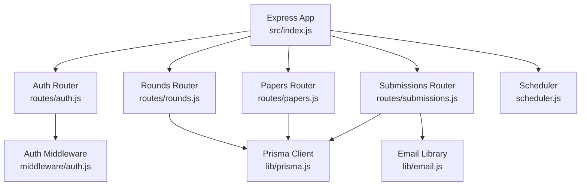
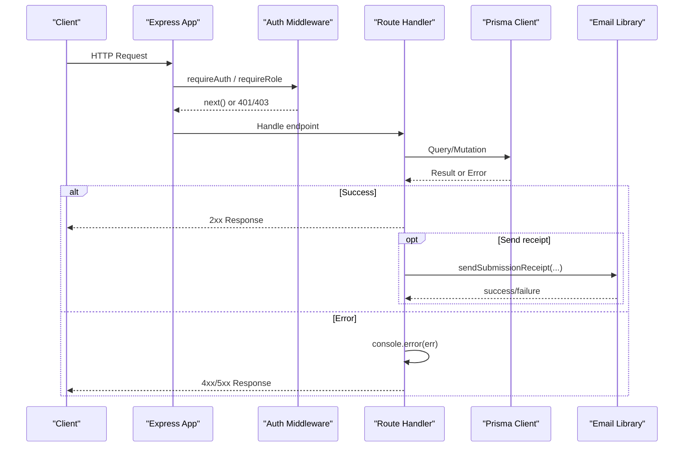
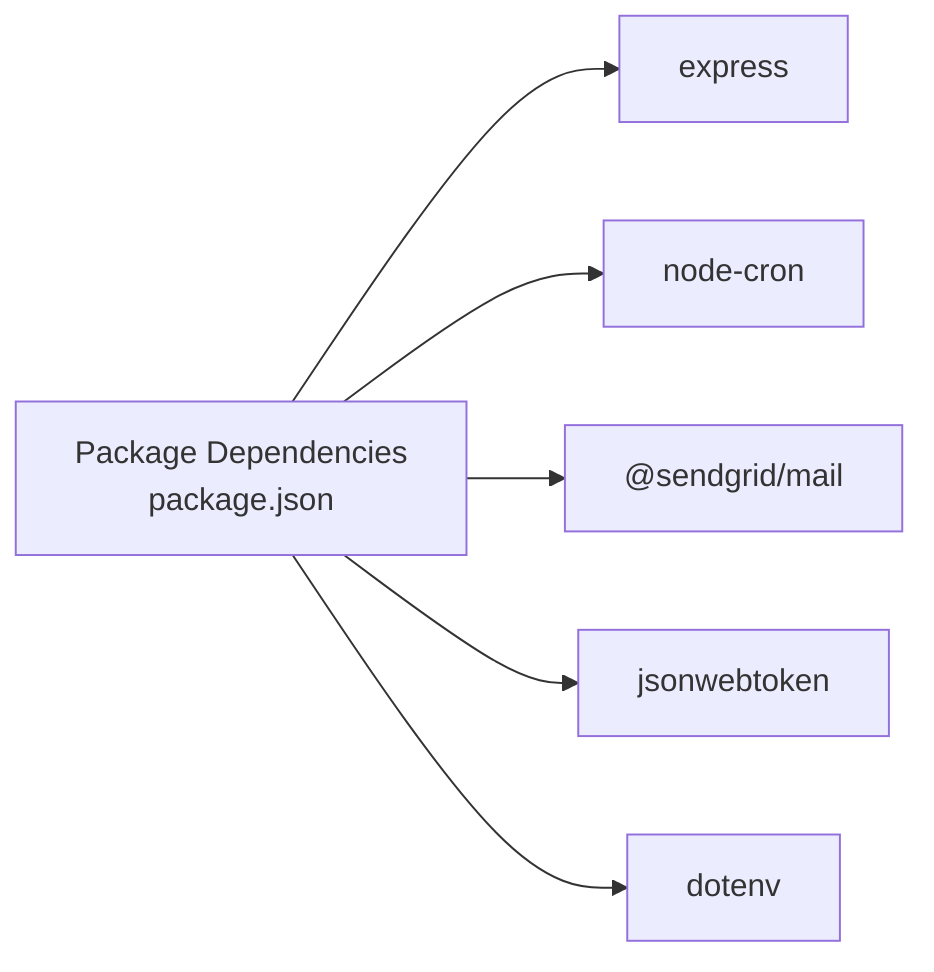

# Monitoring & Logging

<cite>
**Referenced Files in This Document**
- [index.js](file://backend/src/index.js)
- [auth.js](file://backend/src/middleware/auth.js)
- [scheduler.js](file://backend/src/scheduler.js)
- [auth.js](file://backend/src/routes/auth.js)
- [papers.js](file://backend/src/routes/papers.js)
- [rounds.js](file://backend/src/routes/rounds.js)
- [submissions.js](file://backend/src/routes/submissions.js)
- [email.js](file://backend/src/lib/email.js)
- [prisma.js](file://backend/src/lib/prisma.js)
- [package.json](file://backend/package.json)
</cite>

## Table of Contents
1. Introduction
2. Project Structure
3. Core Components
4. Architecture Overview
5. Detailed Component Analysis
6. Dependency Analysis
7. Performance Considerations
8. Troubleshooting Guide
9. Conclusion
10. Appendices

## Introduction
This document provides comprehensive monitoring and logging guidance for the Olympiad Portal backend. It explains the current logging implementation across routes, middleware, and background jobs; outlines error tracking strategies; proposes log aggregation and alerting approaches; and details performance monitoring, request tracing, and debugging techniques for development and production. It also includes guidelines for adding new logs, structured logging formats, retention policies, and security considerations for sensitive data in logs.

## Project Structure
The backend is an Express application with:
- Central app bootstrap and middleware setup
- Feature-based route modules (auth, rounds, papers, submissions)
- Shared middleware for authentication and authorization
- Background scheduler for round state transitions
- Utility libraries (database client, email)

**Diagram sources**
- [index.js:14-32](file://backend/src/index.js#L14-L32)
- [auth.js:5-34](file://backend/src/middleware/auth.js#L5-L34)
- [scheduler.js:4-26](file://backend/src/scheduler.js#L4-L26)
- [auth.js:22-151](file://backend/src/routes/auth.js#L22-L151)
- [rounds.js:6-115](file://backend/src/routes/rounds.js#L6-L115)
- [papers.js:25-98](file://backend/src/routes/papers.js#L25-L98)
- [submissions.js:9-86](file://backend/src/routes/submissions.js#L9-L86)
- [email.js:5-20](file://backend/src/lib/email.js#L5-L20)
- [prisma.js:1-5](file://backend/src/lib/prisma.js#L1-L5)

**Section sources**
- [index.js:14-39](file://backend/src/index.js#L14-L39)
- [package.json:19-31](file://backend/package.json#L19-L31)

## Core Components
- Application bootstrap and global middleware:
  - CORS, cookie parsing, JSON body parsing, static uploads
  - Mounts feature routers under /api
  - Starts the server and background scheduler on process start
- Authentication middleware:
  - Validates JWT from cookies and attaches user context
  - Provides role-based guard composition
- Route handlers:
  - Auth endpoints (register, login, reset password, logout, me, delete account)
  - Rounds CRUD and listing endpoints
  - Papers upload and retrieval
  - Submissions with idempotency and optional auto-marking
- Background scheduler:
  - Periodically updates round states based on open/close times
- Utilities:
  - Prisma database client singleton
  - Email sending for submission receipts

Current logging approach:
- Uses console.log and console.error throughout routes, middleware, scheduler, and utilities
- No structured logger or centralized error handler yet
- Errors are logged to stderr and responses return generic messages to clients

**Section sources**
- [index.js:14-39](file://backend/src/index.js#L14-L39)
- [auth.js:5-34](file://backend/src/middleware/auth.js#L5-L34)
- [auth.js:22-151](file://backend/src/routes/auth.js#L22-L151)
- [rounds.js:6-115](file://backend/src/routes/rounds.js#L6-L115)
- [papers.js:25-98](file://backend/src/routes/papers.js#L25-L98)
- [submissions.js:9-86](file://backend/src/routes/submissions.js#L9-L86)
- [scheduler.js:4-26](file://backend/src/scheduler.js#L4-L26)
- [email.js:5-20](file://backend/src/lib/email.js#L5-L20)
- [prisma.js:1-5](file://backend/src/lib/prisma.js#L1-L5)

## Architecture Overview
Request lifecycle and logging touchpoints:
- Requests enter via Express, pass through global middleware, then route handlers
- Handlers call Prisma for persistence and may send emails
- Errors are caught locally and logged via console.error
- Scheduler runs independently on a cron schedule and logs state changes

**Diagram sources**
- [index.js:14-32](file://backend/src/index.js#L14-L32)
- [auth.js:5-34](file://backend/src/middleware/auth.js#L5-L34)
- [submissions.js:9-86](file://backend/src/routes/submissions.js#L9-L86)
- [email.js:5-20](file://backend/src/lib/email.js#L5-L20)
- [prisma.js:1-5](file://backend/src/lib/prisma.js#L1-L5)

## Detailed Component Analysis

### Application Bootstrap and Global Setup
- Sets up CORS, cookie parser, JSON parsing, and static file serving
- Mounts routers under /api
- Starts server and scheduler when run directly
- Logs startup message

Recommendations:
- Add a global request logger middleware that emits structured logs per request (method, path, status, duration)
- Add a global error handler to capture unhandled exceptions and log them consistently

**Section sources**
- [index.js:14-39](file://backend/src/index.js#L14-L39)

### Authentication Middleware
- Extracts token from cookies, verifies JWT, attaches user to request
- Logs invalid/expired tokens via console.error
- Role guard enforces required roles

Recommendations:
- Log auth events with contextual fields (userId, role, ip, userAgent) without sensitive payloads
- Ensure errors do not leak stack traces to clients

**Section sources**
- [auth.js:5-34](file://backend/src/middleware/auth.js#L5-L34)

### Auth Routes
- Register, login, reset password, logout, me, delete account
- Returns appropriate status codes and messages
- No explicit logging beyond standard responses

Recommendations:
- Add structured logs for key events: successful login, registration, password change, account deletion
- Avoid logging secrets or full payloads; include only safe identifiers

**Section sources**
- [auth.js:22-151](file://backend/src/routes/auth.js#L22-L151)

### Rounds Routes
- Create/list olympiads and rounds; list entrants and submissions
- Uses try/catch blocks and logs errors via console.error
- Returns generic 500 messages on failure

Recommendations:
- Standardize error logging to include operation name, parameters (sanitized), and error code
- Consider adding request correlation IDs for traceability

**Section sources**
- [rounds.js:6-115](file://backend/src/routes/rounds.js#L6-L115)

### Papers Routes
- Upload paper and memo files with multer; parse memoAnswers JSON
- Logs invalid JSON and general errors via console.error
- Enforces access control via role middleware

Recommendations:
- Log upload events with file metadata (size, type) but never content
- Validate and sanitize inputs before logging

**Section sources**
- [papers.js:25-98](file://backend/src/routes/papers.js#L25-L98)

### Submissions Route
- Creates submissions with idempotency key support
- Auto-marks if memo answers exist and creates results
- Sends submission receipt email asynchronously
- Handles duplicate key conflicts gracefully and logs other errors

Recommendations:
- Add structured logs for submission lifecycle: received, processed, marked, emailed
- Include idempotencyKey (safe) and result score for observability

**Section sources**
- [submissions.js:9-86](file://backend/src/routes/submissions.js#L9-L86)

### Background Scheduler
- Runs every 30 seconds to open/close rounds based on time windows
- Logs number of rounds opened/closed and scheduler start

Recommendations:
- Add metrics around scheduling latency and counts
- Ensure logs include timestamps and environment context

**Section sources**
- [scheduler.js:4-26](file://backend/src/scheduler.js#L4-L26)

### Email Library
- Sends submission receipts using SendGrid
- Logs success and failures via console.log/error

Recommendations:
- Capture delivery status and errors with structured fields
- Avoid logging recipient addresses in high-volume environments unless necessary

**Section sources**
- [email.js:5-20](file://backend/src/lib/email.js#L5-L20)

### Database Client
- Singleton Prisma client instance

Recommendations:
- Enable query logging in development via Prisma configuration to aid debugging
- In production, rely on application-level structured logs for business events

**Section sources**
- [prisma.js:1-5](file://backend/src/lib/prisma.js#L1-L5)

## Dependency Analysis
Key runtime dependencies relevant to monitoring/logging:
- Express for HTTP handling
- node-cron for scheduled tasks
- @sendgrid/mail for email notifications
- jsonwebtoken for session management
- dotenv for environment configuration

**Diagram sources**
- [package.json:19-31](file://backend/package.json#L19-L31)

**Section sources**
- [package.json:19-31](file://backend/package.json#L19-L31)

## Performance Considerations
- Current logging uses synchronous console calls; this is acceptable for low-throughput services but can become a bottleneck at scale.
- Consider asynchronous logging sinks (e.g., writing to a buffer or external service) to minimize impact on request latency.
- Avoid logging large payloads or binary data; keep logs concise and structured.
- For database-heavy operations, consider sampling or throttling debug logs in production.

[No sources needed since this section provides general guidance]

## Troubleshooting Guide
Common issues and where to look:
- Authentication failures: check middleware logs for invalid/expired tokens
- Submission errors: inspect route-level error logs and idempotency conflict handling
- Email delivery problems: review email library logs for SendGrid errors
- Scheduler behavior: verify scheduler logs for round state transitions

Actionable steps:
- Reproduce the issue and collect request context (method, path, userId if available)
- Search logs by error keywords and timestamps
- If using a log aggregator, filter by service name and environment tags

**Section sources**
- [auth.js:5-34](file://backend/src/middleware/auth.js#L5-L34)
- [submissions.js:9-86](file://backend/src/routes/submissions.js#L9-L86)
- [email.js:5-20](file://backend/src/lib/email.js#L5-L20)
- [scheduler.js:4-26](file://backend/src/scheduler.js#L4-L26)

## Conclusion
The Olympiad Portal currently relies on console-based logging across routes, middleware, scheduler, and utilities. While functional, it lacks structured logging, centralized error handling, request tracing, and robust alerting. Adopting a structured logger, adding a global request/error middleware, integrating a log aggregation platform, and implementing targeted alerts will significantly improve observability, debugging speed, and operational reliability.

[No sources needed since this section summarizes without analyzing specific files]

## Appendices

### Structured Logging Format Guidelines
- Use consistent fields: timestamp, level, service, env, requestId, method, path, statusCode, durationMs, userId (if available), message
- Never log secrets, passwords, tokens, or full payloads
- Sanitize inputs before inclusion in logs
- Keep log levels meaningful: info for normal flows, warn for recoverable issues, error for failures

[No sources needed since this section provides general guidance]

### Adding New Logging Statements
- Place logs at boundaries: entry/exit of handlers, after critical operations, and in catch blocks
- Prefer structured objects over string concatenation
- Include context: operation name, identifiers, and outcome
- Avoid noisy logs in hot paths; use sampling or conditional logging in production

[No sources needed since this section provides general guidance]

### Log Aggregation and Alerting Approaches
- Aggregate stdout/stderr into a central system (e.g., cloud logging service or ELK stack)
- Parse structured logs to enable querying and dashboards
- Define alerts for:
  - Elevated error rates (e.g., 5xx spikes)
  - Authentication failures exceeding thresholds
  - Email delivery failures
  - Scheduler anomalies (no state changes when expected)

[No sources needed since this section provides general guidance]

### Performance Monitoring and Request Tracing
- Add a request timing middleware to measure latency per endpoint
- Integrate distributed tracing (e.g., OpenTelemetry) to correlate requests across components
- Track database query durations and external API call latencies
- Expose health and readiness endpoints for orchestration tools

[No sources needed since this section provides general guidance]

### Debugging Techniques
- Development:
  - Enable verbose logging and Prisma query logging
  - Use local log viewers to inspect structured logs
- Production:
  - Rely on aggregated logs and tracing
  - Correlate issues using requestId and userId
  - Reduce log verbosity to essential levels

[No sources needed since this section provides general guidance]

### Security and Privacy Considerations
- Do not log sensitive data: passwords, tokens, personal identifiable information (PII), or full request/response bodies
- Mask or omit sensitive fields in logs
- Restrict log access to authorized personnel
- Apply log retention policies aligned with privacy requirements
- Rotate and secure log storage

[No sources needed since this section provides general guidance]