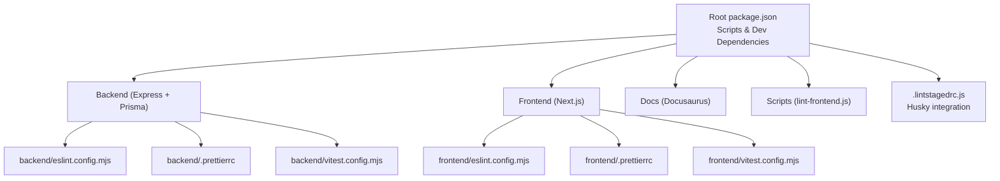
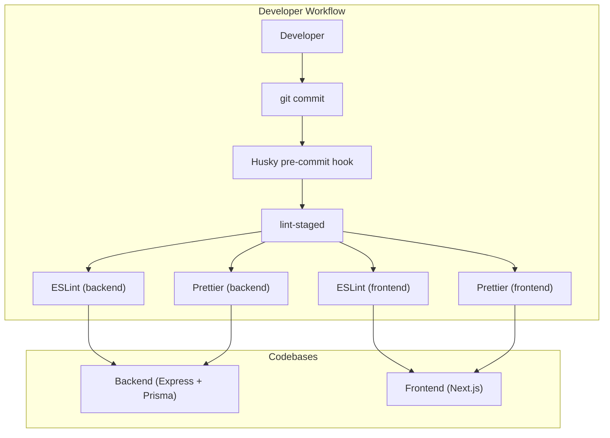
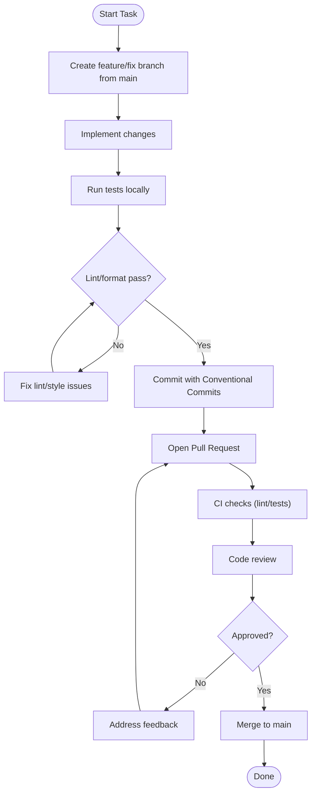
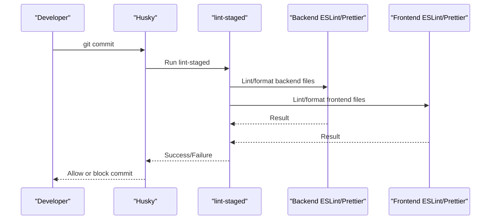
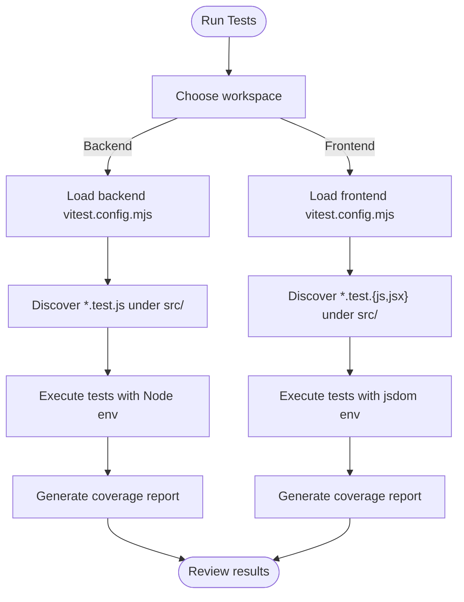
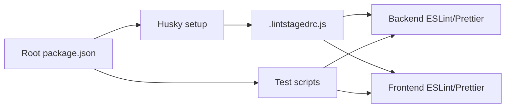

# Developer Guide

<cite>
**Referenced Files in This Document**
- [README.md](file://README.md)
- [package.json](file://package.json)
- [.lintstagedrc.js](file://.lintstagedrc.js)
- [scripts/lint-frontend.js](file://scripts/lint-frontend.js)
- [backend/package.json](file://backend/package.json)
- [backend/eslint.config.mjs](file://backend/eslint.config.mjs)
- [backend/.prettierrc](file://backend/.prettierrc)
- [backend/vitest.config.mjs](file://backend/vitest.config.mjs)
- [backend/README.md](file://backend/README.md)
- [frontend/package.json](file://frontend/package.json)
- [frontend/eslint.config.mjs](file://frontend/eslint.config.mjs)
- [frontend/.prettierrc](file://frontend/.prettierrc)
- [frontend/vitest.config.mjs](file://frontend/vitest.config.mjs)
- [documents/docs/git-methodology.md](file://documents/docs/git-methodology.md)
- [documents/docs/code_quality_tool.md](file://documents/docs/code_quality_tool.md)
</cite>

## Table of Contents
1. [Introduction](#introduction)
2. [Project Structure](#project-structure)
3. [Core Components](#core-components)
4. [Architecture Overview](#architecture-overview)
5. [Detailed Component Analysis](#detailed-component-analysis)
6. [Dependency Analysis](#dependency-analysis)
7. [Performance Considerations](#performance-considerations)
8. [Troubleshooting Guide](#troubleshooting-guide)
9. [Conclusion](#conclusion)
10. [Appendices](#appendices)

## Introduction
This Developer Guide provides a comprehensive, contributor-focused overview of the Olympiad Portal development workflow. It covers code style guidelines, Git branching and contribution procedures, code quality tooling (ESLint, Prettier, Husky), debugging techniques, logging strategies, testing practices, documentation standards, and performance tips. The goal is to help contributors work efficiently and consistently across the monorepo’s backend, frontend, and documentation components.

The project includes:
- A Node.js/Express backend with Prisma and a scheduler for round lifecycle management
- A Next.js frontend
- Shared configuration for linting, formatting, and testing
- Documentation site powered by Docusaurus

**Section sources**
- [README.md:1-1](file://README.md#L1-L1)
- [backend/README.md:1-12](file://backend/README.md#L1-L12)

## Project Structure
The repository is organized as a monorepo with clear separation between backend, frontend, shared assets, scripts, and documentation.

- Root
  - Package scripts orchestrate tests across backend and frontend
  - Linting and formatting are enforced via Husky and lint-staged
- Backend
  - Express server, routes, middleware, Prisma schema/migrations, seed, scheduler
  - ESLint and Prettier configured per folder; Vitest for unit/integration tests
- Frontend
  - Next.js application with React hooks, API client, and tests
  - ESLint based on Next.js config; Prettier for formatting; Vitest for tests
- Documents
  - Docusaurus-based docs including methodology and code quality guides
- Scripts
  - Helper script to run frontend lint/format during pre-commit

**Diagram sources**
- [package.json:6-12](file://package.json#L6-L12)
- [.lintstagedrc.js:1-13](file://.lintstagedrc.js#L1-L13)
- [backend/eslint.config.mjs:1-18](file://backend/eslint.config.mjs#L1-L18)
- [backend/.prettierrc:1-6](file://backend/.prettierrc#L1-L6)
- [backend/vitest.config.mjs:1-28](file://backend/vitest.config.mjs#L1-L28)
- [frontend/eslint.config.mjs:1-17](file://frontend/eslint.config.mjs#L1-L17)
- [frontend/.prettierrc:1-6](file://frontend/.prettierrc#L1-L6)
- [frontend/vitest.config.mjs:1-31](file://frontend/vitest.config.mjs#L1-L31)

**Section sources**
- [package.json:1-23](file://package.json#L1-L23)
- [.lintstagedrc.js:1-13](file://.lintstagedrc.js#L1-L13)
- [scripts/lint-frontend.js:1-9](file://scripts/lint-frontend.js#L1-L9)

## Core Components
This section summarizes the core development tools and workflows that every contributor should know.

- Code Style and Formatting
  - ESLint rules are defined per workspace (backend and frontend) and extended with Prettier to avoid conflicts
  - Prettier settings are consistent across backend and frontend (single quotes, semicolons, trailing commas, 100-char width)
- Pre-commit Hooks
  - Husky triggers lint-staged on commit
  - lint-staged runs ESLint and Prettier on staged files per workspace
- Testing
  - Vitest configured for both backend and frontend with coverage thresholds
  - Test discovery patterns and setup files are explicitly defined
- Scripts
  - Root-level scripts run tests across backend and frontend
  - Workspace-level scripts provide lint, format, test, and start commands

**Section sources**
- [backend/eslint.config.mjs:1-18](file://backend/eslint.config.mjs#L1-L18)
- [frontend/eslint.config.mjs:1-17](file://frontend/eslint.config.mjs#L1-L17)
- [backend/.prettierrc:1-6](file://backend/.prettierrc#L1-L6)
- [frontend/.prettierrc:1-6](file://frontend/.prettierrc#L1-L6)
- [.lintstagedrc.js:1-13](file://.lintstagedrc.js#L1-L13)
- [backend/vitest.config.mjs:1-28](file://backend/vitest.config.mjs#L1-L28)
- [frontend/vitest.config.mjs:1-31](file://frontend/vitest.config.mjs#L1-L31)
- [package.json:6-12](file://package.json#L6-L12)
- [backend/package.json:6-14](file://backend/package.json#L6-L14)
- [frontend/package.json:5-14](file://frontend/package.json#L5-L14)

## Architecture Overview
At a high level, contributors will interact with three main layers:
- Backend services (Express routes, middleware, Prisma data layer, scheduler)
- Frontend UI (Next.js pages, hooks, API client)
- Tooling and CI (ESLint, Prettier, Husky, lint-staged, Vitest)

**Diagram sources**
- [.lintstagedrc.js:1-13](file://.lintstagedrc.js#L1-L13)
- [backend/eslint.config.mjs:1-18](file://backend/eslint.config.mjs#L1-L18)
- [frontend/eslint.config.mjs:1-17](file://frontend/eslint.config.mjs#L1-L17)
- [backend/.prettierrc:1-6](file://backend/.prettierrc#L1-L6)
- [frontend/.prettierrc:1-6](file://frontend/.prettierrc#L1-L6)

## Detailed Component Analysis

### Development Workflow and Contribution Procedures
- Branching Strategy
  - Create one branch per task or feature from main
  - Use descriptive names tied to tickets when possible
- Commit Conventions
  - Follow Conventional Commits for clarity and automation-friendly history
- Merging
  - Merge via Pull Requests after CI passes and at least one approval
- Versioning
  - Tag releases at sprint boundaries using MAJOR.MINOR.PATCH and maintain a CHANGELOG

**Section sources**
- [documents/docs/git-methodology.md:1-37](file://documents/docs/git-methodology.md#L1-L37)

### Code Quality Tools Setup (ESLint, Prettier, Husky)
- ESLint
  - Backend uses a Node-focused config with globals and CommonJS support where needed
  - Frontend uses Next.js recommended rules with global ignores for build artifacts
- Prettier
  - Consistent settings across backend and frontend
- Husky and lint-staged
  - Pre-commit hook runs lint-staged which applies ESLint and Prettier to staged files per workspace
  - A helper script ensures frontend files are linted and formatted correctly during staging

**Diagram sources**
- [.lintstagedrc.js:1-13](file://.lintstagedrc.js#L1-L13)
- [scripts/lint-frontend.js:1-9](file://scripts/lint-frontend.js#L1-L9)
- [backend/eslint.config.mjs:1-18](file://backend/eslint.config.mjs#L1-L18)
- [frontend/eslint.config.mjs:1-17](file://frontend/eslint.config.mjs#L1-L17)
- [backend/.prettierrc:1-6](file://backend/.prettierrc#L1-L6)
- [frontend/.prettierrc:1-6](file://frontend/.prettierrc#L1-L6)

**Section sources**
- [documents/docs/code_quality_tool.md:1-43](file://documents/docs/code_quality_tool.md#L1-L43)
- [.lintstagedrc.js:1-13](file://.lintstagedrc.js#L1-L13)
- [scripts/lint-frontend.js:1-9](file://scripts/lint-frontend.js#L1-L9)
- [backend/eslint.config.mjs:1-18](file://backend/eslint.config.mjs#L1-L18)
- [frontend/eslint.config.mjs:1-17](file://frontend/eslint.config.mjs#L1-L17)
- [backend/.prettierrc:1-6](file://backend/.prettierrc#L1-L6)
- [frontend/.prettierrc:1-6](file://frontend/.prettierrc#L1-L6)

### Testing Strategy and Coverage
- Backend
  - Vitest configured for Node environment with explicit include patterns and setup file
  - Coverage thresholds set for lines, functions, branches, statements
- Frontend
  - Vitest configured for jsdom environment with React plugin
  - Coverage targets specific directories (lib, hooks) and excludes tests and test setup
- Running Tests
  - Use workspace scripts to run tests and generate coverage reports
  - Root scripts can run tests across both workspaces

**Diagram sources**
- [backend/vitest.config.mjs:1-28](file://backend/vitest.config.mjs#L1-L28)
- [frontend/vitest.config.mjs:1-31](file://frontend/vitest.config.mjs#L1-L31)

**Section sources**
- [backend/vitest.config.mjs:1-28](file://backend/vitest.config.mjs#L1-L28)
- [frontend/vitest.config.mjs:1-31](file://frontend/vitest.config.mjs#L1-L31)
- [backend/package.json:6-14](file://backend/package.json#L6-L14)
- [frontend/package.json:5-14](file://frontend/package.json#L5-L14)
- [package.json:6-12](file://package.json#L6-L12)

### Debugging Techniques and Logging Strategies
- Backend
  - Use standard console logging for local development; consider structured logs for production
  - Leverage Prisma query logging in development to inspect database interactions
  - Inspect request/response cycles in route handlers and middleware
- Frontend
  - Use browser developer tools to inspect network requests and state
  - Add targeted logs around async flows and error paths
- General Tips
  - Keep logs concise and contextual; avoid sensitive data in logs
  - Use environment variables to toggle verbose logging in dev vs prod

[No sources needed since this section provides general guidance]

### Writing Documentation
- Update or add pages under the documentation site directory
- Follow existing structure and conventions for consistency
- Ensure links and references are valid before submitting changes

[No sources needed since this section provides general guidance]

### Adding Tests
- Place tests adjacent to source files with .test.js suffix
- Use Vitest APIs for assertions and mocking as appropriate
- Maintain coverage thresholds and ensure new code meets them

**Section sources**
- [backend/vitest.config.mjs:1-28](file://backend/vitest.config.mjs#L1-L28)
- [frontend/vitest.config.mjs:1-31](file://frontend/vitest.config.mjs#L1-L31)

### Performing Code Reviews
- Ensure all CI checks pass (lint, tests)
- Verify adherence to coding standards and architecture principles
- Validate test coverage and correctness of edge cases
- Provide constructive feedback focused on clarity, maintainability, and performance

[No sources needed since this section provides general guidance]

## Dependency Analysis
This section highlights how development dependencies and scripts coordinate across the monorepo.

**Diagram sources**
- [package.json:6-12](file://package.json#L6-L12)
- [.lintstagedrc.js:1-13](file://.lintstagedrc.js#L1-L13)

**Section sources**
- [package.json:16-21](file://package.json#L16-L21)
- [backend/package.json:33-44](file://backend/package.json#L33-L44)
- [frontend/package.json:21-34](file://frontend/package.json#L21-L34)
- [.lintstagedrc.js:1-13](file://.lintstagedrc.js#L1-L13)

## Performance Considerations
- Linting and Formatting
  - Rely on pre-commit hooks to catch issues early; keep rule sets minimal and relevant
- Testing
  - Use selective test runs for faster iteration; leverage watch mode during development
  - Focus coverage on critical paths (e.g., lib and hooks in frontend)
- Database
  - Use Prisma query logging in development to identify slow queries
  - Apply proper indexing and pagination in backend endpoints
- Frontend
  - Avoid unnecessary re-renders; memoize expensive computations
  - Defer heavy operations off the main thread when possible

[No sources needed since this section provides general guidance]

## Troubleshooting Guide
- Pre-commit Hook Failures
  - If commits are blocked, run the corresponding lint/format commands locally to fix issues
  - For frontend-specific issues, use the helper script invoked by lint-staged
- Linting Errors
  - Backend: Run the workspace lint command to auto-fix where possible
  - Frontend: Run the workspace lint command to apply fixes
- Test Failures
  - Run tests in watch mode to iterate quickly
  - Check coverage thresholds if tests are failing due to insufficient coverage
- Environment Issues
  - Ensure required environment variables are set for backend services (database, email, etc.)
  - Confirm Prisma client generation is up-to-date after schema changes

**Section sources**
- [.lintstagedrc.js:1-13](file://.lintstagedrc.js#L1-L13)
- [scripts/lint-frontend.js:1-9](file://scripts/lint-frontend.js#L1-L9)
- [backend/package.json:6-14](file://backend/package.json#L6-L14)
- [frontend/package.json:5-14](file://frontend/package.json#L5-L14)
- [backend/vitest.config.mjs:1-28](file://backend/vitest.config.mjs#L1-L28)
- [frontend/vitest.config.mjs:1-31](file://frontend/vitest.config.mjs#L1-L31)

## Conclusion
By following the outlined development workflow, code style guidelines, and tooling setup, contributors can maintain a consistent, high-quality codebase. Embrace pre-commit hooks, write meaningful tests, and document changes thoroughly. Adhering to these practices ensures smooth collaboration and reliable delivery of features for the Olympiad Portal.

[No sources needed since this section summarizes without analyzing specific files]

## Appendices

### Quick Commands Reference
- Backend
  - Run tests: workspace test script
  - Generate coverage: workspace test:coverage script
  - Lint: workspace lint script
  - Format: workspace format script
- Frontend
  - Run tests: workspace test script
  - Generate coverage: workspace test:coverage script
  - Lint: workspace lint script
  - Format: workspace format script
- Monorepo
  - Run all tests: root test script
  - Generate all coverage: root test:coverage script

**Section sources**
- [backend/package.json:6-14](file://backend/package.json#L6-L14)
- [frontend/package.json:5-14](file://frontend/package.json#L5-L14)
- [package.json:6-12](file://package.json#L6-L12)