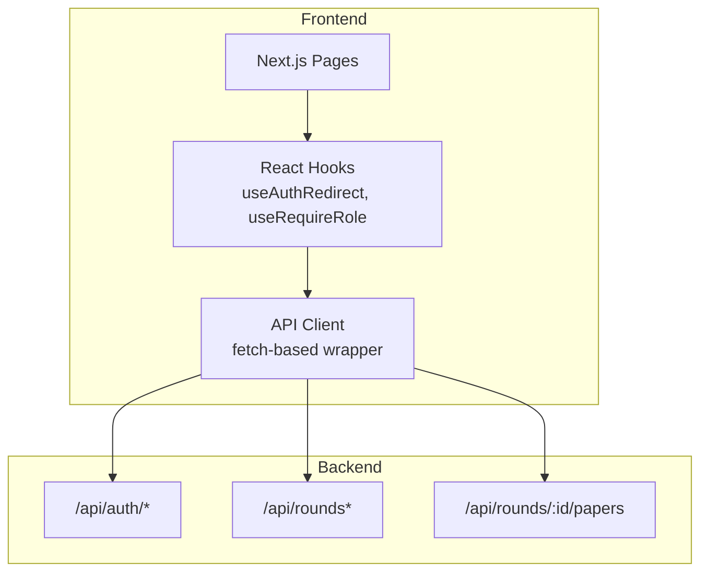
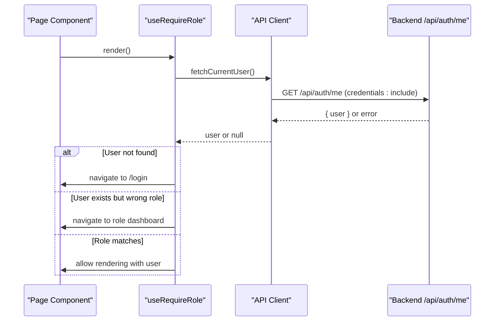
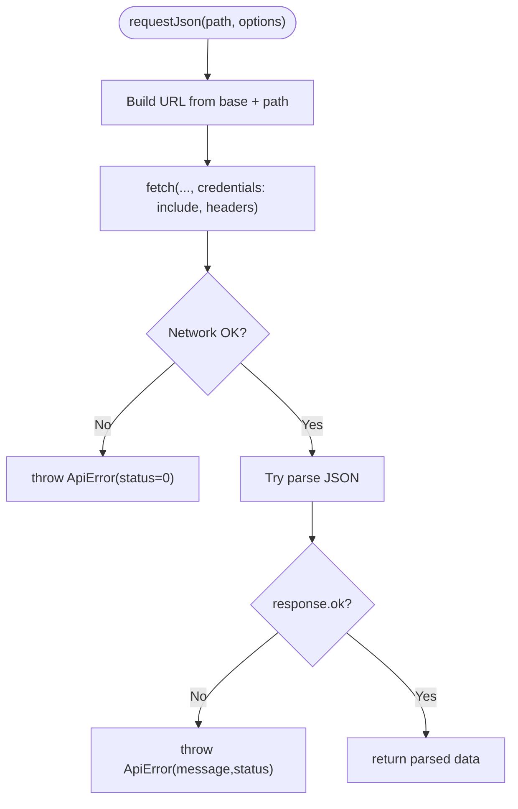
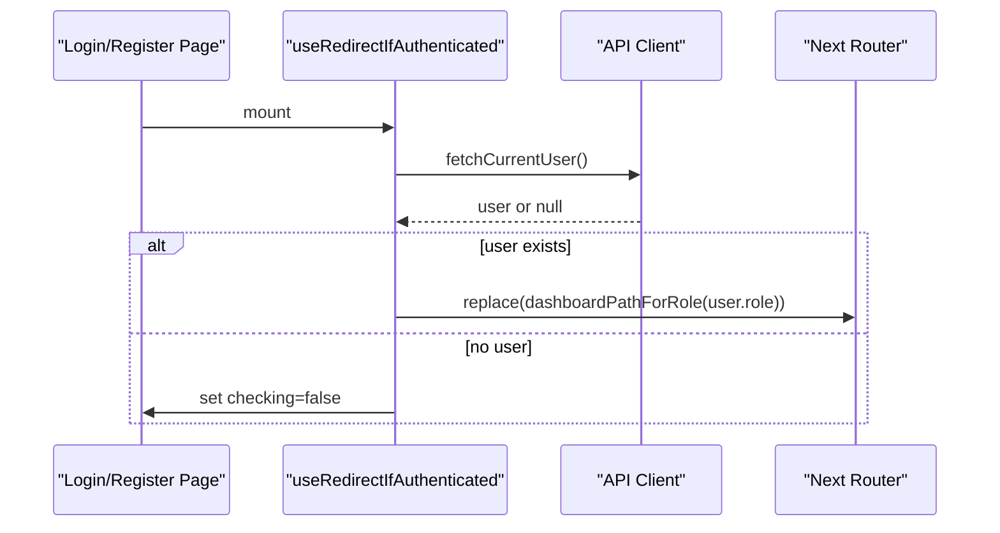
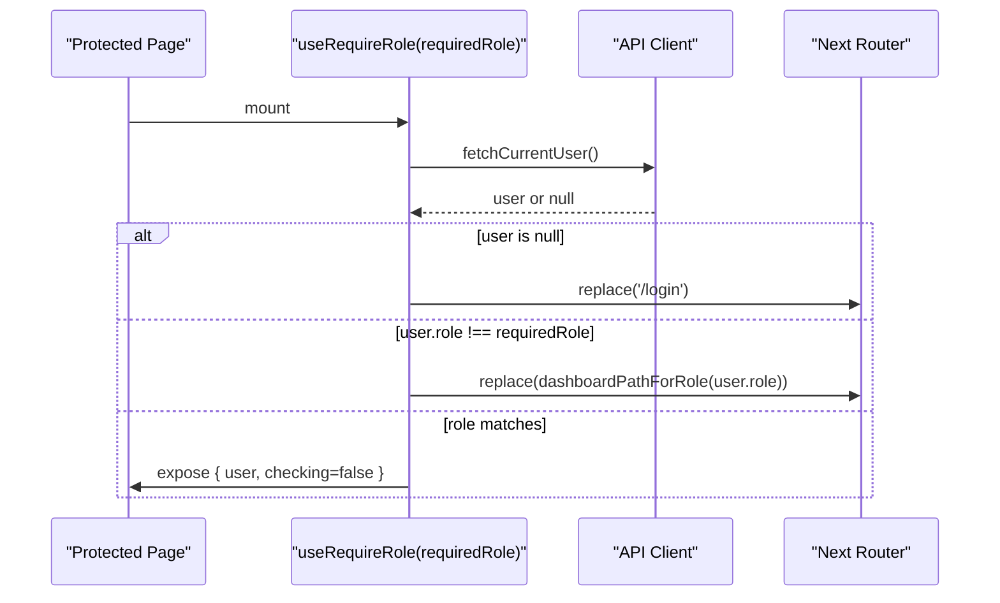
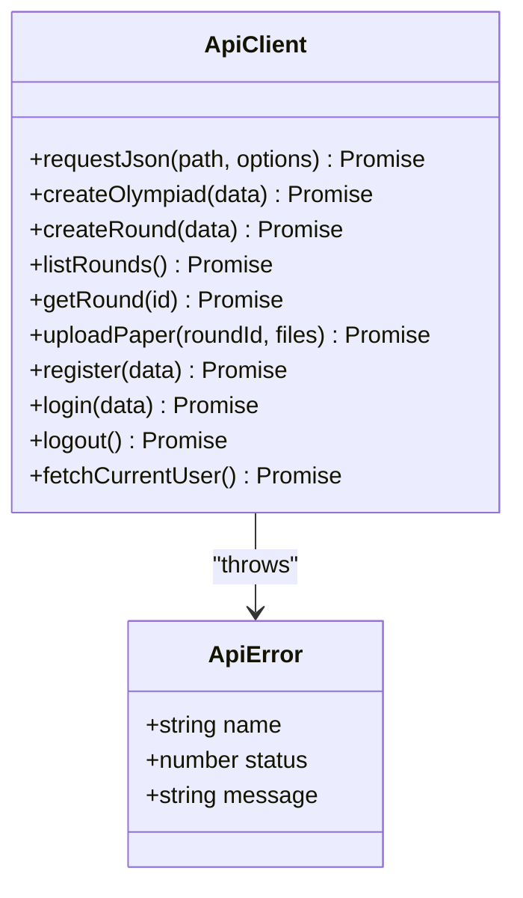
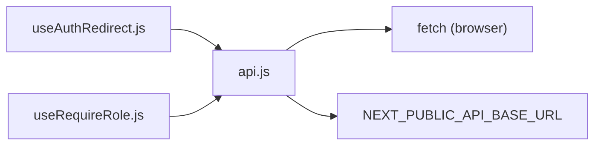

# API Integration Layer

<cite>
**Referenced Files in This Document**
- [api.js](file://frontend/src/lib/api.js)
- [useAuthRedirect.js](file://frontend/src/hooks/useAuthRedirect.js)
- [useRequireRole.js](file://frontend/src/hooks/useRequireRole.js)
- [api.test.js](file://frontend/src/lib/api.test.js)
- [useAuthRedirect.test.js](file://frontend/src/hooks/useAuthRedirect.test.js)
- [useRequireRole.test.js](file://frontend/src/hooks/useRequireRole.test.js)
</cite>

## Table of Contents
1. [Introduction](#introduction)
2. [Project Structure](#project-structure)
3. [Core Components](#core-components)
4. [Architecture Overview](#architecture-overview)
5. [Detailed Component Analysis](#detailed-component-analysis)
6. [Dependency Analysis](#dependency-analysis)
7. [Performance Considerations](#performance-considerations)
8. [Troubleshooting Guide](#troubleshooting-guide)
9. [Conclusion](#conclusion)

## Introduction
This document explains the frontend API integration layer for the Olympiad Portal. It focuses on the centralized API client built with fetch, how requests and responses are handled, error management, authentication token handling via cookies, and the custom hooks that manage authentication flow and role-based access control. It also covers request interception patterns, retry strategies, error boundaries, caching approaches, optimistic updates, and real-time synchronization considerations.

## Project Structure
The relevant frontend code is organized into:
- A shared API client module that centralizes HTTP calls and error handling.
- Custom React hooks that enforce authentication and authorization at the page level.
- Tests that validate behavior for both the API client and hooks.

**Diagram sources**
- [api.js:17-45](file://frontend/src/lib/api.js#L17-L45)
- [api.js:47-139](file://frontend/src/lib/api.js#L47-L139)
- [useAuthRedirect.js:1-32](file://frontend/src/hooks/useAuthRedirect.js#L1-L32)
- [useRequireRole.js:1-39](file://frontend/src/hooks/useRequireRole.js#L1-L39)

**Section sources**
- [api.js:1-146](file://frontend/src/lib/api.js#L1-L146)
- [useAuthRedirect.js:1-32](file://frontend/src/hooks/useAuthRedirect.js#L1-L32)
- [useRequireRole.js:1-39](file://frontend/src/hooks/useRequireRole.js#L1-L39)

## Core Components
- Centralized API client using fetch with a unified error type and consistent response handling.
- Authentication helpers to register, login, logout, and fetch current user.
- Role-aware dashboard path mapping.
- React hooks to redirect authenticated users and enforce required roles.

Key responsibilities:
- Normalize network errors and non-2xx responses into typed errors.
- Attach credentials (cookies) automatically for session-based auth.
- Provide typed endpoints for common operations like creating rounds, listing rounds, uploading papers, and managing auth.

**Section sources**
- [api.js:5-11](file://frontend/src/lib/api.js#L5-L11)
- [api.js:17-45](file://frontend/src/lib/api.js#L17-L45)
- [api.js:47-139](file://frontend/src/lib/api.js#L47-L139)
- [api.js:141-145](file://frontend/src/lib/api.js#L141-L145)

## Architecture Overview
The API client wraps fetch to standardize headers, credentials, and error handling. Hooks call the client to determine user state and enforce navigation rules based on roles.

**Diagram sources**
- [useRequireRole.js:7-38](file://frontend/src/hooks/useRequireRole.js#L7-L38)
- [api.js:128-135](file://frontend/src/lib/api.js#L128-L135)

## Detailed Component Analysis

### Centralized API Client
- Base URL configuration via environment variable with a sensible default.
- Unified JSON request helper that:
  - Sets Content-Type to application/json.
  - Includes credentials for cookie-based sessions.
  - Catches network failures and throws a typed ApiError.
  - Parses JSON when possible; falls back to status-based messages if the body is not JSON.
  - Throws ApiError for non-2xx responses, preferring server-provided error messages.
- Endpoint functions for:
  - Olympiads and rounds CRUD.
  - Paper uploads using FormData.
  - Authentication flows: register, login, logout, and fetching current user.
  - Role-to-dashboard path mapping.

**Diagram sources**
- [api.js:17-45](file://frontend/src/lib/api.js#L17-L45)

**Section sources**
- [api.js:1-45](file://frontend/src/lib/api.js#L1-L45)
- [api.js:47-139](file://frontend/src/lib/api.js#L47-L139)
- [api.js:141-145](file://frontend/src/lib/api.js#L141-L145)

### Authentication Flow Hooks

#### Redirect If Authenticated
- Purpose: Prevent already-authenticated users from seeing login/register pages by redirecting them to their appropriate dashboard.
- Behavior:
  - Checks current user via the API client.
  - If a user exists, navigates to the role-specific dashboard path.
  - Returns a checking flag to indicate pending resolution.

**Diagram sources**
- [useAuthRedirect.js:9-31](file://frontend/src/hooks/useAuthRedirect.js#L9-L31)
- [api.js:128-135](file://frontend/src/lib/api.js#L128-L135)
- [api.js:141-145](file://frontend/src/lib/api.js#L141-L145)

**Section sources**
- [useAuthRedirect.js:1-32](file://frontend/src/hooks/useAuthRedirect.js#L1-L32)
- [useAuthRedirect.test.js:23-65](file://frontend/src/hooks/useAuthRedirect.test.js#L23-L65)

#### Require Role
- Purpose: Guard pages requiring a specific role.
- Behavior:
  - Fetches current user.
  - If not authenticated, redirects to login.
  - If authenticated but role does not match, redirects to the user’s dashboard.
  - If role matches, exposes user and clears checking state.

**Diagram sources**
- [useRequireRole.js:7-38](file://frontend/src/hooks/useRequireRole.js#L7-L38)
- [api.js:128-135](file://frontend/src/lib/api.js#L128-L135)
- [api.js:141-145](file://frontend/src/lib/api.js#L141-L145)

**Section sources**
- [useRequireRole.js:1-39](file://frontend/src/hooks/useRequireRole.js#L1-L39)
- [useRequireRole.test.js:23-86](file://frontend/src/hooks/useRequireRole.test.js#L23-L86)

### Request Interception and Error Handling
- Interception pattern: The requestJson helper acts as a single interception point for all JSON requests, ensuring consistent headers, credentials, and error normalization.
- Error types:
  - Network errors throw ApiError with status 0.
  - Non-2xx responses throw ApiError with the HTTP status and either a server-provided message or a generic fallback.
- Upload endpoint uses FormData directly while still enforcing credentials and error handling.

**Diagram sources**
- [api.js:5-11](file://frontend/src/lib/api.js#L5-L11)
- [api.js:17-45](file://frontend/src/lib/api.js#L17-L45)
- [api.js:47-139](file://frontend/src/lib/api.js#L47-L139)

**Section sources**
- [api.js:5-11](file://frontend/src/lib/api.js#L5-L11)
- [api.js:17-45](file://frontend/src/lib/api.js#L17-L45)
- [api.test.js:30-109](file://frontend/src/lib/api.test.js#L30-L109)

### Retry Logic
- Current implementation: No automatic retry logic is present in the API client.
- Recommendation: Add exponential backoff retries for transient errors (e.g., 5xx, network timeouts) with a bounded number of attempts and jitter. Implement per-endpoint policies where needed.

[No sources needed since this section provides general guidance]

### Error Boundaries
- Current implementation: No explicit React error boundaries are present in the referenced files.
- Recommendation: Wrap route-level components with error boundaries to catch rendering errors and display graceful fallback UI. For network errors, rely on ApiError propagation and handle them in components or global error handlers.

[No sources needed since this section provides general guidance]

### Caching Strategies
- Current implementation: No client-side caching is implemented in the API client.
- Recommendations:
  - Use React Query or SWR for declarative caching, background refetching, and deduplication.
  - Cache GET endpoints with appropriate stale-while-revalidate semantics.
  - Invalidate caches on mutations (e.g., after creating or updating rounds).

[No sources needed since this section provides general guidance]

### Optimistic Updates
- Current implementation: Not present in the API client or hooks.
- Recommendations:
  - On create/update/delete mutations, optimistically update local state before the API call.
  - Revert on failure and show inline error feedback.
  - Combine with cache invalidation to keep UI consistent.

[No sources needed since this section provides general guidance]

### Real-Time Data Synchronization
- Current implementation: No real-time features (e.g., WebSockets, SSE) are present in the referenced files.
- Recommendations:
  - Use Server-Sent Events or WebSockets for live round status changes or submission updates.
  - Integrate with a caching layer to reconcile real-time events with cached data.

[No sources needed since this section provides general guidance]

## Dependency Analysis
The hooks depend on the API client for user state, and the API client depends on fetch and environment configuration.

**Diagram sources**
- [useAuthRedirect.js:1-32](file://frontend/src/hooks/useAuthRedirect.js#L1-L32)
- [useRequireRole.js:1-39](file://frontend/src/hooks/useRequireRole.js#L1-L39)
- [api.js:1-45](file://frontend/src/lib/api.js#L1-L45)

**Section sources**
- [useAuthRedirect.js:1-32](file://frontend/src/hooks/useAuthRedirect.js#L1-L32)
- [useRequireRole.js:1-39](file://frontend/src/hooks/useRequireRole.js#L1-L39)
- [api.js:1-45](file://frontend/src/lib/api.js#L1-L45)

## Performance Considerations
- Keep the API client minimal and focused on request/response normalization to avoid overhead.
- Avoid unnecessary re-fetches by introducing caching layers (React Query/SWR).
- Debounce rapid navigation or repeated checks in hooks to reduce redundant calls.
- For large file uploads, consider progress indicators and chunked uploads if supported by the backend.

[No sources needed since this section provides general guidance]

## Troubleshooting Guide
Common issues and how to diagnose them:
- Network unreachable:
  - Symptom: ApiError with status 0 and a message indicating the server could not be reached.
  - Action: Verify backend is running and reachable at the configured base URL.
- Non-2xx responses:
  - Symptom: ApiError with HTTP status and message derived from server payload or a generic fallback.
  - Action: Inspect server logs and ensure request payloads and headers are correct.
- Authentication state mismatches:
  - Symptom: Unexpected redirects or protected content not rendering.
  - Action: Confirm cookies are being sent (credentials: include) and that the backend sets valid session cookies.
- Upload failures:
  - Symptom: ApiError during paper upload.
  - Action: Validate FormData fields and file presence; check backend validation errors.

Validation references:
- Network and HTTP error behaviors are validated in tests.
- Hook navigation behaviors are validated for both authenticated and unauthenticated states.

**Section sources**
- [api.test.js:30-109](file://frontend/src/lib/api.test.js#L30-L109)
- [useAuthRedirect.test.js:23-65](file://frontend/src/hooks/useAuthRedirect.test.js#L23-L65)
- [useRequireRole.test.js:23-86](file://frontend/src/hooks/useRequireRole.test.js#L23-L86)

## Conclusion
The frontend integrates with the backend through a centralized, fetch-based API client that standardizes headers, credentials, and error handling. Authentication and authorization are enforced via two React hooks that read current user state and redirect accordingly. While robust error handling is in place, additional features such as retry logic, caching, optimistic updates, and real-time synchronization can be layered on top to improve resilience and user experience.