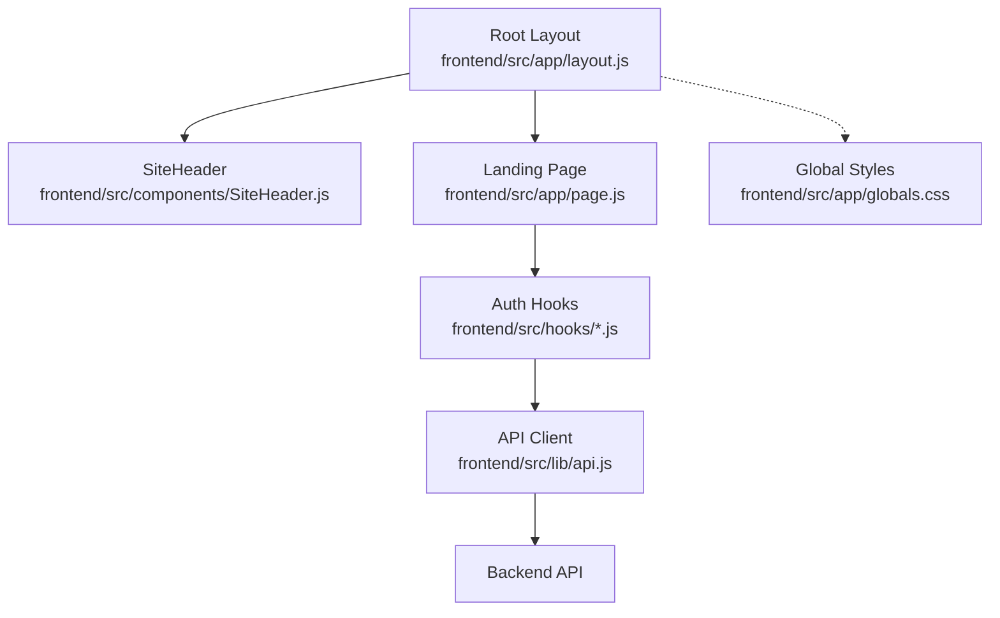
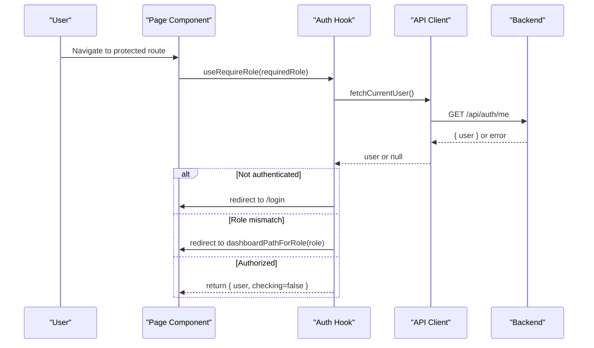
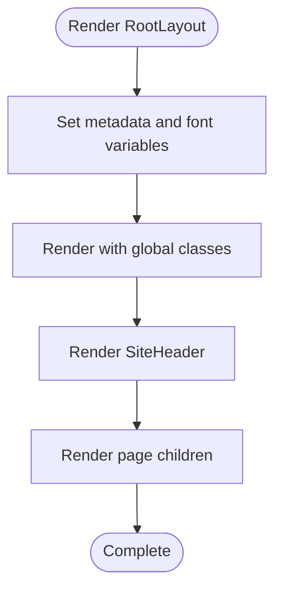
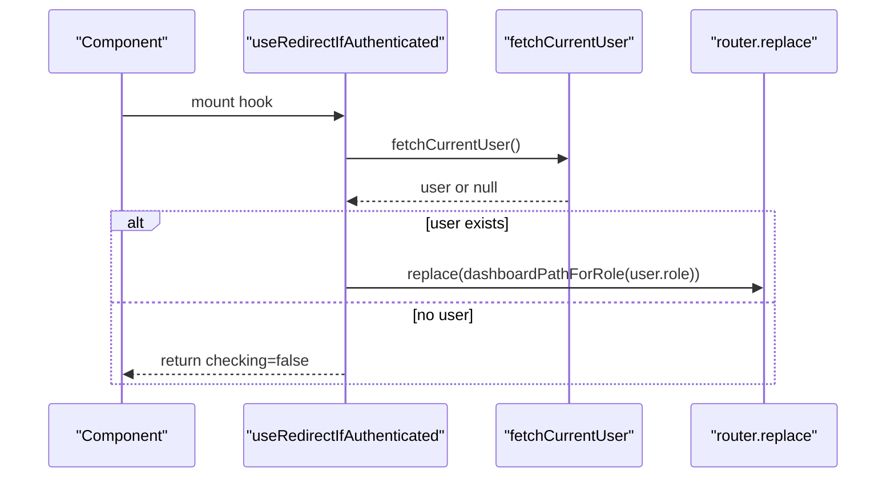
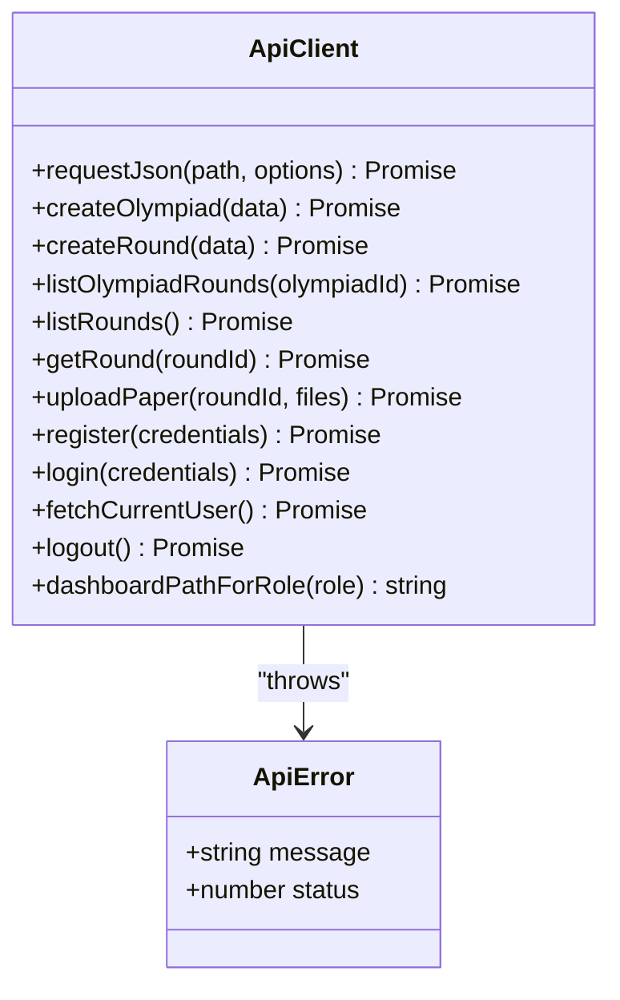
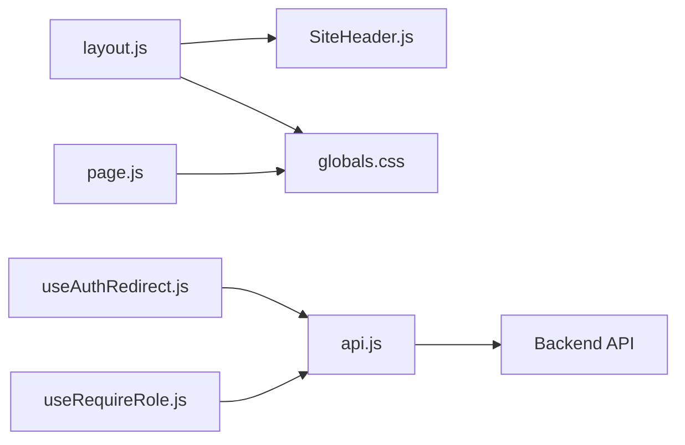
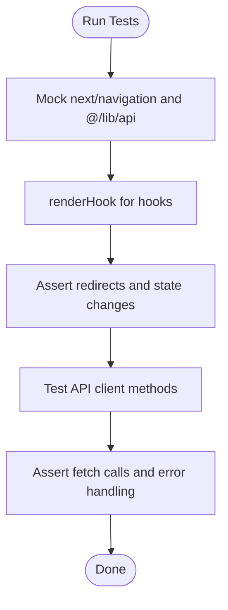

# Component Structure & Organization

<cite>
**Referenced Files in This Document**
- [layout.js](file://frontend/src/app/layout.js)
- [SiteHeader.js](file://frontend/src/components/SiteHeader.js)
- [page.js](file://frontend/src/app/page.js)
- [useAuthRedirect.js](file://frontend/src/hooks/useAuthRedirect.js)
- [useRequireRole.js](file://frontend/src/hooks/useRequireRole.js)
- [api.js](file://frontend/src/lib/api.js)
- [types.js](file://shared/types.js)
- [globals.css](file://frontend/src/app/globals.css)
- [useAuthRedirect.test.js](file://frontend/src/hooks/useAuthRedirect.test.js)
- [useRequireRole.test.js](file://frontend/src/hooks/useRequireRole.test.js)
- [api.test.js](file://frontend/src/lib/api.test.js)
</cite>

## Table of Contents
1. [Introduction](#introduction)
2. [Project Structure](#project-structure)
3. [Core Components](#core-components)
4. [Architecture Overview](#architecture-overview)
5. [Detailed Component Analysis](#detailed-component-analysis)
6. [Dependency Analysis](#dependency-analysis)
7. [Performance Considerations](#performance-considerations)
8. [Troubleshooting Guide](#troubleshooting-guide)
9. [Conclusion](#conclusion)
10. [Appendices](#appendices)

## Introduction
This document explains the React component architecture of the Olympiad Portal frontend, focusing on how the root layout composes UI components like SiteHeader, how pages are structured, and how authentication-related logic is encapsulated in custom hooks. It also covers prop interfaces, state management patterns, separation of concerns between presentational and container-like components, testing strategies, and performance considerations such as memoization and efficient re-renders.

## Project Structure
The frontend follows a Next.js App Router structure:
- Root layout defines global fonts, metadata, and wraps all pages with a shared header.
- Pages define route-level views (e.g., landing page).
- Reusable UI components live under a dedicated folder.
- Custom hooks encapsulate navigation and authorization logic.
- A shared API client centralizes HTTP requests and error handling.
- Global styles and Tailwind configuration provide consistent theming.

**Diagram sources**
- [layout.js:1-44](file://frontend/src/app/layout.js#L1-L44)
- [SiteHeader.js:1-52](file://frontend/src/components/SiteHeader.js#L1-L52)
- [page.js:1-85](file://frontend/src/app/page.js#L1-L85)
- [useAuthRedirect.js:1-32](file://frontend/src/hooks/useAuthRedirect.js#L1-L32)
- [useRequireRole.js:1-39](file://frontend/src/hooks/useRequireRole.js#L1-L39)
- [api.js:1-146](file://frontend/src/lib/api.js#L1-L146)
- [globals.css:1-456](file://frontend/src/app/globals.css#L1-L456)

**Section sources**
- [layout.js:1-44](file://frontend/src/app/layout.js#L1-L44)
- [SiteHeader.js:1-52](file://frontend/src/components/SiteHeader.js#L1-L52)
- [page.js:1-85](file://frontend/src/app/page.js#L1-L85)
- [globals.css:1-456](file://frontend/src/app/globals.css#L1-L456)

## Core Components
- Root Layout: Provides global HTML/body classes, injects font variables, sets metadata, and renders SiteHeader plus page content via children.
- SiteHeader: A client-side component that adapts its appearance based on the current path and renders navigation links for public vs authenticated contexts.
- Landing Page: A presentational page showcasing key steps and calls to action.

Key responsibilities:
- Layout handles global shell and theme setup.
- SiteHeader encapsulates navigation behavior and visual context switching.
- Pages compose higher-level features and link to routes.

**Section sources**
- [layout.js:27-44](file://frontend/src/app/layout.js#L27-L44)
- [SiteHeader.js:8-50](file://frontend/src/components/SiteHeader.js#L8-L50)
- [page.js:17-84](file://frontend/src/app/page.js#L17-L84)

## Architecture Overview
The application separates concerns across layers:
- Presentation layer: Pages and UI components render the user interface using Tailwind classes and global CSS.
- Behavior layer: Custom hooks manage authentication checks and routing decisions.
- Data layer: A centralized API client abstracts network requests, error normalization, and role-based routing helpers.

**Diagram sources**
- [useRequireRole.js:7-38](file://frontend/src/hooks/useRequireRole.js#L7-L38)
- [api.js:128-135](file://frontend/src/lib/api.js#L128-L135)
- [api.js:141-145](file://frontend/src/lib/api.js#L141-L145)

## Detailed Component Analysis

### Root Layout
- Responsibilities:
  - Define global metadata and font variables.
  - Provide a full-height body with flex column layout.
  - Render SiteHeader at the top and pass children to it.
- Styling:
  - Uses Tailwind utility classes and CSS variables from globals.css.
- Composition:
  - Wraps all routes; ensures consistent chrome across the app.

**Diagram sources**
- [layout.js:27-44](file://frontend/src/app/layout.js#L27-L44)

**Section sources**
- [layout.js:1-44](file://frontend/src/app/layout.js#L1-L44)

### SiteHeader
- Responsibilities:
  - Determine if the current page is public and switch styling accordingly.
  - Render logo and navigation links appropriate to the context.
- State and side effects:
  - Reads current pathname from Next.js navigation to compute visibility.
- Prop interface:
  - No props; behavior driven by router context.

```mermaid
flowchart TD
Enter(["Mount SiteHeader"]) --> GetPath["Read current pathname"]
GetPath --> CheckPublic{"Is public page?"}
CheckPublic --> |Yes| PublicStyle["Apply public header styles"]
CheckPublic --> |No| AuthStyle["Apply authenticated header styles"]
PublicStyle --> RenderNavPublic["Render Register/Login links"]
AuthStyle --> RenderNavAuth["Render Rounds link"]
RenderNavPublic --> Exit(["Return header"])
RenderNavAuth --> Exit
```

**Diagram sources**
- [SiteHeader.js:8-50](file://frontend/src/components/SiteHeader.js#L8-L50)

**Section sources**
- [SiteHeader.js:1-52](file://frontend/src/components/SiteHeader.js#L1-L52)

### Landing Page
- Responsibilities:
  - Present hero messaging and three-step process.
  - Provide primary calls to action to login/register.
- Composition:
  - Purely presentational; no data fetching or side effects.
- Styling:
  - Leverages Tailwind utilities and global CSS animations.

**Section sources**
- [page.js:1-85](file://frontend/src/app/page.js#L1-L85)

### Authentication Hooks
- useRedirectIfAuthenticated:
  - Checks current user and redirects to the appropriate dashboard if already logged in.
  - Returns a boolean indicating whether authentication check is still in progress.
- useRequireRole:
  - Ensures the current user exists and has the required role.
  - Redirects to login or role-appropriate dashboard when necessary.
  - Returns user object and a checking flag for loading states.

**Diagram sources**
- [useAuthRedirect.js:9-31](file://frontend/src/hooks/useAuthRedirect.js#L9-L31)
- [api.js:128-135](file://frontend/src/lib/api.js#L128-L135)
- [api.js:141-145](file://frontend/src/lib/api.js#L141-L145)

**Section sources**
- [useAuthRedirect.js:1-32](file://frontend/src/hooks/useAuthRedirect.js#L1-L32)
- [useRequireRole.js:1-39](file://frontend/src/hooks/useRequireRole.js#L1-L39)

### API Client
- Centralized JSON request helper:
  - Normalizes errors into a custom ApiError with status codes.
  - Handles network failures and non-JSON responses gracefully.
- Feature functions:
  - CRUD operations for rounds and olympiads.
  - File upload for papers with optional memo and answers.
  - Authentication endpoints: register, login, logout, and current user retrieval.
- Routing helper:
  - Maps roles to dashboard paths.

**Diagram sources**
- [api.js:5-11](file://frontend/src/lib/api.js#L5-L11)
- [api.js:17-45](file://frontend/src/lib/api.js#L17-L45)
- [api.js:47-145](file://frontend/src/lib/api.js#L47-L145)

**Section sources**
- [api.js:1-146](file://frontend/src/lib/api.js#L1-L146)

### Shared Types
- JSDoc typedefs define expected shapes for Olympiad, Round, Submission, and Paper.
- Used to document API contracts and improve developer experience.

**Section sources**
- [types.js:1-38](file://shared/types.js#L1-L38)

## Dependency Analysis
- Layout depends on SiteHeader and global styles.
- SiteHeader depends on Next.js navigation to read the current path.
- Hooks depend on the API client for user state and role-based routing.
- API client depends on environment configuration for base URL and standard fetch.

**Diagram sources**
- [layout.js:1-44](file://frontend/src/app/layout.js#L1-L44)
- [SiteHeader.js:1-52](file://frontend/src/components/SiteHeader.js#L1-L52)
- [page.js:1-85](file://frontend/src/app/page.js#L1-L85)
- [useAuthRedirect.js:1-32](file://frontend/src/hooks/useAuthRedirect.js#L1-L32)
- [useRequireRole.js:1-39](file://frontend/src/hooks/useRequireRole.js#L1-L39)
- [api.js:1-146](file://frontend/src/lib/api.js#L1-L146)

**Section sources**
- [layout.js:1-44](file://frontend/src/app/layout.js#L1-L44)
- [SiteHeader.js:1-52](file://frontend/src/components/SiteHeader.js#L1-L52)
- [useAuthRedirect.js:1-32](file://frontend/src/hooks/useAuthRedirect.js#L1-L32)
- [useRequireRole.js:1-39](file://frontend/src/hooks/useRequireRole.js#L1-L39)
- [api.js:1-146](file://frontend/src/lib/api.js#L1-L146)

## Performance Considerations
- Memoization opportunities:
  - Wrap expensive computations or derived values with useMemo where applicable.
  - Use useCallback for stable function references passed to child components to prevent unnecessary re-renders.
- Efficient re-renders:
  - Keep SiteHeader lightweight; avoid heavy computations inside render.
  - Defer non-critical work until after initial paint.
- Network efficiency:
  - Centralize error handling in the API client to reduce duplicated try/catch blocks.
  - Consider caching strategies for frequently accessed data (e.g., current user) to minimize redundant requests.
- Styling performance:
  - Prefer Tailwind utilities and CSS variables for consistent and minimal runtime overhead.
  - Avoid excessive inline styles; leverage global CSS classes defined in globals.css.

[No sources needed since this section provides general guidance]

## Troubleshooting Guide
Common issues and resolutions:
- Network reachability:
  - If the backend is not running, API requests throw ApiError with a descriptive message. Ensure the backend is accessible at the configured base URL.
- Non-JSON responses:
  - The API client handles non-JSON bodies and falls back to generic error messages; verify backend response formats.
- Authentication redirects:
  - Hooks redirect to login or role-specific dashboards; ensure routes exist and roles are correctly mapped.
- Upload failures:
  - File uploads construct FormData; ensure file inputs are valid and server accepts multipart/form-data.

**Section sources**
- [api.js:17-45](file://frontend/src/lib/api.js#L17-L45)
- [api.js:78-112](file://frontend/src/lib/api.js#L78-L112)
- [useAuthRedirect.js:9-31](file://frontend/src/hooks/useAuthRedirect.js#L9-L31)
- [useRequireRole.js:7-38](file://frontend/src/hooks/useRequireRole.js#L7-L38)

## Conclusion
The Olympiad Portal’s frontend organizes components around a clear separation of concerns:
- Root layout establishes global structure and theme.
- SiteHeader encapsulates navigation and contextual styling.
- Pages remain presentational and focused on user flow.
- Custom hooks centralize authentication and authorization logic.
- The API client standardizes networking and error handling.
This structure promotes maintainability, testability, and scalability while enabling performance optimizations through memoization and efficient rendering practices.

[No sources needed since this section summarizes without analyzing specific files]

## Appendices

### Testing Approach
- Unit tests:
  - Hooks: Validate redirection behavior and loading states using renderHook and mocked dependencies.
  - API client: Verify request construction, error handling, and response parsing with mocked fetch.
- Integration considerations:
  - Mock next/navigation to control routing behavior in tests.
  - Use consistent environment variables for API base URLs during tests.

**Diagram sources**
- [useAuthRedirect.test.js:1-66](file://frontend/src/hooks/useAuthRedirect.test.js#L1-L66)
- [useRequireRole.test.js:1-87](file://frontend/src/hooks/useRequireRole.test.js#L1-L87)
- [api.test.js:1-337](file://frontend/src/lib/api.test.js#L1-L337)

**Section sources**
- [useAuthRedirect.test.js:1-66](file://frontend/src/hooks/useAuthRedirect.test.js#L1-L66)
- [useRequireRole.test.js:1-87](file://frontend/src/hooks/useRequireRole.test.js#L1-L87)
- [api.test.js:1-337](file://frontend/src/lib/api.test.js#L1-L337)