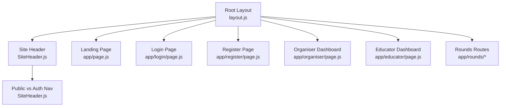
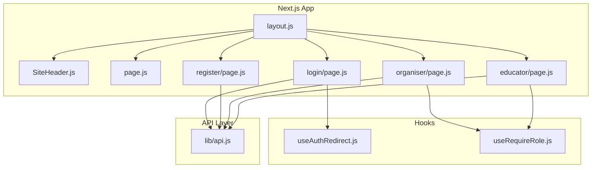
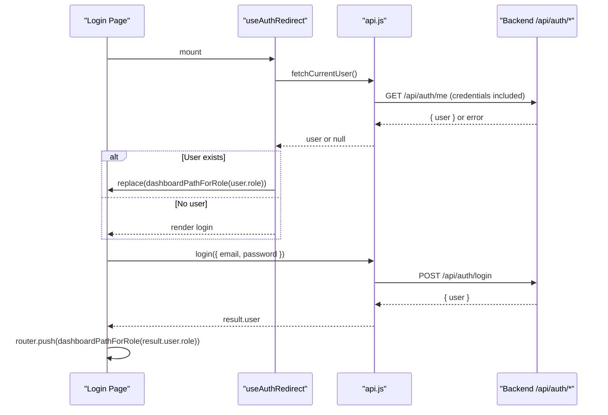
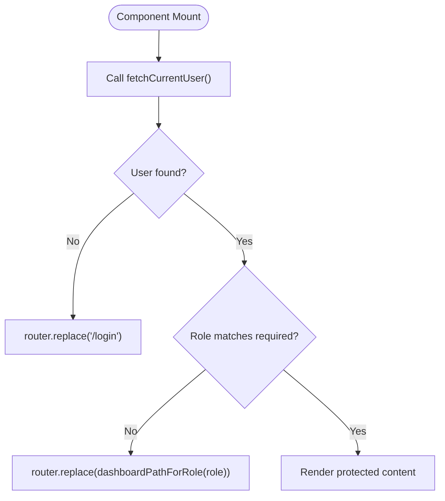
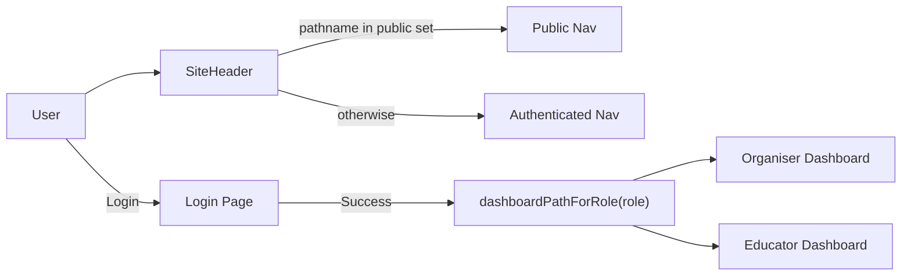
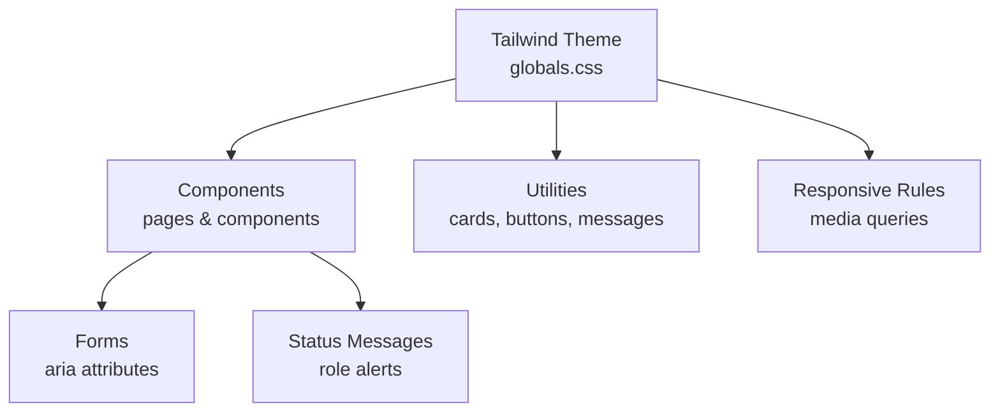
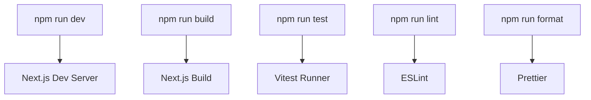
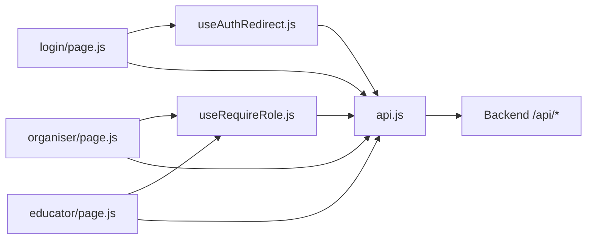

# Frontend Architecture

<cite>
**Referenced Files in This Document**
- [layout.js](file://frontend/src/app/layout.js)
- [page.js](file://frontend/src/app/page.js)
- [globals.css](file://frontend/src/app/globals.css)
- [api.js](file://frontend/src/lib/api.js)
- [useAuthRedirect.js](file://frontend/src/hooks/useAuthRedirect.js)
- [useRequireRole.js](file://frontend/src/hooks/useRequireRole.js)
- [SiteHeader.js](file://frontend/src/components/SiteHeader.js)
- [organiser/page.js](file://frontend/src/app/organiser/page.js)
- [educator/page.js](file://frontend/src/app/educator/page.js)
- [login/page.js](file://frontend/src/app/login/page.js)
- [register/page.js](file://frontend/src/app/register/page.js)
- [next.config.mjs](file://frontend/next.config.mjs)
- [postcss.config.mjs](file://frontend/postcss.config.mjs)
- [package.json](file://frontend/package.json)
</cite>

## Table of Contents
1. Introduction
2. Project Structure
3. Core Components
4. Architecture Overview
5. Detailed Component Analysis
6. Dependency Analysis
7. Performance Considerations
8. Troubleshooting Guide
9. Conclusion

## Introduction
This document describes the frontend architecture of the Olympiad Portal’s Next.js application. It covers component hierarchy, routing structure, state management with React hooks and client-side logic, API client design for backend communication, role-based navigation, design system with Tailwind CSS, build configuration, development workflow, testing strategy, and performance considerations.

## Project Structure
The application uses Next.js App Router with a minimal root layout and page routes:
- Root layout defines global fonts, metadata, and wraps pages with a shared header.
- Public pages include landing, login, and registration.
- Role-specific dashboards are under educator and organiser directories.
- Rounds feature includes dynamic routes for viewing rounds and papers.

**Diagram sources**
- [layout.js:1-44](file://frontend/src/app/layout.js#L1-L44)
- [SiteHeader.js:1-52](file://frontend/src/components/SiteHeader.js#L1-L52)
- [page.js:1-85](file://frontend/src/app/page.js#L1-L85)
- [login/page.js:1-113](file://frontend/src/app/login/page.js#L1-L113)
- [register/page.js:1-139](file://frontend/src/app/register/page.js#L1-L139)
- [organiser/page.js:1-105](file://frontend/src/app/organiser/page.js#L1-L105)
- [educator/page.js:1-87](file://frontend/src/app/educator/page.js#L1-L87)

**Section sources**
- [layout.js:1-44](file://frontend/src/app/layout.js#L1-L44)
- [page.js:1-85](file://frontend/src/app/page.js#L1-L85)
- [SiteHeader.js:1-52](file://frontend/src/components/SiteHeader.js#L1-L52)

## Core Components
- RootLayout: Sets up Google Fonts via next/font, applies global classes, and renders SiteHeader plus children.
- SiteHeader: Renders navigation links that differ between public and authenticated contexts based on current pathname.
- LandingPage: Entry point with calls-to-action to login or register.
- Role Dashboards: Organiser and Educator dashboards fetch rounds and present them with status-aware UI states.
- Authentication Pages: Login and Register implement form validation, error handling, and redirect flows.

Key responsibilities:
- Routing: Next.js App Router file-based routing.
- State: Local component state for forms and data fetching; hooks for auth redirects and role checks.
- Styling: Tailwind CSS v4 with custom theme tokens and utility classes.

**Section sources**
- [layout.js:1-44](file://frontend/src/app/layout.js#L1-L44)
- [SiteHeader.js:1-52](file://frontend/src/components/SiteHeader.js#L1-L52)
- [page.js:1-85](file://frontend/src/app/page.js#L1-L85)
- [organiser/page.js:1-105](file://frontend/src/app/organiser/page.js#L1-L105)
- [educator/page.js:1-87](file://frontend/src/app/educator/page.js#L1-L87)
- [login/page.js:1-113](file://frontend/src/app/login/page.js#L1-L113)
- [register/page.js:1-139](file://frontend/src/app/register/page.js#L1-L139)

## Architecture Overview
The frontend is a client-rendered Next.js app using the App Router. Shared layout provides consistent typography and header. Pages use React hooks for local state and side effects. Authentication and authorization are enforced via client-side hooks that call the API to determine user identity and role. The API client centralizes HTTP requests, error normalization, and credentials handling.

**Diagram sources**
- [layout.js:1-44](file://frontend/src/app/layout.js#L1-L44)
- [SiteHeader.js:1-52](file://frontend/src/components/SiteHeader.js#L1-L52)
- [page.js:1-85](file://frontend/src/app/page.js#L1-L85)
- [login/page.js:1-113](file://frontend/src/app/login/page.js#L1-L113)
- [register/page.js:1-139](file://frontend/src/app/register/page.js#L1-L139)
- [organiser/page.js:1-105](file://frontend/src/app/organiser/page.js#L1-L105)
- [educator/page.js:1-87](file://frontend/src/app/educator/page.js#L1-L87)
- [useAuthRedirect.js:1-32](file://frontend/src/hooks/useAuthRedirect.js#L1-L32)
- [useRequireRole.js:1-39](file://frontend/src/hooks/useRequireRole.js#L1-L39)
- [api.js:1-146](file://frontend/src/lib/api.js#L1-L146)

## Detailed Component Analysis

### API Client Layer
The API client centralizes network requests, error handling, and credential passing:
- Base URL from environment variable with fallback.
- requestJson helper normalizes responses, handles non-JSON bodies, and throws ApiError with status codes.
- Dedicated functions for auth (register, login, logout, fetchCurrentUser), rounds, and paper uploads.
- uploadPaper uses FormData for multipart uploads and mirrors error handling.

**Diagram sources**
- [login/page.js:1-113](file://frontend/src/app/login/page.js#L1-L113)
- [useAuthRedirect.js:1-32](file://frontend/src/hooks/useAuthRedirect.js#L1-L32)
- [api.js:1-146](file://frontend/src/lib/api.js#L1-L146)

**Section sources**
- [api.js:1-146](file://frontend/src/lib/api.js#L1-L146)

### Authentication and Authorization Hooks
- useRedirectIfAuthenticated: On mount, checks current user and redirects to the appropriate dashboard if already logged in; otherwise allows access to login/register.
- useRequireRole: Ensures the current user exists and has the required role; otherwise redirects to login or their correct dashboard.

**Diagram sources**
- [useAuthRedirect.js:1-32](file://frontend/src/hooks/useAuthRedirect.js#L1-L32)
- [useRequireRole.js:1-39](file://frontend/src/hooks/useRequireRole.js#L1-L39)
- [api.js:128-145](file://frontend/src/lib/api.js#L128-L145)

**Section sources**
- [useAuthRedirect.js:1-32](file://frontend/src/hooks/useAuthRedirect.js#L1-L32)
- [useRequireRole.js:1-39](file://frontend/src/hooks/useRequireRole.js#L1-L39)

### Role-Based Routing and Navigation
- Public paths (/ , /login, /register) show a different header variant with lighter styling and registration/login links.
- Authenticated paths show a simplified nav focused on rounds.
- Dashboards enforce roles via useRequireRole and route users based on role using dashboardPathForRole.

**Diagram sources**
- [SiteHeader.js:1-52](file://frontend/src/components/SiteHeader.js#L1-L52)
- [login/page.js:1-113](file://frontend/src/app/login/page.js#L1-L113)
- [api.js:141-145](file://frontend/src/lib/api.js#L141-L145)
- [organiser/page.js:1-105](file://frontend/src/app/organiser/page.js#L1-L105)
- [educator/page.js:1-87](file://frontend/src/app/educator/page.js#L1-L87)

**Section sources**
- [SiteHeader.js:1-52](file://frontend/src/components/SiteHeader.js#L1-L52)
- [login/page.js:1-113](file://frontend/src/app/login/page.js#L1-L113)
- [api.js:141-145](file://frontend/src/lib/api.js#L141-L145)
- [organiser/page.js:1-105](file://frontend/src/app/organiser/page.js#L1-L105)
- [educator/page.js:1-87](file://frontend/src/app/educator/page.js#L1-L87)

### Design System and Accessibility
- Typography: Google Fonts loaded via next/font with CSS variables exposed to Tailwind theme.
- Theme: Custom color tokens and font families defined in Tailwind theme inline config.
- Utilities: Reusable styles for cards, buttons, messages, animations, and responsive behavior.
- Accessibility:
  - Semantic HTML elements and proper headings.
  - aria-invalid and aria-describedby for form fields.
  - role="alert" for error messages and role="status" for success states.
  - prefers-reduced-motion respected for animations.

**Diagram sources**
- [globals.css:1-456](file://frontend/src/app/globals.css#L1-L456)
- [login/page.js:1-113](file://frontend/src/app/login/page.js#L1-L113)
- [register/page.js:1-139](file://frontend/src/app/register/page.js#L1-L139)

**Section sources**
- [globals.css:1-456](file://frontend/src/app/globals.css#L1-L456)
- [login/page.js:1-113](file://frontend/src/app/login/page.js#L1-L113)
- [register/page.js:1-139](file://frontend/src/app/register/page.js#L1-L139)

### Build Configuration and Development Workflow
- Next.js configuration is minimal, enabling standard dev/build/start workflows.
- PostCSS configured with Tailwind CSS v4 plugin.
- Scripts provide development server, production build, test runner, linting, and formatting.

**Diagram sources**
- [package.json:1-36](file://frontend/package.json#L1-L36)
- [next.config.mjs:1-7](file://frontend/next.config.mjs#L1-L7)
- [postcss.config.mjs:1-8](file://frontend/postcss.config.mjs#L1-L8)

**Section sources**
- [package.json:1-36](file://frontend/package.json#L1-L36)
- [next.config.mjs:1-7](file://frontend/next.config.mjs#L1-L7)
- [postcss.config.mjs:1-8](file://frontend/postcss.config.mjs#L1-L8)

## Dependency Analysis
Client-side dependencies and relationships:
- Pages depend on hooks for authentication and authorization.
- Hooks depend on the API client for user and role resolution.
- API client depends on environment variables and communicates with backend endpoints.
- Global styles define the design tokens used across components.

**Diagram sources**
- [login/page.js:1-113](file://frontend/src/app/login/page.js#L1-L113)
- [organiser/page.js:1-105](file://frontend/src/app/organiser/page.js#L1-L105)
- [educator/page.js:1-87](file://frontend/src/app/educator/page.js#L1-L87)
- [useAuthRedirect.js:1-32](file://frontend/src/hooks/useAuthRedirect.js#L1-L32)
- [useRequireRole.js:1-39](file://frontend/src/hooks/useRequireRole.js#L1-L39)
- [api.js:1-146](file://frontend/src/lib/api.js#L1-L146)

**Section sources**
- [api.js:1-146](file://frontend/src/lib/api.js#L1-L146)
- [useAuthRedirect.js:1-32](file://frontend/src/hooks/useAuthRedirect.js#L1-L32)
- [useRequireRole.js:1-39](file://frontend/src/hooks/useRequireRole.js#L1-L39)

## Performance Considerations
- Network efficiency:
  - Centralized request helper reduces duplication and ensures consistent error handling.
  - Credentials included automatically for session-based auth.
- Rendering:
  - Minimal client-side state; heavy lifting done by backend APIs.
  - Conditional rendering based on loading/error/empty states avoids unnecessary work.
- Styling:
  - Tailwind CSS v4 enables efficient utility usage; custom theme tokens reduce repeated values.
- Bundle size:
  - Keep dependencies lean; only necessary modules imported per page.
  - Avoid large third-party libraries unless required (e.g., xlsx dependency present).
- Future optimizations:
  - Implement caching strategies for round lists and user info.
  - Use Next.js code splitting at route boundaries (App Router does this by default).
  - Consider lazy-loading heavy components within pages.

[No sources needed since this section provides general guidance]

## Troubleshooting Guide
Common issues and where to investigate:
- Network errors:
  - The API client throws ApiError with descriptive messages for unreachable servers or non-2xx responses.
  - Verify NEXT_PUBLIC_API_BASE_URL and backend availability.
- Authentication failures:
  - Login page displays errors from ApiError; ensure credentials are valid and backend returns expected payloads.
  - useRequireRole redirects to login if no user is found; check session cookies and /api/auth/me endpoint.
- Form validation:
  - Fields use aria-invalid and aria-describedby to communicate errors to assistive technologies.
  - Ensure fieldErrors are cleared before submission and reset on new attempts.
- Uploads:
  - uploadPaper uses FormData; verify file types and sizes on the backend and handle multipart errors consistently.

**Section sources**
- [api.js:1-146](file://frontend/src/lib/api.js#L1-L146)
- [login/page.js:1-113](file://frontend/src/app/login/page.js#L1-L113)
- [register/page.js:1-139](file://frontend/src/app/register/page.js#L1-L139)

## Conclusion
The Olympiad Portal frontend is a clean, client-rendered Next.js application leveraging the App Router, React hooks for state and side effects, and a centralized API client for robust backend communication. Role-based navigation and a cohesive design system built with Tailwind CSS provide a consistent user experience. The project’s scripts and configuration support a straightforward development workflow and testing strategy. Future enhancements can focus on caching, advanced error reporting, and further performance tuning.