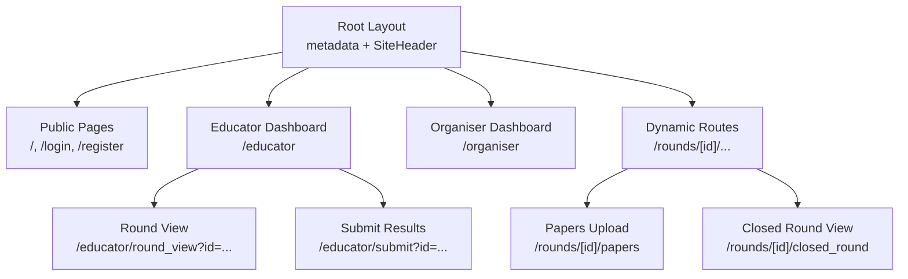
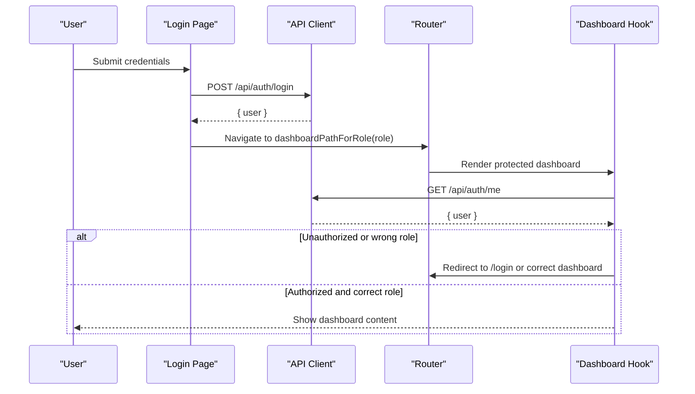
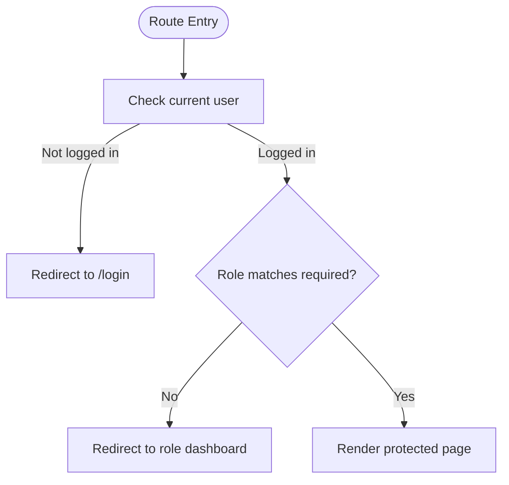
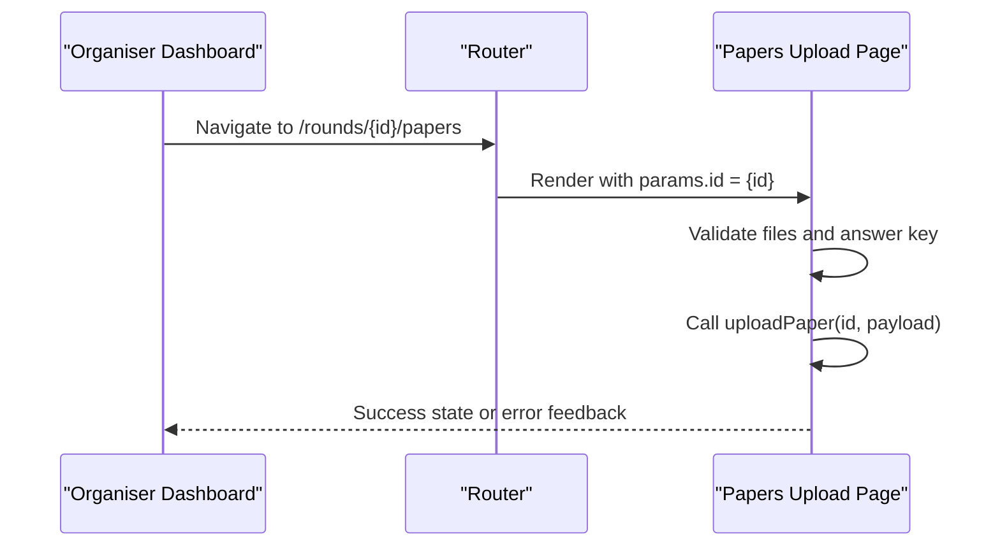
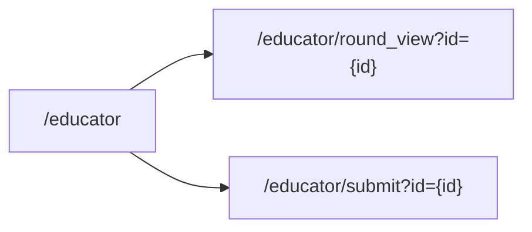
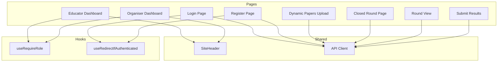

# Routing & Navigation System

<cite>
**Referenced Files in This Document**
- [layout.js](file://frontend/src/app/layout.js)
- [page.js (Landing)](file://frontend/src/app/page.js)
- [SiteHeader.js](file://frontend/src/components/SiteHeader.js)
- [api.js](file://frontend/src/lib/api.js)
- [useRequireRole.js](file://frontend/src/hooks/useRequireRole.js)
- [useAuthRedirect.js](file://frontend/src/hooks/useAuthRedirect.js)
- [login page.js](file://frontend/src/app/login/page.js)
- [register page.js](file://frontend/src/app/register/page.js)
- [educator dashboard page.js](file://frontend/src/app/educator/page.js)
- [organiser dashboard page.js](file://frontend/src/app/organiser/page.js)
- [round view page.js](file://frontend/src/app/educator/round_view/page.js)
- [submit results page.js](file://frontend/src/app/educator/submit/page.js)
- [dynamic papers upload page.js](file://frontend/src/app/rounds/[id]/papers/page.js)
- [dynamic closed round page.js](file://frontend/src/app/rounds/[id]/closed_round/page.js)
- [next.config.mjs](file://frontend/next.config.mjs)
</cite>

## Table of Contents
1. [Introduction](#introduction)
2. [Project Structure](#project-structure)
3. [Core Components](#core-components)
4. [Architecture Overview](#architecture-overview)
5. [Detailed Component Analysis](#detailed-component-analysis)
6. [Dependency Analysis](#dependency-analysis)
7. [Performance Considerations](#performance-considerations)
8. [Troubleshooting Guide](#troubleshooting-guide)
9. [Conclusion](#conclusion)

## Introduction
This document explains the Next.js routing and navigation system for the Olympiad Portal frontend. It covers file-based routing, dynamic routes for rounds and papers, nested routing patterns, role-based navigation guards, protected routes, authentication-driven redirects, programmatic navigation, route parameters, query strings, SEO metadata, layout composition, and performance considerations such as code splitting by route.

## Project Structure
The application uses the Next.js App Router with a file-system based routing convention:
- Root layout defines global HTML structure, fonts, and site-wide metadata.
- Public pages include landing, login, and registration.
- Role-specific dashboards are under /educator and /organiser.
- Dynamic routes exist under /rounds/:id for paper uploads and closed-round views.
- Shared UI is provided via a header component used across all pages.

**Diagram sources**
- [layout.js:27-44](file://frontend/src/app/layout.js#L27-L44)
- [page.js (Landing):17-84](file://frontend/src/app/page.js#L17-L84)
- [SiteHeader.js:8-50](file://frontend/src/components/SiteHeader.js#L8-L50)
- [educator dashboard page.js:9-86](file://frontend/src/app/educator/page.js#L9-L86)
- [organiser dashboard page.js:11-104](file://frontend/src/app/organiser/page.js#L11-L104)
- [dynamic papers upload page.js:26-259](file://frontend/src/app/rounds/[id]/papers/page.js#L26-L259)
- [dynamic closed round page.js:8-95](file://frontend/src/app/rounds/[id]/closed_round/page.js#L8-L95)
- [round view page.js:19-156](file://frontend/src/app/educator/round_view/page.js#L19-L156)
- [submit results page.js:8-529](file://frontend/src/app/educator/submit/page.js#L8-L529)

**Section sources**
- [layout.js:27-44](file://frontend/src/app/layout.js#L27-L44)
- [page.js (Landing):17-84](file://frontend/src/app/page.js#L17-L84)
- [SiteHeader.js:8-50](file://frontend/src/components/SiteHeader.js#L8-L50)

## Core Components
- Root layout: Provides global metadata, font variables, and wraps every page with a shared header.
- SiteHeader: Renders public vs authenticated navigation links based on current pathname.
- API client: Centralizes HTTP calls, error handling, and role-based redirect path mapping.
- Auth hooks: Enforce authentication and role checks; redirect unauthenticated or misrouted users.

Key responsibilities:
- Metadata management at the root level for consistent titles and descriptions.
- Consistent navigation UX across public and authenticated areas.
- Centralized API interactions with robust error propagation to UI.
- Declarative protection of routes using React hooks.

**Section sources**
- [layout.js:27-44](file://frontend/src/app/layout.js#L27-L44)
- [SiteHeader.js:8-50](file://frontend/src/components/SiteHeader.js#L8-L50)
- [api.js:17-145](file://frontend/src/lib/api.js#L17-L145)
- [useRequireRole.js:7-38](file://frontend/src/hooks/useRequireRole.js#L7-L38)
- [useAuthRedirect.js:9-31](file://frontend/src/hooks/useAuthRedirect.js#L9-L31)

## Architecture Overview
The navigation architecture combines Next.js file-based routing with client-side guards:
- Public routes (/ and /login, /register) are accessible without authentication.
- Protected routes (/educator, /organiser, /rounds/*) enforce authentication and role checks via hooks.
- After successful login, users are redirected to their role-appropriate dashboard.
- Dynamic routes use route parameters for round context; some pages also read query parameters for additional context.

**Diagram sources**
- [login page.js:25-41](file://frontend/src/app/login/page.js#L25-L41)
- [api.js:121-145](file://frontend/src/lib/api.js#L121-L145)
- [useRequireRole.js:12-35](file://frontend/src/hooks/useRequireRole.js#L12-L35)

## Detailed Component Analysis

### File-Based Routing and Layouts
- Root layout sets global metadata and includes the shared header. All pages inherit this structure.
- The landing page provides entry points to login and registration.
- Public header shows Register/Login; authenticated header exposes Rounds link.

SEO and metadata:
- Global title and description are defined in the root layout metadata export.

Layout composition:
- SiteHeader is rendered once per page via the root layout, ensuring consistent branding and navigation.

**Section sources**
- [layout.js:27-44](file://frontend/src/app/layout.js#L27-L44)
- [page.js (Landing):17-84](file://frontend/src/app/page.js#L17-L84)
- [SiteHeader.js:8-50](file://frontend/src/components/SiteHeader.js#L8-L50)

### Authentication and Role-Based Guards
- Login page validates input, calls the API, and navigates to the appropriate dashboard based on user role.
- Registration stores an auth token locally and indicates success; subsequent protected routes rely on session cookies via the API client’s credentials mode.
- useRequireRole enforces that only users with the required role can access a route; otherwise, it redirects to login or the correct dashboard.
- useRedirectIfAuthenticated prevents logged-in users from accessing login/register pages by redirecting them to their dashboard.

Navigation flow by role:
- Educator: Accessible via /educator after role check.
- Organiser: Accessible via /organiser after role check.
- Student: Not directly exposed in these routes; student flows would be gated similarly if added.

**Diagram sources**
- [useRequireRole.js:12-35](file://frontend/src/hooks/useRequireRole.js#L12-L35)
- [useAuthRedirect.js:13-28](file://frontend/src/hooks/useAuthRedirect.js#L13-L28)
- [api.js:128-145](file://frontend/src/lib/api.js#L128-L145)

**Section sources**
- [login page.js:25-41](file://frontend/src/app/login/page.js#L25-L41)
- [register page.js:30-49](file://frontend/src/app/register/page.js#L30-L49)
- [useRequireRole.js:7-38](file://frontend/src/hooks/useRequireRole.js#L7-L38)
- [useAuthRedirect.js:9-31](file://frontend/src/hooks/useAuthRedirect.js#L9-L31)
- [api.js:121-145](file://frontend/src/lib/api.js#L121-L145)

### Dynamic Routes for Rounds and Papers
- /rounds/[id]/papers: Uses useParams to capture the round ID and handles paper/memo uploads with validation and error states.
- /rounds/[id]/closed_round: Displays round details when a round is closed and prevents further uploads.

Programmatic navigation and parameters:
- Route parameter id is read via useParams.
- Links to dynamic routes are constructed using template literals with the round id.

Query string usage:
- Some educator pages read query parameters via useSearchParams to identify the target round.

**Diagram sources**
- [organiser dashboard page.js:72-99](file://frontend/src/app/organiser/page.js#L72-L99)
- [dynamic papers upload page.js:26-79](file://frontend/src/app/rounds/[id]/papers/page.js#L26-L79)

**Section sources**
- [dynamic papers upload page.js:26-259](file://frontend/src/app/rounds/[id]/papers/page.js#L26-L259)
- [dynamic closed round page.js:8-95](file://frontend/src/app/rounds/[id]/closed_round/page.js#L8-L95)
- [organiser dashboard page.js:72-99](file://frontend/src/app/organiser/page.js#L72-L99)

### Nested Routing Patterns
- /educator/round_view and /educator/submit are nested under the educator namespace and use query parameters to scope behavior to a specific round.
- These pages demonstrate how to combine nested routes with query strings for flexible data scoping.

**Diagram sources**
- [educator dashboard page.js:68-82](file://frontend/src/app/educator/page.js#L68-L82)
- [round view page.js:19-156](file://frontend/src/app/educator/round_view/page.js#L19-L156)
- [submit results page.js:8-529](file://frontend/src/app/educator/submit/page.js#L8-L529)

**Section sources**
- [round view page.js:19-156](file://frontend/src/app/educator/round_view/page.js#L19-L156)
- [submit results page.js:8-529](file://frontend/src/app/educator/submit/page.js#L8-L529)

### Programmatic Navigation and Query String Management
- Programmatic navigation:
  - Use next/navigation router.push to navigate after login or logout.
  - Use router.replace to prevent back-navigation into protected pages during redirects.
- Query strings:
  - useSearchParams reads query parameters like id for round scoping.
  - Links construct URLs with query parameters for educational workflows.

Examples:
- Login redirects to role-based dashboard using a helper function.
- Educator and organiser dashboards build links with query parameters for round actions.

**Section sources**
- [login page.js:25-41](file://frontend/src/app/login/page.js#L25-L41)
- [api.js:141-145](file://frontend/src/lib/api.js#L141-L145)
- [educator dashboard page.js:68-82](file://frontend/src/app/educator/page.js#L68-L82)
- [round view page.js:19-24](file://frontend/src/app/educator/round_view/page.js#L19-L24)
- [submit results page.js:8-11](file://frontend/src/app/educator/submit/page.js#L8-L11)

### SEO and Metadata Management
- Global metadata is set in the root layout, providing consistent title and description across all pages.
- Public pages use semantic headings and descriptive text to improve accessibility and SEO.

Recommendations:
- Consider adding page-level metadata where needed (e.g., round detail pages) to enhance search indexing and social sharing.

**Section sources**
- [layout.js:27-30](file://frontend/src/app/layout.js#L27-L30)
- [page.js (Landing):17-84](file://frontend/src/app/page.js#L17-L84)

### Performance Optimizations and Code Splitting
- Next.js automatically splits code by route; each page module is loaded on demand.
- Keep heavy dependencies (e.g., spreadsheet libraries) co-located with the pages that need them to minimize bundle size for other routes.
- Avoid unnecessary re-renders by keeping state local to components and using efficient updates.

Practical notes:
- The submit results page imports a large library for spreadsheet operations; ensure it remains scoped to that route.
- Use environment variables for API base URLs to avoid runtime configuration overhead.

**Section sources**
- [submit results page.js:4-6](file://frontend/src/app/educator/submit/page.js#L4-L6)
- [api.js:3-3](file://frontend/src/lib/api.js#L3-L3)
- [next.config.mjs:1-7](file://frontend/next.config.mjs#L1-L7)

## Dependency Analysis
The navigation system depends on a small set of core modules:
- API client centralizes HTTP requests and error handling.
- Hooks encapsulate authentication and role logic.
- Pages compose UI and orchestrate navigation and data fetching.

**Diagram sources**
- [login page.js:25-41](file://frontend/src/app/login/page.js#L25-L41)
- [register page.js:30-49](file://frontend/src/app/register/page.js#L30-L49)
- [educator dashboard page.js:9-86](file://frontend/src/app/educator/page.js#L9-L86)
- [organiser dashboard page.js:11-104](file://frontend/src/app/organiser/page.js#L11-L104)
- [dynamic papers upload page.js:26-259](file://frontend/src/app/rounds/[id]/papers/page.js#L26-L259)
- [dynamic closed round page.js:8-95](file://frontend/src/app/rounds/[id]/closed_round/page.js#L8-L95)
- [round view page.js:19-156](file://frontend/src/app/educator/round_view/page.js#L19-L156)
- [submit results page.js:8-529](file://frontend/src/app/educator/submit/page.js#L8-L529)
- [useRequireRole.js:7-38](file://frontend/src/hooks/useRequireRole.js#L7-L38)
- [useAuthRedirect.js:9-31](file://frontend/src/hooks/useAuthRedirect.js#L9-L31)
- [SiteHeader.js:8-50](file://frontend/src/components/SiteHeader.js#L8-L50)
- [api.js:17-145](file://frontend/src/lib/api.js#L17-L145)

**Section sources**
- [api.js:17-145](file://frontend/src/lib/api.js#L17-L145)
- [useRequireRole.js:7-38](file://frontend/src/hooks/useRequireRole.js#L7-L38)
- [useAuthRedirect.js:9-31](file://frontend/src/hooks/useAuthRedirect.js#L9-L31)
- [SiteHeader.js:8-50](file://frontend/src/components/SiteHeader.js#L8-L50)

## Performance Considerations
- Route-based code splitting is automatic in Next.js; keep heavy libraries scoped to relevant pages.
- Minimize network calls by batching requests where possible and caching responses appropriately.
- Use environment variables for configuration to avoid runtime changes.
- Prefer static metadata at the root level and add page-level metadata selectively.

[No sources needed since this section provides general guidance]

## Troubleshooting Guide
Common issues and resolutions:
- Network errors: The API client throws structured errors with status codes; pages should display user-friendly messages and suggest retrying.
- Authentication failures: If fetchCurrentUser returns null, protected routes redirect to login. Ensure cookies/session are properly configured on the backend.
- Role mismatches: useRequireRole redirects users to the correct dashboard or login if roles do not match.
- Form validation: Pages validate inputs before submission; ensure field errors are displayed clearly to guide users.

Operational tips:
- Verify NEXT_PUBLIC_API_BASE_URL or NEXT_PUBLIC_API_URL environment variables point to a running backend.
- Confirm credentials mode is enabled for cross-origin requests if necessary.

**Section sources**
- [api.js:17-45](file://frontend/src/lib/api.js#L17-L45)
- [api.js:78-112](file://frontend/src/lib/api.js#L78-L112)
- [useRequireRole.js:12-35](file://frontend/src/hooks/useRequireRole.js#L12-L35)
- [login page.js:25-41](file://frontend/src/app/login/page.js#L25-L41)
- [register page.js:30-49](file://frontend/src/app/register/page.js#L30-L49)

## Conclusion
The Olympiad Portal’s routing and navigation system leverages Next.js file-based routing, dynamic segments, and client-side guards to deliver a secure, role-aware experience. The root layout centralizes metadata and shared UI, while hooks enforce authentication and authorization consistently across protected routes. Dynamic routes handle round-specific workflows, and query parameters enable flexible scoping. With automatic code splitting and careful dependency scoping, the app balances usability and performance. Future enhancements can include page-level metadata, more granular role permissions, and expanded student-facing routes following the same patterns.