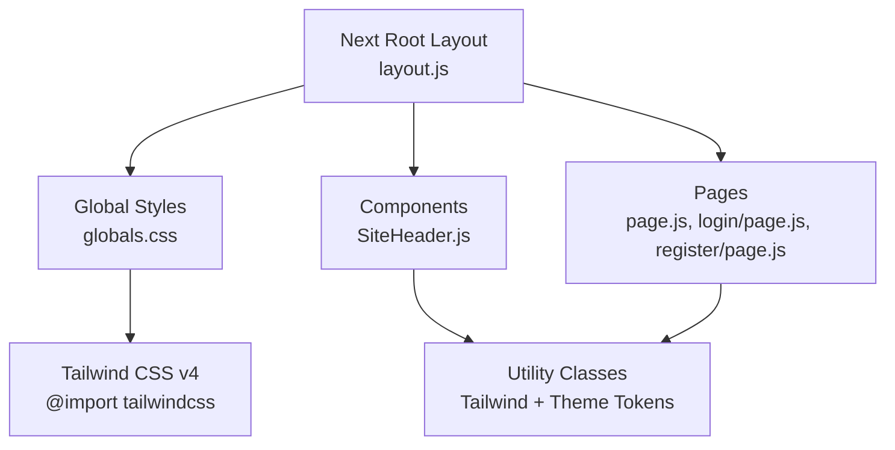
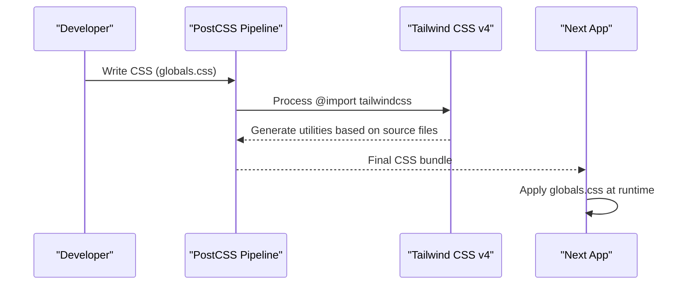
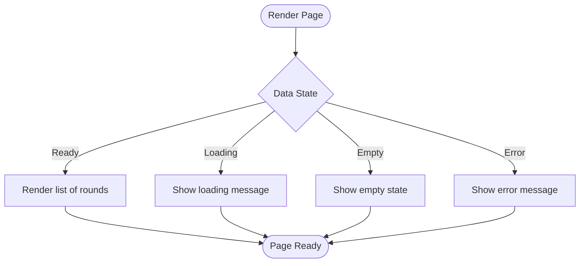
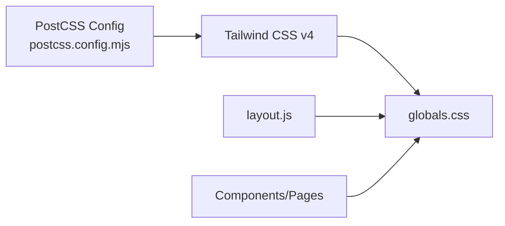

# Styling & Design System

<cite>
**Referenced Files in This Document**
- [globals.css](file://frontend/src/app/globals.css)
- [postcss.config.mjs](file://frontend/postcss.config.mjs)
- [layout.js](file://frontend/src/app/layout.js)
- [SiteHeader.js](file://frontend/src/components/SiteHeader.js)
- [page.js (Landing)](file://frontend/src/app/page.js)
- [login page.js](file://frontend/src/app/login/page.js)
- [register page.js](file://frontend/src/app/register/page.js)
- [educator page.js](file://frontend/src/app/educator/page.js)
- [organiser page.js](file://frontend/src/app/organiser/page.js)
- [package-lock.json](file://frontend/package-lock.json)
</cite>

## Table of Contents
1. [Introduction](#introduction)
2. [Project Structure](#project-structure)
3. [Core Components](#core-components)
4. [Architecture Overview](#architecture-overview)
5. [Detailed Component Analysis](#detailed-component-analysis)
6. [Dependency Analysis](#dependency-analysis)
7. [Performance Considerations](#performance-considerations)
8. [Troubleshooting Guide](#troubleshooting-guide)
9. [Conclusion](#conclusion)

## Introduction
This document explains the styling architecture and design system for the frontend, which uses Tailwind CSS v4 with a PostCSS pipeline and a global stylesheet that defines theme tokens, typography, and component styles. It covers how global styles are configured, how the custom theme is set up, responsive patterns, utility class usage, CSS-in-JS considerations, accessibility, performance optimizations, and testing strategies.

## Project Structure
The styling setup centers around:
- A single global stylesheet that imports Tailwind and declares theme tokens and shared components.
- A Next.js root layout that injects font variables into the HTML element so Tailwind can reference them via theme tokens.
- Pages and components composed primarily from Tailwind utility classes, with a small set of reusable CSS classes for complex UI elements.

**Diagram sources**
- [layout.js:1-44](file://frontend/src/app/layout.js#L1-L44)
- [globals.css:1-26](file://frontend/src/app/globals.css#L1-L26)
- [SiteHeader.js:1-52](file://frontend/src/components/SiteHeader.js#L1-L52)
- [page.js (Landing):1-85](file://frontend/src/app/page.js#L1-L85)

**Section sources**
- [globals.css:1-26](file://frontend/src/app/globals.css#L1-L26)
- [layout.js:1-44](file://frontend/src/app/layout.js#L1-L44)
- [postcss.config.mjs:1-8](file://frontend/postcss.config.mjs#L1-L8)

## Core Components
- Global theme tokens: Colors and fonts are defined as CSS variables and exposed to Tailwind via an inline theme block. This enables consistent use of semantic tokens like ink, surface, lavender, gold, and sage across utilities and components.
- Typography system: Three typefaces are loaded via next/font and exposed as CSS variables, then mapped to Tailwind’s font families (display, sans, mono).
- Shared component styles: Reusable visual primitives such as cards, buttons, status badges, navigation links, seals, and animations live in the global stylesheet to avoid duplication and ensure consistency.
- Utility-first composition: Most pages compose layouts and states using Tailwind utilities (spacing, colors, typography, focus rings, responsive breakpoints), while reserving CSS classes for complex or animated behaviors.

Key implementation highlights:
- Theme tokens and fonts are declared in the global stylesheet and referenced by both utilities and custom classes.
- The root layout applies font variables to the html element, enabling Tailwind to resolve font-family tokens.
- Components leverage semantic color tokens (e.g., ink, surface, lavender-deep) and typography tokens (font-display, font-sans, font-mono) through Tailwind utilities.

**Section sources**
- [globals.css:3-26](file://frontend/src/app/globals.css#L3-L26)
- [layout.js:1-44](file://frontend/src/app/layout.js#L1-L44)
- [SiteHeader.js:12-47](file://frontend/src/components/SiteHeader.js#L12-L47)
- [page.js (Landing):18-80](file://frontend/src/app/page.js#L18-L80)

## Architecture Overview
The styling architecture follows a layered approach:
- Build layer: PostCSS processes CSS with the Tailwind plugin.
- Global layer: A single stylesheet imports Tailwind and defines theme tokens, base styles, and shared component classes.
- Composition layer: Pages and components compose Tailwind utilities and reuse shared classes for consistent UI.

**Diagram sources**
- [postcss.config.mjs:1-8](file://frontend/postcss.config.mjs#L1-L8)
- [globals.css:1-26](file://frontend/src/app/globals.css#L1-L26)

## Detailed Component Analysis

### Global Styles and Theme Tokens
- Color palette: Semantic tokens include paper, surface, ink, ink-soft, lavender, lavender-deep, gold, sage, and slate. These are exposed via CSS variables and mapped into Tailwind’s theme for direct utility usage.
- Typography: Display, sans, and mono fonts are provided via next/font and bound to CSS variables, then mapped to Tailwind’s font tokens.
- Base styles: Body background and text color are set using semantic tokens; common layout helpers and component classes (cards, buttons, status badges) are centralized.

Accessibility notes:
- Focus-visible rings are used on interactive elements to ensure keyboard accessibility.
- Animations respect reduced motion preferences.

**Section sources**
- [globals.css:3-26](file://frontend/src/app/globals.css#L3-L26)
- [globals.css:28-33](file://frontend/src/app/globals.css#L28-L33)
- [globals.css:116-131](file://frontend/src/app/globals.css#L116-L131)
- [globals.css:141-159](file://frontend/src/app/globals.css#L141-L159)
- [globals.css:244-249](file://frontend/src/app/globals.css#L244-L249)

### Typography System
- Fonts are loaded via next/font and injected as CSS variables on the html element.
- Tailwind theme maps display, sans, and mono to these variables, enabling consistent typography across utilities and components.

Usage examples:
- Headings use font-display for a refined display face.
- Body and UI text use font-sans for readability.
- Monospace values use font-mono for IDs and timestamps.

**Section sources**
- [layout.js:1-25](file://frontend/src/app/layout.js#L1-L25)
- [globals.css:23-25](file://frontend/src/app/globals.css#L23-L25)
- [page.js (Landing):28-58](file://frontend/src/app/page.js#L28-L58)

### Responsive Design Patterns
- Mobile-first approach: Utilities and layout classes are applied at base sizes and enhanced with responsive prefixes where needed.
- Breakpoints: The global stylesheet includes a media query targeting small screens to adjust layout and spacing.
- Grid and flex layouts adapt to screen size using responsive utilities and media queries.

Examples:
- Landing page uses responsive typography and grid adjustments.
- Header and content sections reflow on smaller viewports.

**Section sources**
- [globals.css:141-159](file://frontend/src/app/globals.css#L141-L159)
- [page.js (Landing):18-61](file://frontend/src/app/page.js#L18-L61)

### Component Styling Approach
- Utility-first composition: Most UI is built with Tailwind utilities for spacing, colors, typography, borders, and focus states.
- Shared classes: Complex or repeated patterns (cards, buttons, status badges, navigation links, seals, animations) are centralized in the global stylesheet to maintain consistency and reduce duplication.
- CSS-in-JS: Inline styles are occasionally used for dynamic layout properties (e.g., gap, margins), but the primary pattern remains utility-driven.

Examples:
- SiteHeader composes header appearance and navigation links using utilities and shared link styles.
- Forms in login and register pages use utilities for layout, borders, focus rings, and error messaging.

**Section sources**
- [SiteHeader.js:12-47](file://frontend/src/components/SiteHeader.js#L12-L47)
- [login page.js:45-108](file://frontend/src/app/login/page.js#L45-L108)
- [register page.js:71-134](file://frontend/src/app/register/page.js#L71-L134)
- [globals.css:99-139](file://frontend/src/app/globals.css#L99-L139)

### Accessibility Considerations
- Keyboard navigation: Focus-visible rings are applied to inputs and buttons to ensure clear focus indicators.
- Screen readers: Decorative images use aria-hidden; form errors use role="alert" and descriptive labels.
- Motion preferences: Animations are disabled when users prefer reduced motion.

**Section sources**
- [login page.js:52-108](file://frontend/src/app/login/page.js#L52-L108)
- [register page.js:78-134](file://frontend/src/app/register/page.js#L78-L134)
- [globals.css:244-249](file://frontend/src/app/globals.css#L244-L249)

### Data Flow and Stateful UI Styling
- Dashboard pages fetch data and render different states (loading, empty, ready, error) with corresponding messages and layouts.
- Status-based styling uses shared classes and utilities to communicate state clearly to users.

**Diagram sources**
- [educator page.js:16-83](file://frontend/src/app/educator/page.js#L16-L83)
- [organiser page.js:18-99](file://frontend/src/app/organiser/page.js#L18-L99)

**Section sources**
- [educator page.js:16-83](file://frontend/src/app/educator/page.js#L16-L83)
- [organiser page.js:18-99](file://frontend/src/app/organiser/page.js#L18-L99)

## Dependency Analysis
- Tailwind CSS v4 is integrated via PostCSS using the official plugin.
- Fonts are loaded via next/font and injected as CSS variables, consumed by Tailwind theme tokens.
- Components rely on Tailwind utilities and shared CSS classes for consistent styling.

**Diagram sources**
- [postcss.config.mjs:1-8](file://frontend/postcss.config.mjs#L1-L8)
- [globals.css:1-26](file://frontend/src/app/globals.css#L1-L26)
- [layout.js:1-44](file://frontend/src/app/layout.js#L1-L44)

**Section sources**
- [postcss.config.mjs:1-8](file://frontend/postcss.config.mjs#L1-L8)
- [package-lock.json:7696-7702](file://frontend/package-lock.json#L7696-L7702)

## Performance Considerations
- CSS purging: Tailwind v4 generates only the utilities actually used in source files, minimizing bundle size. Ensure all paths containing class names are included in your build configuration if you extend beyond standard scanning.
- Critical CSS extraction: Since the app uses a single global stylesheet, consider extracting critical styles for above-the-fold content to improve initial paint performance.
- Font optimization: Fonts are loaded via next/font with subsets and weights specified, reducing unnecessary downloads.
- Animation efficiency: Animations are lightweight and respect reduced motion preferences, improving perceived performance and accessibility.

[No sources needed since this section provides general guidance]

## Troubleshooting Guide
- Missing utilities: If a class does not apply, verify it exists in the source files and that PostCSS/Tailwind are processing correctly.
- Theme token not found: Ensure the variable is defined in the global stylesheet and mapped in the inline theme block.
- Focus ring not visible: Confirm focus-visible utilities are applied and that no conflicting styles override them.
- Reduced motion: If animations cause discomfort, check that prefers-reduced-motion rules are active and that animations are properly disabled.

**Section sources**
- [globals.css:244-249](file://frontend/src/app/globals.css#L244-L249)
- [login page.js:52-108](file://frontend/src/app/login/page.js#L52-L108)
- [register page.js:78-134](file://frontend/src/app/register/page.js#L78-L134)

## Conclusion
The project adopts a modern, utility-first styling approach powered by Tailwind CSS v4, complemented by a well-defined global theme and shared component styles. Typography is standardized via next/font and mapped to Tailwind tokens, ensuring consistency. Responsive design is implemented with mobile-first principles and targeted media queries. Accessibility is considered through focus management, screen reader support, and reduced motion handling. Performance is optimized through Tailwind’s generation model, font subset selection, and minimal animation overhead. This architecture provides a scalable foundation for maintaining a cohesive design system across the application.