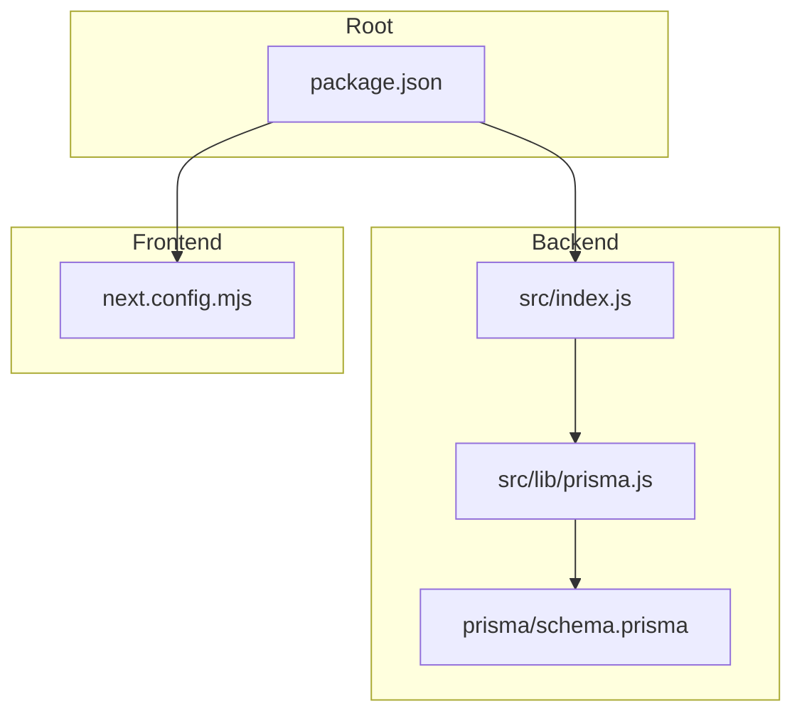
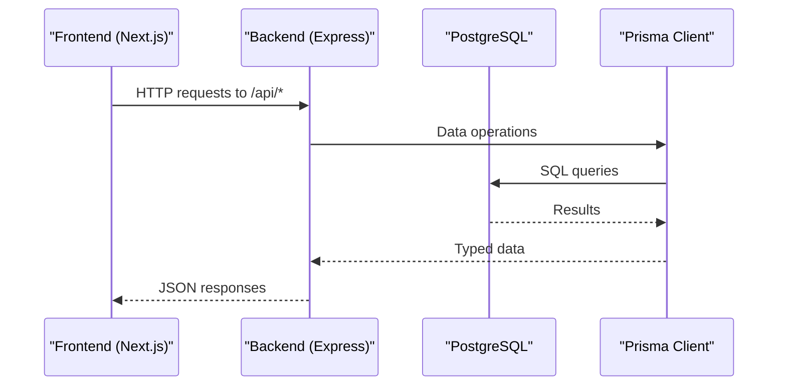
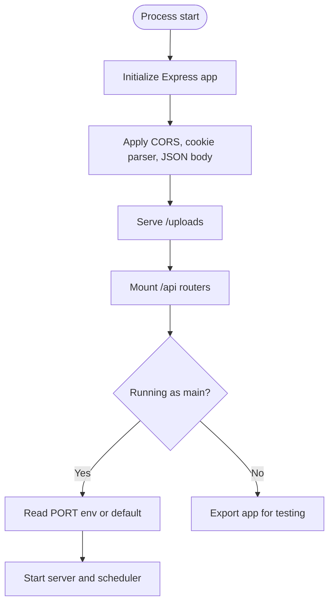
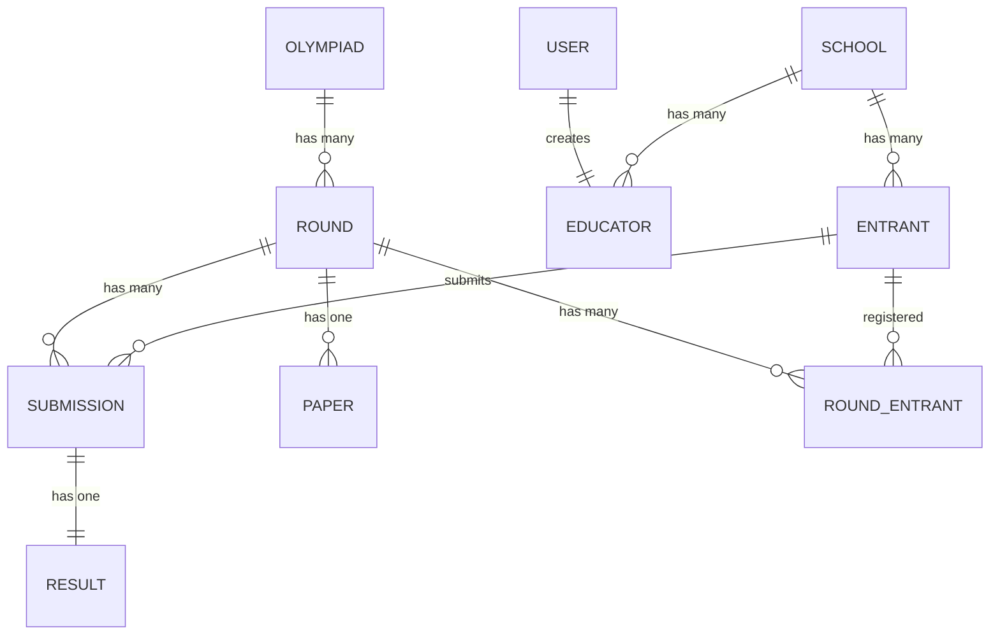
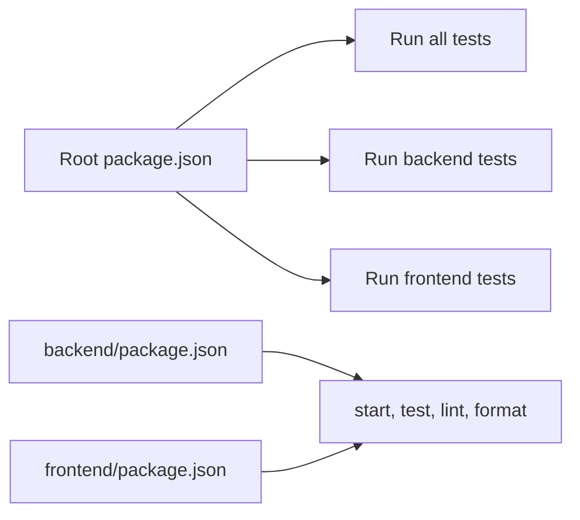

# Getting Started

<cite>
**Referenced Files in This Document**
- [package.json](file://package.json)
- [backend/package.json](file://backend/package.json)
- [frontend/package.json](file://frontend/package.json)
- [backend/src/index.js](file://backend/src/index.js)
- [backend/prisma/schema.prisma](file://backend/prisma/schema.prisma)
- [backend/src/lib/prisma.js](file://backend/src/lib/prisma.js)
- [backend/.gitignore](file://backend/.gitignore)
- [frontend/next.config.mjs](file://frontend/next.config.mjs)
- [frontend/.gitignore](file://frontend/.gitignore)
</cite>

## Table of Contents
1. Introduction
2. Project Structure
3. Core Components
4. Architecture Overview
5. Detailed Component Analysis
6. Dependency Analysis
7. Performance Considerations
8. Troubleshooting Guide
9. Conclusion
10. Appendices

## Introduction
This guide helps you set up and run the Olympiad Portal locally for development and production. It covers prerequisites, environment configuration, database setup, installing dependencies, running migrations, starting services, executing tests, and verifying a successful installation. It also outlines the development workflow including linting and formatting.

## Project Structure
The repository is a monorepo with three main parts:
- Backend (Express + Prisma + PostgreSQL)
- Frontend (Next.js)
- Shared tooling and scripts at the root

**Diagram sources**
- [backend/src/index.js:1-43](file://backend/src/index.js#L1-L43)
- [backend/prisma/schema.prisma:1-109](file://backend/prisma/schema.prisma#L1-L109)
- [backend/src/lib/prisma.js:1-6](file://backend/src/lib/prisma.js#L1-L6)
- [frontend/next.config.mjs:1-7](file://frontend/next.config.mjs#L1-L7)
- [package.json:1-23](file://package.json#L1-L23)

**Section sources**
- [package.json:1-23](file://package.json#L1-L23)
- [backend/package.json:1-50](file://backend/package.json#L1-L50)
- [frontend/package.json:1-36](file://frontend/package.json#L1-L36)

## Core Components
- Backend server entrypoint that wires Express middleware, routes, static uploads, and starts a scheduler.
- Database schema defined with Prisma using PostgreSQL.
- Prisma client singleton used by backend modules.
- Frontend Next.js app configured via its config file.

Key responsibilities:
- Backend: HTTP API, authentication, scheduling, file uploads, database access via Prisma.
- Frontend: UI and client-side logic for interacting with the backend.

**Section sources**
- [backend/src/index.js:1-43](file://backend/src/index.js#L1-L43)
- [backend/prisma/schema.prisma:1-109](file://backend/prisma/schema.prisma#L1-L109)
- [backend/src/lib/prisma.js:1-6](file://backend/src/lib/prisma.js#L1-L6)
- [frontend/next.config.mjs:1-7](file://frontend/next.config.mjs#L1-L7)

## Architecture Overview
High-level flow from frontend to backend and database:

**Diagram sources**
- [backend/src/index.js:16-32](file://backend/src/index.js#L16-L32)
- [backend/src/lib/prisma.js:1-6](file://backend/src/lib/prisma.js#L1-L6)
- [backend/prisma/schema.prisma:6-9](file://backend/prisma/schema.prisma#L6-L9)

## Detailed Component Analysis

### Backend Setup and Execution
- The server initializes Express, enables CORS for the local frontend, parses cookies and JSON, serves static uploads, mounts API routers under /api, and listens on a port from environment or default.
- A scheduler is started when the process runs directly.

**Diagram sources**
- [backend/src/index.js:14-40](file://backend/src/index.js#L14-L40)

**Section sources**
- [backend/src/index.js:1-43](file://backend/src/index.js#L1-L43)

### Database Schema and Migrations
- The database provider is PostgreSQL and the connection URL is read from an environment variable.
- Models include Olympiad, Round, User, School, Educator, Entrant, Paper, Submission, Result, RoundEntrant.

**Diagram sources**
- [backend/prisma/schema.prisma:11-108](file://backend/prisma/schema.prisma#L11-L108)

**Section sources**
- [backend/prisma/schema.prisma:1-109](file://backend/prisma/schema.prisma#L1-L109)

### Environment Variables
Required variables:
- DATABASE_URL: PostgreSQL connection string used by Prisma.
- PORT: Backend server port; defaults are applied if not provided.

Notes:
- .env files are ignored in version control for both backend and frontend.
- Ensure your PostgreSQL instance is reachable and credentials are correct.

**Section sources**
- [backend/prisma/schema.prisma:6-9](file://backend/prisma/schema.prisma#L6-L9)
- [backend/src/index.js:34-38](file://backend/src/index.js#L34-L38)
- [backend/.gitignore:1-5](file://backend/.gitignore#L1-L5)
- [frontend/.gitignore:33-34](file://frontend/.gitignore#L33-L34)

### Frontend Configuration
- Next.js application with standard dev/build/start/test/lint/format scripts.
- Minimal next.config.mjs present; can be extended as needed.

**Section sources**
- [frontend/package.json:1-36](file://frontend/package.json#L1-L36)
- [frontend/next.config.mjs:1-7](file://frontend/next.config.mjs#L1-L7)

## Dependency Analysis
Scripts and tooling overview:
- Root package.json provides unified test commands across backend and frontend.
- Backend uses Vitest for unit/integration tests, ESLint and Prettier for code quality.
- Frontend uses Vitest for tests, ESLint and Prettier for code quality.

**Diagram sources**
- [package.json:6-11](file://package.json#L6-L11)
- [backend/package.json:6-13](file://backend/package.json#L6-L13)
- [frontend/package.json:5-13](file://frontend/package.json#L5-L13)

**Section sources**
- [package.json:1-23](file://package.json#L1-L23)
- [backend/package.json:1-50](file://backend/package.json#L1-L50)
- [frontend/package.json:1-36](file://frontend/package.json#L1-L36)

## Performance Considerations
- Use a local or fast network PostgreSQL instance during development to reduce latency.
- Keep migrations small and incremental to minimize downtime and lock contention.
- Avoid heavy synchronous operations in request handlers; offload background tasks to the scheduler where appropriate.
- Enable compression and caching in production proxies/load balancers.

[No sources needed since this section provides general guidance]

## Troubleshooting Guide
Common issues and resolutions:
- Cannot connect to database:
  - Verify DATABASE_URL points to a running PostgreSQL server and has correct credentials.
  - Confirm Prisma client is generated after install.
- Port conflicts:
  - Set PORT to an available value if the default is in use.
- CORS errors from frontend:
  - Ensure the backend CORS origin matches the frontend’s development URL.
- Missing environment variables:
  - Create .env files in backend and frontend directories as needed; they are ignored by git.
- Tests fail due to missing generated client:
  - Reinstall dependencies and ensure postinstall generates Prisma client.

Verification steps:
- Start the backend and confirm it logs the listening port.
- Run database migrations to create tables.
- Execute tests for both backend and frontend to validate setup.

**Section sources**
- [backend/src/index.js:34-38](file://backend/src/index.js#L34-L38)
- [backend/prisma/schema.prisma:6-9](file://backend/prisma/schema.prisma#L6-L9)
- [backend/.gitignore:1-5](file://backend/.gitignore#L1-L5)
- [frontend/.gitignore:33-34](file://frontend/.gitignore#L33-L34)

## Conclusion
You now have the context to install dependencies, configure environment variables, set up the database, run migrations, and start both backend and frontend services. Use the provided scripts to run tests and maintain code quality with linting and formatting.

[No sources needed since this section summarizes without analyzing specific files]

## Appendices

### Installation and Setup

#### Prerequisites
- Node.js runtime compatible with the project’s scripts and dependencies.
- A running PostgreSQL server accessible from your machine.

#### Backend Setup
1. Install dependencies:
   - Navigate to the backend directory and install packages.
2. Configure environment:
   - Create a .env file in the backend directory with DATABASE_URL and optional PORT.
3. Generate Prisma client and apply migrations:
   - Generate the Prisma client and run database migrations to create tables.
4. Start the backend:
   - Run the start script to launch the server.

Expected outcome:
- Server logs indicate it is listening on the configured port.
- Scheduler starts alongside the server.

**Section sources**
- [backend/package.json:6-13](file://backend/package.json#L6-L13)
- [backend/src/index.js:34-40](file://backend/src/index.js#L34-L40)
- [backend/prisma/schema.prisma:6-9](file://backend/prisma/schema.prisma#L6-L9)

#### Frontend Setup
1. Install dependencies:
   - Navigate to the frontend directory and install packages.
2. Start the development server:
   - Run the dev script to start the Next.js development server.

Expected outcome:
- Development server starts and serves the application.

**Section sources**
- [frontend/package.json:5-13](file://frontend/package.json#L5-L13)

#### Running Tests
- Run all tests:
  - Use the root test command to execute backend and frontend tests.
- Run backend tests only:
  - Use the backend-specific test command.
- Run frontend tests only:
  - Use the frontend-specific test command.

**Section sources**
- [package.json:6-11](file://package.json#L6-L11)
- [backend/package.json:6-13](file://backend/package.json#L6-L13)
- [frontend/package.json:5-13](file://frontend/package.json#L5-L13)

#### Code Quality Workflow
- Linting:
  - Backend and frontend provide lint scripts to check code style and rules.
- Formatting:
  - Backend and frontend provide format scripts to auto-format code.
- Git hooks:
  - Husky is configured at the root to enable pre-commit workflows.

**Section sources**
- [backend/package.json:6-13](file://backend/package.json#L6-L13)
- [frontend/package.json:5-13](file://frontend/package.json#L5-L13)
- [package.json:6-11](file://package.json#L6-L11)