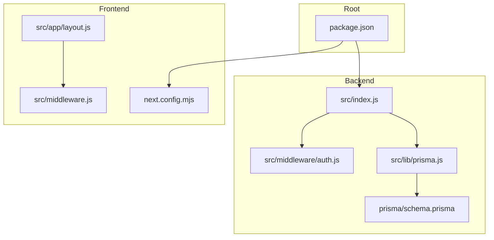
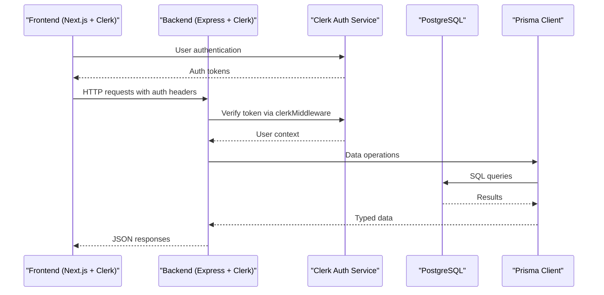
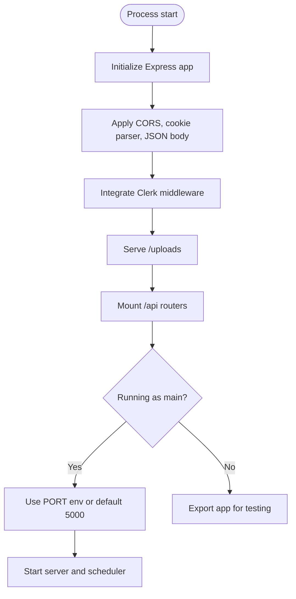
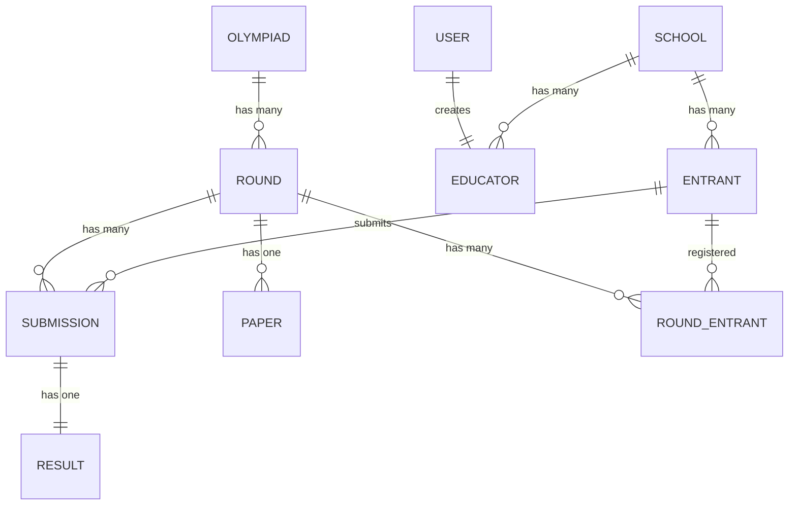
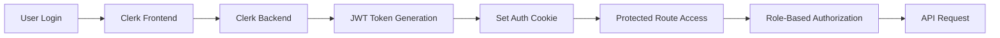
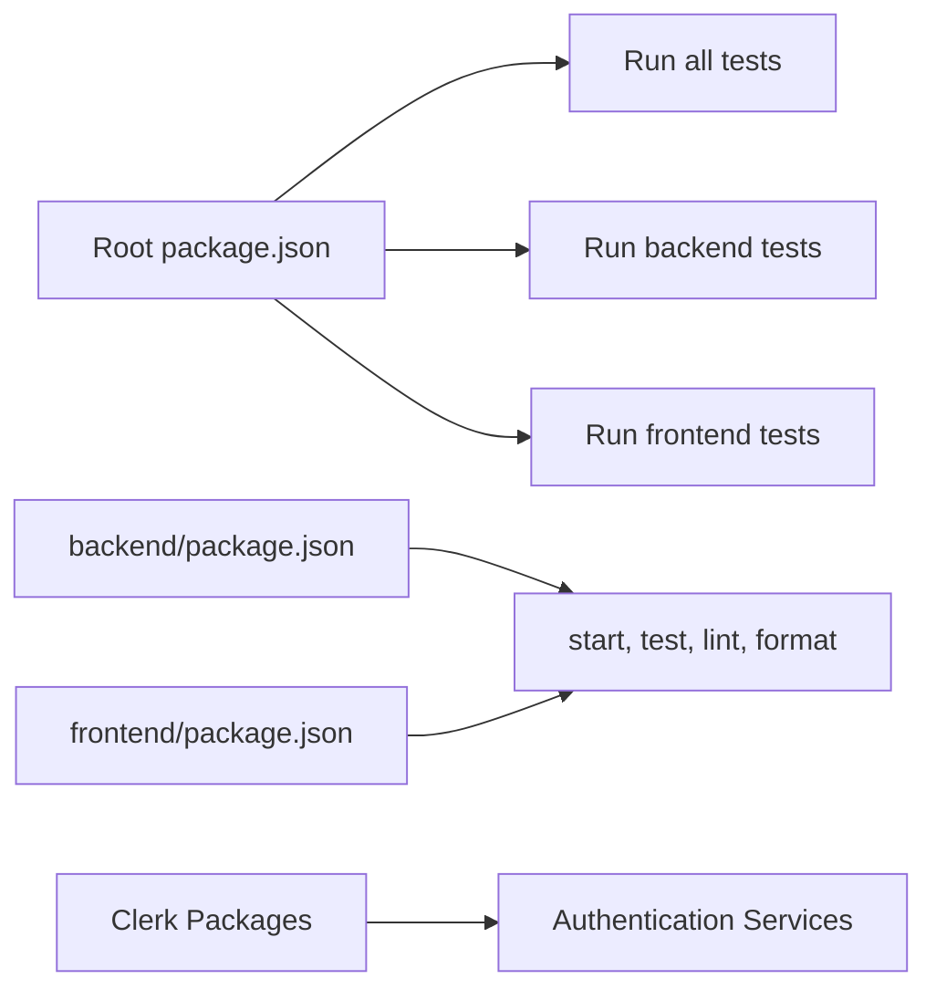

# Getting Started

<cite>
**Referenced Files in This Document**
- [package.json](file://package.json)
- [backend/package.json](file://backend/package.json)
- [frontend/package.json](file://frontend/package.json)
- [backend/src/index.js](file://backend/src/index.js)
- [backend/prisma/schema.prisma](file://backend/prisma/schema.prisma)
- [backend/src/lib/prisma.js](file://backend/src/lib/prisma.js)
- [backend/.gitignore](file://backend/.gitignore)
- [frontend/next.config.mjs](file://frontend/next.config.mjs)
- [frontend/.gitignore](file://frontend/.gitignore)
- [documents/docs/getting-started.md](file://documents/docs/getting-started.md)
- [README.md](file://README.md)
- [backend/README.md](file://backend/README.md)
- [frontend/README.md](file://frontend/README.md)
- [backend/src/middleware/auth.js](file://backend/src/middleware/auth.js)
- [frontend/src/middleware.js](file://frontend/src/middleware.js)
- [backend/src/routes/auth.js](file://backend/src/routes/auth.js)
- [frontend/src/app/layout.js](file://frontend/src/app/layout.js)
- [backend/src/test-setup.js](file://backend/src/test-setup.js)
</cite>

## Update Summary
**Changes Made**
- Added comprehensive Clerk authentication setup for both frontend and backend
- Updated environment variable configuration to include Clerk-specific variables
- Enhanced setup instructions with detailed Clerk configuration steps
- Added authentication middleware integration details
- Updated troubleshooting section with Clerk-related issues and solutions

## Table of Contents
1. Introduction
2. Project Structure
3. Core Components
4. Architecture Overview
5. Detailed Component Analysis
6. Dependency Analysis
7. Performance Considerations
8. Troubleshooting Guide
9. Conclusion
10. Appendices

## Introduction
This guide helps you set up and run the Olympiad Portal locally for development and production. The documentation has been consolidated into a structured Docusaurus format, providing comprehensive setup and usage instructions previously found in standalone files. It covers prerequisites, environment configuration, database setup, installing dependencies, running migrations, starting services, executing tests, and verifying a successful installation. It also outlines the development workflow including linting and formatting.

## Project Structure
The repository is a monorepo with three main parts:
- Backend (Express + Prisma + PostgreSQL + Clerk Authentication)
- Frontend (Next.js + Clerk Authentication)
- Shared tooling and scripts at the root



**Diagram sources**
- [backend/src/index.js:1-41](file://backend/src/index.js#L1-L41)
- [backend/prisma/schema.prisma:1-109](file://backend/prisma/schema.prisma#L1-L109)
- [backend/src/lib/prisma.js:1-6](file://backend/src/lib/prisma.js#L1-L6)
- [backend/src/middleware/auth.js:1-35](file://backend/src/middleware/auth.js#L1-L35)
- [frontend/next.config.mjs:1-7](file://frontend/next.config.mjs#L1-L7)
- [frontend/src/app/layout.js:1-47](file://frontend/src/app/layout.js#L1-L47)
- [frontend/src/middleware.js:1-11](file://frontend/src/middleware.js#L1-L11)
- [package.json:1-27](file://package.json#L1-L27)

**Section sources**
- [package.json:1-27](file://package.json#L1-L27)
- [backend/package.json:1-52](file://backend/package.json#L1-L52)
- [frontend/package.json:1-37](file://frontend/package.json#L1-L37)

## Core Components
- Backend server entrypoint that wires Express middleware, routes, static uploads, Clerk authentication, and starts a scheduler.
- Database schema defined with Prisma using PostgreSQL.
- Prisma client singleton used by backend modules.
- Frontend Next.js app configured via its config file with Clerk authentication provider.
- Authentication middleware for protecting routes and managing user sessions.

Key responsibilities:
- Backend: HTTP API, Clerk authentication integration, scheduling, file uploads, database access via Prisma.
- Frontend: UI and client-side logic for interacting with the backend, Clerk authentication handling.

**Section sources**
- [backend/src/index.js:1-41](file://backend/src/index.js#L1-L41)
- [backend/prisma/schema.prisma:1-109](file://backend/prisma/schema.prisma#L1-L109)
- [backend/src/lib/prisma.js:1-6](file://backend/src/lib/prisma.js#L1-L6)
- [backend/src/middleware/auth.js:1-35](file://backend/src/middleware/auth.js#L1-L35)
- [frontend/next.config.mjs:1-7](file://frontend/next.config.mjs#L1-L7)
- [frontend/src/app/layout.js:1-47](file://frontend/src/app/layout.js#L1-L47)

## Architecture Overview
High-level flow from frontend to backend and database with Clerk authentication:



**Diagram sources**
- [backend/src/index.js:11-24](file://backend/src/index.js#L11-L24)
- [backend/src/lib/prisma.js:1-6](file://backend/src/lib/prisma.js#L1-L6)
- [backend/prisma/schema.prisma:6-9](file://backend/prisma/schema.prisma#L6-L9)
- [frontend/src/middleware.js:1-11](file://frontend/src/middleware.js#L1-L11)

## Detailed Component Analysis

### Backend Setup and Execution
- The server initializes Express, enables CORS for the local frontend, parses cookies and JSON, integrates Clerk middleware, serves static uploads, mounts API routers under /api, and listens on port 5000 by default.
- A scheduler is started when the process runs directly, managing round lifecycle transitions every 30 seconds.



**Updated** The backend now includes Clerk authentication middleware integration with automatic scheduler startup.

**Diagram sources**
- [backend/src/index.js:13-38](file://backend/src/index.js#L13-L38)

**Section sources**
- [backend/src/index.js:1-41](file://backend/src/index.js#L1-L41)

### Database Schema and Migrations
- The database provider is PostgreSQL and the connection URL is read from an environment variable.
- Models include Olympiad, Round, User, School, Educator, Entrant, Paper, Submission, Result, RoundEntrant.



**Diagram sources**
- [backend/prisma/schema.prisma:11-108](file://backend/prisma/schema.prisma#L11-L108)

**Section sources**
- [backend/prisma/schema.prisma:1-109](file://backend/prisma/schema.prisma#L1-L109)

### Environment Variables
Required variables:
- DATABASE_URL: PostgreSQL connection string for the shared Railway database (ask teammates for access).
- PORT: Backend server port; defaults to 5000 if not provided.
- JWT_SECRET: Secret key for JWT token signing and verification.
- CLERK_SECRET_KEY: Clerk secret key for backend authentication.
- SENDGRID_API_KEY: SendGrid API key for email functionality.
- SENDGRID_FROM_EMAIL: Default sender email address.
- SUPABASE_URL: Supabase service URL for storage.
- SUPABASE_SERVICE_ROLE_KEY: Supabase service role key.
- SUPABASE_BUCKET_NAME: Supabase bucket name for file storage.

Notes:
- .env files are ignored in version control for both backend and frontend.
- Ensure your PostgreSQL instance is reachable and credentials are correct.
- Use Node.js 20 (LTS) as newer versions (22+) have caused compatibility issues.

**Updated** Environment setup now includes Clerk authentication variables and updated Node.js version requirements.

**Section sources**
- [backend/prisma/schema.prisma:6-9](file://backend/prisma/schema.prisma#L6-L9)
- [backend/src/index.js:33-37](file://backend/src/index.js#L33-L37)
- [backend/src/middleware/auth.js:3](file://backend/src/middleware/auth.js#L3)
- [backend/.gitignore:1-5](file://backend/.gitignore#L1-L5)
- [frontend/.gitignore:33-34](file://frontend/.gitignore#L33-L34)
- [backend/src/test-setup.js:1-10](file://backend/src/test-setup.js#L1-L10)

### Frontend Configuration
- Next.js application with standard dev/build/start/test/lint/format scripts.
- Minimal next.config.mjs present; can be extended as needed.
- Runs on port 3000 by default and connects to backend at localhost:5000.
- Integrated with Clerk authentication provider for user management.

**Updated** Frontend now includes Clerk authentication integration with middleware and provider setup.

**Section sources**
- [frontend/package.json:1-37](file://frontend/package.json#L1-L37)
- [frontend/next.config.mjs:1-7](file://frontend/next.config.mjs#L1-L7)
- [frontend/README.md:3-17](file://frontend/README.md#L3-L17)
- [frontend/src/app/layout.js:1-47](file://frontend/src/app/layout.js#L1-L47)
- [frontend/src/middleware.js:1-11](file://frontend/src/middleware.js#L1-L11)

### Authentication System
- Backend uses Clerk middleware for request authentication and user context injection.
- Frontend uses Clerk provider and middleware for client-side authentication.
- JWT-based session management with custom middleware for route protection.
- Role-based access control for different user types (educator, organiser).



**Diagram sources**
- [backend/src/middleware/auth.js:5-32](file://backend/src/middleware/auth.js#L5-L32)
- [backend/src/routes/auth.js:37-99](file://backend/src/routes/auth.js#L37-L99)
- [frontend/src/middleware.js:1-11](file://frontend/src/middleware.js#L1-L11)

**Section sources**
- [backend/src/middleware/auth.js:1-35](file://backend/src/middleware/auth.js#L1-L35)
- [backend/src/routes/auth.js:37-99](file://backend/src/routes/auth.js#L37-L99)
- [frontend/src/middleware.js:1-11](file://frontend/src/middleware.js#L1-L11)
- [frontend/src/app/layout.js:1-47](file://frontend/src/app/layout.js#L1-L47)

## Dependency Analysis
Scripts and tooling overview:
- Root package.json provides unified test commands across backend and frontend.
- Backend uses Vitest for unit/integration tests, ESLint and Prettier for code quality.
- Frontend uses Vitest for tests, ESLint and Prettier for code quality.
- Both services integrate Clerk authentication packages.



**Diagram sources**
- [package.json:6-11](file://package.json#L6-L11)
- [backend/package.json:6-13](file://backend/package.json#L6-L13)
- [frontend/package.json:5-13](file://frontend/package.json#L5-L13)

**Section sources**
- [package.json:1-27](file://package.json#L1-L27)
- [backend/package.json:1-52](file://backend/package.json#L1-L52)
- [frontend/package.json:1-37](file://frontend/package.json#L1-L37)

## Performance Considerations
- Use a local or fast network PostgreSQL instance during development to reduce latency.
- Keep migrations small and incremental to minimize downtime and lock contention.
- Avoid heavy synchronous operations in request handlers; offload background tasks to the scheduler where appropriate.
- Enable compression and caching in production proxies/load balancers.
- The round scheduler runs every 30 seconds, so avoid excessive database queries in scheduled tasks.
- Clerk authentication adds minimal overhead but should be considered in high-traffic scenarios.

[No sources needed since this section provides general guidance]

## Troubleshooting Guide
Common issues and resolutions:
- Cannot connect to database:
  - Verify DATABASE_URL points to the shared Railway Postgres database and has correct credentials.
  - Confirm Prisma client is generated after install.
  - Campus Wi-Fi may block connection ports; try mobile hotspot if experiencing connectivity issues.
- Port conflicts:
  - Set PORT to an available value if the default (5000) is in use.
- CORS errors from frontend:
  - Ensure the backend CORS origin matches the frontend's development URL (http://localhost:3000).
- Missing environment variables:
  - Create .env files in backend and frontend directories as needed; they are ignored by git.
- Tests fail due to missing generated client:
  - Reinstall dependencies and ensure postinstall generates Prisma client.
- Node.js version compatibility:
  - Use Node.js 20 (LTS); newer versions (22+) have caused dependency compatibility issues.
- Clerk authentication issues:
  - Verify CLERK_SECRET_KEY is correctly set in backend environment.
  - Check that Clerk middleware is properly integrated in both frontend and backend.
  - Ensure proper CORS configuration for Clerk domains.
- JWT token errors:
  - Verify JWT_SECRET is set consistently across all environments.
  - Check that tokens are being properly signed and verified.

Verification steps:
- Start the backend and confirm it logs "Backend running on :5000" and "Round scheduler started".
- Run database migrations to create tables.
- Execute tests for both backend and frontend to validate setup.
- Test API endpoint: `Invoke-RestMethod -Uri http://localhost:5000/api/olympiads`
- Verify Clerk authentication by attempting to access protected routes.

**Updated** Added specific troubleshooting tips for Clerk authentication, JWT tokens, and Node.js version requirements.

**Section sources**
- [backend/src/index.js:33-37](file://backend/src/index.js#L33-L37)
- [backend/prisma/schema.prisma:6-9](file://backend/prisma/schema.prisma#L6-L9)
- [backend/.gitignore:1-5](file://backend/.gitignore#L1-L5)
- [frontend/.gitignore:33-34](file://frontend/.gitignore#L33-L34)
- [documents/docs/getting-started.md:63-66](file://documents/docs/getting-started.md#L63-L66)
- [README.md:66-69](file://README.md#L66-L69)
- [backend/src/middleware/auth.js:12-19](file://backend/src/middleware/auth.js#L12-L19)
- [backend/src/test-setup.js:1-10](file://backend/src/test-setup.js#L1-L10)

## Conclusion
You now have the context to install dependencies, configure environment variables, set up the database, run migrations, and start both backend and frontend services with full Clerk authentication support. The documentation has been consolidated into a structured Docusaurus format for easier navigation and maintenance. Use the provided scripts to run tests and maintain code quality with linting and formatting.

[No sources needed since this section summarizes without analyzing specific files]

## Appendices

### Installation and Setup

#### Prerequisites
- **Node.js 20 (LTS)** — newer versions (22+) have caused compatibility issues with our dependencies. Use [nvm-windows](https://github.com/coreybutler/nvm-windows) to manage versions if needed:
  ```
  nvm install 20
  nvm use 20
  ```
- Access to the shared Railway Postgres database (ask a teammate for the connection string)
- Clerk account setup for authentication services

#### Backend Setup
1. Install dependencies:
   - Navigate to the backend directory and install packages.
2. Configure environment:
   - Create a .env file in the backend directory with DATABASE_URL, PORT, JWT_SECRET, CLERK_SECRET_KEY, and other required variables.
3. Generate Prisma client and apply migrations:
   - Generate the Prisma client and run database migrations to create tables.
4. Start the backend:
   - Run the start script to launch the server.

Expected outcome:
- Server logs indicate it is listening on port 5000.
- Scheduler starts alongside the server with "Round scheduler started — ticking every 30s".
- Clerk middleware is active for authentication.

**Updated** Added Clerk authentication setup and JWT configuration requirements.

**Section sources**
- [backend/package.json:6-13](file://backend/package.json#L6-L13)
- [backend/src/index.js:33-37](file://backend/src/index.js#L33-L37)
- [backend/prisma/schema.prisma:6-9](file://backend/prisma/schema.prisma#L6-L9)
- [documents/docs/getting-started.md:7-47](file://documents/docs/getting-started.md#L7-L47)
- [README.md:10-50](file://README.md#L10-L50)
- [backend/src/test-setup.js:1-10](file://backend/src/test-setup.js#L1-L10)

#### Frontend Setup
1. Install dependencies:
   - Navigate to the frontend directory and install packages.
2. Configure environment:
   - Set up Clerk environment variables for frontend authentication.
3. Start the development server:
   - Run the dev script to start the Next.js development server.

Expected outcome:
- Development server starts and serves the application at http://localhost:3000.
- Clerk authentication provider is initialized.
- Protected routes are accessible with proper authentication.

**Updated** Added Clerk authentication setup for frontend.

**Section sources**
- [frontend/package.json:5-13](file://frontend/package.json#L5-L13)
- [frontend/README.md:3-17](file://frontend/README.md#L3-L17)
- [frontend/src/app/layout.js:1-47](file://frontend/src/app/layout.js#L1-L47)
- [frontend/src/middleware.js:1-11](file://frontend/src/middleware.js#L1-L11)

#### Running Tests
- Run all tests:
  - Use the root test command to execute backend and frontend tests.
- Run backend tests only:
  - Use the backend-specific test command.
- Run frontend tests only:
  - Use the frontend-specific test command.

**Section sources**
- [package.json:6-11](file://package.json#L6-L11)
- [backend/package.json:6-13](file://backend/package.json#L6-L13)
- [frontend/package.json:5-13](file://frontend/package.json#L5-L13)

#### Code Quality Workflow
- Linting:
  - Backend and frontend provide lint scripts to check code style and rules.
- Formatting:
  - Backend and frontend provide format scripts to auto-format code.
- Git hooks:
  - Husky is configured at the root to enable pre-commit workflows.

**Section sources**
- [backend/package.json:6-13](file://backend/package.json#L6-L13)
- [frontend/package.json:5-13](file://frontend/package.json#L5-L13)
- [package.json:6-11](file://package.json#L6-L11)

### Documentation Structure
The project documentation has been consolidated into a structured Docusaurus format located in the `documents/docs/` directory. This provides:
- Centralized getting started guide
- API reference documentation
- Technical stack information
- Testing guidelines
- Roadmap and planning documents

**Updated** Documentation is now organized in Docusaurus format for better navigation and maintenance.

**Section sources**
- [documents/docs/getting-started.md:1-85](file://documents/docs/getting-started.md#L1-L85)
- [documents/docs/api-reference.md](file://documents/docs/api-reference.md)
- [documents/docs/tech-stack.md](file://documents/docs/tech-stack.md)
- [documents/docs/testing.md](file://documents/docs/testing.md)