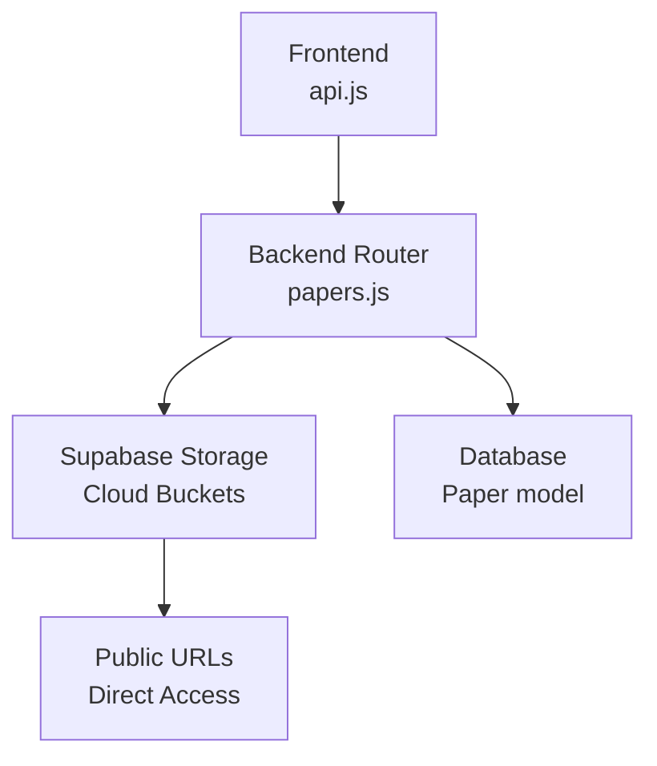
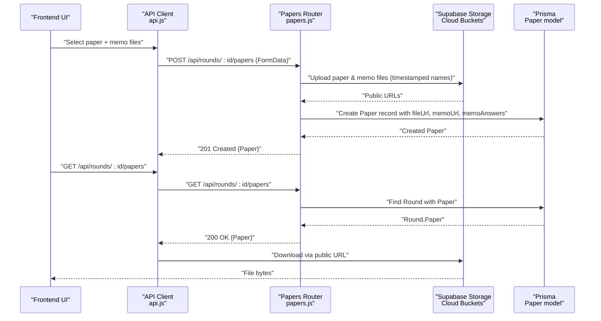
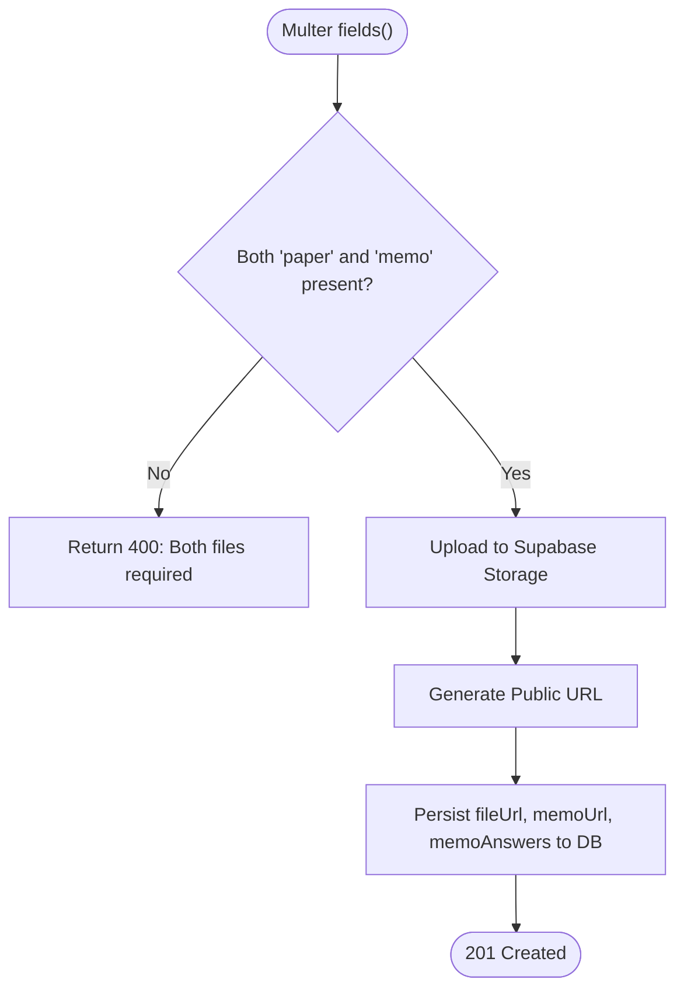
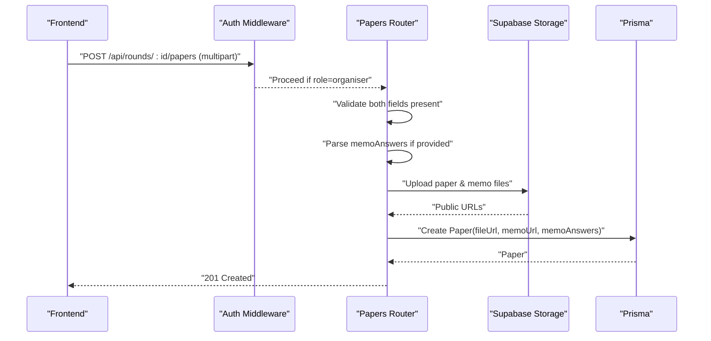
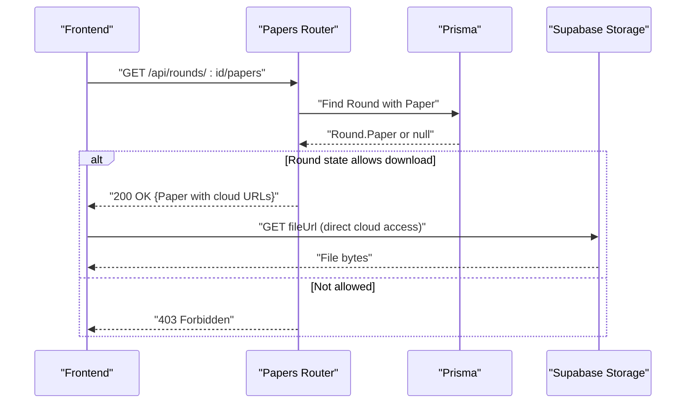
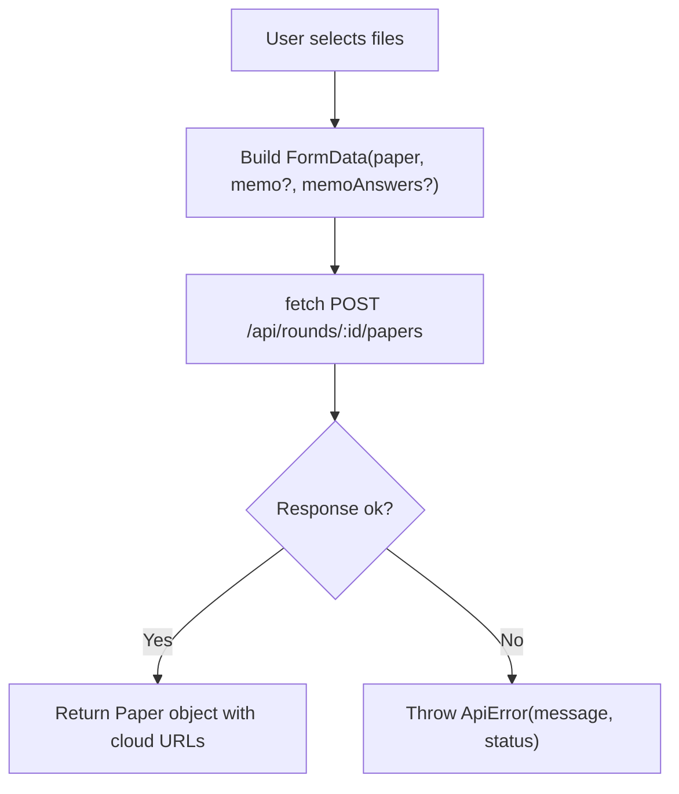
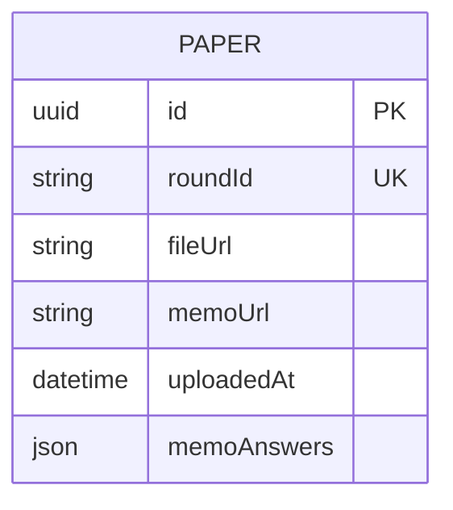
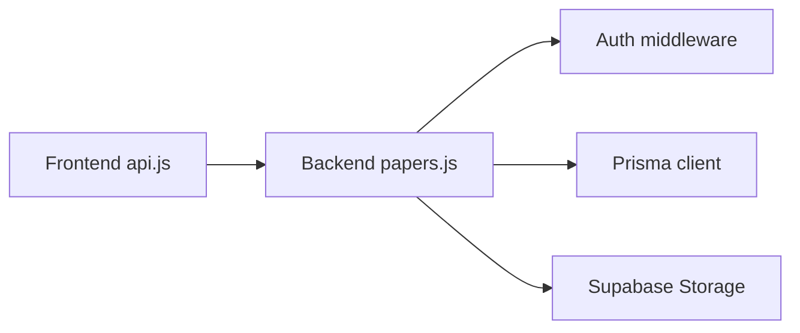

# File Upload and Download

<cite>
**Referenced Files in This Document**
- [papers.js](file://backend/src/routes/papers.js)
- [supabase.js](file://backend/src/lib/supabase.js)
- [index.js](file://backend/src/index.js)
- [auth.js](file://backend/src/middleware/auth.js)
- [schema.prisma](file://backend/prisma/schema.prisma)
- [api.js](file://frontend/src/lib/api.js)
- [papers.test.js](file://backend/src/routes/papers.test.js)
- [api.test.js](file://frontend/src/lib/api.test.js)
</cite>

## Update Summary
**Changes Made**
- Updated Multer configuration from local disk storage to memory storage for cloud upload
- Replaced local filesystem storage with Supabase Storage integration
- Updated file URL generation to use Supabase public URLs instead of local paths
- Modified architecture diagrams to reflect cloud storage approach
- Updated troubleshooting section for cloud-specific considerations

## Table of Contents
1. [Introduction](#introduction)
2. [Project Structure](#project-structure)
3. [Core Components](#core-components)
4. [Architecture Overview](#architecture-overview)
5. [Detailed Component Analysis](#detailed-component-analysis)
6. [Dependency Analysis](#dependency-analysis)
7. [Performance Considerations](#performance-considerations)
8. [Troubleshooting Guide](#troubleshooting-guide)
9. [Conclusion](#conclusion)

## Introduction
This document explains the file upload and download functionality for the Paper Distribution System. It covers how Multer is configured to handle examination papers and memo answer keys using memory storage for direct upload to Supabase Storage, how files are stored in cloud buckets with automatic public URL generation, how the frontend uploads and downloads files via the API client, and how errors are handled throughout the process.

## Project Structure
The file handling spans both backend and frontend with cloud storage integration:
- Backend routes define Multer configuration with memory storage, accept multipart form data for dual-file uploads, upload files directly to Supabase Storage, persist metadata to the database, and return cloud URLs for access.
- Frontend provides an API client that builds FormData for uploads and handles network and server errors consistently.

**Diagram sources**
- [papers.js:10-29](file://backend/src/routes/papers.js#L10-L29)
- [supabase.js:1-6](file://backend/src/lib/supabase.js#L1-L6)
- [api.js:78-112](file://frontend/src/lib/api.js#L78-L112)

**Section sources**
- [papers.js:1-114](file://backend/src/routes/papers.js#L1-L114)
- [supabase.js:1-6](file://backend/src/lib/supabase.js#L1-L6)
- [api.js:1-146](file://frontend/src/lib/api.js#L1-L146)

## Core Components
- Multer memory storage configured to keep files in memory for direct upload to Supabase Storage.
- Filename generation using a timestamp prefix to avoid conflicts in cloud storage.
- Dual-field upload accepting both paper and memo fields in a single request.
- Optional memoAnswers JSON field attached to the same multipart payload.
- Database persistence of Supabase public URLs and optional memo answers.
- Direct access to files via Supabase public URLs without intermediate static serving.
- Frontend API client building FormData and sending it to the upload endpoint.

**Section sources**
- [papers.js:10-29](file://backend/src/routes/papers.js#L10-L29)
- [papers.js:42-83](file://backend/src/routes/papers.js#L42-L83)
- [supabase.js:1-6](file://backend/src/lib/supabase.js#L1-L6)
- [api.js:78-112](file://frontend/src/lib/api.js#L78-L112)

## Architecture Overview
The end-to-end flow for uploading and downloading papers and memos using cloud storage:

**Diagram sources**
- [api.js:78-112](file://frontend/src/lib/api.js#L78-L112)
- [papers.js:42-111](file://backend/src/routes/papers.js#L42-L111)
- [supabase.js:1-6](file://backend/src/lib/supabase.js#L1-L6)
- [schema.prisma:69-77](file://backend/prisma/schema.prisma#L69-L77)

## Detailed Component Analysis

### Multer Configuration and Cloud Storage
- **Updated**: Files are now processed in memory using `multer.memoryStorage()` instead of being written to local disk.
- **Filename strategy**: Each file receives a unique name by prepending the current timestamp to the original filename, preventing conflicts when multiple rounds or users upload files to the cloud bucket.
- **Fields**: The route expects two fields—paper and memo—each with maxCount 1.
- **Cloud Upload**: Files are uploaded directly to Supabase Storage buckets using the configured bucket name from environment variables.
- **URL Generation**: Public URLs are automatically generated by Supabase for direct file access.

**Diagram sources**
- [papers.js:10-29](file://backend/src/routes/papers.js#L10-L29)
- [papers.js:42-83](file://backend/src/routes/papers.js#L42-L83)

**Section sources**
- [papers.js:10-29](file://backend/src/routes/papers.js#L10-L29)
- [papers.js:42-83](file://backend/src/routes/papers.js#L42-L83)

### Dual-File Upload Endpoint
- Route: POST /api/rounds/:id/papers
- Authorization: Protected by role-based middleware requiring organiser role.
- Payload: Multipart/form-data with fields paper, memo, and optional memoAnswers (JSON string).
- Validation:
  - Both paper and memo must be present; otherwise returns 400.
  - If memoAnswers is provided, it must be valid JSON; otherwise returns 400.
- Persistence: Creates a Paper record storing Supabase public URLs to the uploaded files and optional memo answers.
- Response: 201 Created with the created Paper object containing cloud URLs.

**Diagram sources**
- [auth.js:22-32](file://backend/src/middleware/auth.js#L22-L32)
- [papers.js:42-83](file://backend/src/routes/papers.js#L42-L83)

**Section sources**
- [auth.js:1-35](file://backend/src/middleware/auth.js#L1-L35)
- [papers.js:42-83](file://backend/src/routes/papers.js#L42-L83)

### File Download and Access Control
- Route: GET /api/rounds/:id/papers
- Behavior:
  - Retrieves the round and its associated Paper.
  - Allows download only when the round state is open or released; otherwise returns 403 with a descriptive error.
  - Returns 404 if no paper has been uploaded yet.
- **Updated**: File retrieval now uses Supabase public URLs returned in the response, eliminating the need for intermediate static file serving.
- Direct Access: Clients download files directly from Supabase Storage using the public URLs provided in the Paper response.

**Diagram sources**
- [papers.js:85-111](file://backend/src/routes/papers.js#L85-L111)

**Section sources**
- [papers.js:85-111](file://backend/src/routes/papers.js#L85-L111)

### Frontend Integration and Multipart Handling
- The API client constructs a FormData object containing:
  - paper: selected file
  - memo: optional file
  - memoAnswers: optional JSON stringified object
- It sends this FormData to POST /api/rounds/:id/papers with credentials included.
- Error handling:
  - Network failures throw ApiError with status 0.
  - Non-2xx responses throw ApiError with the server-provided error message or a generic status-based message.

**Diagram sources**
- [api.js:78-112](file://frontend/src/lib/api.js#L78-L112)

**Section sources**
- [api.js:78-112](file://frontend/src/lib/api.js#L78-L112)

### Data Model and Cloud Storage Strategy
- Paper model stores:
  - fileUrl: Supabase public URL to the exam paper file
  - memoUrl: Supabase public URL to the memo answer key file
  - memoAnswers: optional JSON content
  - uploadedAt: timestamp
- **Updated**: Files are stored in Supabase Storage buckets with timestamp-prefixed filenames to prevent collisions.
- **Updated**: Direct access via Supabase public URLs eliminates the need for local file serving infrastructure.

**Diagram sources**
- [schema.prisma:69-77](file://backend/prisma/schema.prisma#L69-L77)

**Section sources**
- [schema.prisma:69-77](file://backend/prisma/schema.prisma#L69-L77)

## Dependency Analysis
- Papers router depends on:
  - Multer for parsing multipart/form-data with memory storage
  - Supabase client for cloud storage operations
  - Prisma for creating Paper records
  - Auth middleware for role enforcement
- Frontend API client depends on:
  - Browser Fetch API
  - FormData for multipart payloads
  - Environment variable for base API URL

**Diagram sources**
- [api.js:78-112](file://frontend/src/lib/api.js#L78-L112)
- [papers.js:1-114](file://backend/src/routes/papers.js#L1-L114)
- [auth.js:22-32](file://backend/src/middleware/auth.js#L22-L32)
- [supabase.js:1-6](file://backend/src/lib/supabase.js#L1-L6)

**Section sources**
- [papers.js:1-114](file://backend/src/routes/papers.js#L1-L114)
- [api.js:78-112](file://frontend/src/lib/api.js#L78-L112)
- [auth.js:22-32](file://backend/src/middleware/auth.js#L22-L32)
- [supabase.js:1-6](file://backend/src/lib/supabase.js#L1-L6)

## Performance Considerations
- **Updated**: Memory storage means files are held in server memory during upload, which may impact memory usage for large files.
- **Updated**: No explicit size limits are set in Multer. For production, consider adding limits to protect server resources and prevent memory exhaustion.
- **Updated**: Cloud storage eliminates local disk I/O bottlenecks but introduces network latency for uploads and downloads.
- **Updated**: Concurrency considerations include memory pressure from concurrent uploads and network bandwidth limitations.
- **Updated**: Supabase CDN caching can improve download performance for frequently accessed files.

## Troubleshooting Guide
Common issues and their causes:
- Missing files: If either paper or memo is not provided, the endpoint returns 400 with a message indicating both are required.
- Invalid memoAnswers: If memoAnswers is provided but not valid JSON, the endpoint returns 400 with a message about invalid JSON.
- Unauthorized access: Without the organiser role, the upload endpoint returns 403.
- Round not available: When downloading, if the round is not in open or released state, the endpoint returns 403 with a descriptive error.
- No paper uploaded: If no paper exists for the round, the download endpoint returns 404.
- **Updated**: Supabase upload failures: Network or authentication errors when uploading to Supabase Storage result in 500 errors.
- **Updated**: Memory exhaustion: Large concurrent uploads may cause memory issues due to memory storage approach.
- **Updated**: Bucket permissions: Ensure Supabase bucket has appropriate read/write permissions configured.

Frontend error handling:
- Network failures throw ApiError with status 0.
- Non-2xx responses throw ApiError with the server's error message or a generic status-based message.

**Section sources**
- [papers.js:42-83](file://backend/src/routes/papers.js#L42-L83)
- [papers.js:85-111](file://backend/src/routes/papers.js#L85-L111)
- [auth.js:22-32](file://backend/src/middleware/auth.js#L22-L32)
- [api.js:78-112](file://frontend/src/lib/api.js#L78-L112)
- [papers.test.js:84-125](file://backend/src/routes/papers.test.js#L84-L125)
- [api.test.js:179-241](file://frontend/src/lib/api.test.js#L179-L241)

## Conclusion
The system implements a robust dual-file upload mechanism for examination papers and memo answer keys using Multer with memory storage for direct upload to Supabase Storage. Files are now stored in cloud buckets with automatic public URL generation, eliminating the need for local filesystem management. The frontend integrates seamlessly through an API client that handles multipart payloads and consistent error reporting. Access control ensures only authorised roles can upload, and download availability is gated by round state. For production readiness, consider implementing file size limits, memory usage monitoring, and proper error handling for cloud storage operations.