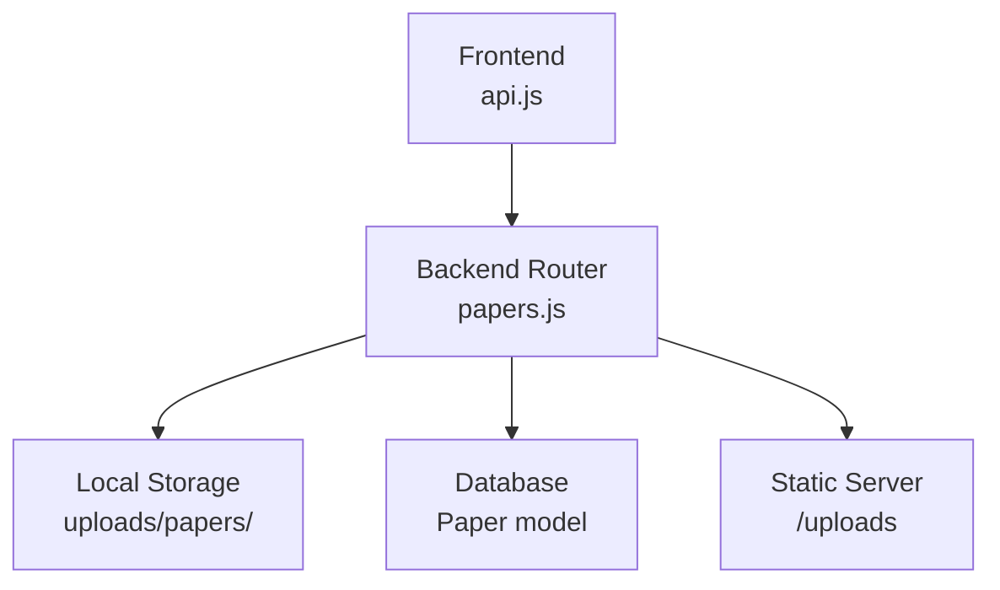
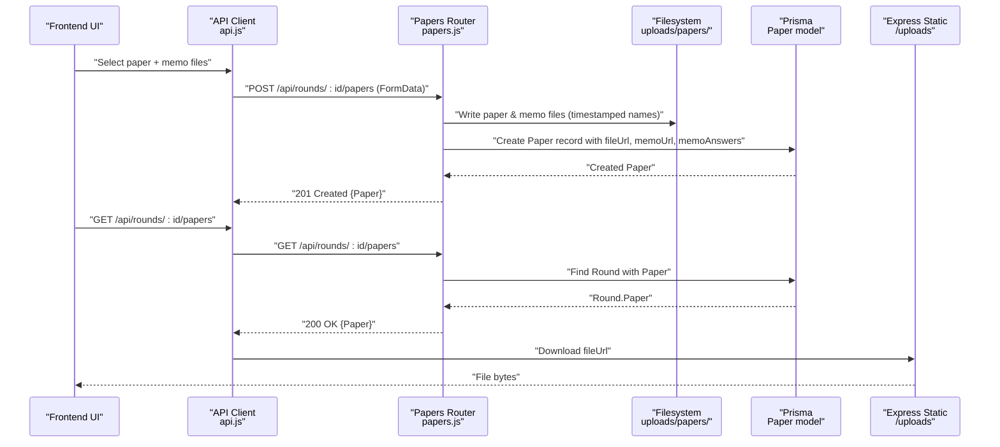
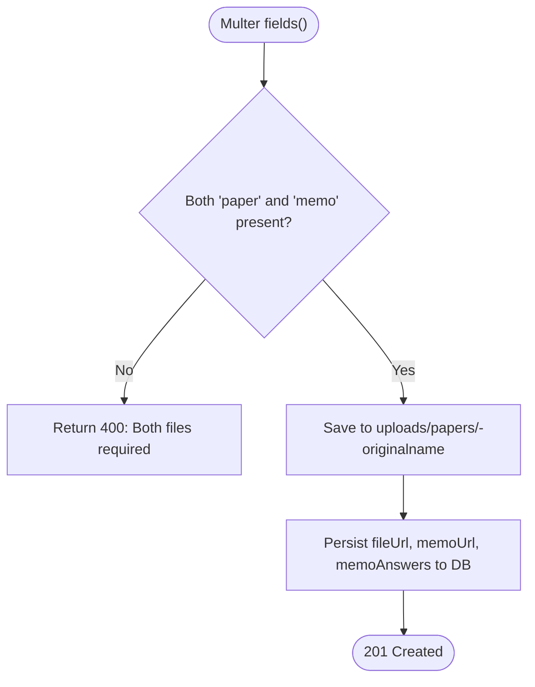
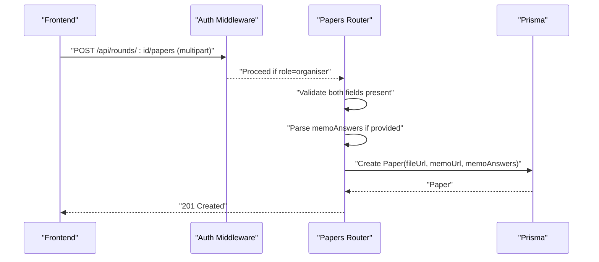
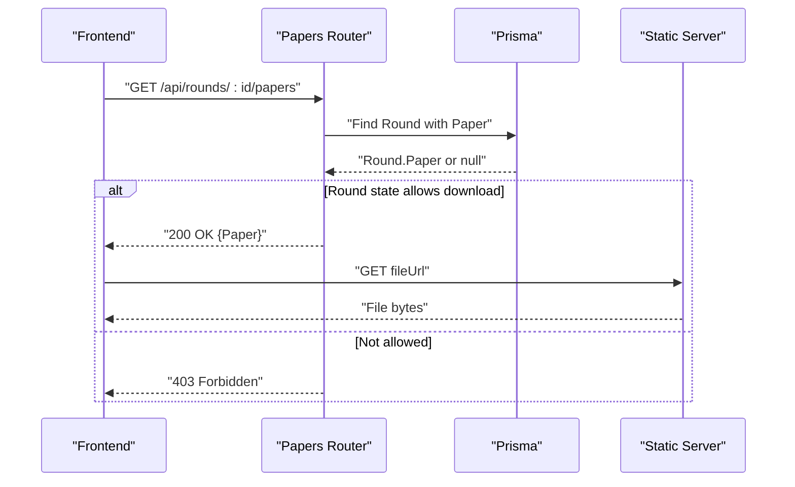
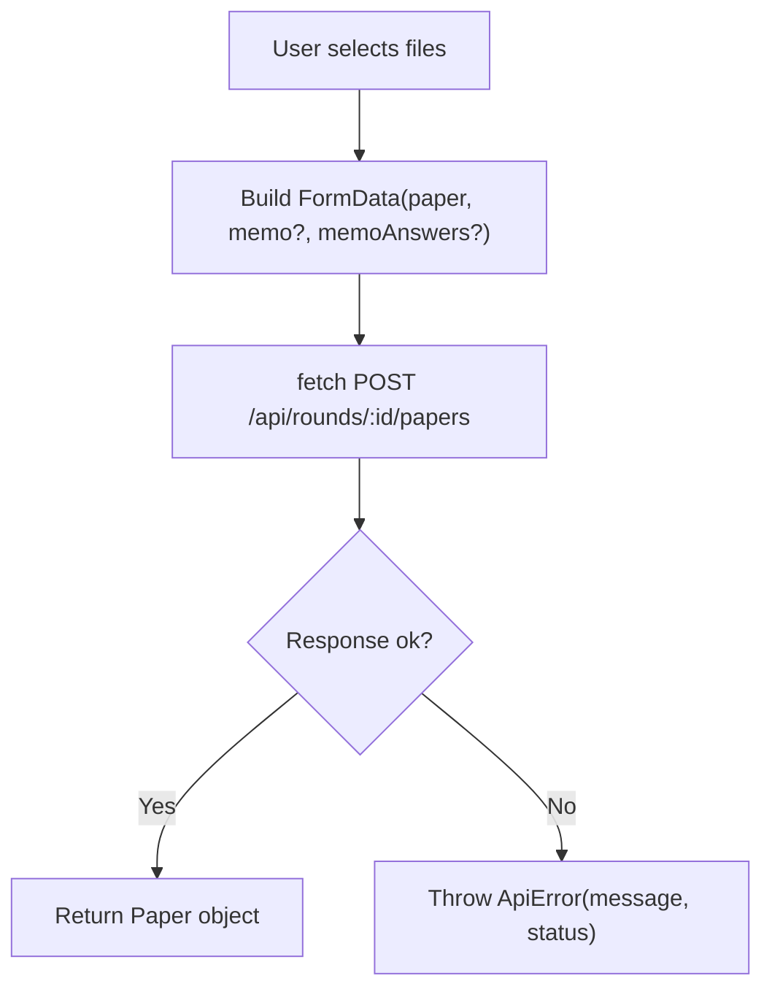
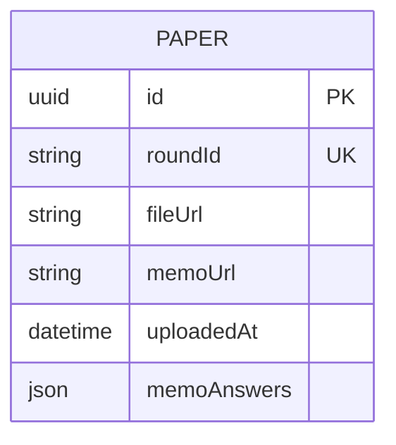
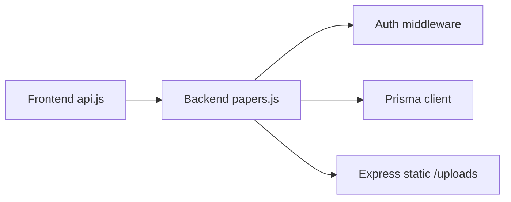

# File Upload and Download

<cite>
**Referenced Files in This Document**
- [papers.js](file://backend/src/routes/papers.js)
- [index.js](file://backend/src/index.js)
- [auth.js](file://backend/src/middleware/auth.js)
- [schema.prisma](file://backend/prisma/schema.prisma)
- [api.js](file://frontend/src/lib/api.js)
- [papers.test.js](file://backend/src/routes/papers.test.js)
- [api.test.js](file://frontend/src/lib/api.test.js)
</cite>

## Table of Contents
1. [Introduction](#introduction)
2. [Project Structure](#project-structure)
3. [Core Components](#core-components)
4. [Architecture Overview](#architecture-overview)
5. [Detailed Component Analysis](#detailed-component-analysis)
6. [Dependency Analysis](#dependency-analysis)
7. [Performance Considerations](#performance-considerations)
8. [Troubleshooting Guide](#troubleshooting-guide)
9. [Conclusion](#conclusion)

## Introduction
This document explains the file upload and download functionality for the Paper Distribution System. It covers how Multer is configured to handle examination papers and memo answer keys, how files are stored locally with a timestamp-based naming strategy, how the frontend uploads and downloads files via the API client, and how errors are handled throughout the process.

## Project Structure
The file handling spans both backend and frontend:
- Backend routes define Multer configuration, accept multipart form data for dual-file uploads (paper and memo), persist metadata to the database, and serve static files from a local directory.
- Frontend provides an API client that builds FormData for uploads and handles network and server errors consistently.

**Diagram sources**
- [papers.js:12-23](file://backend/src/routes/papers.js#L12-L23)
- [index.js:26-32](file://backend/src/index.js#L26-L32)
- [api.js:78-112](file://frontend/src/lib/api.js#L78-L112)

**Section sources**
- [papers.js:1-99](file://backend/src/routes/papers.js#L1-L99)
- [index.js:1-43](file://backend/src/index.js#L1-L43)
- [api.js:1-146](file://frontend/src/lib/api.js#L1-L146)

## Core Components
- Multer disk storage configured to write files into a dedicated folder under uploads/papers.
- Filename generation using a timestamp prefix to avoid collisions.
- Dual-field upload accepting both paper and memo fields in a single request.
- Optional memoAnswers JSON field attached to the same multipart payload.
- Database persistence of file URLs and optional memo answers.
- Static serving of uploaded files via Express static middleware.
- Frontend API client building FormData and sending it to the upload endpoint.

**Section sources**
- [papers.js:12-23](file://backend/src/routes/papers.js#L12-L23)
- [papers.js:25-67](file://backend/src/routes/papers.js#L25-L67)
- [index.js:26-32](file://backend/src/index.js#L26-L32)
- [api.js:78-112](file://frontend/src/lib/api.js#L78-L112)

## Architecture Overview
The end-to-end flow for uploading and downloading papers and memos:

**Diagram sources**
- [api.js:78-112](file://frontend/src/lib/api.js#L78-L112)
- [papers.js:25-96](file://backend/src/routes/papers.js#L25-L96)
- [index.js:26-32](file://backend/src/index.js#L26-L32)
- [schema.prisma:69-77](file://backend/prisma/schema.prisma#L69-L77)

## Detailed Component Analysis

### Multer Configuration and Local Storage
- Destination: Files are saved under a dedicated uploads/papers directory created at startup.
- Filename strategy: Each file receives a unique name by prepending the current timestamp to the original filename, preventing conflicts when multiple rounds or users upload files.
- Fields: The route expects two fields—paper and memo—each with maxCount 1.
- No explicit file size limits or MIME type validation are configured in Multer; requests without both required fields are rejected early.

**Diagram sources**
- [papers.js:12-23](file://backend/src/routes/papers.js#L12-L23)
- [papers.js:25-67](file://backend/src/routes/papers.js#L25-L67)

**Section sources**
- [papers.js:12-23](file://backend/src/routes/papers.js#L12-L23)
- [papers.js:25-67](file://backend/src/routes/papers.js#L25-L67)

### Dual-File Upload Endpoint
- Route: POST /api/rounds/:id/papers
- Authorization: Protected by role-based middleware requiring organiser role.
- Payload: Multipart/form-data with fields paper, memo, and optional memoAnswers (JSON string).
- Validation:
  - Both paper and memo must be present; otherwise returns 400.
  - If memoAnswers is provided, it must be valid JSON; otherwise returns 400.
- Persistence: Creates a Paper record storing relative paths to the uploaded files and optional memo answers.
- Response: 201 Created with the created Paper object.

**Diagram sources**
- [auth.js:22-32](file://backend/src/middleware/auth.js#L22-L32)
- [papers.js:25-67](file://backend/src/routes/papers.js#L25-L67)

**Section sources**
- [auth.js:1-35](file://backend/src/middleware/auth.js#L1-L35)
- [papers.js:25-67](file://backend/src/routes/papers.js#L25-L67)

### File Download and Access Control
- Route: GET /api/rounds/:id/papers
- Behavior:
  - Retrieves the round and its associated Paper.
  - Allows download only when the round state is open or released; otherwise returns 403 with a descriptive error.
  - Returns 404 if no paper has been uploaded yet.
- Actual file retrieval:
  - The response includes fileUrl and memoUrl pointing to the static path /uploads/papers/...
  - The browser or client fetches these URLs directly from the static server mounted at /uploads.

**Diagram sources**
- [papers.js:70-96](file://backend/src/routes/papers.js#L70-L96)
- [index.js:26-32](file://backend/src/index.js#L26-L32)

**Section sources**
- [papers.js:70-96](file://backend/src/routes/papers.js#L70-L96)
- [index.js:26-32](file://backend/src/index.js#L26-L32)

### Frontend Integration and Multipart Handling
- The API client constructs a FormData object containing:
  - paper: selected file
  - memo: optional file
  - memoAnswers: optional JSON stringified object
- It sends this FormData to POST /api/rounds/:id/papers with credentials included.
- Error handling:
  - Network failures throw ApiError with status 0.
  - Non-2xx responses throw ApiError with the server-provided error message or a generic status-based message.

**Diagram sources**
- [api.js:78-112](file://frontend/src/lib/api.js#L78-L112)

**Section sources**
- [api.js:78-112](file://frontend/src/lib/api.js#L78-L112)

### Data Model and Storage Strategy
- Paper model stores:
  - fileUrl: relative URL to the exam paper file
  - memoUrl: relative URL to the memo answer key file
  - memoAnswers: optional JSON content
  - uploadedAt: timestamp
- Files are stored on the local filesystem under uploads/papers with timestamp-prefixed filenames to prevent collisions.
- The static server serves files under /uploads, making fileUrl and memoUrl directly accessible.

**Diagram sources**
- [schema.prisma:69-77](file://backend/prisma/schema.prisma#L69-L77)

**Section sources**
- [schema.prisma:69-77](file://backend/prisma/schema.prisma#L69-L77)

## Dependency Analysis
- Papers router depends on:
  - Multer for parsing multipart/form-data and writing files
  - Prisma for creating Paper records
  - Auth middleware for role enforcement
  - Express static middleware for serving files
- Frontend API client depends on:
  - Browser Fetch API
  - FormData for multipart payloads
  - Environment variable for base API URL

**Diagram sources**
- [api.js:78-112](file://frontend/src/lib/api.js#L78-L112)
- [papers.js:1-99](file://backend/src/routes/papers.js#L1-L99)
- [auth.js:22-32](file://backend/src/middleware/auth.js#L22-L32)
- [index.js:26-32](file://backend/src/index.js#L26-L32)

**Section sources**
- [papers.js:1-99](file://backend/src/routes/papers.js#L1-L99)
- [api.js:78-112](file://frontend/src/lib/api.js#L78-L112)
- [auth.js:22-32](file://backend/src/middleware/auth.js#L22-L32)
- [index.js:26-32](file://backend/src/index.js#L26-L32)

## Performance Considerations
- File size limits: No explicit size limits are set in Multer. For production, consider adding limits to protect server resources.
- Disk I/O: Large files can block the event loop during writes; ensure adequate disk throughput and monitor storage usage.
- Concurrency: Multiple concurrent uploads may contend for disk I/O; consider rate limiting or queueing strategies if needed.
- Caching: Since files are served statically, leverage CDN or caching headers for better performance.

[No sources needed since this section provides general guidance]

## Troubleshooting Guide
Common issues and their causes:
- Missing files: If either paper or memo is not provided, the endpoint returns 400 with a message indicating both are required.
- Invalid memoAnswers: If memoAnswers is provided but not valid JSON, the endpoint returns 400 with a message about invalid JSON.
- Unauthorized access: Without the organiser role, the upload endpoint returns 403.
- Round not available: When downloading, if the round is not in open or released state, the endpoint returns 403 with a descriptive error.
- No paper uploaded: If no paper exists for the round, the download endpoint returns 404.
- Database errors: If saving the Paper record fails, the endpoint returns 500 with a generic error.

Frontend error handling:
- Network failures throw ApiError with status 0.
- Non-2xx responses throw ApiError with the server’s error message or a generic status-based message.

**Section sources**
- [papers.js:25-67](file://backend/src/routes/papers.js#L25-L67)
- [papers.js:70-96](file://backend/src/routes/papers.js#L70-L96)
- [auth.js:22-32](file://backend/src/middleware/auth.js#L22-L32)
- [api.js:78-112](file://frontend/src/lib/api.js#L78-L112)
- [papers.test.js:52-141](file://backend/src/routes/papers.test.js#L52-L141)
- [api.test.js:179-240](file://frontend/src/lib/api.test.js#L179-L240)

## Conclusion
The system implements a robust dual-file upload mechanism for examination papers and memo answer keys using Multer with timestamp-based filenames to avoid conflicts. Files are stored locally and served via a static server, while metadata is persisted in the database. The frontend integrates seamlessly through an API client that handles multipart payloads and consistent error reporting. Access control ensures only authorised roles can upload, and download availability is gated by round state. For production readiness, consider adding file size limits, MIME validation, and monitoring for disk usage and concurrency.

[No sources needed since this section summarizes without analyzing specific files]