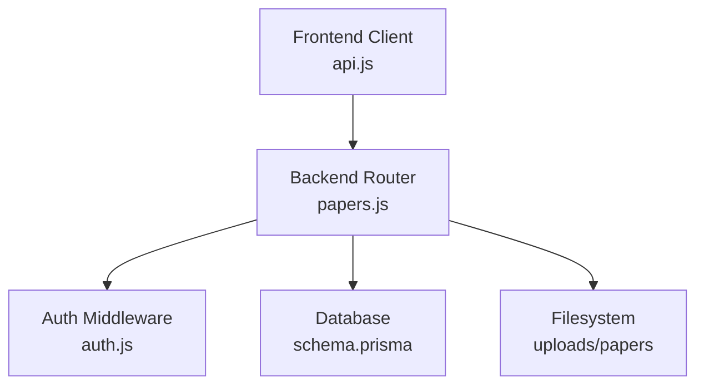
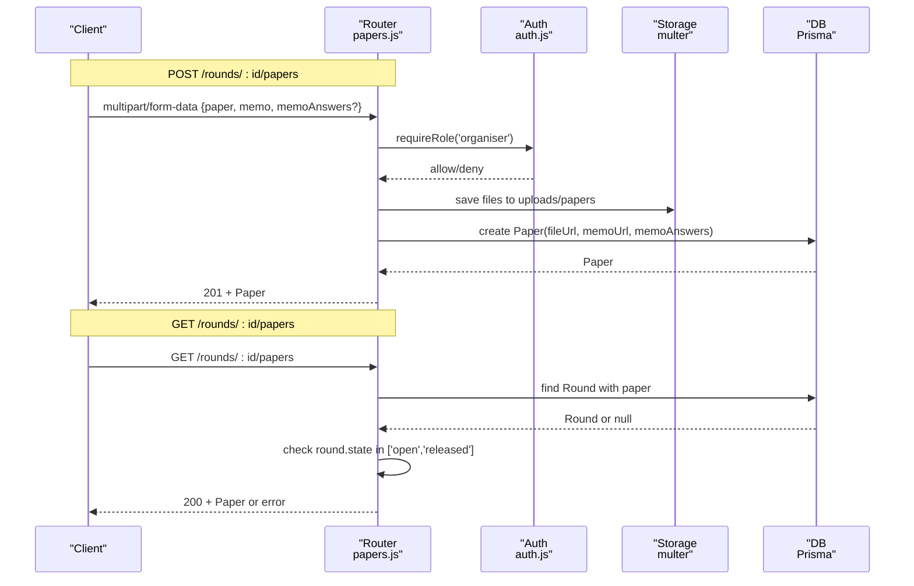
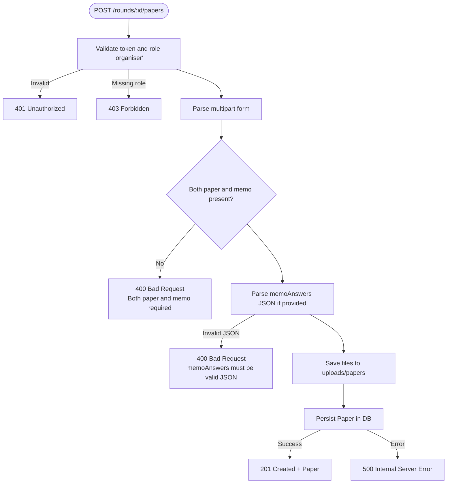
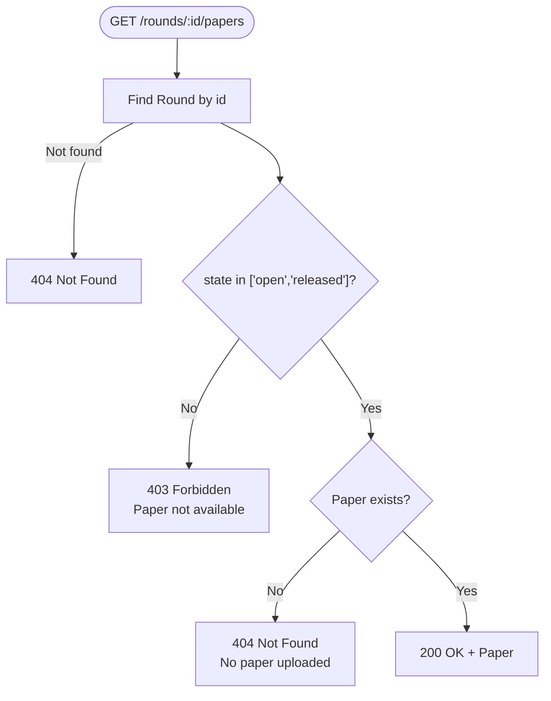
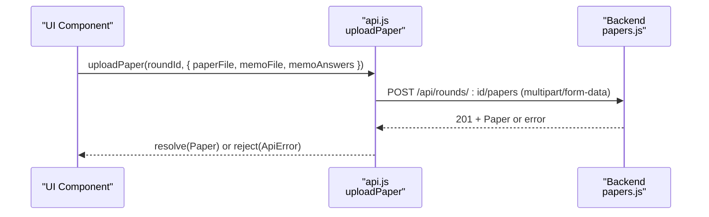
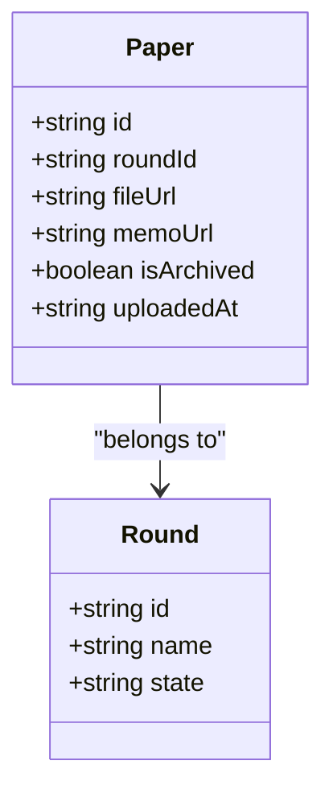

# Paper API Endpoints

<cite>
**Referenced Files in This Document**
- [papers.js](file://backend/src/routes/papers.js)
- [auth.js](file://backend/src/middleware/auth.js)
- [schema.prisma](file://backend/prisma/schema.prisma)
- [api.js](file://frontend/src/lib/api.js)
- [papers.test.js](file://backend/src/routes/papers.test.js)
- [api.test.js](file://frontend/src/lib/api.test.js)
</cite>

## Table of Contents
1. Introduction
2. Project Structure
3. Core Components
4. Architecture Overview
5. Detailed Component Analysis
6. Dependency Analysis
7. Performance Considerations
8. Troubleshooting Guide
9. Conclusion

## Introduction
This document provides detailed API documentation for paper-related endpoints in the Olympiad Portal. It covers:
- POST /rounds/:id/papers for uploading examination papers and memo answer keys (organiser-only)
- GET /rounds/:id/papers for retrieving paper information with access control based on round state
- Authentication requirements, request/response formats, status codes, error handling
- Frontend API client methods that interact with these endpoints

## Project Structure
The relevant implementation is split across backend routes, middleware, database schema, and frontend API client:
- Backend route handlers define the endpoints and business logic
- Middleware enforces authentication and role-based access
- Database schema defines the Paper model and its fields
- Frontend client exposes methods to call the endpoints with proper error handling

**Diagram sources**
- [papers.js:1-99](file://backend/src/routes/papers.js#L1-L99)
- [auth.js:1-35](file://backend/src/middleware/auth.js#L1-L35)
- [schema.prisma:69-77](file://backend/prisma/schema.prisma#L69-L77)
- [api.js:78-112](file://frontend/src/lib/api.js#L78-L112)

**Section sources**
- [papers.js:1-99](file://backend/src/routes/papers.js#L1-L99)
- [auth.js:1-35](file://backend/src/middleware/auth.js#L1-L35)
- [schema.prisma:69-77](file://backend/prisma/schema.prisma#L69-L77)
- [api.js:78-112](file://frontend/src/lib/api.js#L78-L112)

## Core Components
- POST /rounds/:id/papers
  - Requires organiser role via cookie token
  - Accepts multipart/form-data with fields paper and memo; optional memoAnswers as JSON string
  - Saves files to uploads/papers and persists Paper record with file URLs and memoAnswers
  - Returns created Paper object on success
- GET /rounds/:id/papers
  - No explicit auth required by route, but access controlled by round state
  - Allows download only when round is open or released
  - Returns Paper object if available; otherwise returns appropriate errors

**Section sources**
- [papers.js:25-96](file://backend/src/routes/papers.js#L25-L96)
- [auth.js:22-32](file://backend/src/middleware/auth.js#L22-L32)
- [schema.prisma:69-77](file://backend/prisma/schema.prisma#L69-L77)

## Architecture Overview
The flow for both endpoints involves routing, optional authentication/authorization, data validation, storage, and database persistence.

**Diagram sources**
- [papers.js:25-96](file://backend/src/routes/papers.js#L25-L96)
- [auth.js:5-32](file://backend/src/middleware/auth.js#L5-L32)
- [schema.prisma:18-29](file://backend/prisma/schema.prisma#L18-L29)

## Detailed Component Analysis

### POST /rounds/:id/papers
- Purpose: Upload an examination paper and memo answer key for a round, and optionally attach memo answers.
- Authentication: Requires a valid JWT in cookies and user role must be organiser.
- Request:
  - Method: POST
  - Path: /api/rounds/:id/papers
  - Content-Type: multipart/form-data
  - Fields:
    - paper: File (required)
    - memo: File (required)
    - memoAnswers: String (optional) — must be valid JSON representing the memo answers map
- Response:
  - 201 Created: Paper object including id, roundId, fileUrl, memoUrl, uploadedAt, memoAnswers
  - 400 Bad Request: Missing required files or invalid memoAnswers JSON
  - 401 Unauthorized: Missing or invalid/expired token
  - 403 Forbidden: User does not have organiser role
  - 500 Internal Server Error: Database write failure

**Diagram sources**
- [papers.js:25-68](file://backend/src/routes/papers.js#L25-L68)
- [auth.js:22-32](file://backend/src/middleware/auth.js#L22-L32)

**Section sources**
- [papers.js:25-68](file://backend/src/routes/papers.js#L25-L68)
- [auth.js:22-32](file://backend/src/middleware/auth.js#L22-L32)
- [papers.test.js:52-142](file://backend/src/routes/papers.test.js#L52-L142)

### GET /rounds/:id/papers
- Purpose: Retrieve the paper for a round when it is downloadable.
- Authentication: Not enforced by this route; access controlled by round state.
- Request:
  - Method: GET
  - Path: /api/rounds/:id/papers
- Access Control:
  - Downloadable only when round state is open or released
- Response:
  - 200 OK: Paper object for the round
  - 403 Forbidden: Round is scheduled or closed (not downloadable)
  - 404 Not Found: Round not found or no paper uploaded yet
  - Other errors: As returned by underlying operations

**Diagram sources**
- [papers.js:70-96](file://backend/src/routes/papers.js#L70-L96)

**Section sources**
- [papers.js:70-96](file://backend/src/routes/papers.js#L70-L96)
- [papers.test.js:144-207](file://backend/src/routes/papers.test.js#L144-L207)

### Frontend API Client Methods
- uploadPaper(roundId, { paperFile, memoFile, memoAnswers })
  - Sends multipart/form-data to /api/rounds/:id/papers
  - Appends paper and memo files; memoAnswers appended as JSON string when provided
  - Uses credentials: include to send cookies
  - Throws ApiError on network failures or non-2xx responses
- Error handling
  - Network errors throw ApiError with status 0
  - HTTP errors throw ApiError with response status and message from server or generic fallback
- Loading states
  - The client does not manage UI loading states; callers should handle Promise resolution/rejection to update UI accordingly

**Diagram sources**
- [api.js:78-112](file://frontend/src/lib/api.js#L78-L112)
- [papers.js:25-68](file://backend/src/routes/papers.js#L25-L68)

**Section sources**
- [api.js:78-112](file://frontend/src/lib/api.js#L78-L112)
- [api.test.js:179-241](file://frontend/src/lib/api.test.js#L179-L241)

## Dependency Analysis
- Route dependencies:
  - Express router mounts at /api
  - Multer handles multipart parsing and file storage under uploads/papers
  - Prisma interacts with PostgreSQL to persist Paper records
  - Auth middleware validates JWT and enforces organiser role
- Data model:
  - Paper has fields: id, roundId (unique), fileUrl, memoUrl, uploadedAt, memoAnswers (JSON?)
  - Round relation includes paper; GET endpoint uses include to fetch paper

**Diagram sources**
- [schema.prisma:69-77](file://backend/prisma/schema.prisma#L69-L77)
- [schema.prisma:18-29](file://backend/prisma/schema.prisma#L18-L29)

**Section sources**
- [schema.prisma:69-77](file://backend/prisma/schema.prisma#L69-L77)
- [schema.prisma:18-29](file://backend/prisma/schema.prisma#L18-L29)

## Performance Considerations
- File uploads:
  - Multer stores files to disk; ensure adequate disk space and consider size limits in production
  - Unique filenames are generated using timestamp plus original name to avoid collisions
- Database writes:
  - Single insert per upload; ensure indexes on roundId for efficient queries
- Concurrency:
  - Avoid concurrent uploads to the same round unless necessary; unique constraint on roundId prevents duplicates
- Network:
  - Use credentials: include to maintain session cookies; ensure CORS and secure cookie settings in production

[No sources needed since this section provides general guidance]

## Troubleshooting Guide
Common issues and resolutions:
- 401 Unauthorized
  - Cause: Missing or invalid/expired JWT in cookies
  - Resolution: Ensure login succeeded and cookie is present; refresh token if expired
- 403 Forbidden
  - Cause: User lacks organiser role for POST; or round state not open/released for GET
  - Resolution: Verify user role; ensure round is open or released before downloading
- 400 Bad Request
  - Cause: Missing paper or memo files; invalid memoAnswers JSON
  - Resolution: Attach both files; ensure memoAnswers is valid JSON string
- 404 Not Found
  - Cause: Round not found; or no paper uploaded for round
  - Resolution: Confirm roundId; ensure paper was uploaded successfully
- 500 Internal Server Error
  - Cause: Database write failure
  - Resolution: Check database connectivity and logs; retry after resolving DB issues

**Section sources**
- [papers.js:25-96](file://backend/src/routes/papers.js#L25-L96)
- [auth.js:5-32](file://backend/src/middleware/auth.js#L5-L32)
- [papers.test.js:52-207](file://backend/src/routes/papers.test.js#L52-L207)
- [api.test.js:179-241](file://frontend/src/lib/api.test.js#L179-L241)

## Conclusion
The paper endpoints provide secure and state-aware management of examination papers and memos:
- POST requires organiser role and validates inputs before persisting
- GET enforces availability based on round state
- Frontend client abstracts network calls and centralizes error handling
Adhering to these specifications ensures consistent behavior across the portal.