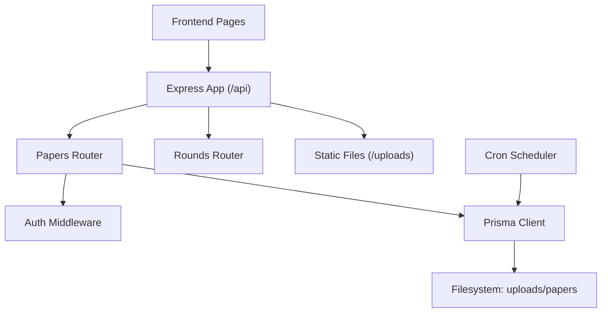
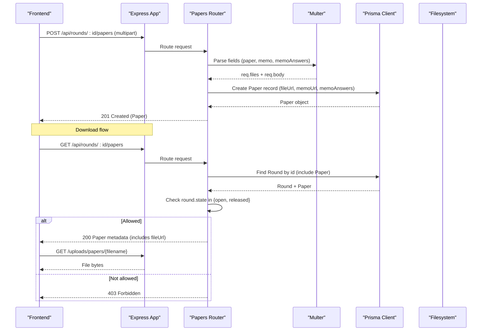
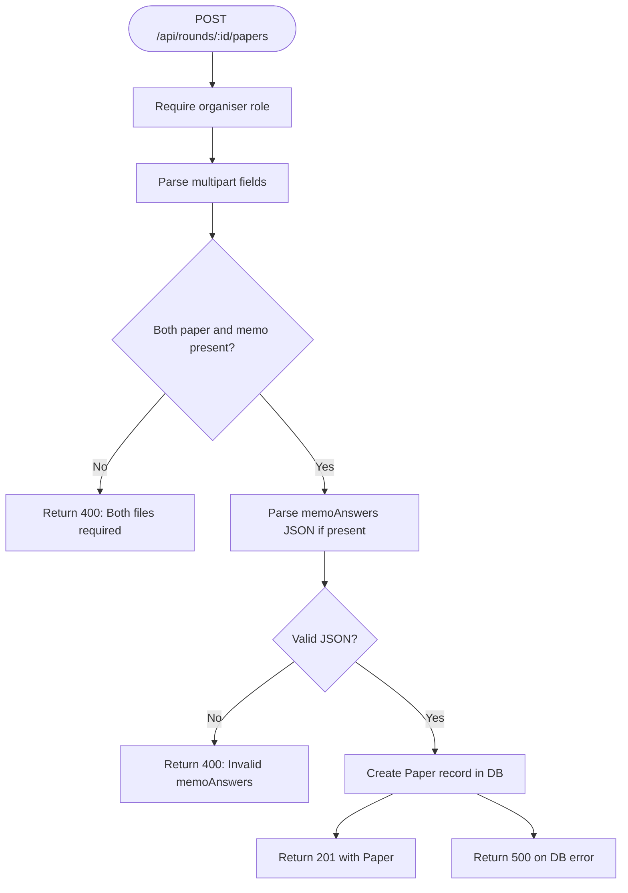
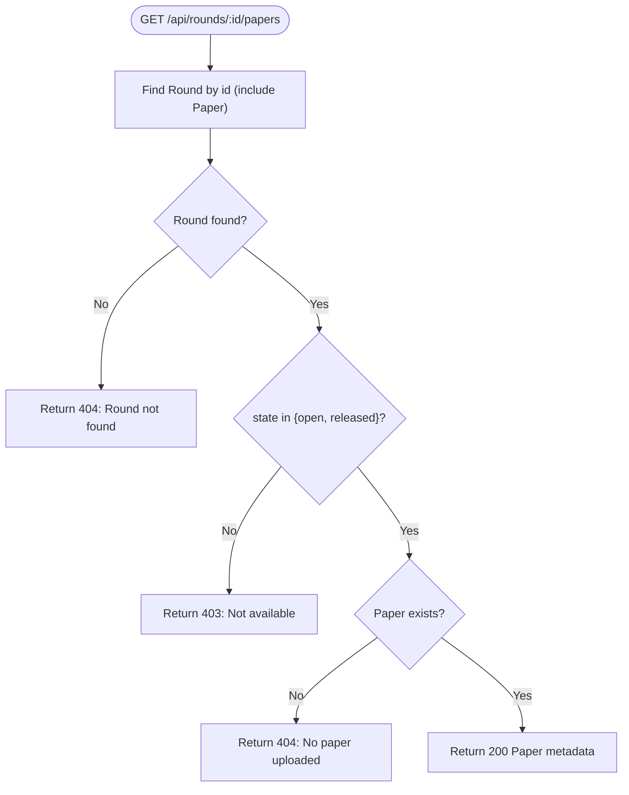
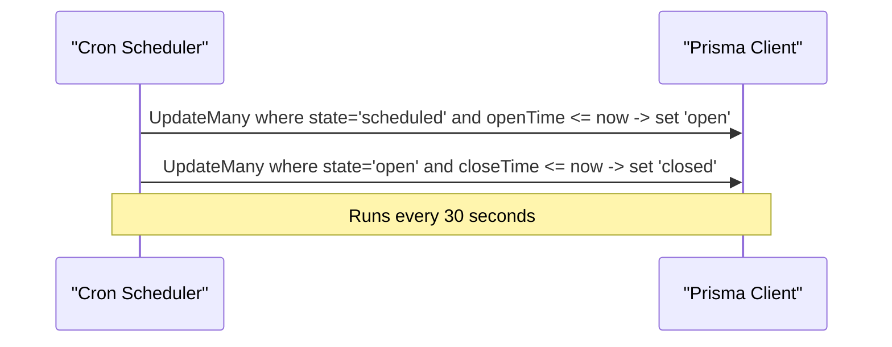
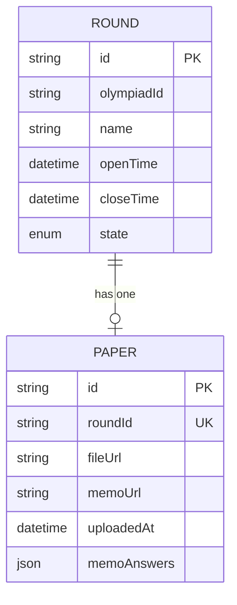
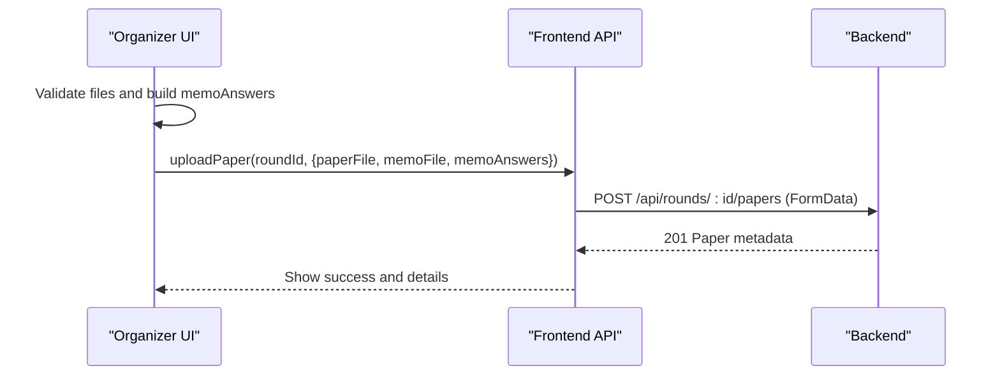
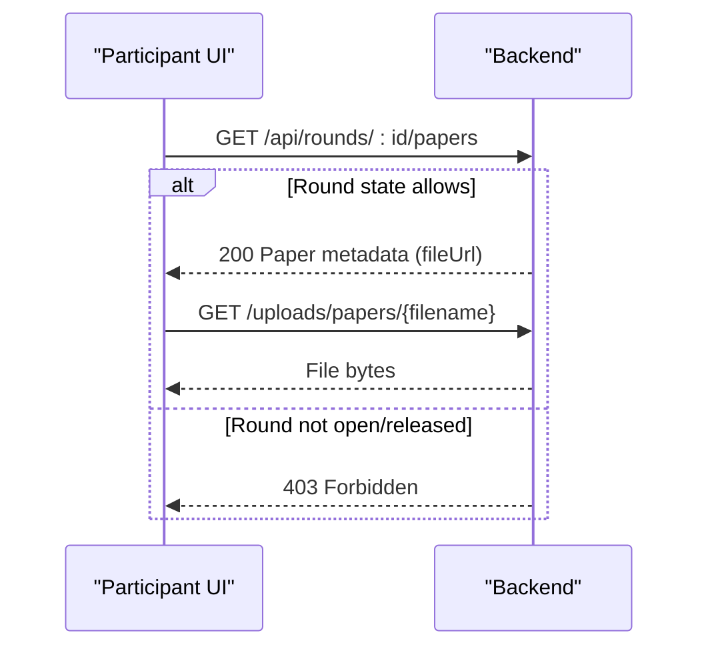
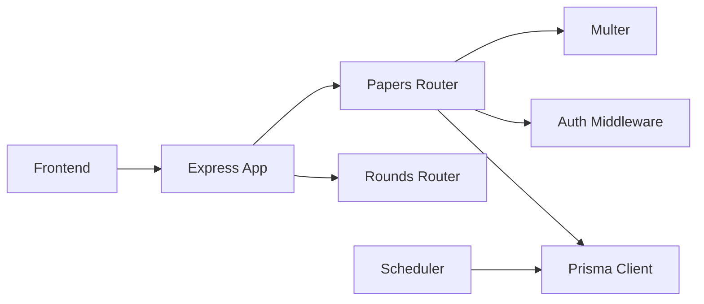

# Paper Distribution System

<cite>
**Referenced Files in This Document**
- [papers.js](file://backend/src/routes/papers.js)
- [index.js](file://backend/src/index.js)
- [auth.js](file://backend/src/middleware/auth.js)
- [scheduler.js](file://backend/src/scheduler.js)
- [schema.prisma](file://backend/prisma/schema.prisma)
- [migration.sql](file://backend/prisma/migrations/20260811072329_add_memo_answers_to_paper/migration.sql)
- [rounds.js](file://backend/src/routes/rounds.js)
- [api.js](file://frontend/src/lib/api.js)
- [page.js (paper upload)](file://frontend/src/app/rounds/[id]/papers/page.js)
- [page.js (educator round view)](file://frontend/src/app/educator/round_view/page.js)
</cite>

## Table of Contents
1. [Introduction](#introduction)
2. [Project Structure](#project-structure)
3. [Core Components](#core-components)
4. [Architecture Overview](#architecture-overview)
5. [Detailed Component Analysis](#detailed-component-analysis)
6. [Dependency Analysis](#dependency-analysis)
7. [Performance Considerations](#performance-considerations)
8. [Troubleshooting Guide](#troubleshooting-guide)
9. [Conclusion](#conclusion)
10. [Appendices](#appendices)

## Introduction
This document describes the Paper Distribution System for the Olympiad Portal. It covers how organizers upload papers and memo answer keys, how participants download papers during time-restricted windows based on round states, and how metadata is stored and served. It also documents file validation, security measures, storage management, API endpoints, database schema, error handling, and frontend integration examples.

## Project Structure
The paper distribution feature spans backend routes, middleware, scheduler, Prisma schema, and frontend pages:
- Backend Express app serves static files under /uploads and mounts routers under /api.
- The papers router handles uploads and gated downloads using Multer and role-based middleware.
- A cron scheduler transitions rounds between scheduled, open, and closed states based on openTime and closeTime.
- The Prisma schema defines models for Round, Paper, and related entities.
- Frontend provides an organizer upload page and a participant download flow.

**Diagram sources**
- [index.js:14-32](file://backend/src/index.js#L14-L32)
- [papers.js:1-99](file://backend/src/routes/papers.js#L1-L99)
- [scheduler.js:1-29](file://backend/src/scheduler.js#L1-L29)
- [schema.prisma:18-77](file://backend/prisma/schema.prisma#L18-L77)

**Section sources**
- [index.js:14-32](file://backend/src/index.js#L14-L32)
- [papers.js:1-99](file://backend/src/routes/papers.js#L1-L99)
- [scheduler.js:1-29](file://backend/src/scheduler.js#L1-L29)
- [schema.prisma:18-77](file://backend/prisma/schema.prisma#L18-L77)

## Core Components
- File upload with Multer: Organizers upload both a paper file and a memo file to associate them with a round. Memo answers can be provided as JSON metadata.
- Time-restricted access: Participants can only download papers when a round’s state is open or released; otherwise, requests are rejected.
- Role-based protection: Only users with the organiser role can upload papers.
- Metadata persistence: Paper records store file URLs and optional memo answers in the database.
- Static serving: Uploaded files are served from a dedicated directory via Express static middleware.

**Section sources**
- [papers.js:15-67](file://backend/src/routes/papers.js#L15-L67)
- [papers.js:70-96](file://backend/src/routes/papers.js#L70-L96)
- [auth.js:22-32](file://backend/src/middleware/auth.js#L22-L32)
- [index.js:26-27](file://backend/src/index.js#L26-L27)

## Architecture Overview
The system integrates authentication, routing, file handling, database operations, and scheduling:

**Diagram sources**
- [papers.js:25-96](file://backend/src/routes/papers.js#L25-L96)
- [index.js:26-32](file://backend/src/index.js#L26-L32)
- [schema.prisma:69-77](file://backend/prisma/schema.prisma#L69-L77)

## Detailed Component Analysis

### Upload Endpoint: POST /api/rounds/:id/papers
- Purpose: Associate uploaded paper and memo files with a round and persist metadata.
- Authentication: Requires organiser role via middleware.
- Input:
  - Multipart fields: paper (required), memo (required), memoAnswers (optional JSON string).
- Processing:
  - Multer stores files to uploads/papers with unique filenames.
  - Validates presence of both files.
  - Parses memoAnswers if provided; rejects invalid JSON.
  - Creates a Paper record with fileUrl and memoUrl paths and memoAnswers.
- Output:
  - 201 Created with Paper metadata.
  - 400 Bad Request for missing files or invalid memoAnswers.
  - 500 Internal Server Error on database write failure.

**Diagram sources**
- [papers.js:25-67](file://backend/src/routes/papers.js#L25-L67)
- [auth.js:22-32](file://backend/src/middleware/auth.js#L22-L32)

**Section sources**
- [papers.js:25-67](file://backend/src/routes/papers.js#L25-L67)
- [auth.js:22-32](file://backend/src/middleware/auth.js#L22-L32)

### Download Endpoint: GET /api/rounds/:id/papers
- Purpose: Return paper metadata for download when permitted by round state.
- Access control:
  - Fetches round by id including associated paper.
  - Allows download only when round.state is open or released.
  - Returns 403 Forbidden otherwise.
  - Returns 404 if no paper exists for the round.
- Output:
  - 200 OK with Paper metadata (including fileUrl).
  - 404 Not Found for unknown round or missing paper.
  - 403 Forbidden when round is not open/released.

**Diagram sources**
- [papers.js:70-96](file://backend/src/routes/papers.js#L70-L96)

**Section sources**
- [papers.js:70-96](file://backend/src/routes/papers.js#L70-L96)

### Static File Serving: /uploads
- Purpose: Serve uploaded files directly from disk.
- Configuration:
  - Express static middleware serves files from the uploads directory mounted at /uploads.
- Security note:
  - Ensure environment restricts directory traversal and that filenames are sanitized (current implementation uses timestamped names).

**Section sources**
- [index.js:26-27](file://backend/src/index.js#L26-L27)

### Role-Based Access Control
- Purpose: Restrict sensitive operations to authorised roles.
- Implementation:
  - requireRole wraps requireAuth and checks user.role against expected role.
  - Used on paper upload endpoint to enforce organiser-only access.

**Section sources**
- [auth.js:5-32](file://backend/src/middleware/auth.js#L5-L32)
- [papers.js:25-32](file://backend/src/routes/papers.js#L25-L32)

### Round State Scheduler
- Purpose: Automatically transition rounds between scheduled, open, and closed states based on openTime and closeTime.
- Behavior:
  - Runs every 30 seconds.
  - Sets state to open when current time >= openTime.
  - Sets state to closed when current time >= closeTime.
- Impact:
  - Controls availability of paper downloads via the download endpoint’s state check.

**Diagram sources**
- [scheduler.js:4-23](file://backend/src/scheduler.js#L4-L23)

**Section sources**
- [scheduler.js:4-23](file://backend/src/scheduler.js#L4-L23)

### Database Schema for Papers and Related Entities
- Models:
  - Round: includes openTime, closeTime, state, and relation to Paper.
  - Paper: links to Round, stores fileUrl, memoUrl, uploadedAt, and memoAnswers (JSON).
  - Submission, Result, User, School, Educator, Entrant, RoundEntrant exist but are not directly part of this feature.
- Key relationships:
  - One-to-one between Round and Paper via roundId uniqueness.
  - Paper.memoAnswers holds structured answer key data.

**Diagram sources**
- [schema.prisma:18-29](file://backend/prisma/schema.prisma#L18-L29)
- [schema.prisma:69-77](file://backend/prisma/schema.prisma#L69-L77)

**Section sources**
- [schema.prisma:18-29](file://backend/prisma/schema.prisma#L18-L29)
- [schema.prisma:69-77](file://backend/prisma/schema.prisma#L69-L77)
- [migration.sql:1-3](file://backend/prisma/migrations/20260811072329_add_memo_answers_to_paper/migration.sql#L1-L3)

### Frontend Integration Examples

#### Organizer Upload Page
- Validates file sizes and extensions before submission.
- Builds memoAnswers from question-answer rows.
- Sends FormData to POST /api/rounds/:id/papers.
- Handles success and error states, displaying confirmation and counts of answer key entries.

**Diagram sources**
- [page.js (paper upload):1-137](file://frontend/src/app/rounds/[id]/papers/page.js#L1-L137)
- [api.js:78-112](file://frontend/src/lib/api.js#L78-L112)
- [papers.js:25-67](file://backend/src/routes/papers.js#L25-L67)

**Section sources**
- [page.js (paper upload):1-137](file://frontend/src/app/rounds/[id]/papers/page.js#L1-L137)
- [api.js:78-112](file://frontend/src/lib/api.js#L78-L112)

#### Participant Download Flow
- Polls round details and displays a countdown to closeTime.
- On download click, fetches paper metadata from GET /api/rounds/:id/papers.
- If allowed, redirects to the file URL returned in metadata.
- Displays errors for network issues or forbidden access.

**Diagram sources**
- [page.js (educator round view):72-88](file://frontend/src/app/educator/round_view/page.js#L72-L88)
- [papers.js:70-96](file://backend/src/routes/papers.js#L70-L96)
- [index.js:26-27](file://backend/src/index.js#L26-L27)

**Section sources**
- [page.js (educator round view):72-88](file://frontend/src/app/educator/round_view/page.js#L72-L88)
- [papers.js:70-96](file://backend/src/routes/papers.js#L70-L96)
- [index.js:26-27](file://backend/src/index.js#L26-L27)

## Dependency Analysis
- Express app mounts routers under /api and serves static files under /uploads.
- Papers router depends on:
  - Multer for multipart parsing and disk storage.
  - Auth middleware for role enforcement.
  - Prisma client for database operations.
- Scheduler depends on Prisma client to update round states.
- Frontend depends on shared API client to interact with backend endpoints.

**Diagram sources**
- [index.js:14-32](file://backend/src/index.js#L14-L32)
- [papers.js:1-99](file://backend/src/routes/papers.js#L1-L99)
- [scheduler.js:1-29](file://backend/src/scheduler.js#L1-L29)

**Section sources**
- [index.js:14-32](file://backend/src/index.js#L14-L32)
- [papers.js:1-99](file://backend/src/routes/papers.js#L1-L99)
- [scheduler.js:1-29](file://backend/src/scheduler.js#L1-L29)

## Performance Considerations
- File size limits:
  - Multer default limits apply unless configured; consider setting limits in production to prevent large uploads.
  - Frontend enforces a client-side limit (e.g., 20 MB) for better UX.
- Format restrictions:
  - Frontend accepts specific extensions (.pdf, .doc, .docx); backend does not currently validate MIME types—add server-side validation for stricter control.
- Storage management:
  - Files are stored locally under uploads/papers; ensure adequate disk space and periodic cleanup policies.
  - Unique filenames avoid collisions; consider hashing or versioning for updates.
- Concurrency:
  - Multer streams to disk; monitor I/O performance under load.
- Caching:
  - Consider caching paper metadata responses for short periods to reduce DB queries.

[No sources needed since this section provides general guidance]

## Troubleshooting Guide
Common issues and resolutions:
- Missing files on upload:
  - Symptom: 400 error indicating both paper and memo are required.
  - Resolution: Ensure both fields are attached in FormData.
- Invalid memoAnswers:
  - Symptom: 400 error indicating memoAnswers must be valid JSON.
  - Resolution: Validate JSON structure before sending.
- Unauthorized access:
  - Symptom: 403 Forbidden on upload.
  - Resolution: Authenticate and ensure user role is organiser.
- Download blocked:
  - Symptom: 403 Forbidden when downloading.
  - Resolution: Wait until round state is open or released; scheduler updates states automatically.
- No paper uploaded:
  - Symptom: 404 Not Found when downloading.
  - Resolution: Upload paper and memo first.
- Network errors:
  - Symptom: Frontend ApiError indicating server unreachable.
  - Resolution: Verify backend is running and CORS settings allow requests.

**Section sources**
- [papers.js:36-50](file://backend/src/routes/papers.js#L36-L50)
- [papers.js:79-93](file://backend/src/routes/papers.js#L79-L93)
- [auth.js:5-32](file://backend/src/middleware/auth.js#L5-L32)
- [api.js:17-45](file://frontend/src/lib/api.js#L17-L45)

## Conclusion
The Paper Distribution System provides secure, time-gated access to competition materials through a well-structured backend and intuitive frontend flows. Organizers can upload papers and memo answer keys, while participants can download papers only during designated periods enforced by round states. The system leverages Multer for file handling, role-based middleware for authorization, and a cron scheduler for lifecycle management. Proper configuration of file limits, format validation, and storage policies will further strengthen security and reliability.

[No sources needed since this section summarizes without analyzing specific files]

## Appendices

### API Endpoints Summary
- POST /api/rounds/:id/papers
  - Method: POST
  - Headers: Cookie with JWT token
  - Body: multipart/form-data
    - paper: File (required)
    - memo: File (required)
    - memoAnswers: String (optional, JSON)
  - Responses:
    - 201 Created: Paper metadata
    - 400 Bad Request: Missing files or invalid memoAnswers
    - 403 Forbidden: Not authenticated or insufficient role
    - 500 Internal Server Error: Database error
- GET /api/rounds/:id/papers
  - Method: GET
  - Responses:
    - 200 OK: Paper metadata (includes fileUrl)
    - 403 Forbidden: Round not open/released
    - 404 Not Found: Round not found or no paper uploaded

**Section sources**
- [papers.js:25-96](file://backend/src/routes/papers.js#L25-L96)
- [auth.js:5-32](file://backend/src/middleware/auth.js#L5-L32)

### Environment and Configuration Notes
- CORS: Configured to allow credentials from specified origin.
- Static files: Served from uploads directory under /uploads.
- Scheduler: Starts with the application and runs every 30 seconds.

**Section sources**
- [index.js:17-32](file://backend/src/index.js#L17-L32)
- [scheduler.js:4-23](file://backend/src/scheduler.js#L4-L23)