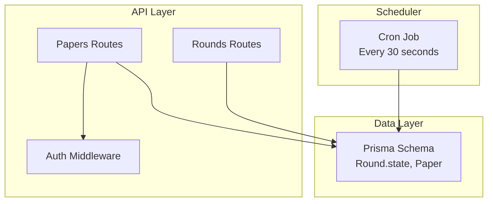
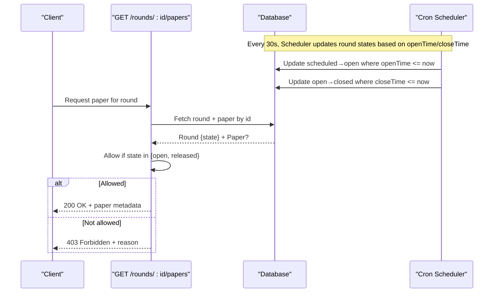
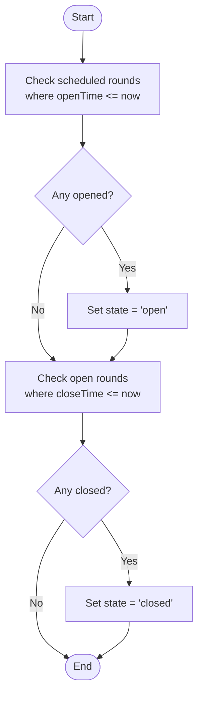
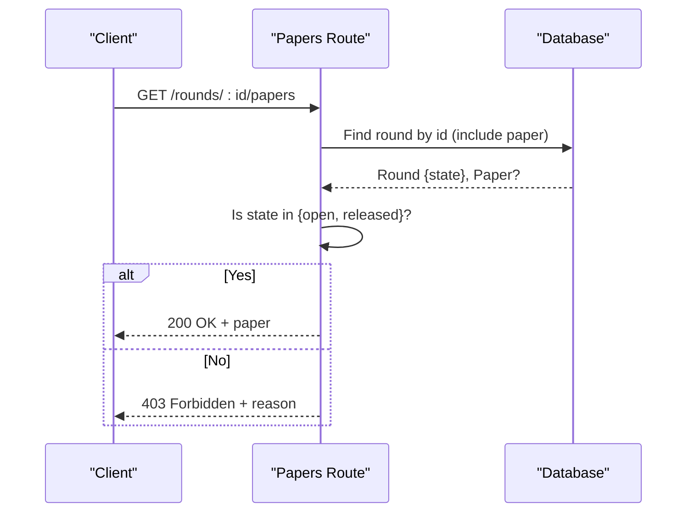
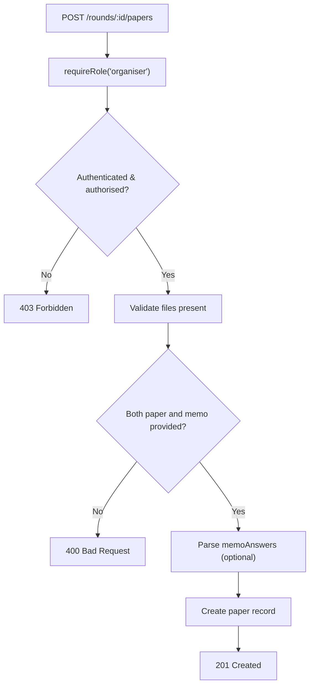
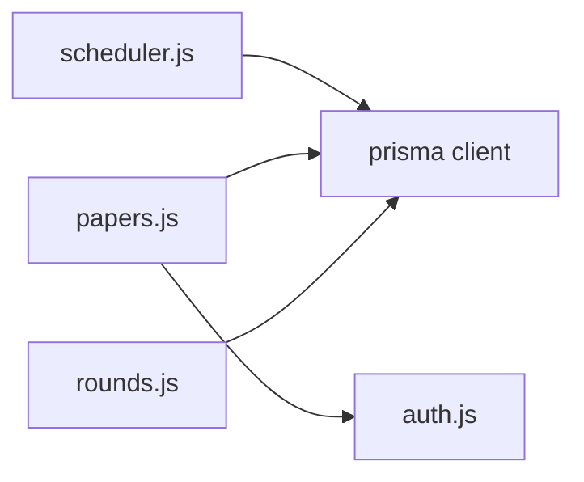

# Time-Based Access Control

<cite>
**Referenced Files in This Document**
- [schema.prisma](file://backend/prisma/schema.prisma)
- [scheduler.js](file://backend/src/scheduler.js)
- [round-lifecycle.md](file://documents/docs/round-lifecycle.md)
- [papers.js](file://backend/src/routes/papers.js)
- [auth.js](file://backend/src/middleware/auth.js)
- [rounds.js](file://backend/src/routes/rounds.js)
- [papers.test.js](file://backend/src/routes/papers.test.js)
- [scheduler.test.js](file://backend/src/scheduler.test.js)
</cite>

## Table of Contents
1. [Introduction](#introduction)
2. [Project Structure](#project-structure)
3. [Core Components](#core-components)
4. [Architecture Overview](#architecture-overview)
5. [Detailed Component Analysis](#detailed-component-analysis)
6. [Dependency Analysis](#dependency-analysis)
7. [Performance Considerations](#performance-considerations)
8. [Troubleshooting Guide](#troubleshooting-guide)
9. [Conclusion](#conclusion)

## Introduction
This document explains the time-based access control mechanism that governs when papers can be downloaded and accessed in the Paper Distribution System. It focuses on round lifecycle states (scheduled, open, closed, released), how those states are enforced at request time, and how automated scheduling transitions ensure secure, time-bound paper distribution aligned with examination periods.

## Project Structure
The time-based access control spans three layers:
- Data model: defines rounds, papers, and their relationships.
- Scheduler: automatically transitions round states based on stored timestamps.
- API routes: enforce state checks before allowing paper downloads or uploads.



**Diagram sources**
- [schema.prisma:18-29](file://backend/prisma/schema.prisma#L18-L29)
- [scheduler.js:4-23](file://backend/src/scheduler.js#L4-L23)
- [papers.js:70-96](file://backend/src/routes/papers.js#L70-L96)
- [auth.js:5-31](file://backend/src/middleware/auth.js#L5-L31)
- [rounds.js:32-51](file://backend/src/routes/rounds.js#L32-L51)

**Section sources**
- [schema.prisma:18-29](file://backend/prisma/schema.prisma#L18-L29)
- [scheduler.js:4-23](file://backend/src/scheduler.js#L4-L23)
- [papers.js:70-96](file://backend/src/routes/papers.js#L70-L96)
- [auth.js:5-31](file://backend/src/middleware/auth.js#L5-L31)
- [rounds.js:32-51](file://backend/src/routes/rounds.js#L32-L51)

## Core Components
- Round lifecycle states: scheduled, open, closed, released. These determine whether a paper is downloadable and whether submissions are accepted.
- Automated scheduler: polls every 30 seconds to transition rounds from scheduled to open at openTime, and from open to closed at closeTime.
- Access enforcement: GET /rounds/:id/papers checks the current round state and only allows downloads when the round is open or released.
- Role-based protection: POST /rounds/:id/papers requires organiser role via middleware to upload papers.

**Section sources**
- [round-lifecycle.md:9-21](file://documents/docs/round-lifecycle.md#L9-L21)
- [scheduler.js:4-23](file://backend/src/scheduler.js#L4-L23)
- [papers.js:70-96](file://backend/src/routes/papers.js#L70-L96)
- [papers.js:25-68](file://backend/src/routes/papers.js#L25-L68)
- [auth.js:22-31](file://backend/src/middleware/auth.js#L22-L31)

## Architecture Overview
The system uses a polling-based scheduler to keep round states synchronized with real-world time, while API endpoints enforce state-based permissions at request time.



**Diagram sources**
- [scheduler.js:4-23](file://backend/src/scheduler.js#L4-L23)
- [papers.js:70-96](file://backend/src/routes/papers.js#L70-L96)

## Detailed Component Analysis

### Round State Machine and Lifecycle
- States:
  - Scheduled: round exists with a paper attached but not visible; no submissions accepted.
  - Open: openTime reached; paper downloadable; submissions accepted.
  - Closed: closeTime reached; no new submissions; marking finalises.
  - Released: results released; paper remains accessible per route logic.
- Transitions:
  - scheduled → open when openTime <= now.
  - open → closed when closeTime <= now.
- Time handling:
  - All comparisons use UTC to ensure consistent behavior across timezones.



**Diagram sources**
- [scheduler.js:4-23](file://backend/src/scheduler.js#L4-L23)
- [round-lifecycle.md:23-30](file://documents/docs/round-lifecycle.md#L23-L30)

**Section sources**
- [round-lifecycle.md:9-30](file://documents/docs/round-lifecycle.md#L9-L30)
- [scheduler.js:4-23](file://backend/src/scheduler.js#L4-L23)

### Paper Download Access Control
- Endpoint: GET /rounds/:id/papers
- Logic:
  - Load round and associated paper.
  - If round state is open or released, return paper metadata.
  - Otherwise, return 403 with a message indicating current state.
  - If no paper uploaded yet, return 404.
- Security:
  - No authentication required for download, but availability is strictly gated by round state.
  - Upload endpoint is protected by role-based middleware.



**Diagram sources**
- [papers.js:70-96](file://backend/src/routes/papers.js#L70-L96)

**Section sources**
- [papers.js:70-96](file://backend/src/routes/papers.js#L70-L96)
- [papers.test.js:144-206](file://backend/src/routes/papers.test.js#L144-L206)

### Paper Upload Protection
- Endpoint: POST /rounds/:id/papers
- Protection:
  - Requires organiser role via middleware chain.
  - Validates presence of both paper and memo files.
  - Parses optional memoAnswers JSON safely.
- Behavior:
  - On success, creates paper record with file URLs and optional answers.
  - Returns appropriate errors for missing fields or invalid JSON.



**Diagram sources**
- [papers.js:25-68](file://backend/src/routes/papers.js#L25-L68)
- [auth.js:22-31](file://backend/src/middleware/auth.js#L22-L31)

**Section sources**
- [papers.js:25-68](file://backend/src/routes/papers.js#L25-L68)
- [auth.js:22-31](file://backend/src/middleware/auth.js#L22-L31)
- [papers.test.js:52-142](file://backend/src/routes/papers.test.js#L52-L142)

### Round Creation and Validation
- Endpoint: POST /api/rounds
- Validation:
  - Requires olympiadId, name, openTime, closeTime.
  - Ensures closeTime is after openTime.
- Result:
  - Creates round with default state scheduled.

**Section sources**
- [rounds.js:32-51](file://backend/src/routes/rounds.js#L32-L51)
- [rounds.test.js:82-127](file://backend/src/routes/rounds.test.js#L82-L127)

### Data Model Relationships
- Round has a one-to-one optional Paper.
- Round tracks openTime, closeTime, and state.
- Submission and Result models support exam workflow but are not directly involved in paper download gating.

```mermaid
erDiagram
ROUND {
string id PK
string olympiadId FK
string name
datetime openTime
datetime closeTime
string state
}
PAPER {
string id PK
string roundId UK FK
string fileUrl
string memoUrl
json memoAnswers
datetime uploadedAt
}
ROUND ||--o| PAPER : "has one optional"
```

**Diagram sources**
- [schema.prisma:18-29](file://backend/prisma/schema.prisma#L18-L29)
- [schema.prisma:69-77](file://backend/prisma/schema.prisma#L69-L77)

**Section sources**
- [schema.prisma:18-29](file://backend/prisma/schema.prisma#L18-L29)
- [schema.prisma:69-77](file://backend/prisma/schema.prisma#L69-L77)

## Dependency Analysis
- Scheduler depends on Prisma client to update round states based on time conditions.
- Papers route depends on Prisma client to fetch round state and paper data.
- Auth middleware enforces role-based access for sensitive operations like paper uploads.
- Rounds route provides administrative endpoints to create and query rounds.



**Diagram sources**
- [scheduler.js:1-3](file://backend/src/scheduler.js#L1-L3)
- [papers.js:1-8](file://backend/src/routes/papers.js#L1-L8)
- [rounds.js:1-3](file://backend/src/routes/rounds.js#L1-L3)
- [auth.js:1-31](file://backend/src/middleware/auth.js#L1-L31)

**Section sources**
- [scheduler.js:1-3](file://backend/src/scheduler.js#L1-L3)
- [papers.js:1-8](file://backend/src/routes/papers.js#L1-L8)
- [rounds.js:1-3](file://backend/src/routes/rounds.js#L1-L3)
- [auth.js:1-31](file://backend/src/middleware/auth.js#L1-L31)

## Performance Considerations
- Polling interval: The scheduler runs every 30 seconds, which introduces up to a 30-second delay between actual open/close times and state updates. This is acceptable for the project’s scale and simplifies testing and deployment.
- Database load: Batch updates using updateMany minimize database writes during transitions.
- Request-time checks: Lightweight state checks on GET /rounds/:id/papers avoid unnecessary processing.

[No sources needed since this section provides general guidance]

## Troubleshooting Guide
- Paper not available (403):
  - Cause: Round state is not open or released.
  - Action: Wait until openTime passes or confirm release status.
  - Reference: [papers.js:70-96](file://backend/src/routes/papers.js#L70-L96)
- Round not found (404):
  - Cause: Invalid round ID.
  - Action: Verify round ID and existence.
  - Reference: [papers.js:70-96](file://backend/src/routes/papers.js#L70-L96)
- No paper uploaded (404):
  - Cause: Round is open but paper not yet attached.
  - Action: Ensure organiser uploads both paper and memo files.
  - Reference: [papers.js:70-96](file://backend/src/routes/papers.js#L70-L96)
- Unauthorized upload (403):
  - Cause: Missing organiser role.
  - Action: Authenticate with a token having organiser role.
  - Reference: [auth.js:22-31](file://backend/src/middleware/auth.js#L22-L31)
- Scheduler not transitioning states:
  - Cause: Cron job not running or timezone mismatch.
  - Action: Confirm scheduler started and all times are in UTC.
  - Reference: [scheduler.js:4-23](file://backend/src/scheduler.js#L4-L23), [round-lifecycle.md:32-37](file://documents/docs/round-lifecycle.md#L32-L37)

**Section sources**
- [papers.js:70-96](file://backend/src/routes/papers.js#L70-L96)
- [auth.js:22-31](file://backend/src/middleware/auth.js#L22-L31)
- [scheduler.js:4-23](file://backend/src/scheduler.js#L4-L23)
- [round-lifecycle.md:32-37](file://documents/docs/round-lifecycle.md#L32-L37)

## Conclusion
The Paper Distribution System enforces strict time-based access control through a combination of automated state transitions and request-time checks. Rounds progress from scheduled to open to closed based on openTime and closeTime, ensuring papers are only downloadable during designated examination windows. Role-based middleware protects sensitive operations like paper uploads. This design balances simplicity, reliability, and security, making it suitable for managing timed academic assessments at scale.