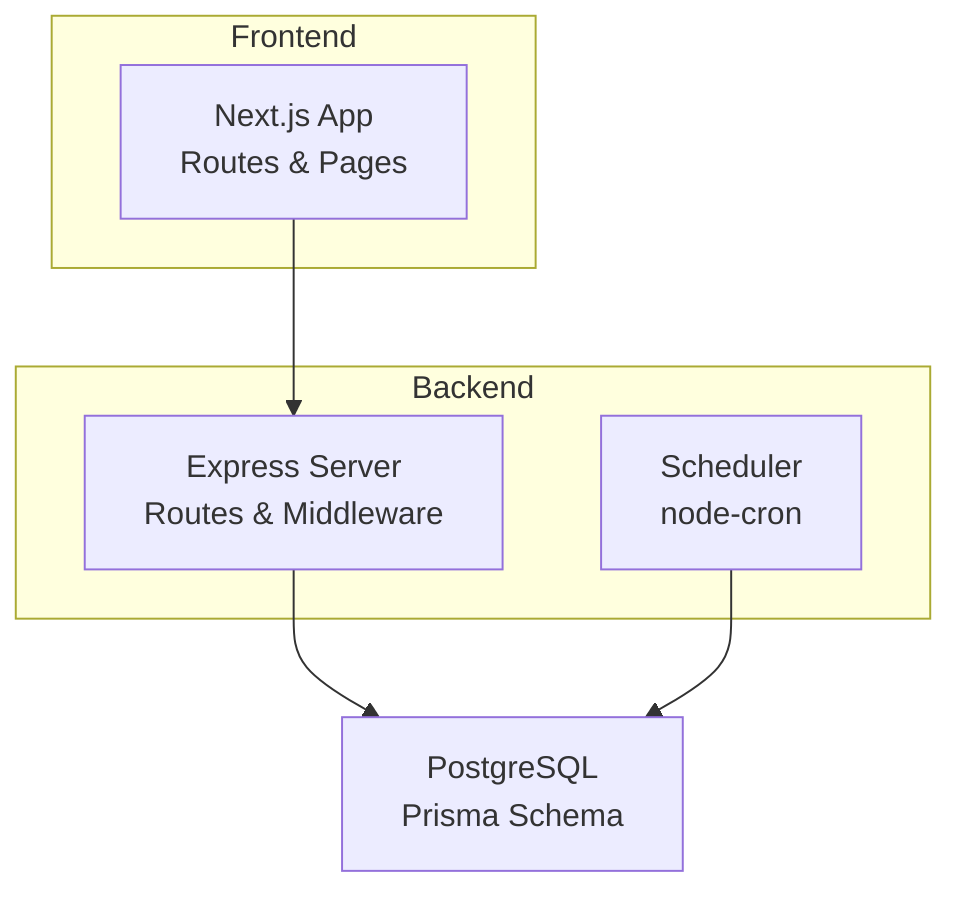
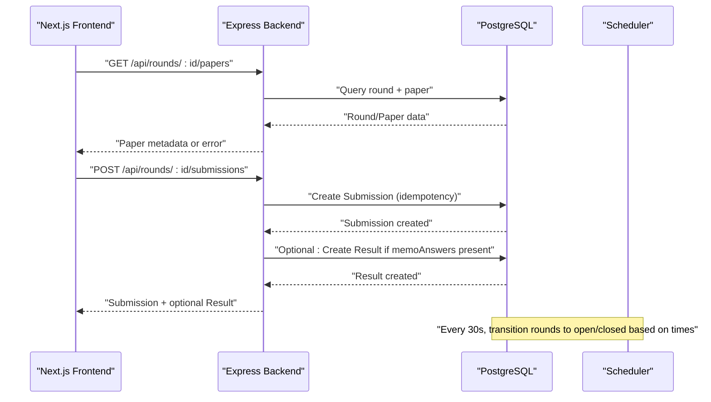
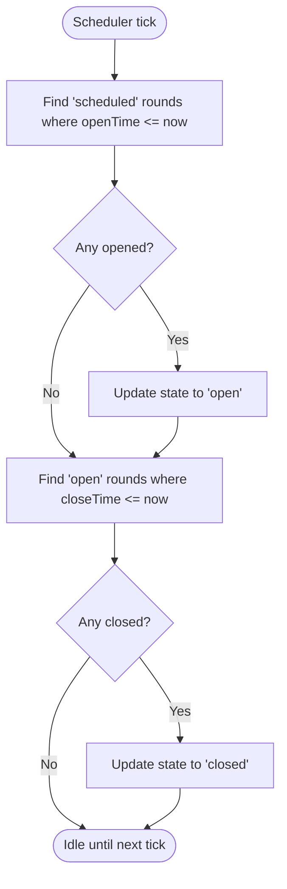
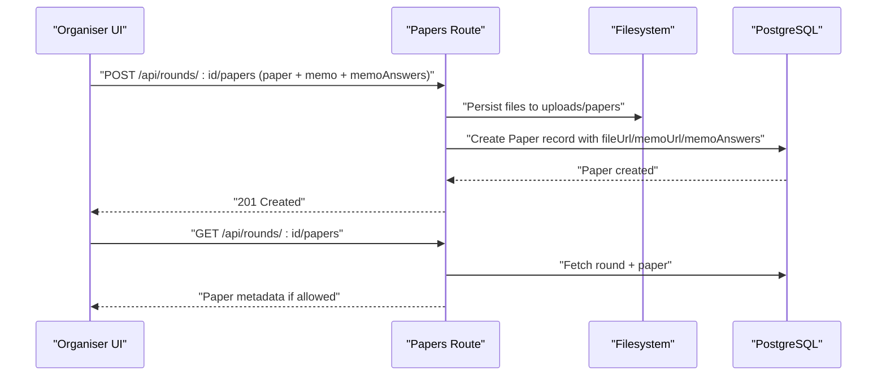
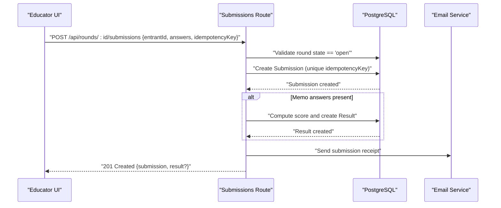
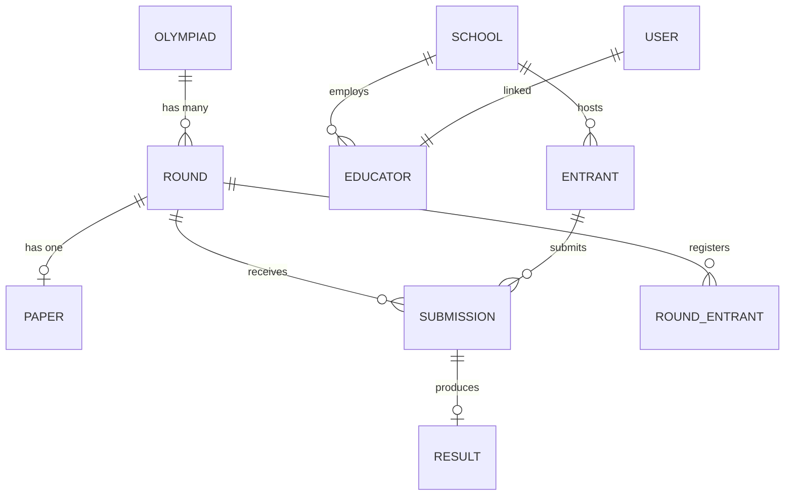
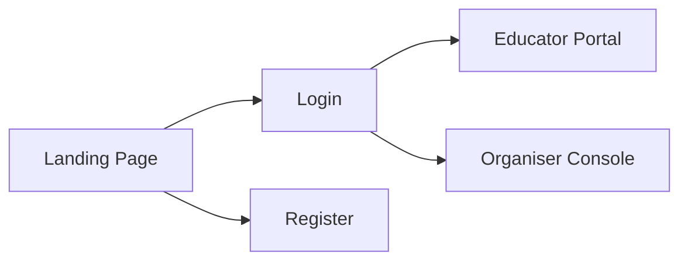
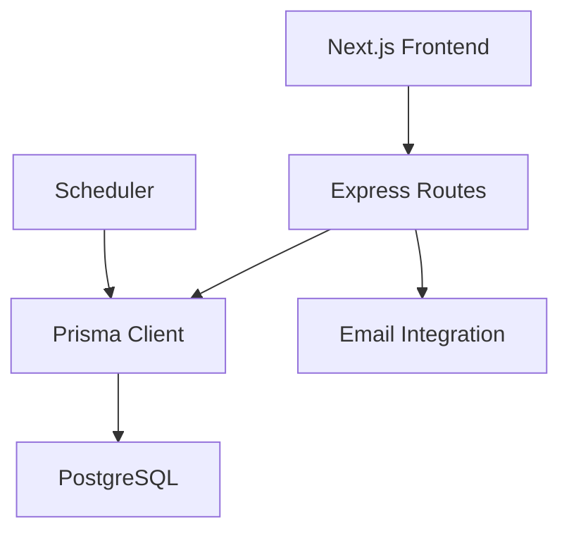

# Project Overview

<cite>
**Referenced Files in This Document**
- [README.md](file://README.md)
- [backend/README.md](file://backend/README.md)
- [frontend/README.md](file://frontend/README.md)
- [documents/docs/tech-stack.md](file://documents/docs/tech-stack.md)
- [documents/docs/round-lifecycle.md](file://documents/docs/round-lifecycle.md)
- [backend/src/index.js](file://backend/src/index.js)
- [backend/src/scheduler.js](file://backend/src/scheduler.js)
- [backend/prisma/schema.prisma](file://backend/prisma/schema.prisma)
- [backend/src/routes/papers.js](file://backend/src/routes/papers.js)
- [backend/src/routes/submissions.js](file://backend/src/routes/submissions.js)
- [backend/src/routes/rounds.js](file://backend/src/routes/rounds.js)
- [shared/types.js](file://shared/types.js)
- [frontend/src/app/layout.js](file://frontend/src/app/layout.js)
- [frontend/src/app/page.js](file://frontend/src/app/page.js)
</cite>

## Table of Contents
1. Introduction
2. Project Structure
3. Core Components
4. Architecture Overview
5. Detailed Component Analysis
6. Dependency Analysis
7. Performance Considerations
8. Troubleshooting Guide
9. Conclusion
10. Appendices

## Introduction
Olympiad Portal is an academic olympiad management system that helps educators and organizers run competition rounds end-to-end: set up rounds, distribute papers, collect submissions, and automate scoring when possible. The platform targets three primary audiences:
- Organizers: create Olympiads and Rounds, upload papers and answer keys, and monitor round status and results.
- Educators: register schools and entrants, submit answers on behalf of students during open rounds, and receive submission receipts.
- Students (via educators): participate in rounds through their school’s educator by submitting answers while a round is open.

Core value proposition:
- Centralized lifecycle management for rounds with automatic state transitions.
- Secure paper distribution and controlled access based on round state.
- Idempotent submission handling to prevent duplicates under load.
- Automated scoring when memo answer keys are provided.
- A full-stack monorepo with clear separation between Next.js frontend and Express.js backend, PostgreSQL database, and Prisma ORM.

**Section sources**
- [documents/docs/tech-stack.md:7-66](file://documents/docs/tech-stack.md#L7-L66)
- [documents/docs/round-lifecycle.md:5-41](file://documents/docs/round-lifecycle.md#L5-L41)
- [backend/README.md:1-12](file://backend/README.md#L1-L12)

## Project Structure
The repository is organized as a full-stack monorepo:
- frontend: Next.js application serving the organiser console and educator portal.
- backend: Express.js API server with routes for authentication, rounds, papers, and submissions; includes a scheduler for round lifecycle automation.
- shared: Shared TypeScript/JSDoc types used across layers.
- documents: Docusaurus-based documentation site.
- scripts: Utility scripts (e.g., linting).

**Diagram sources**
- [backend/src/index.js:1-43](file://backend/src/index.js#L1-L43)
- [backend/src/scheduler.js:1-29](file://backend/src/scheduler.js#L1-L29)
- [backend/prisma/schema.prisma:1-109](file://backend/prisma/schema.prisma#L1-L109)
- [frontend/src/app/layout.js:1-44](file://frontend/src/app/layout.js#L1-L44)

**Section sources**
- [frontend/README.md:1-37](file://frontend/README.md#L1-L37)
- [backend/README.md:1-12](file://backend/README.md#L1-L12)
- [documents/docs/tech-stack.md:7-66](file://documents/docs/tech-stack.md#L7-L66)

## Core Components
- Round lifecycle management: Automatic transitions from scheduled → open → closed → released based on openTime/closeTime using a cron-driven scheduler.
- Paper distribution: Organisers upload paper and memo files; access is gated by round state.
- Submission processing: Educators submit answers during open rounds with idempotency protection.
- Automated scoring: When a memo answer key exists, scores are computed immediately upon submission.
- Authentication and authorization: Role-based middleware protects sensitive endpoints.

Key data models include Olympiad, Round, User, School, Educator, Entrant, Paper, Submission, Result, and RoundEntrant.

**Section sources**
- [backend/src/scheduler.js:1-29](file://backend/src/scheduler.js#L1-L29)
- [backend/src/routes/papers.js:1-99](file://backend/src/routes/papers.js#L1-L99)
- [backend/src/routes/submissions.js:1-89](file://backend/src/routes/submissions.js#L1-L89)
- [backend/prisma/schema.prisma:11-109](file://backend/prisma/schema.prisma#L11-L109)
- [shared/types.js:1-38](file://shared/types.js#L1-L38)

## Architecture Overview
High-level architecture shows the Next.js frontend communicating with an Express.js backend over HTTP. The backend uses Prisma to interact with PostgreSQL and runs a background scheduler to manage round states.

**Diagram sources**
- [backend/src/routes/papers.js:70-96](file://backend/src/routes/papers.js#L70-L96)
- [backend/src/routes/submissions.js:8-85](file://backend/src/routes/submissions.js#L8-L85)
- [backend/src/scheduler.js:4-23](file://backend/src/scheduler.js#L4-L23)
- [backend/prisma/schema.prisma:18-97](file://backend/prisma/schema.prisma#L18-L97)

## Detailed Component Analysis

### Round Lifecycle Management
Rounds progress automatically via a scheduler that compares current UTC time against stored openTime and closeTime. This ensures consistent behavior across timezones and removes manual intervention.

**Diagram sources**
- [backend/src/scheduler.js:4-23](file://backend/src/scheduler.js#L4-L23)
- [documents/docs/round-lifecycle.md:23-30](file://documents/docs/round-lifecycle.md#L23-L30)

**Section sources**
- [backend/src/scheduler.js:1-29](file://backend/src/scheduler.js#L1-L29)
- [documents/docs/round-lifecycle.md:5-41](file://documents/docs/round-lifecycle.md#L5-L41)

### Paper Distribution
Organisers upload both the exam paper and memo (answer key) along with optional memoAnswers JSON. Access to download the paper is restricted to rounds that are open or released.

**Diagram sources**
- [backend/src/routes/papers.js:25-67](file://backend/src/routes/papers.js#L25-L67)
- [backend/src/routes/papers.js:70-96](file://backend/src/routes/papers.js#L70-L96)

**Section sources**
- [backend/src/routes/papers.js:1-99](file://backend/src/routes/papers.js#L1-L99)

### Submission Processing and Automated Scoring
Submissions are accepted only when a round is open. Each submission must include an idempotency key to prevent duplicate entries. If a memo answer key exists, scoring is performed immediately.

**Diagram sources**
- [backend/src/routes/submissions.js:8-85](file://backend/src/routes/submissions.js#L8-L85)

**Section sources**
- [backend/src/routes/submissions.js:1-89](file://backend/src/routes/submissions.js#L1-L89)

### Data Model and Relationships
The relational model captures the hierarchy from Olympiad down to Results, including roles and entities like Schools, Educators, and Entrants.

**Diagram sources**
- [backend/prisma/schema.prisma:11-109](file://backend/prisma/schema.prisma#L11-L109)

**Section sources**
- [backend/prisma/schema.prisma:1-109](file://backend/prisma/schema.prisma#L1-L109)
- [shared/types.js:1-38](file://shared/types.js#L1-L38)

### Frontend Entry Points and Navigation
The Next.js app provides a landing page and root layout for the organiser console and educator portal. It links to login/register flows and organizes role-specific pages.

**Diagram sources**
- [frontend/src/app/page.js:1-85](file://frontend/src/app/page.js#L1-L85)
- [frontend/src/app/layout.js:1-44](file://frontend/src/app/layout.js#L1-L44)

**Section sources**
- [frontend/src/app/page.js:1-85](file://frontend/src/app/page.js#L1-L85)
- [frontend/src/app/layout.js:1-44](file://frontend/src/app/layout.js#L1-L44)

## Dependency Analysis
- Frontend depends on backend APIs for all dynamic data and actions.
- Backend routes depend on Prisma client and environment configuration.
- Scheduler depends on node-cron and Prisma to update round states.
- Email integration is invoked after successful submissions.

**Diagram sources**
- [backend/src/index.js:1-43](file://backend/src/index.js#L1-L43)
- [backend/src/scheduler.js:1-29](file://backend/src/scheduler.js#L1-L29)
- [backend/src/routes/submissions.js:1-89](file://backend/src/routes/submissions.js#L1-L89)

**Section sources**
- [backend/src/index.js:1-43](file://backend/src/index.js#L1-L43)
- [documents/docs/tech-stack.md:7-66](file://documents/docs/tech-stack.md#L7-L66)

## Performance Considerations
- Concurrency spikes at round open/close are handled by Node.js event loop and Postgres constraints (e.g., unique idempotencyKey).
- Polling-based scheduler every 30 seconds balances simplicity and acceptable latency for this scale.
- File storage is separated from the database; consider object storage (e.g., S3/R2) for scalability beyond local filesystem.
- Database queries use Prisma relations and selective includes to minimize payload size.

[No sources needed since this section provides general guidance]

## Troubleshooting Guide
Common issues and resolutions:
- Round not opening/closing: Verify openTime/closeTime are set correctly in UTC and the scheduler is running.
- Duplicate submissions: Ensure clients generate unique idempotencyKey per submission attempt; the backend returns existing submission on conflict.
- Paper not downloadable: Confirm round state is open or released; otherwise access is denied.
- Auth errors: Ensure requests include proper credentials and roles; endpoints enforce role checks.

**Section sources**
- [backend/src/scheduler.js:4-23](file://backend/src/scheduler.js#L4-L23)
- [backend/src/routes/submissions.js:32-85](file://backend/src/routes/submissions.js#L32-L85)
- [backend/src/routes/papers.js:70-96](file://backend/src/routes/papers.js#L70-L96)

## Conclusion
Olympiad Portal provides a robust, scalable foundation for managing academic olympiads with automated lifecycle control, secure paper distribution, reliable submission handling, and optional automated scoring. Its monorepo structure separates concerns cleanly between frontend and backend while sharing type definitions, enabling efficient development and deployment.

[No sources needed since this section summarizes without analyzing specific files]

## Appendices
- Deployment topology: Backend on Railway, Frontend on Vercel, Docs on Netlify.
- External integrations: Email service for submission receipts; file storage via object storage (planned).
- Documentation site: Publicly accessible via Netlify.

**Section sources**
- [documents/docs/tech-stack.md:57-66](file://documents/docs/tech-stack.md#L57-L66)
- [README.md:1-1](file://README.md#L1-L1)