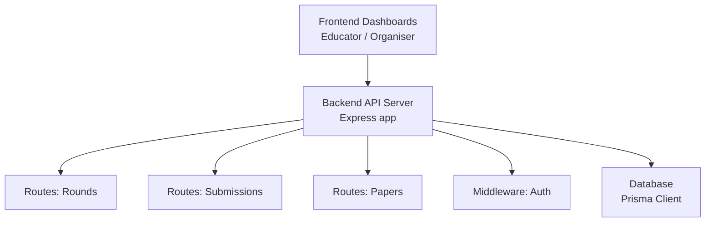
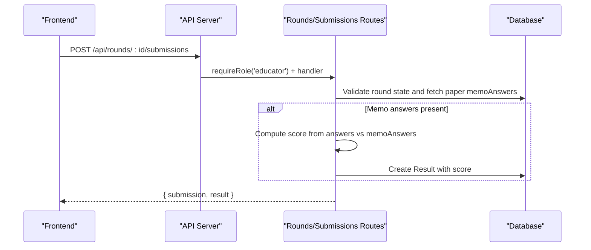
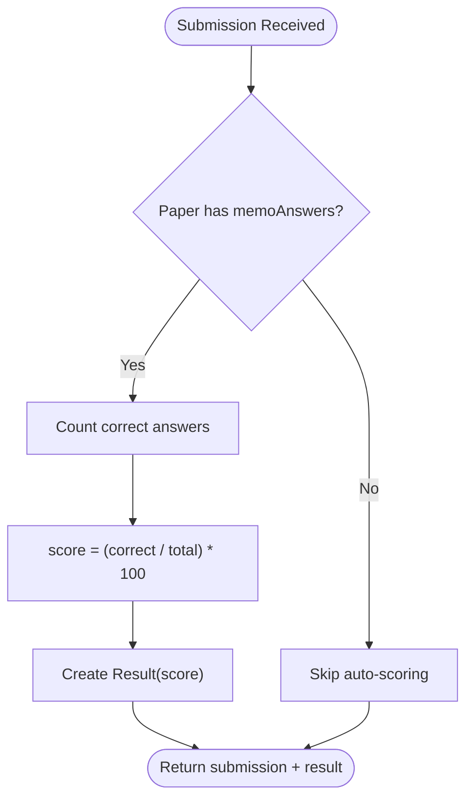
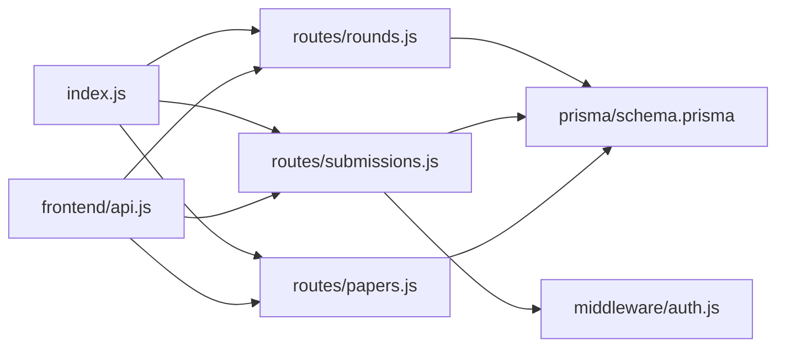

# Analytics & Reporting

<cite>
**Referenced Files in This Document**
- [index.js](file://backend/src/index.js)
- [rounds.js](file://backend/src/routes/rounds.js)
- [submissions.js](file://backend/src/routes/submissions.js)
- [papers.js](file://backend/src/routes/papers.js)
- [auth.js](file://backend/src/middleware/auth.js)
- [schema.prisma](file://backend/prisma/schema.prisma)
- [api.js](file://frontend/src/lib/api.js)
- [educator page.js](file://frontend/src/app/educator/page.js)
- [organiser page.js](file://frontend/src/app/organiser/page.js)
</cite>

## Table of Contents
1. Introduction
2. Project Structure
3. Core Components
4. Architecture Overview
5. Detailed Component Analysis
6. Dependency Analysis
7. Performance Considerations
8. Troubleshooting Guide
9. Conclusion
10. Appendices

## Introduction
This document describes the analytics and reporting capabilities for Olympiad performance and participation metrics. It explains how scores are computed, how data is aggregated across rounds and participant groups, and how educators and organizers can generate reports. It also covers data visualization concepts, export strategies, integration points with external analytics tools, performance considerations for large datasets, and privacy safeguards for sensitive performance data.

## Project Structure
The system consists of:
- Backend API (Express) that exposes endpoints for rounds, papers, submissions, and authentication.
- Database schema (Prisma) defining entities such as Olympiad, Round, Paper, Submission, Result, Entrant, School, Educator, and User.
- Frontend dashboards for educators and organizers to interact with rounds and view available data.

**Diagram sources**
- [index.js:14-32](file://backend/src/index.js#L14-L32)
- [rounds.js:1-116](file://backend/src/routes/rounds.js#L1-L116)
- [submissions.js:1-89](file://backend/src/routes/submissions.js#L1-L89)
- [papers.js:1-99](file://backend/src/routes/papers.js#L1-L99)
- [auth.js:1-35](file://backend/src/middleware/auth.js#L1-L35)

**Section sources**
- [index.js:14-32](file://backend/src/index.js#L14-L32)
- [schema.prisma:11-109](file://backend/prisma/schema.prisma#L11-L109)

## Core Components
- Rounds management: create, list, and retrieve rounds; list entrants and submissions per round.
- Submissions handling: accept educator submissions, auto-mark when memo answers exist, compute scores, and store results.
- Papers management: upload paper and memo files; optionally attach memo answers for auto-scoring.
- Authentication and authorization: JWT-based auth and role-based access control for protected routes.
- Data model: Prisma schema defines relationships between Olympiad, Round, Paper, Submission, Result, Entrant, School, Educator, and User.

Key analytics primitives derived from these components:
- Score distribution: aggregate Result.score values per round or across rounds.
- Participation rate: count distinct entrants registered per round vs. those who submitted.
- Performance trends: track mean/median scores over time by round openTime or submission timestamps.
- Comparative analytics: compare distributions and trends across rounds, schools, or grade bands.

**Section sources**
- [rounds.js:32-113](file://backend/src/routes/rounds.js#L32-L113)
- [submissions.js:8-86](file://backend/src/routes/submissions.js#L8-L86)
- [papers.js:25-96](file://backend/src/routes/papers.js#L25-L96)
- [auth.js:5-32](file://backend/src/middleware/auth.js#L5-L32)
- [schema.prisma:11-109](file://backend/prisma/schema.prisma#L11-L109)

## Architecture Overview
The backend serves REST endpoints under /api. The frontend dashboards call these endpoints to display round information and enable actions like uploading papers and submitting answers. When a submission includes memo answers, the server computes a score immediately and persists it as a Result.

**Diagram sources**
- [submissions.js:8-86](file://backend/src/routes/submissions.js#L8-L86)
- [papers.js:25-96](file://backend/src/routes/papers.js#L25-L96)
- [index.js:14-32](file://backend/src/index.js#L14-L32)

## Detailed Component Analysis

### Scoring Engine and Auto-Marking
When an educator submits answers for a round whose paper has memo answers, the system automatically calculates the score as the ratio of correct answers to total questions, expressed as a percentage. The resulting score is stored in a Result linked to the Submission.

**Diagram sources**
- [submissions.js:32-59](file://backend/src/routes/submissions.js#L32-L59)
- [papers.js:43-61](file://backend/src/routes/papers.js#L43-L61)

**Section sources**
- [submissions.js:32-59](file://backend/src/routes/submissions.js#L32-L59)
- [papers.js:43-61](file://backend/src/routes/papers.js#L43-L61)

### Rounds and Participation Metrics
- List rounds and retrieve all submissions for a round, including associated results.
- Retrieve entrants for a round to support participation calculations.

These endpoints provide the raw data needed to compute:
- Participation rate: number of unique entrants who submitted divided by number of registered entrants.
- Submission volume over time: counts grouped by submission date or round open/close windows.

**Section sources**
- [rounds.js:53-113](file://backend/src/routes/rounds.js#L53-L113)

### Papers and Memo Answers
- Upload paper and memo files; optionally include memo answers JSON for auto-scoring.
- Restrict paper downloads based on round state to ensure controlled access.

Memo answers are essential for automated scoring and subsequent analytics.

**Section sources**
- [papers.js:25-96](file://backend/src/routes/papers.js#L25-L96)

### Authentication and Authorization
- JWT-based authentication validates user identity via cookies.
- Role-based middleware enforces educator-only submission endpoints and organiser-only paper uploads.

This ensures only authorized users can influence scoring and report data.

**Section sources**
- [auth.js:5-32](file://backend/src/middleware/auth.js#L5-L32)
- [submissions.js:8-15](file://backend/src/routes/submissions.js#L8-L15)
- [papers.js:25-38](file://backend/src/routes/papers.js#L25-L38)

### Frontend Interfaces for Educators and Organizers
- Educator dashboard lists rounds and navigates to round-specific views.
- Organizer dashboard lists rounds and provides links to upload papers or manage closed rounds.

These interfaces expose the operational surfaces through which data enters the system and where reports can be consumed.

**Section sources**
- [educator page.js:1-87](file://frontend/src/app/educator/page.js#L1-L87)
- [organiser page.js:1-105](file://frontend/src/app/organiser/page.js#L1-L105)
- [api.js:65-77](file://frontend/src/lib/api.js#L65-L77)

## Dependency Analysis
The following diagram shows key runtime dependencies among modules and their roles in analytics and reporting.

**Diagram sources**
- [index.js:14-32](file://backend/src/index.js#L14-L32)
- [rounds.js:1-116](file://backend/src/routes/rounds.js#L1-L116)
- [submissions.js:1-89](file://backend/src/routes/submissions.js#L1-L89)
- [papers.js:1-99](file://backend/src/routes/papers.js#L1-L99)
- [auth.js:1-35](file://backend/src/middleware/auth.js#L1-L35)
- [schema.prisma:11-109](file://backend/prisma/schema.prisma#L11-L109)
- [api.js:1-146](file://frontend/src/lib/api.js#L1-L146)

**Section sources**
- [index.js:14-32](file://backend/src/index.js#L14-L32)
- [api.js:1-146](file://frontend/src/lib/api.js#L1-L146)

## Performance Considerations
- Aggregation queries: For large datasets, prefer database-side aggregation using Prisma’s groupBy or raw SQL to minimize payload sizes and reduce memory usage.
- Pagination and filtering: Implement pagination for submissions and results endpoints to avoid loading entire datasets into memory.
- Indexing: Ensure indexes on frequently filtered fields such as roundId, entrantId, and submittedAt to speed up queries for participation and trend analysis.
- Caching: Cache read-heavy aggregates (e.g., round-level summaries) with short TTLs to reduce repeated computation.
- Asynchronous processing: Offload heavy computations (e.g., cross-round analytics) to background jobs to keep APIs responsive.
- Storage: Keep memo answers compact; consider compressing large answer payloads if necessary.

[No sources needed since this section provides general guidance]

## Troubleshooting Guide
Common issues and resolutions:
- Not authenticated: Missing or invalid JWT cookie. Verify login flow and cookie settings.
- Permission denied: Attempted action requires a different role (e.g., educator vs. organiser). Confirm user role and endpoint requirements.
- Round not found: Invalid roundId or inaccessible round due to state restrictions.
- Submissions not accepted: Round state is not open; verify round lifecycle and timing.
- Duplicate submissions: IdempotencyKey collisions return existing submission; use unique keys per attempt.
- Invalid memoAnswers: Must be valid JSON; check client serialization before upload.

Operational tips:
- Inspect error responses from the API for structured messages.
- Use browser network tab to validate request/response payloads.
- For persistent issues, review server logs around the failing endpoint.

**Section sources**
- [auth.js:5-32](file://backend/src/middleware/auth.js#L5-L32)
- [submissions.js:13-30](file://backend/src/routes/submissions.js#L13-L30)
- [submissions.js:75-85](file://backend/src/routes/submissions.js#L75-L85)
- [papers.js:36-50](file://backend/src/routes/papers.js#L36-L50)

## Conclusion
The platform currently supports core building blocks for analytics and reporting: robust data models, automated scoring via memo answers, and endpoints to retrieve submissions and results. To fully realize advanced analytics (score distributions, trends, comparative analytics), extend the backend with dedicated aggregation endpoints, implement caching and indexing, and add frontend visualizations and export features while maintaining strict privacy controls.

[No sources needed since this section summarizes without analyzing specific files]

## Appendices

### Analytics Capabilities Roadmap
- Score distributions: Aggregate Result.score per round and across multiple rounds; compute mean, median, percentiles.
- Performance trends: Time-series of average scores by round openTime or submission dates; cohort analysis by school or grade.
- Participation rates: Ratio of unique submitters to registered entrants per round; trends over time.
- Comparative analytics: Cross-round comparisons, school-to-school benchmarks, and grade-band insights.

### Reporting Interfaces
- Educator reports: Per-round performance summaries, class-level participation, and individual student progress.
- Organizer reports: Round effectiveness (completion rates, score distributions), overall participation trends, and resource utilization.

### Data Visualization Components
- Charts: Histograms for score distributions; line charts for trends; bar charts for participation rates.
- Tables: Filterable tables of submissions and results with sorting and search.
- Dashboards: Role-based dashboards aggregating key metrics for quick insights.

### Export Functionality
- CSV/Excel exports for submissions and results with filters by round, date range, and participant attributes.
- PDF reports for printable summaries and audit trails.

### Integration with External Analytics Tools
- Webhooks or scheduled exports to BI platforms (e.g., Power BI, Tableau) for deeper analysis.
- Secure API endpoints for analytics pipelines with rate limiting and access controls.

### Data Aggregation Methods
- Database-level aggregation using Prisma groupBy or raw SQL for efficiency.
- Precomputed summary tables updated via background jobs for fast dashboard loads.

### Privacy Considerations
- Role-based access to sensitive performance data.
- Minimize PII in exported reports; anonymize or aggregate where appropriate.
- Enforce secure transmission (HTTPS) and secure storage of tokens and credentials.

[No sources needed since this section provides general guidance]