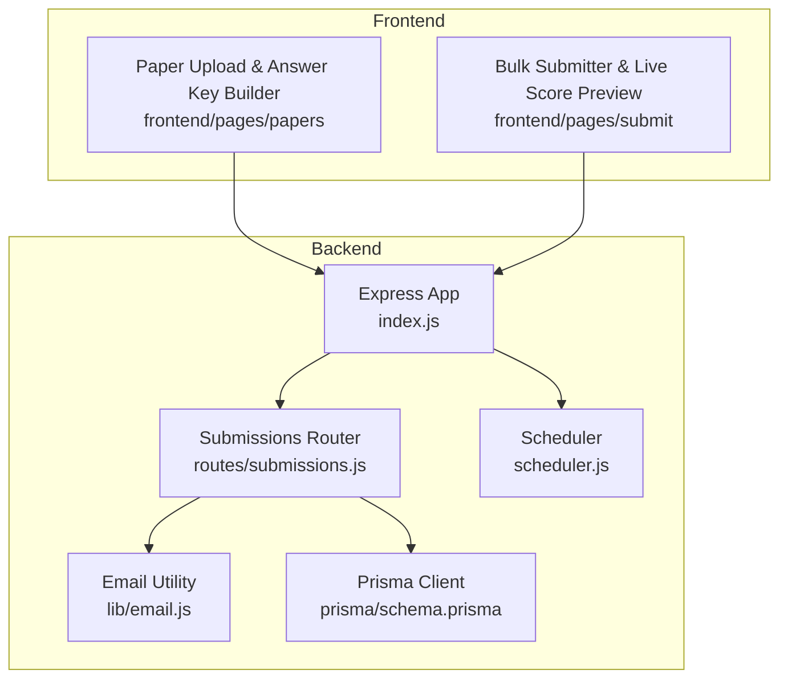
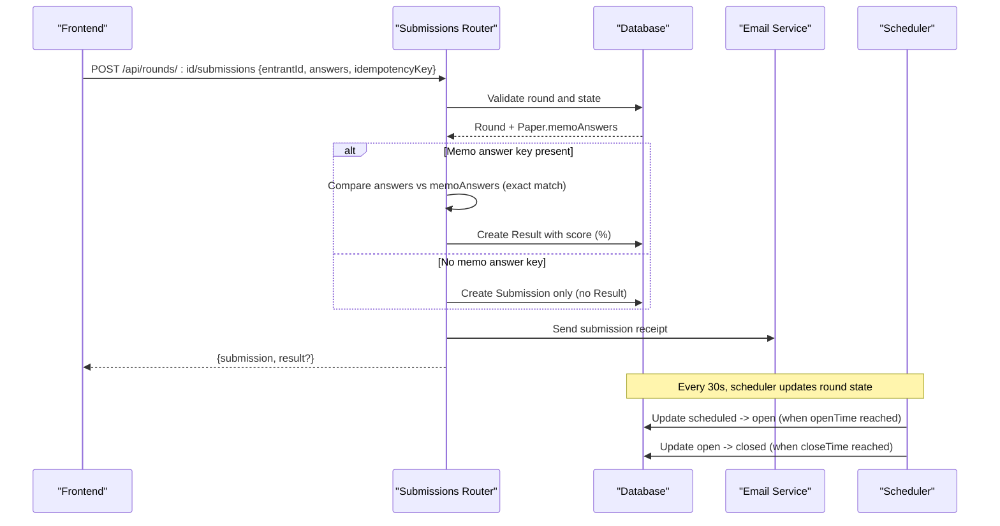
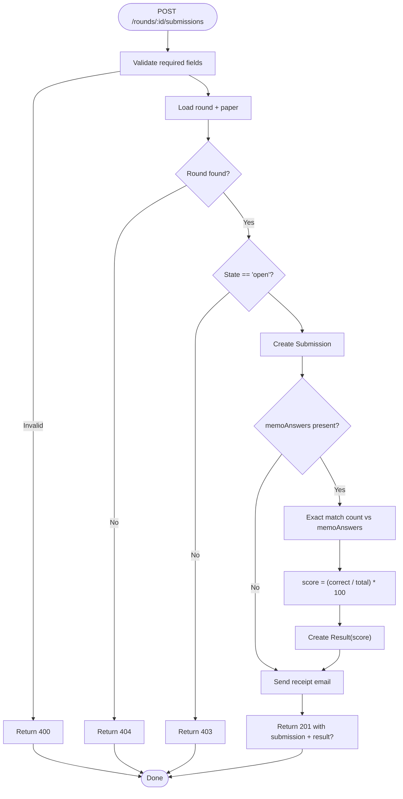
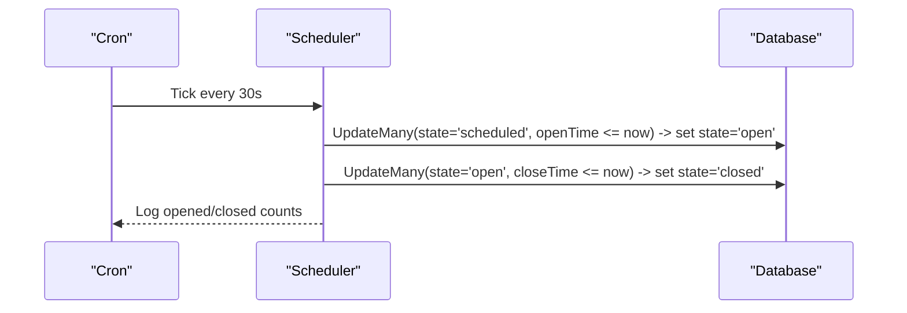
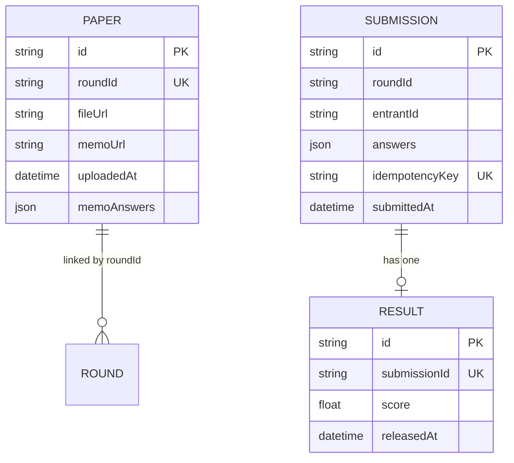
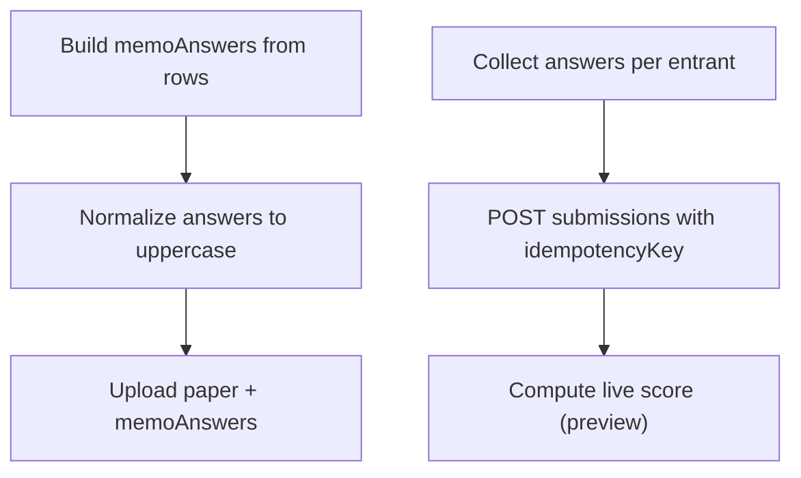
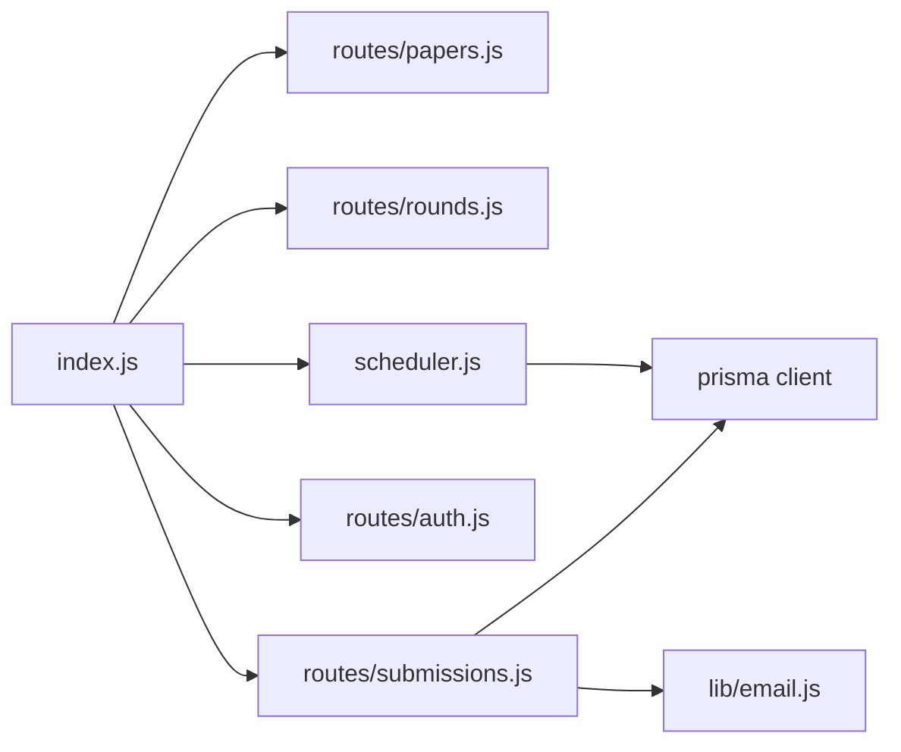

# Automated Scoring Engine

<cite>
**Referenced Files in This Document**
- [index.js](file://backend/src/index.js)
- [scheduler.js](file://backend/src/scheduler.js)
- [submissions.js](file://backend/src/routes/submissions.js)
- [rounds.js](file://backend/src/routes/rounds.js)
- [email.js](file://backend/src/lib/email.js)
- [schema.prisma](file://backend/prisma/schema.prisma)
- [migration.sql](file://backend/prisma/migrations/20260811072329_add_memo_answers_to_paper/migration.sql)
- [papers page (frontend)](file://frontend/src/app/rounds/[id]/papers/page.js)
- [submit page (frontend)](file://frontend/src/app/educator/submit/page.js)
- [database-schema.md](file://documents/docs/database-schema.md)
</cite>

## Table of Contents
1. [Introduction](#introduction)
2. [Project Structure](#project-structure)
3. [Core Components](#core-components)
4. [Architecture Overview](#architecture-overview)
5. [Detailed Component Analysis](#detailed-component-analysis)
6. [Dependency Analysis](#dependency-analysis)
7. [Performance Considerations](#performance-considerations)
8. [Troubleshooting Guide](#troubleshooting-guide)
9. [Conclusion](#conclusion)
10. [Appendices](#appendices)

## Introduction
This document explains the automated scoring engine that compares student submissions against memo answer keys and computes scores. It covers:
- How scoring is triggered on submission when a memo answer key exists
- The exact match algorithm used to compare answers
- How results are stored and when they become visible
- Error handling for corrupted submissions, missing answer keys, and idempotency conflicts
- The scheduler’s role in transitioning rounds to closed state

The system supports immediate automarking when an answer key is present; otherwise, submissions are accepted without an automatic score until manual marking or future automation is implemented.

## Project Structure
Key backend components involved in scoring and scheduling:
- API routes handle submission intake and automarking
- Scheduler transitions round states based on open/close times
- Database schema defines Paper.memoAnswers, Submission.answers, and Result.score
- Frontend builds and submits answer keys and submissions

**Diagram sources**
- [index.js:1-43](file://backend/src/index.js#L1-L43)
- [submissions.js:1-89](file://backend/src/routes/submissions.js#L1-L89)
- [scheduler.js:1-29](file://backend/src/scheduler.js#L1-L29)
- [email.js:1-23](file://backend/src/lib/email.js#L1-L23)
- [schema.prisma:69-97](file://backend/prisma/schema.prisma#L69-L97)
- [papers page (frontend):49-79](file://frontend/src/app/rounds/[id]/papers/page.js#L49-L79)
- [submit page (frontend):130-138](file://frontend/src/app/educator/submit/page.js#L130-L138)

**Section sources**
- [index.js:1-43](file://backend/src/index.js#L1-L43)
- [schema.prisma:69-97](file://backend/prisma/schema.prisma#L69-L97)

## Core Components
- Submission endpoint: validates input, persists the submission, and automarks if a memo answer key exists
- Scheduler: periodically opens and closes rounds based on configured times
- Email utility: sends submission receipts to educators
- Data models: Paper.memoAnswers stores correct answers; Submission.answers stores student responses; Result.score stores computed percentage

Scoring behavior:
- Exact match per question between submission.answers[questionId] and memoAnswers[questionId]
- Score = (number of exact matches / total number of questions in memoAnswers) × 100
- If no memoAnswers exist, no automatic result is created

**Section sources**
- [submissions.js:32-59](file://backend/src/routes/submissions.js#L32-L59)
- [schema.prisma:69-97](file://backend/prisma/schema.prisma#L69-L97)
- [database-schema.md:116-117](file://documents/docs/database-schema.md#L116-L117)

## Architecture Overview
The scoring flow integrates with the submission lifecycle and scheduler:

**Diagram sources**
- [submissions.js:9-85](file://backend/src/routes/submissions.js#L9-L85)
- [scheduler.js:4-23](file://backend/src/scheduler.js#L4-L23)
- [email.js:5-19](file://backend/src/lib/email.js#L5-L19)
- [schema.prisma:18-29](file://backend/prisma/schema.prisma#L18-L29)

## Detailed Component Analysis

### Submission Endpoint and Automark Logic
- Validates required fields: entrantId, answers, idempotencyKey
- Ensures round exists and is in 'open' state before accepting submissions
- Persists submission with unique idempotencyKey to prevent duplicates
- If Paper.memoAnswers exists:
  - Iterates all questions in memoAnswers
  - Counts exact matches where submission.answers[questionId] equals memoAnswers[questionId]
  - Computes score as percentage of correct answers
  - Creates a Result record linked to the submission
- Sends a submission receipt email to the requesting educator

**Diagram sources**
- [submissions.js:9-85](file://backend/src/routes/submissions.js#L9-L85)

**Section sources**
- [submissions.js:9-85](file://backend/src/routes/submissions.js#L9-L85)

### Scheduler and Round Lifecycle
- Runs every 30 seconds via cron
- Opens rounds whose openTime has passed (state: scheduled → open)
- Closes rounds whose closeTime has passed (state: open → closed)
- Logs counts when changes occur

Important note: In the current implementation, closing a round does not automatically trigger scoring of pending submissions. Scoring occurs at submission time when memoAnswers are available.

**Diagram sources**
- [scheduler.js:4-23](file://backend/src/scheduler.js#L4-L23)

**Section sources**
- [scheduler.js:4-23](file://backend/src/scheduler.js#L4-L23)

### Data Models and Storage
- Paper.memoAnswers: JSON object mapping question identifiers to correct answers
- Submission.answers: JSON object mapping question identifiers to student answers
- Result.score: Float representing percentage score
- Result.releasedAt: Nullable timestamp controlling visibility of scores

**Diagram sources**
- [schema.prisma:69-97](file://backend/prisma/schema.prisma#L69-L97)

**Section sources**
- [schema.prisma:69-97](file://backend/prisma/schema.prisma#L69-L97)
- [migration.sql:1-2](file://backend/prisma/migrations/20260811072329_add_memo_answers_to_paper/migration.sql#L1-L2)
- [database-schema.md:116-117](file://documents/docs/database-schema.md#L116-L117)

### Frontend Integration
- Answer key builder constructs memoAnswers from user-entered rows and normalizes answers to uppercase
- Bulk submitter computes live preview scores using the same exact-match logic as the backend
- Submission payloads include entrantId, answers, and idempotencyKey

**Diagram sources**
- [papers page (frontend):49-79](file://frontend/src/app/rounds/[id]/papers/page.js#L49-L79)
- [submit page (frontend):130-138](file://frontend/src/app/educator/submit/page.js#L130-L138)

**Section sources**
- [papers page (frontend):49-79](file://frontend/src/app/rounds/[id]/papers/page.js#L49-L79)
- [submit page (frontend):130-138](file://frontend/src/app/educator/submit/page.js#L130-L138)

## Dependency Analysis
- Express app mounts routers and starts scheduler on boot
- Submissions router depends on Prisma client and email utility
- Scheduler depends on Prisma client and node-cron
- Frontend pages depend on backend APIs for paper upload and submission

**Diagram sources**
- [index.js:1-43](file://backend/src/index.js#L1-L43)
- [submissions.js:1-89](file://backend/src/routes/submissions.js#L1-L89)
- [scheduler.js:1-29](file://backend/src/scheduler.js#L1-L29)
- [email.js:1-23](file://backend/src/lib/email.js#L1-L23)

**Section sources**
- [index.js:1-43](file://backend/src/index.js#L1-L43)

## Performance Considerations
- Scoring is O(Q) per submission where Q is the number of questions in memoAnswers
- IdempotencyKey prevents duplicate writes and reduces redundant processing
- Immediate scoring avoids batch jobs but may increase load during peak submission windows
- Consider indexing frequently queried fields (e.g., roundId, idempotencyKey) if needed

[No sources needed since this section provides general guidance]

## Troubleshooting Guide
Common issues and how the system handles them:

- Missing required fields: Returns 400 with error message indicating required fields
- Round not found: Returns 404
- Round not open: Returns 403 with current state
- Duplicate submission: Unique constraint on idempotencyKey returns existing submission and result (idempotent behavior)
- Unexpected errors: Returns 500 with generic error message
- Email send failures: Logged without blocking submission flow

Error handling locations:
- Validation and state checks in submissions route
- Idempotency conflict handling
- Email sending wrapped in try/catch

**Section sources**
- [submissions.js:13-30](file://backend/src/routes/submissions.js#L13-L30)
- [submissions.js:75-85](file://backend/src/routes/submissions.js#L75-L85)
- [email.js:14-19](file://backend/src/lib/email.js#L14-L19)

## Conclusion
The automated scoring engine performs exact-match comparison between student submissions and memo answer keys at submission time. Scores are calculated as a percentage of correct answers and stored in Result records. The scheduler manages round lifecycle transitions but does not currently trigger batch scoring upon closure. Robust error handling ensures resilience for common failure modes such as missing data, invalid states, and duplicate submissions.

[No sources needed since this section summarizes without analyzing specific files]

## Appendices

### Scoring Criteria and Formulas
- Exact match: submission.answers[questionId] must equal memoAnswers[questionId] exactly
- Total questions: number of entries in memoAnswers
- Score formula: score = (correctCount / totalQuestions) × 100
- If memoAnswers is absent or empty: no automatic result is created

Examples:
- 2-question memo with 1 correct answer → score = 50%
- 3-question memo with 0 correct answers → score = 0%
- 4-question memo with 4 correct answers → score = 100%

**Section sources**
- [submissions.js:40-52](file://backend/src/routes/submissions.js#L40-L52)
- [submit page (frontend):130-138](file://frontend/src/app/educator/submit/page.js#L130-L138)

### Grade Boundaries and Release Policy
- Results store a numeric percentage score
- Visibility control: Result.releasedAt remains unset until release; documentation indicates scores are not visible to schools early
- Actual release mechanism beyond storing releasedAt is not implemented in the examined code

**Section sources**
- [schema.prisma:91-97](file://backend/prisma/schema.prisma#L91-L97)
- [database-schema.md:116-117](file://documents/docs/database-schema.md#L116-L117)

### Scheduler Behavior Clarification
- The scheduler transitions rounds to 'closed' when closeTime is reached
- There is no automatic scoring job triggered by closure in the current implementation
- Scoring happens immediately upon submission when memoAnswers exist

**Section sources**
- [scheduler.js:4-23](file://backend/src/scheduler.js#L4-L23)
- [submissions.js:37-59](file://backend/src/routes/submissions.js#L37-L59)