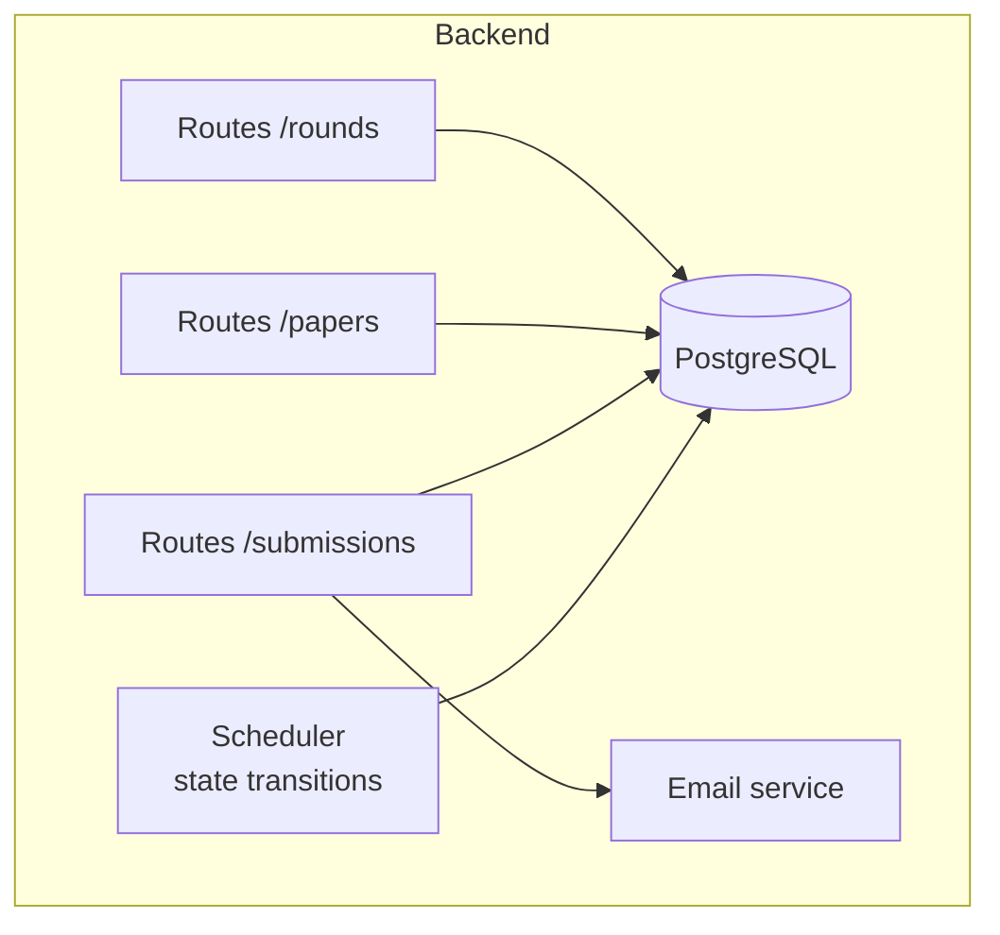
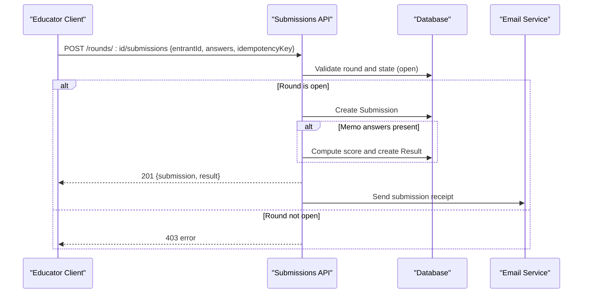
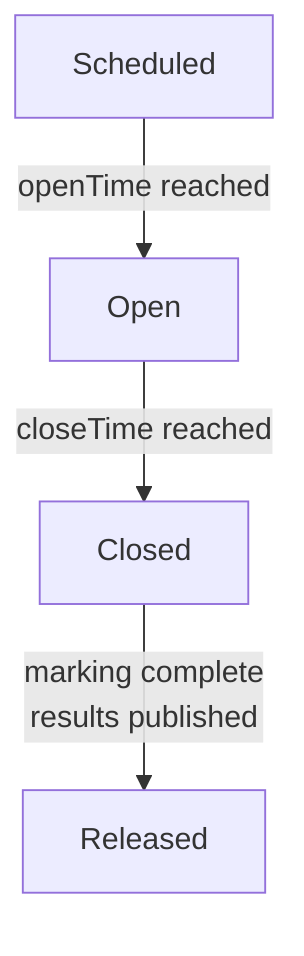
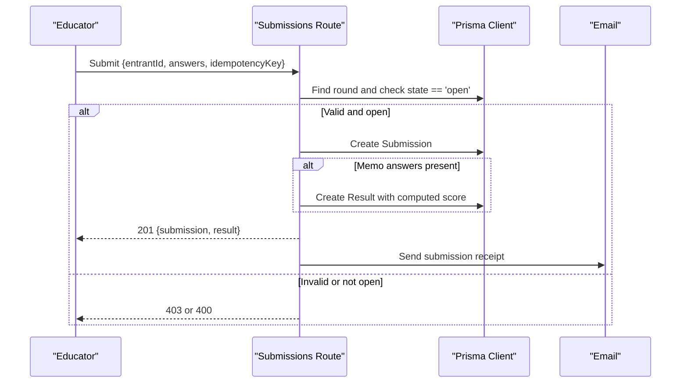
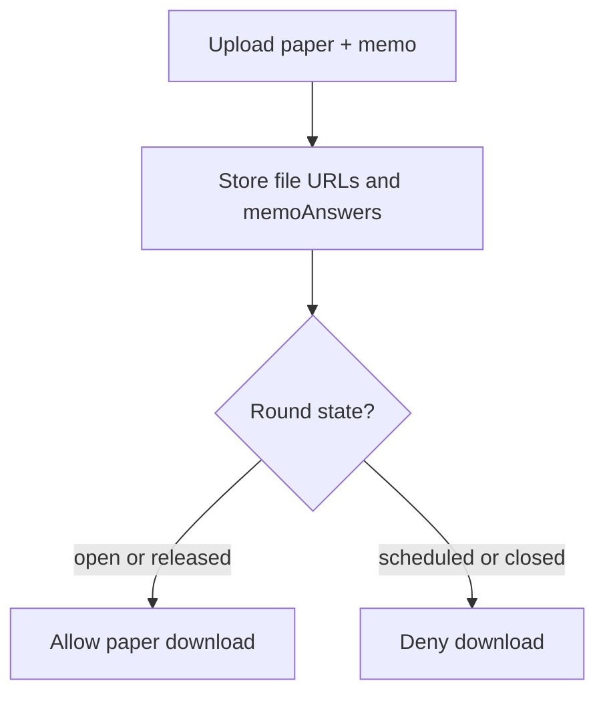
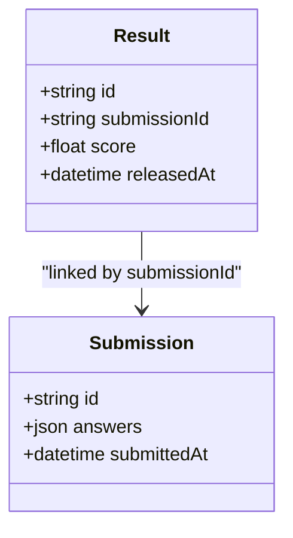
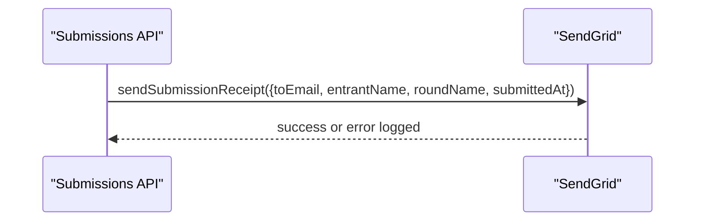
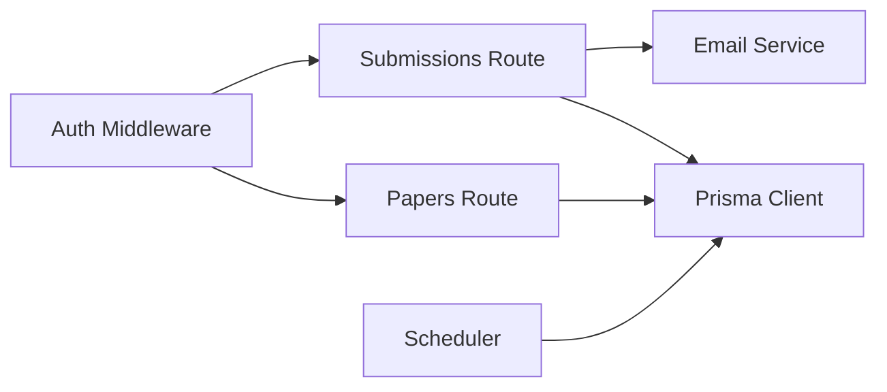

# Result Publication Workflow

<cite>
**Referenced Files in This Document**
- [schema.prisma](file://backend/prisma/schema.prisma)
- [scheduler.js](file://backend/src/scheduler.js)
- [rounds.js](file://backend/src/routes/rounds.js)
- [submissions.js](file://backend/src/routes/submissions.js)
- [papers.js](file://backend/src/routes/papers.js)
- [email.js](file://backend/src/lib/email.js)
- [auth.js](file://backend/src/middleware/auth.js)
- [round-lifecycle.md](file://documents/docs/round-lifecycle.md)
</cite>

## Table of Contents
1. [Introduction](#introduction)
2. [Project Structure](#project-structure)
3. [Core Components](#core-components)
4. [Architecture Overview](#architecture-overview)
5. [Detailed Component Analysis](#detailed-component-analysis)
6. [Dependency Analysis](#dependency-analysis)
7. [Performance Considerations](#performance-considerations)
8. [Troubleshooting Guide](#troubleshooting-guide)
9. [Conclusion](#conclusion)
10. [Appendices](#appendices)

## Introduction
This document explains the result publication workflow that manages olympiad results from generation to public availability. It covers how results are generated when rounds close, validation and integrity checks during submission, the controlled release mechanism for making results publicly accessible, state transitions from “closed” to “results released,” notifications to participants, and current capabilities and gaps around versioning, audit trails, and rollback.

## Project Structure
The result publication workflow spans several backend modules:
- Round lifecycle automation via a scheduler
- Submission handling with optional automarking
- Paper and memo management
- Email notifications
- Data model definitions for rounds, submissions, and results

**Diagram sources**
- [scheduler.js:1-29](file://backend/src/scheduler.js#L1-L29)
- [submissions.js:1-89](file://backend/src/routes/submissions.js#L1-L89)
- [papers.js:1-99](file://backend/src/routes/papers.js#L1-L99)
- [rounds.js:1-116](file://backend/src/routes/rounds.js#L1-L116)
- [email.js:1-23](file://backend/src/lib/email.js#L1-L23)
- [schema.prisma:18-97](file://backend/prisma/schema.prisma#L18-L97)

**Section sources**
- [scheduler.js:1-29](file://backend/src/scheduler.js#L1-L29)
- [submissions.js:1-89](file://backend/src/routes/submissions.js#L1-L89)
- [papers.js:1-99](file://backend/src/routes/papers.js#L1-L99)
- [rounds.js:1-116](file://backend/src/routes/rounds.js#L1-L116)
- [email.js:1-23](file://backend/src/lib/email.js#L1-L23)
- [schema.prisma:18-97](file://backend/prisma/schema.prisma#L18-L97)

## Core Components
- Round state machine and scheduling: The scheduler updates round states based on openTime and closeTime.
- Submission processing: Validates inputs, enforces idempotency, optionally automarks using memo answers, and creates results.
- Paper and memo handling: Stores paper files and memo answer keys; controls download access by round state.
- Notifications: Sends submission receipts to educators.
- Data model: Defines Round, Submission, Result, Paper, and related entities.

Key responsibilities:
- Generate results at submission time if memo answers exist.
- Gate submissions to only accept when round is open.
- Control paper downloads to open or released rounds.
- Provide endpoints to list rounds, entrants, and submissions.

**Section sources**
- [scheduler.js:4-23](file://backend/src/scheduler.js#L4-L23)
- [submissions.js:8-86](file://backend/src/routes/submissions.js#L8-L86)
- [papers.js:25-96](file://backend/src/routes/papers.js#L25-L96)
- [rounds.js:32-113](file://backend/src/routes/rounds.js#L32-L113)
- [email.js:5-20](file://backend/src/lib/email.js#L5-L20)
- [schema.prisma:18-97](file://backend/prisma/schema.prisma#L18-L97)

## Architecture Overview
The system uses a polling-based scheduler to transition rounds between states. Submissions create results immediately when an answer key exists. Results become visible once the round reaches “released.”

**Diagram sources**
- [submissions.js:8-86](file://backend/src/routes/submissions.js#L8-L86)
- [email.js:5-20](file://backend/src/lib/email.js#L5-L20)
- [schema.prisma:79-97](file://backend/prisma/schema.prisma#L79-L97)

## Detailed Component Analysis

### Round Lifecycle and State Transitions
- States: scheduled → open → closed → released.
- Transitions:
  - scheduled → open when openTime has passed.
  - open → closed when closeTime has passed.
  - closed → released when marking completes and results are published.
- The scheduler runs every 30 seconds and updates states accordingly.

**Diagram sources**
- [scheduler.js:4-23](file://backend/src/scheduler.js#L4-L23)
- [round-lifecycle.md:11-21](file://documents/docs/round-lifecycle.md#L11-L21)

**Section sources**
- [scheduler.js:4-23](file://backend/src/scheduler.js#L4-L23)
- [round-lifecycle.md:11-21](file://documents/docs/round-lifecycle.md#L11-L21)

### Submission Processing and Automarking
- Input validation: requires entrantId, answers, and idempotencyKey.
- Idempotency: prevents duplicate submissions via unique idempotencyKey.
- State gating: submissions accepted only when round.state is open.
- Automarking: if memoAnswers exist, scores are computed and stored as a Result.
- Notification: sends a submission receipt email to the requester.

**Diagram sources**
- [submissions.js:8-86](file://backend/src/routes/submissions.js#L8-L86)
- [email.js:5-20](file://backend/src/lib/email.js#L5-L20)
- [schema.prisma:79-97](file://backend/prisma/schema.prisma#L79-L97)

**Section sources**
- [submissions.js:8-86](file://backend/src/routes/submissions.js#L8-L86)
- [email.js:5-20](file://backend/src/lib/email.js#L5-L20)
- [schema.prisma:79-97](file://backend/prisma/schema.prisma#L79-L97)

### Paper and Memo Management
- Organisers upload paper and memo files; memo may include memoAnswers JSON.
- Paper downloads are allowed when round.state is open or released.
- Memo answers enable immediate scoring upon submission.

**Diagram sources**
- [papers.js:25-96](file://backend/src/routes/papers.js#L25-L96)
- [schema.prisma:69-77](file://backend/prisma/schema.prisma#L69-L77)

**Section sources**
- [papers.js:25-96](file://backend/src/routes/papers.js#L25-L96)
- [schema.prisma:69-77](file://backend/prisma/schema.prisma#L69-L77)

### Result Visibility and Controlled Release
- Results have a releasedAt timestamp field indicating when they become public.
- Current implementation does not expose a dedicated endpoint to set releasedAt or transition rounds to released; this is a gap to be implemented.
- Documentation indicates that scores should remain hidden until the round closes and results are released.

**Diagram sources**
- [schema.prisma:79-97](file://backend/prisma/schema.prisma#L79-L97)

**Section sources**
- [schema.prisma:79-97](file://backend/prisma/schema.prisma#L79-L97)
- [round-lifecycle.md:11-21](file://documents/docs/round-lifecycle.md#L11-L21)

### Notifications
- Submission receipts are sent to educators after successful submission.
- There is no current implementation for notifying participants when results are released; this is a gap to be added.

**Diagram sources**
- [email.js:5-20](file://backend/src/lib/email.js#L5-L20)
- [submissions.js:63-73](file://backend/src/routes/submissions.js#L63-L73)

**Section sources**
- [email.js:5-20](file://backend/src/lib/email.js#L5-L20)
- [submissions.js:63-73](file://backend/src/routes/submissions.js#L63-L73)

### Business Rules Summary
- Submissions are accepted only when round.state is open.
- If memo answers exist, results are created immediately with a computed score.
- Paper downloads are permitted only when round.state is open or released.
- Rounds transition automatically based on openTime and closeTime.
- Results visibility is gated by releasedAt; currently missing a release action.

**Section sources**
- [submissions.js:17-30](file://backend/src/routes/submissions.js#L17-L30)
- [submissions.js:37-59](file://backend/src/routes/submissions.js#L37-L59)
- [papers.js:70-96](file://backend/src/routes/papers.js#L70-L96)
- [scheduler.js:4-23](file://backend/src/scheduler.js#L4-L23)
- [schema.prisma:79-97](file://backend/prisma/schema.prisma#L79-L97)

## Dependency Analysis
- Scheduler depends on Prisma client to update round states.
- Submissions route depends on Prisma client and email service.
- Papers route depends on Prisma client and file storage.
- Authentication middleware protects sensitive routes.

**Diagram sources**
- [auth.js:1-35](file://backend/src/middleware/auth.js#L1-L35)
- [submissions.js:1-89](file://backend/src/routes/submissions.js#L1-L89)
- [papers.js:1-99](file://backend/src/routes/papers.js#L1-L99)
- [scheduler.js:1-29](file://backend/src/scheduler.js#L1-L29)

**Section sources**
- [auth.js:1-35](file://backend/src/middleware/auth.js#L1-L35)
- [submissions.js:1-89](file://backend/src/routes/submissions.js#L1-L89)
- [papers.js:1-99](file://backend/src/routes/papers.js#L1-L99)
- [scheduler.js:1-29](file://backend/src/scheduler.js#L1-L29)

## Performance Considerations
- Polling interval of 30 seconds introduces up to 30-second delay for state transitions; acceptable for this scale.
- Automarking computes scores per submission; ensure memoAnswers size remains small to avoid performance issues.
- Idempotency prevents duplicate writes and reduces load on downstream services.
- Email sending is fire-and-forget with error logging; consider retry logic for reliability.

[No sources needed since this section provides general guidance]

## Troubleshooting Guide
Common issues and resolutions:
- Submission rejected because round is not open: Ensure round.state is open; verify openTime/closeTime and scheduler execution.
- Duplicate submission errors: Use idempotencyKey; the API returns existing submission on conflict.
- Paper download denied: Confirm round.state is open or released; otherwise access is blocked.
- Email failures: Check SendGrid configuration and logs; failures are logged but do not block submission.

**Section sources**
- [submissions.js:17-30](file://backend/src/routes/submissions.js#L17-L30)
- [submissions.js:75-85](file://backend/src/routes/submissions.js#L75-L85)
- [papers.js:70-96](file://backend/src/routes/papers.js#L70-L96)
- [email.js:14-20](file://backend/src/lib/email.js#L14-L20)

## Conclusion
The current implementation supports automated round state transitions, submission validation, optional automarking, and controlled paper downloads. Results are modeled with a releasedAt field, but there is no implemented endpoint to transition rounds to “released” or to notify participants when results become available. To fully meet the objective, add:
- An admin endpoint to publish results and set releasedAt.
- A notification step to alert participants when their results are released.
- Versioning and audit trails for result modifications.
- Rollback mechanisms to correct scoring errors safely.

[No sources needed since this section summarizes without analyzing specific files]

## Appendices

### Data Model Reference
- Round: stores openTime, closeTime, and state.
- Submission: stores answers, submittedAt, and links to Result.
- Result: stores score and releasedAt; linked to Submission.
- Paper: stores fileUrl, memoUrl, and memoAnswers.

**Section sources**
- [schema.prisma:18-97](file://backend/prisma/schema.prisma#L18-L97)