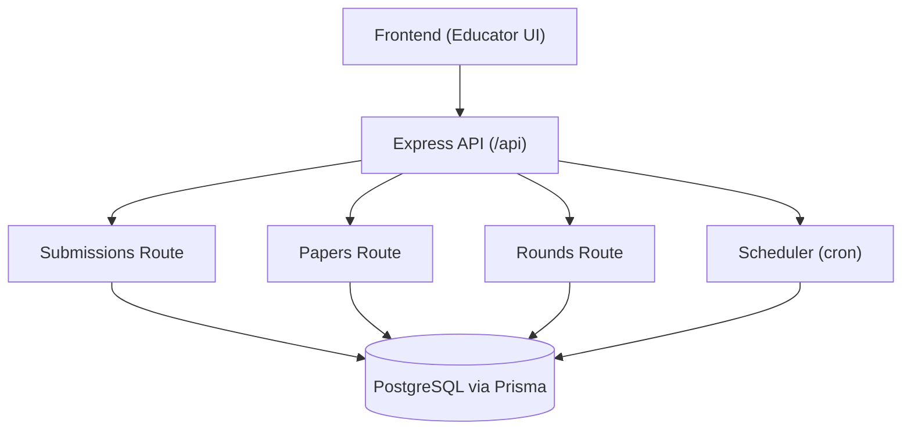
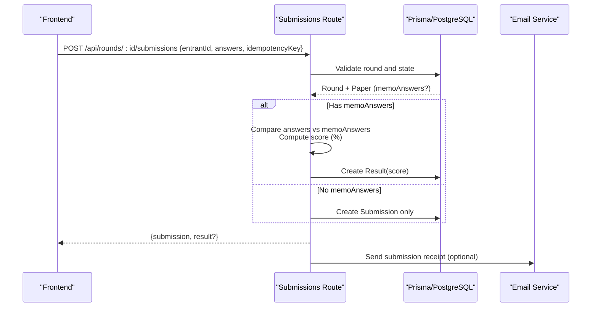
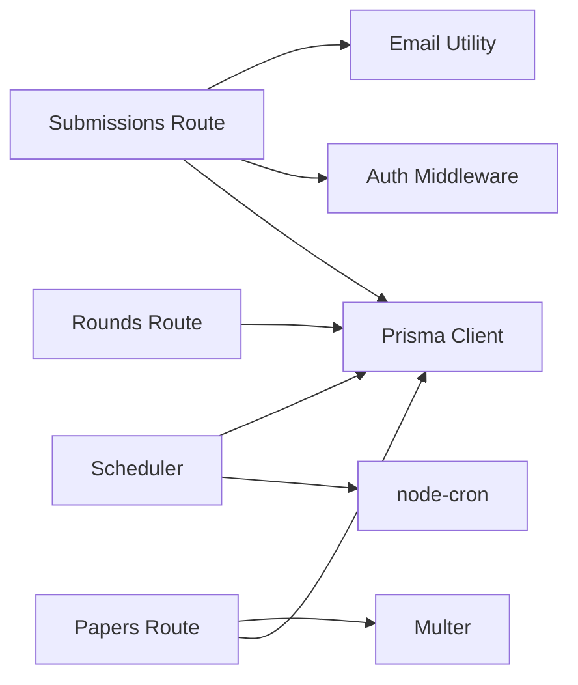
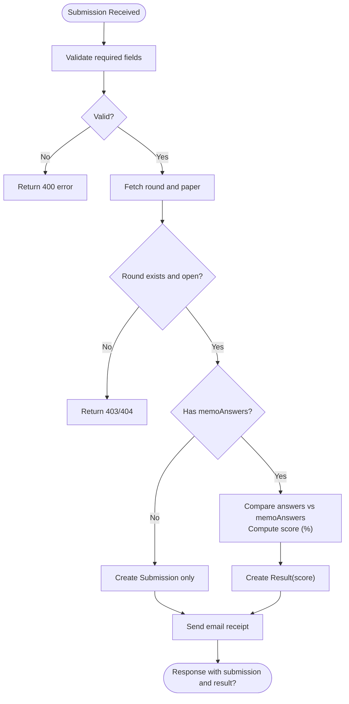

# Results & Scoring

<cite>
**Referenced Files in This Document**
- [schema.prisma](file://backend/prisma/schema.prisma)
- [submissions.js](file://backend/src/routes/submissions.js)
- [papers.js](file://backend/src/routes/papers.js)
- [rounds.js](file://backend/src/routes/rounds.js)
- [scheduler.js](file://backend/src/scheduler.js)
- [email.js](file://backend/src/lib/email.js)
- [index.js](file://backend/src/index.js)
- [submissions.test.js](file://backend/src/routes/submissions.test.js)
- [scheduler.test.js](file://backend/src/scheduler.test.js)
- [database-schema.md](file://documents/docs/database-schema.md)
</cite>

## Table of Contents
1. [Introduction](#introduction)
2. [Project Structure](#project-structure)
3. [Core Components](#core-components)
4. [Architecture Overview](#architecture-overview)
5. [Detailed Component Analysis](#detailed-component-analysis)
6. [Dependency Analysis](#dependency-analysis)
7. [Performance Considerations](#performance-considerations)
8. [Troubleshooting Guide](#troubleshooting-guide)
9. [Conclusion](#conclusion)
10. [Appendices](#appendices)

## Introduction
This document explains how the Olympiad Portal scores student submissions and publishes results. It covers:
- Automated scoring against memo answer keys
- Grade calculation methods
- Result publication workflow
- Scheduler integration for round lifecycle transitions
- Database schema for results, scores, and grading criteria
- API endpoints for result retrieval, score analysis, and reporting
- Validation, accuracy verification, and audit trails
- Example data structures and frontend integration patterns for displaying scores

## Project Structure
The scoring system spans backend routes, a scheduler, and Prisma models:
- Submissions route handles submission intake and immediate auto-scoring when a memo answer key exists
- Papers route allows uploading paper files and memo answer keys
- Rounds route exposes endpoints to list submissions with their results
- Scheduler transitions rounds between scheduled/open/closed states based on openTime/closeTime
- Email utility sends submission receipts to educators



**Diagram sources**
- [index.js:14-39](file://backend/src/index.js#L14-L39)
- [submissions.js:8-86](file://backend/src/routes/submissions.js#L8-L86)
- [papers.js:25-96](file://backend/src/routes/papers.js#L25-L96)
- [rounds.js:102-113](file://backend/src/routes/rounds.js#L102-L113)
- [scheduler.js:4-23](file://backend/src/scheduler.js#L4-L23)

**Section sources**
- [index.js:14-39](file://backend/src/index.js#L14-L39)

## Core Components
- Submission intake and auto-scoring: POST /api/rounds/:id/submissions
- Memo answer key upload: POST /api/rounds/:id/papers
- Retrieve round submissions with results: GET /api/rounds/:id/submissions
- Round lifecycle scheduler: opens/closes rounds on schedule

Key behaviors:
- If a round’s paper includes memoAnswers, submissions are scored immediately as a percentage of correct answers
- If no memoAnswers exist, submissions are stored without an immediate result
- The scheduler updates round state from scheduled to open and open to closed at configured times

**Section sources**
- [submissions.js:8-86](file://backend/src/routes/submissions.js#L8-L86)
- [papers.js:25-67](file://backend/src/routes/papers.js#L25-L67)
- [rounds.js:102-113](file://backend/src/routes/rounds.js#L102-L113)
- [scheduler.js:4-23](file://backend/src/scheduler.js#L4-L23)

## Architecture Overview
The automated scoring engine runs inline during submission creation when memo answers are available. It compares each question’s answer to the memo key and computes a percentage score. A Result record is created and linked to the Submission.



**Diagram sources**
- [submissions.js:8-86](file://backend/src/routes/submissions.js#L8-L86)
- [email.js:5-20](file://backend/src/lib/email.js#L5-L20)

## Detailed Component Analysis

### Scoring Algorithm and Grade Calculation
- Input: submission.answers keyed by question ID; paper.memoAnswers keyed by question ID
- Logic: For each question present in memoAnswers, compare values; count matches
- Score formula: (correctCount / totalQuestions) * 100
- Edge cases:
  - If memoAnswers has zero questions, score defaults to 0
  - If memoAnswers is absent or null, no automatic scoring occurs

Complexity: O(Q) where Q is number of questions in memoAnswers

Accuracy verification:
- IdempotencyKey prevents duplicate submissions
- Tests cover 0% and partial scores, missing memoAnswers, and idempotency conflicts

**Section sources**
- [submissions.js:37-59](file://backend/src/routes/submissions.js#L37-L59)
- [submissions.test.js:108-157](file://backend/src/routes/submissions.test.js#L108-L157)

### Result Publication Workflow
- Immediate publication: When memoAnswers exist, a Result is created at submission time
- Delayed publication: Without memoAnswers, results can be generated later (e.g., after manual grading)
- Release gating: Result.releasedAt remains unset until the round closes (per documentation), controlling visibility

Note: The current code does not set releasedAt automatically upon round close; it is available for future release logic.

**Section sources**
- [schema.prisma:91-97](file://backend/prisma/schema.prisma#L91-L97)
- [database-schema.md:116-117](file://documents/docs/database-schema.md#L116-L117)

### Scheduler Integration for Round Lifecycle
- Runs every 30 seconds
- Opens rounds whose openTime has passed (state: scheduled → open)
- Closes rounds whose closeTime has passed (state: open → closed)
- Logs counts of opened/closed rounds

Impact on scoring:
- Submissions accepted only when round.state === 'open'
- After closing, no new submissions are accepted; existing results remain accessible per endpoint permissions

**Section sources**
- [scheduler.js:4-23](file://backend/src/scheduler.js#L4-L23)
- [submissions.js:17-30](file://backend/src/routes/submissions.js#L17-L30)
- [scheduler.test.js:43-96](file://backend/src/scheduler.test.js#L43-L96)

### Database Schema for Results, Scores, and Grading Criteria
- Paper.memoAnswers: JSON field storing question-to-answer mappings used for auto-grading
- Submission.answers: JSON field storing student answers keyed by question
- Result.score: Float representing percentage score
- Result.releasedAt: DateTime nullable field for controlled publication
- Relationships:
  - Submission has one Result (one-to-one via unique constraint)
  - Paper belongs to Round
  - Submission belongs to Round and Entrant

```mermaid
erDiagram
ROUND ||--o{ SUBMISSION : "has many"
ROUND ||--|| PAPER : "has one"
ENTRANT ||--o{ SUBMISSION : "has many"
SUBMISSION ||--|| RESULT : "has one"
ROUND {
string id PK
string name
datetime openTime
datetime closeTime
string state
}
PAPER {
string id PK
string roundId FK
string fileUrl
string memoUrl
json memoAnswers
}
SUBMISSION {
string id PK
string roundId FK
string entrantId FK
json answers
string idempotencyKey UK
datetime submittedAt
}
RESULT {
string id PK
string submissionId UK FK
float score
datetime releasedAt
}
```

**Diagram sources**
- [schema.prisma:18-97](file://backend/prisma/schema.prisma#L18-L97)

**Section sources**
- [schema.prisma:69-97](file://backend/prisma/schema.prisma#L69-L97)

### API Endpoints for Results, Scores, and Reporting
- POST /api/rounds/:id/submissions
  - Purpose: Submit answers and optionally receive an immediate score
  - Auth: Requires educator role
  - Response: { submission, result? }
  - Errors: 400 validation, 404 round not found, 403 round not open, 500 server error
- GET /api/rounds/:id/submissions
  - Purpose: List all submissions for a round, including associated results
  - Response: Array of submissions with nested result objects
- POST /api/rounds/:id/papers
  - Purpose: Upload paper and memo files; attach memoAnswers JSON
  - Auth: Requires organiser role
  - Response: Created paper record

Reporting and analysis:
- Use GET /api/rounds/:id/submissions to aggregate scores across entrants
- Frontend can compute statistics (mean, median, distribution) client-side using returned results

**Section sources**
- [submissions.js:8-86](file://backend/src/routes/submissions.js#L8-L86)
- [rounds.js:102-113](file://backend/src/routes/rounds.js#L102-L113)
- [papers.js:25-67](file://backend/src/routes/papers.js#L25-L67)

### Result Validation, Accuracy Verification, and Audit Trails
Validation:
- Required fields validated on submission (entrantId, answers, idempotencyKey)
- Round existence and state enforced before accepting submissions
- IdempotencyKey ensures duplicate submissions return existing records safely

Accuracy verification:
- Auto-scoring uses exact match comparison between submission.answers and paper.memoAnswers
- Tests verify correct computation for full, partial, and zero scores

Audit trails:
- Submission.submittedAt provides timestamp for when answers were received
- Result.score stores computed score at time of creation
- Email receipts provide external confirmation of submission acceptance

Limitations:
- No explicit audit log table for changes to memoAnswers or manual regrading
- releasedAt is not automatically set by scheduler; consider adding logic to mark results as released upon round close

**Section sources**
- [submissions.js:13-30](file://backend/src/routes/submissions.js#L13-L30)
- [submissions.js:75-85](file://backend/src/routes/submissions.js#L75-L85)
- [email.js:5-20](file://backend/src/lib/email.js#L5-L20)
- [submissions.test.js:159-186](file://backend/src/routes/submissions.test.js#L159-L186)

### Example Data Structures and Integration Patterns
Submission request payload:
- entrantId: string
- answers: object mapping question IDs to answers
- idempotencyKey: string

Submission response:
- submission: { id, roundId, entrantId, answers, idempotencyKey, submittedAt }
- result?: { id, submissionId, score, releasedAt }

Memo answer key structure:
- memoAnswers: object mapping question IDs to correct answers

Frontend integration pattern:
- Educator UI submits multiple entries in batch, tracking per-row status and building a receipt table
- Displays live preview scores when memoAnswers exist, then shows final scores after successful submission

**Section sources**
- [submissions.js:8-61](file://backend/src/routes/submissions.js#L8-L61)
- [submissions.test.js:108-157](file://backend/src/routes/submissions.test.js#L108-L157)
- [frontend submit page usage:201-235](file://frontend/src/app/educator/submit/page.js#L201-L235)

## Dependency Analysis
- Submissions route depends on:
  - Prisma client for database operations
  - Auth middleware for role enforcement
  - Email utility for receipts
- Papers route depends on:
  - Multer for file uploads
  - Prisma client for persisting paper metadata and memoAnswers
- Rounds route depends on:
  - Prisma client for listing submissions with results
- Scheduler depends on:
  - node-cron for scheduling
  - Prisma client for updating round states



**Diagram sources**
- [submissions.js:1-5](file://backend/src/routes/submissions.js#L1-L5)
- [papers.js:1-7](file://backend/src/routes/papers.js#L1-L7)
- [rounds.js:1-3](file://backend/src/routes/rounds.js#L1-L3)
- [scheduler.js:1-3](file://backend/src/scheduler.js#L1-L3)

**Section sources**
- [submissions.js:1-5](file://backend/src/routes/submissions.js#L1-L5)
- [papers.js:1-7](file://backend/src/routes/papers.js#L1-L7)
- [rounds.js:1-3](file://backend/src/routes/rounds.js#L1-L3)
- [scheduler.js:1-3](file://backend/src/scheduler.js#L1-L3)

## Performance Considerations
- Auto-scoring complexity is linear in the number of questions; keep memoAnswers concise
- Batch submissions in the frontend to reduce network overhead
- Avoid frequent polling for results; rely on immediate responses when memoAnswers exist
- Ensure database indexes on frequently queried fields (e.g., roundId, submissionId) if scale increases

[No sources needed since this section provides general guidance]

## Troubleshooting Guide
Common issues and resolutions:
- Round not found: Verify roundId and ensure the round exists
- Round not open: Check scheduler logs and round.openTime/closeTime; ensure scheduler is running
- Duplicate submission: Use idempotencyKey; server returns existing submission on conflict
- Invalid memoAnswers JSON: Ensure memoAnswers is valid JSON when uploading papers
- Email delivery failures: Check SENDGRID_API_KEY and SENDGRID_FROM_EMAIL environment variables

Logs to inspect:
- Server console logs for scheduler actions (“Opened X round(s)”, “Closed Y round(s)”)
- Email service logs for receipt delivery errors

**Section sources**
- [scheduler.js:12-22](file://backend/src/scheduler.js#L12-L22)
- [submissions.js:22-30](file://backend/src/routes/submissions.js#L22-L30)
- [submissions.js:75-85](file://backend/src/routes/submissions.js#L75-L85)
- [papers.js:43-51](file://backend/src/routes/papers.js#L43-L51)
- [email.js:14-19](file://backend/src/lib/email.js#L14-L19)

## Conclusion
The Olympiad Portal implements a robust automated scoring engine that evaluates submissions against memo answer keys in real time, creating persistent results with timestamps. The scheduler manages round lifecycles to control submission windows. While immediate scoring is supported, result publication gating via releasedAt is available for future use. The API surface enables straightforward retrieval of results for reporting and analysis.

[No sources needed since this section summarizes without analyzing specific files]

## Appendices

### Appendix A: API Reference Summary
- POST /api/rounds/:id/submissions
  - Auth: educator
  - Body: { entrantId, answers, idempotencyKey }
  - Response: { submission, result? }
- GET /api/rounds/:id/submissions
  - Response: Array of submissions with nested results
- POST /api/rounds/:id/papers
  - Auth: organiser
  - Multipart: paper, memo, optional memoAnswers JSON
  - Response: Paper record

**Section sources**
- [submissions.js:8-86](file://backend/src/routes/submissions.js#L8-L86)
- [rounds.js:102-113](file://backend/src/routes/rounds.js#L102-L113)
- [papers.js:25-67](file://backend/src/routes/papers.js#L25-L67)

### Appendix B: Scoring Flowchart


**Diagram sources**
- [submissions.js:8-86](file://backend/src/routes/submissions.js#L8-L86)