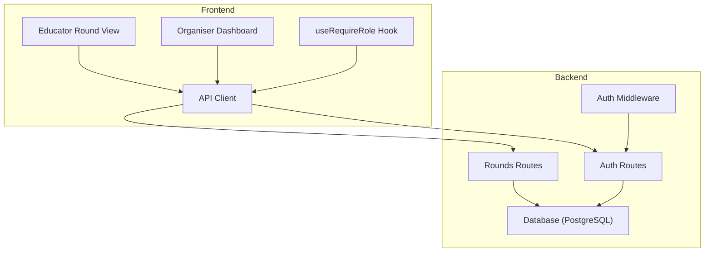
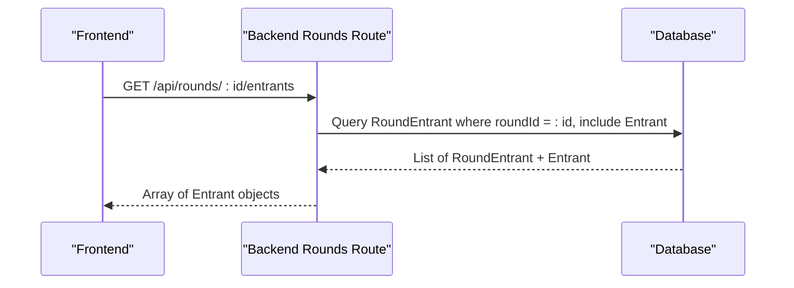
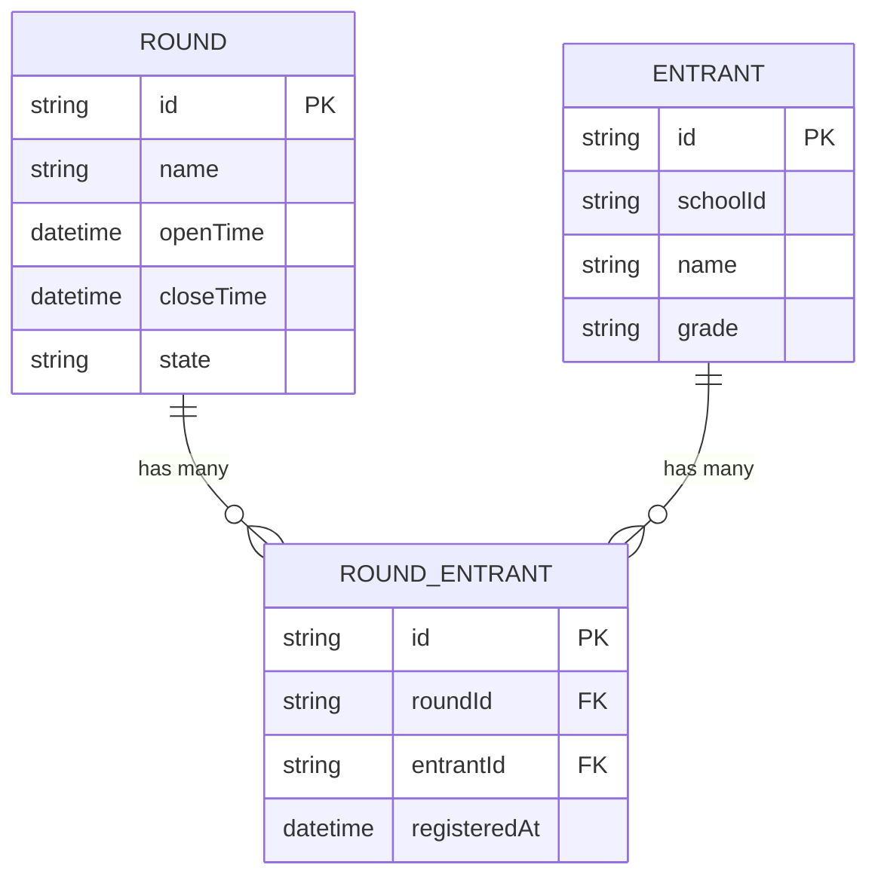
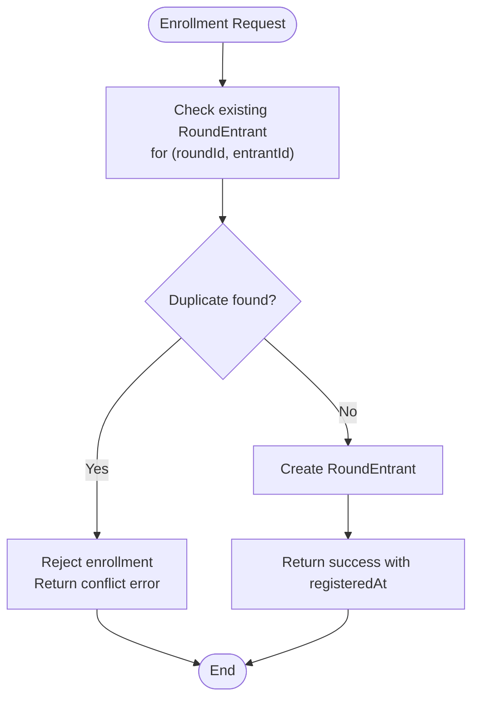
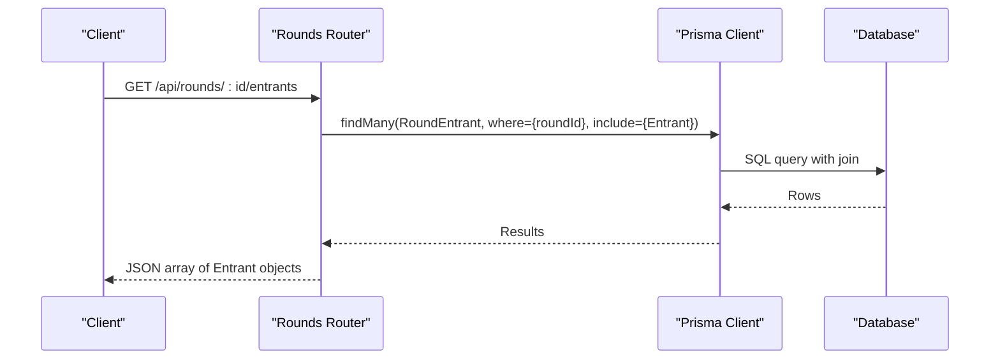
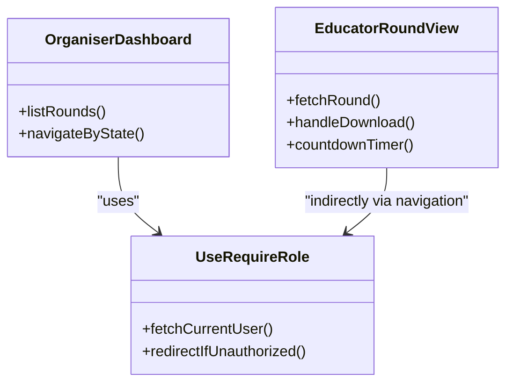
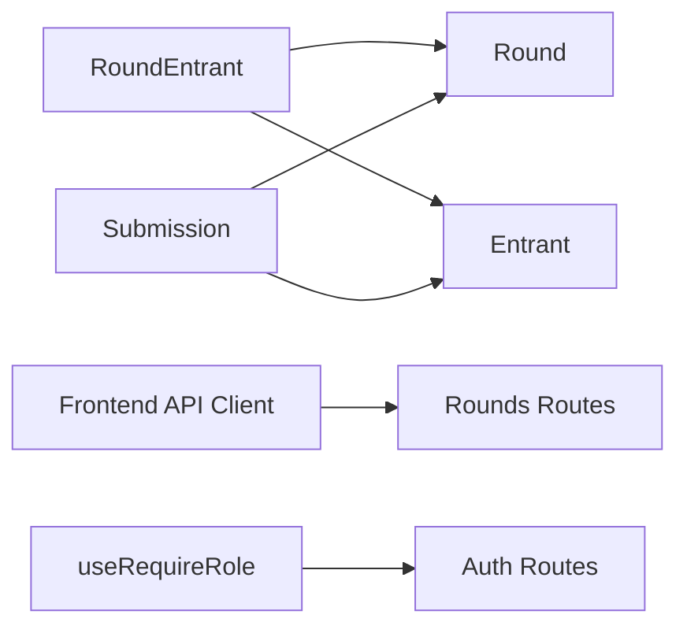

# Participant Enrollment & Management

<cite>
**Referenced Files in This Document**
- [schema.prisma](file://backend/prisma/schema.prisma)
- [migration.sql](file://backend/prisma/migrations/20260815093922_add_round_entrant/migration.sql)
- [rounds.js](file://backend/src/routes/rounds.js)
- [auth.js](file://backend/src/routes/auth.js)
- [auth middleware](file://backend/src/middleware/auth.js)
- [educator round view](file://frontend/src/app/educator/round_view/page.js)
- [organiser dashboard](file://frontend/src/app/organiser/page.js)
- [useRequireRole hook](file://frontend/src/hooks/useRequireRole.js)
- [frontend API client](file://frontend/src/lib/api.js)
</cite>

## Table of Contents
1. [Introduction](#introduction)
2. [Project Structure](#project-structure)
3. [Core Components](#core-components)
4. [Architecture Overview](#architecture-overview)
5. [Detailed Component Analysis](#detailed-component-analysis)
6. [Dependency Analysis](#dependency-analysis)
7. [Performance Considerations](#performance-considerations)
8. [Troubleshooting Guide](#troubleshooting-guide)
9. [Conclusion](#conclusion)

## Introduction
This document explains how participants are enrolled and managed within rounds, focusing on the RoundEntrant model and its relationships with users and rounds. It covers enrollment validation and duplicate prevention, the GET /api/rounds/:id/entrants endpoint for retrieving enrolled participants, frontend components used by educators and organizers, security considerations for accessing participant data, and common scenarios such as bulk enrollment, participant removal, and tracking enrollment status throughout a round’s lifecycle.

## Project Structure
The participant enrollment system spans:
- Backend data model and database schema (Prisma schema and migrations)
- Backend routes that expose endpoints for rounds and entrants
- Authentication and authorization middleware
- Frontend pages and hooks for role-based access and UI interactions

**Diagram sources**
- [educator round view](file://frontend/src/app/educator/round_view/page.js)
- [organiser dashboard](file://frontend/src/app/organiser/page.js)
- [useRequireRole hook](file://frontend/src/hooks/useRequireRole.js)
- [frontend API client](file://frontend/src/lib/api.js)
- [rounds.js](file://backend/src/routes/rounds.js)
- [auth.js](file://backend/src/routes/auth.js)
- [auth middleware](file://backend/src/middleware/auth.js)

**Section sources**
- [schema.prisma](file://backend/prisma/schema.prisma)
- [migration.sql](file://backend/prisma/migrations/20260815093922_add_round_entrant/migration.sql)
- [rounds.js](file://backend/src/routes/rounds.js)
- [auth.js](file://backend/src/routes/auth.js)
- [auth middleware](file://backend/src/middleware/auth.js)
- [educator round view](file://frontend/src/app/educator/round_view/page.js)
- [organiser dashboard](file://frontend/src/app/organiser/page.js)
- [useRequireRole hook](file://frontend/src/hooks/useRequireRole.js)
- [frontend API client](file://frontend/src/lib/api.js)

## Core Components
- RoundEntrant model: Represents a participant’s enrollment in a specific round, linking an Entrant to a Round and recording registration time.
- Relationships:
  - RoundEntrant belongs to Round and Entrant.
  - Round has many RoundEntrants.
  - Entrant has many RoundEntrants and submissions.
- Unique constraint: A unique index on (roundId, entrantId) prevents duplicate enrollments at the database level.
- GET /api/rounds/:id/entrants: Returns all enrolled participants for a given round by querying RoundEntrant and including Entrant details.

Key implementation references:
- Data model and relations: [schema.prisma](file://backend/prisma/schema.prisma)
- Database constraints and foreign keys: [migration.sql](file://backend/prisma/migrations/20260815093922_add_round_entrant/migration.sql)
- Endpoint implementation: [rounds.js](file://backend/src/routes/rounds.js)

**Section sources**
- [schema.prisma:18-29](file://backend/prisma/schema.prisma#L18-L29)
- [schema.prisma:59-67](file://backend/prisma/schema.prisma#L59-L67)
- [schema.prisma:99-108](file://backend/prisma/schema.prisma#L99-L108)
- [migration.sql:1-19](file://backend/prisma/migrations/20260815093922_add_round_entrant/migration.sql#L1-L19)
- [rounds.js:89-100](file://backend/src/routes/rounds.js#L89-L100)

## Architecture Overview
The enrollment architecture ensures integrity and clarity:
- Enrollment creation is enforced by a unique constraint on (roundId, entrantId), preventing duplicates even under concurrent writes.
- Retrieval of enrolled participants uses Prisma’s include to fetch related Entrant data efficiently.
- Role-based access control via JWT and middleware protects sensitive operations; currently, the GET /api/rounds/:id/entrants endpoint does not enforce authentication or roles, which is a security consideration.

**Diagram sources**
- [rounds.js:89-100](file://backend/src/routes/rounds.js#L89-L100)

## Detailed Component Analysis

### RoundEntrant Model and Relationships
- Fields: id, roundId, entrantId, registeredAt.
- Relations:
  - round: Many-to-one to Round.
  - entrant: Many-to-one to Entrant.
- Constraints:
  - Unique composite key on (roundId, entrantId) enforces one enrollment per participant per round.
- Lifecycle:
  - registeredAt records when enrollment occurred.
  - Deletion behavior is restricted by foreign keys to prevent accidental loss of enrollment records.

**Diagram sources**
- [schema.prisma:18-29](file://backend/prisma/schema.prisma#L18-L29)
- [schema.prisma:59-67](file://backend/prisma/schema.prisma#L59-L67)
- [schema.prisma:99-108](file://backend/prisma/schema.prisma#L99-L108)

**Section sources**
- [schema.prisma:99-108](file://backend/prisma/schema.prisma#L99-L108)
- [migration.sql:1-19](file://backend/prisma/migrations/20260815093922_add_round_entrant/migration.sql#L1-L19)

### Enrollment Validation and Duplicate Prevention
- Duplicate prevention: The unique index on (roundId, entrantId) guarantees no duplicate enrollments. Attempts to create a duplicate will fail at the database layer.
- Validation strategy:
  - Application-level checks can be added before attempting insertion to provide user-friendly errors.
  - Database-level enforcement remains the source of truth for uniqueness.
- Bulk enrollment:
  - Use batched inserts with error handling to capture and report failures for duplicates or invalid entries.
  - Consider idempotency keys if re-running imports is expected.

[No sources needed since this diagram shows conceptual workflow, not actual code structure]

### GET /api/rounds/:id/entrants Endpoint
- Purpose: Retrieve all enrolled participants for a specified round.
- Behavior:
  - Queries RoundEntrant filtered by roundId.
  - Includes related Entrant data to return participant information.
  - Maps results to return only Entrant objects for simplicity.
- Error handling:
  - On failure, returns a generic error message with 500 status.

**Diagram sources**
- [rounds.js:89-100](file://backend/src/routes/rounds.js#L89-L100)

**Section sources**
- [rounds.js:89-100](file://backend/src/routes/rounds.js#L89-L100)

### Frontend Components for Participant Management
- Educator Round View:
  - Displays round details and actions based on round state.
  - Polls round data periodically and shows countdown to closing time.
  - Provides submission flows but does not directly manage enrollments.
- Organiser Dashboard:
  - Lists rounds and navigates to appropriate pages based on round state.
  - Uses role-based routing to ensure only authorized users access certain features.
- Role Enforcement:
  - useRequireRole hook verifies current user role and redirects accordingly.
  - Ensures educators and organizers see appropriate dashboards.

**Diagram sources**
- [educator round view](file://frontend/src/app/educator/round_view/page.js)
- [organiser dashboard](file://frontend/src/app/organiser/page.js)
- [useRequireRole hook](file://frontend/src/hooks/useRequireRole.js)

**Section sources**
- [educator round view:19-156](file://frontend/src/app/educator/round_view/page.js#L19-L156)
- [organiser dashboard:11-105](file://frontend/src/app/organiser/page.js#L11-L105)
- [useRequireRole hook:7-39](file://frontend/src/hooks/useRequireRole.js#L7-L39)

### Security Considerations for Participant Data Access
- Current state:
  - GET /api/rounds/:id/entrants does not enforce authentication or role checks.
  - Auth middleware provides requireAuth and requireRole utilities for protecting endpoints.
- Recommendations:
  - Apply requireAuth to restrict access to enrolled participant lists.
  - Optionally apply requireRole('organiser') to limit viewing/enrollment management to organizers.
  - Ensure CORS and cookie settings are configured securely for cross-origin requests.
  - Validate roundId existence and ownership context if multi-organization support is introduced.

**Section sources**
- [auth middleware:5-32](file://backend/src/middleware/auth.js#L5-L32)
- [auth.js:13-20](file://backend/src/routes/auth.js#L13-L20)

### Common Scenarios
- Bulk Enrollment:
  - Implement batch insertions with error handling for duplicates.
  - Use application-level pre-checks to reduce database conflicts.
  - Provide feedback for partial successes/failures.
- Participant Removal:
  - Add DELETE /api/rounds/:id/entrants/:entrantId endpoint.
  - Enforce authentication and role checks.
  - Handle cascading effects carefully due to foreign key restrictions.
- Enrollment Status Tracking:
  - Track registeredAt for auditability.
  - Integrate with round lifecycle states (scheduled, open, closed) to gate enrollment windows.
  - Surface enrollment counts and statuses in organizer dashboards.

[No sources needed since this section provides general guidance]

## Dependency Analysis
- Data dependencies:
  - RoundEntrant depends on Round and Entrant via foreign keys.
  - Submissions depend on Round and Entrant.
- API dependencies:
  - Frontend relies on API client functions for listing rounds and fetching round details.
  - Role-based routing depends on auth endpoints to determine user roles.

**Diagram sources**
- [schema.prisma:18-29](file://backend/prisma/schema.prisma#L18-L29)
- [schema.prisma:59-67](file://backend/prisma/schema.prisma#L59-L67)
- [schema.prisma:79-89](file://backend/prisma/schema.prisma#L79-L89)
- [frontend API client:65-77](file://frontend/src/lib/api.js#L65-L77)
- [auth.js:133-138](file://backend/src/routes/auth.js#L133-L138)

**Section sources**
- [schema.prisma:18-29](file://backend/prisma/schema.prisma#L18-L29)
- [schema.prisma:59-67](file://backend/prisma/schema.prisma#L59-L67)
- [schema.prisma:79-89](file://backend/prisma/schema.prisma#L79-L89)
- [frontend API client:65-77](file://frontend/src/lib/api.js#L65-L77)
- [auth.js:133-138](file://backend/src/routes/auth.js#L133-L138)

## Performance Considerations
- Indexing:
  - The unique index on (roundId, entrantId) also serves as an efficient lookup for duplicate checks and queries filtering by roundId.
- Query optimization:
  - Use Prisma’s include judiciously to avoid N+1 queries when retrieving entrants with additional related data.
- Concurrency:
  - Database-level unique constraints handle race conditions during bulk enrollment attempts.
- Pagination:
  - For large rounds, consider paginating the GET /api/rounds/:id/entrants response to improve performance.

[No sources needed since this section provides general guidance]

## Troubleshooting Guide
- Duplicate enrollment errors:
  - Cause: Attempting to enroll the same entrant twice in the same round.
  - Resolution: Check existing RoundEntrant records before creating new ones; handle database constraint violations gracefully.
- Unauthorized access:
  - Cause: Missing or invalid JWT token when accessing protected endpoints.
  - Resolution: Ensure cookies include credentials and tokens are valid; apply requireAuth middleware to sensitive endpoints.
- Role mismatches:
  - Cause: User role does not match required role for an operation.
  - Resolution: Use requireRole middleware to enforce correct permissions; redirect users appropriately.
- Endpoint failures:
  - Cause: Database errors or missing round/entrant IDs.
  - Resolution: Validate inputs; log detailed errors; return meaningful messages to clients.

**Section sources**
- [auth middleware:5-32](file://backend/src/middleware/auth.js#L5-L32)
- [auth.js:13-20](file://backend/src/routes/auth.js#L13-L20)
- [rounds.js:89-100](file://backend/src/routes/rounds.js#L89-L100)

## Conclusion
The participant enrollment system leverages a robust data model with clear relationships and strong constraints to prevent duplicates and maintain integrity. The GET /api/rounds/:id/entrants endpoint provides a straightforward way to retrieve enrolled participants. While the current implementation lacks authentication on this endpoint, the existing auth middleware offers a foundation for securing participant data access. Frontend components facilitate role-based navigation and display, supporting both educator and organizer workflows. Future enhancements should focus on securing endpoints, adding enrollment management capabilities, and improving performance through pagination and optimized queries.