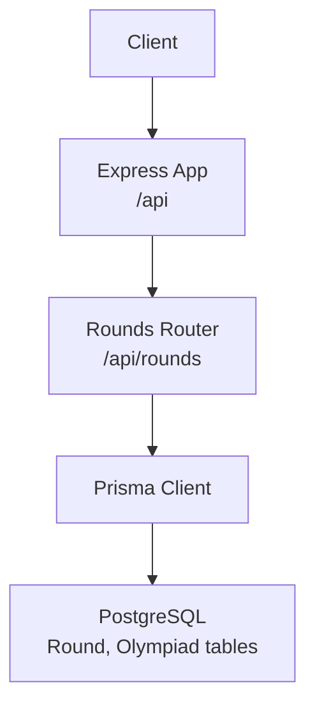
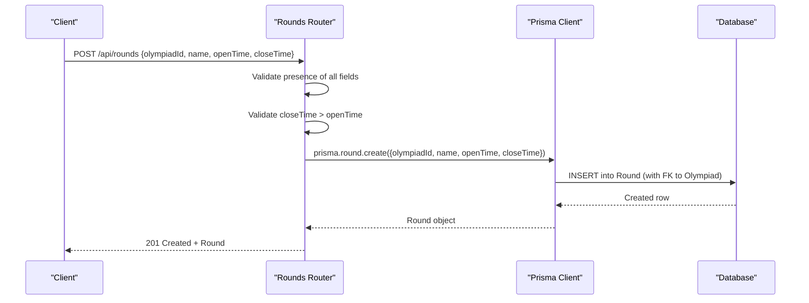
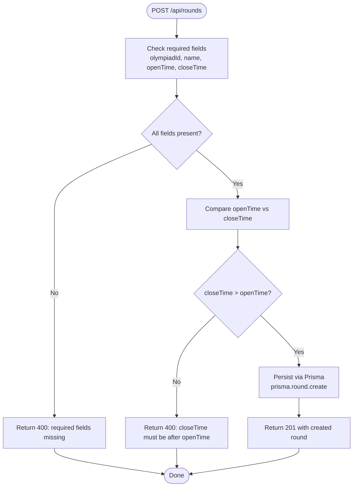
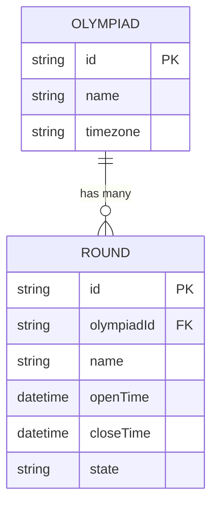
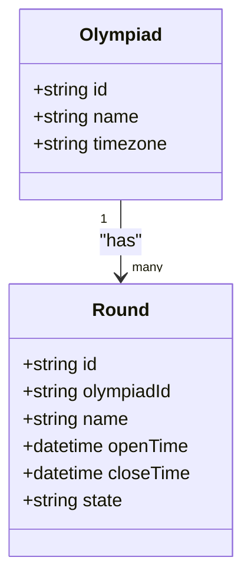
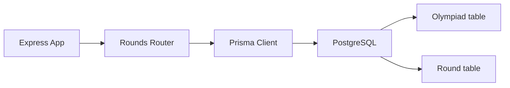

# Round Creation & Configuration

<cite>
**Referenced Files in This Document**
- [rounds.js](file://backend/src/routes/rounds.js)
- [schema.prisma](file://backend/prisma/schema.prisma)
- [migration.sql](file://backend/prisma/migrations/20260806183319_init_round_olympiad/migration.sql)
- [index.js](file://backend/src/index.js)
- [prisma.js](file://backend/src/lib/prisma.js)
- [database-schema.md](file://documents/docs/database-schema.md)
- [round-lifecycle.md](file://documents/docs/round-lifecycle.md)
- [rounds.test.js](file://backend/src/routes/rounds.test.js)
</cite>

## Table of Contents
1. Introduction
2. Project Structure
3. Core Components
4. Architecture Overview
5. Detailed Component Analysis
6. Dependency Analysis
7. Performance Considerations
8. Troubleshooting Guide
9. Conclusion
10. Appendices

## Introduction
This document explains how to create and configure rounds in the Olympiad Portal, focusing on the POST /api/rounds endpoint. It covers required fields, validation rules (including ensuring closeTime is after openTime), the relationship between rounds and olympiads via foreign keys, the database schema for the Round model (including timestamp handling and timezone policy), error handling scenarios, and best practices for setting round time windows.

## Project Structure
The backend exposes REST endpoints under /api. The rounds router defines the endpoints for creating and querying rounds. The application mounts routers under /api and uses Prisma to interact with a PostgreSQL database.

**Diagram sources**
- [index.js:29-32](file://backend/src/index.js#L29-L32)
- [rounds.js:32-51](file://backend/src/routes/rounds.js#L32-L51)
- [prisma.js:1-5](file://backend/src/lib/prisma.js#L1-L5)

**Section sources**
- [index.js:1-43](file://backend/src/index.js#L1-L43)
- [rounds.js:1-116](file://backend/src/routes/rounds.js#L1-L116)

## Core Components
- POST /api/rounds: Creates a new round associated with an existing Olympiad.
- Required request fields: olympiadId, name, openTime, closeTime.
- Validation: All four fields must be present; closeTime must be strictly after openTime.
- Response: On success, returns 201 with the created round object.
- Error responses:
  - 400 when required fields are missing or closeTime is not after openTime.
  - 500 on server-side errors (e.g., database failures).

**Section sources**
- [rounds.js:32-51](file://backend/src/routes/rounds.js#L32-L51)
- [rounds.test.js:82-128](file://backend/src/routes/rounds.test.js#L82-L128)

## Architecture Overview
The round creation flow validates input, enforces business rules, persists data through Prisma, and returns a standardized response.

**Diagram sources**
- [rounds.js:32-51](file://backend/src/routes/rounds.js#L32-L51)
- [schema.prisma:18-29](file://backend/prisma/schema.prisma#L18-L29)
- [migration.sql:11-23](file://backend/prisma/migrations/20260806183319_init_round_olympiad/migration.sql#L11-L23)

## Detailed Component Analysis

### POST /api/rounds Endpoint
- Purpose: Create a new round for a specific Olympiad.
- Request body fields:
  - olympiadId: string (required) — references an existing Olympiad.
  - name: string (required) — human-readable name for the round.
  - openTime: ISO date-time string (required) — when the round opens.
  - closeTime: ISO date-time string (required) — when the round closes.
- Validation rules:
  - All four fields must be present; otherwise return 400 with a descriptive error.
  - closeTime must be strictly after openTime; otherwise return 400 with a descriptive error.
- Success behavior:
  - Converts openTime/closeTime to Date objects before persisting.
  - Persists via Prisma and returns 201 with the created round.
- Error handling:
  - 400 for validation failures (missing fields, invalid time ordering).
  - 500 for unexpected server errors (e.g., database connectivity issues).

**Diagram sources**
- [rounds.js:32-51](file://backend/src/routes/rounds.js#L32-L51)
- [rounds.test.js:82-128](file://backend/src/routes/rounds.test.js#L82-L128)

**Section sources**
- [rounds.js:32-51](file://backend/src/routes/rounds.js#L32-L51)
- [rounds.test.js:82-128](file://backend/src/routes/rounds.test.js#L82-L128)

### Relationship Between Rounds and Olympiads
- One-to-many relationship: An Olympiad has many Rounds.
- Foreign key constraint: Round.olympiadId references Olympiad.id.
- Database-level enforcement ensures referential integrity; attempts to create a round referencing a non-existent Olympiad will fail at the database layer.

**Diagram sources**
- [schema.prisma:11-29](file://backend/prisma/schema.prisma#L11-L29)
- [migration.sql:11-23](file://backend/prisma/migrations/20260806183319_init_round_olympiad/migration.sql#L11-L23)

**Section sources**
- [schema.prisma:11-29](file://backend/prisma/schema.prisma#L11-L29)
- [migration.sql:11-23](file://backend/prisma/migrations/20260806183319_init_round_olympiad/migration.sql#L11-L23)

### Database Schema for Round Model
- Fields:
  - id: string (UUID, primary key).
  - olympiadId: string (foreign key to Olympiad.id).
  - name: string.
  - openTime: DateTime (timestamp).
  - closeTime: DateTime (timestamp).
  - state: string (default "scheduled").
- Timezone handling:
  - openTime and closeTime are stored as UTC timestamps.
  - The scheduler compares against UTC to determine state transitions.
  - Local time is only used for display; conversions happen client-side or at presentation layers.
- Data types:
  - PostgreSQL stores timestamps with millisecond precision (TIMESTAMP(3)).

**Diagram sources**
- [schema.prisma:11-29](file://backend/prisma/schema.prisma#L11-L29)
- [migration.sql:11-23](file://backend/prisma/migrations/20260806183319_init_round_olympiad/migration.sql#L11-L23)

**Section sources**
- [schema.prisma:11-29](file://backend/prisma/schema.prisma#L11-L29)
- [migration.sql:11-23](file://backend/prisma/migrations/20260806183319_init_round_olympiad/migration.sql#L11-L23)
- [round-lifecycle.md:32-38](file://documents/docs/round-lifecycle.md#L32-L38)

### Error Handling Scenarios
- Missing required fields: Returns 400 with an error message indicating which fields are required.
- Invalid time ordering: Returns 400 if closeTime is not after openTime.
- Constraint violations: If the provided olympiadId does not exist, the database foreign key constraint will reject the insert; this surfaces as a server error (500) in the current handler.
- Unexpected errors: Any unhandled exception during creation results in a 500 response.

Best practices for robust error handling:
- Normalize and validate date strings early to ensure valid ISO date-time formats.
- Return consistent error shapes with clear messages for clients.
- Consider mapping known database constraint errors to more specific 4xx codes where appropriate.

**Section sources**
- [rounds.js:32-51](file://backend/src/routes/rounds.js#L32-L51)
- [rounds.test.js:82-128](file://backend/src/routes/rounds.test.js#L82-L128)

### Best Practices for Setting Round Time Windows
- Always use UTC for openTime and closeTime to ensure consistent behavior across timezones.
- Ensure openTime is earlier than closeTime; allow a reasonable buffer for setup and teardown.
- Avoid overlapping rounds unless explicitly supported by additional constraints.
- Use ISO 8601 date-time strings (e.g., "YYYY-MM-DDTHH:mm:ssZ") for reliable parsing.
- When scheduling multiple rounds, consider staggered open/close times to avoid resource contention.

[No sources needed since this section provides general guidance]

## Dependency Analysis
The round creation flow depends on:
- Express router for HTTP routing.
- Prisma client for database access.
- PostgreSQL database enforcing schema and foreign key constraints.

**Diagram sources**
- [index.js:29-32](file://backend/src/index.js#L29-L32)
- [rounds.js:32-51](file://backend/src/routes/rounds.js#L32-L51)
- [prisma.js:1-5](file://backend/src/lib/prisma.js#L1-L5)
- [schema.prisma:11-29](file://backend/prisma/schema.prisma#L11-L29)

**Section sources**
- [index.js:1-43](file://backend/src/index.js#L1-L43)
- [rounds.js:1-116](file://backend/src/routes/rounds.js#L1-L116)
- [prisma.js:1-5](file://backend/src/lib/prisma.js#L1-L5)

## Performance Considerations
- Keep requests small and focused; only include required fields.
- Use UTC timestamps to avoid conversion overhead and reduce ambiguity.
- Indexing: The database schema already supports efficient queries by openTime; ensure indexes remain effective as data grows.
- Batch operations: For bulk round creation, consider batching at the application layer to reduce round trips.

[No sources needed since this section provides general guidance]

## Troubleshooting Guide
Common issues and resolutions:
- 400 Missing fields: Ensure olympiadId, name, openTime, and closeTime are included in the request body.
- 400 Invalid time order: Verify that closeTime is strictly after openTime.
- 404 Not found: When fetching a specific round by ID, ensure the ID exists.
- 500 Server error: Check logs for database connectivity or constraint violation errors; verify that the referenced Olympiad exists.

Validation and error behaviors are covered by tests, which assert expected status codes and error messages for these cases.

**Section sources**
- [rounds.js:32-74](file://backend/src/routes/rounds.js#L32-L74)
- [rounds.test.js:82-165](file://backend/src/routes/rounds.test.js#L82-L165)

## Conclusion
Creating rounds in the Olympiad Portal involves validating required fields, enforcing time ordering, and associating rounds with Olympiads via a foreign key. The system stores timestamps in UTC and relies on a scheduler to transition round states based on openTime and closeTime. Following the best practices outlined here will help ensure reliable, predictable round scheduling across timezones and environments.

[No sources needed since this section summarizes without analyzing specific files]

## Appendices

### API Reference: POST /api/rounds
- Path: /api/rounds
- Method: POST
- Content-Type: application/json
- Request body:
  - olympiadId: string (required)
  - name: string (required)
  - openTime: string (ISO date-time, required)
  - closeTime: string (ISO date-time, required)
- Success response: 201 Created with the created round object.
- Error responses:
  - 400 Bad Request: Missing fields or closeTime not after openTime.
  - 500 Internal Server Error: Database or server errors.

Example request payload structure:
- { "olympiadId": "<uuid>", "name": "<string>", "openTime": "<ISO datetime>", "closeTime": "<ISO datetime>" }

Example success response:
- { "id": "<uuid>", "olympiadId": "<uuid>", "name": "<string>", "openTime": "<UTC datetime>", "closeTime": "<UTC datetime>", "state": "scheduled" }

**Section sources**
- [rounds.js:32-51](file://backend/src/routes/rounds.js#L32-L51)
- [rounds.test.js:82-128](file://backend/src/routes/rounds.test.js#L82-L128)

### Database Schema Summary: Round
- Primary key: id (UUID)
- Foreign key: olympiadId → Olympiad.id
- Timestamps: openTime, closeTime (stored as UTC)
- Default state: scheduled

**Section sources**
- [schema.prisma:18-29](file://backend/prisma/schema.prisma#L18-L29)
- [migration.sql:11-23](file://backend/prisma/migrations/20260806183319_init_round_olympiad/migration.sql#L11-L23)
- [database-schema.md:87-117](file://documents/docs/database-schema.md#L87-L117)

### Timezone Policy
- All timestamps are stored and compared in UTC.
- Display conversions should be handled client-side or at the presentation layer.

**Section sources**
- [round-lifecycle.md:32-38](file://documents/docs/round-lifecycle.md#L32-L38)