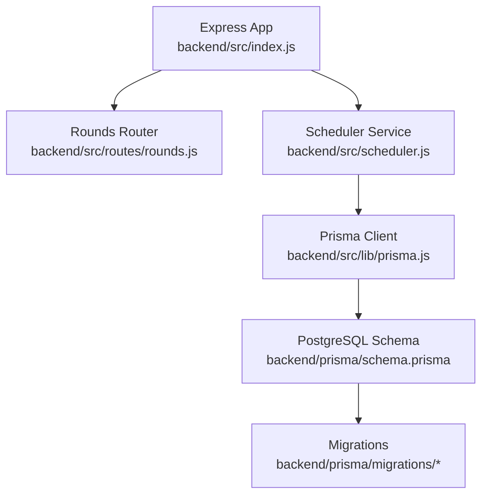
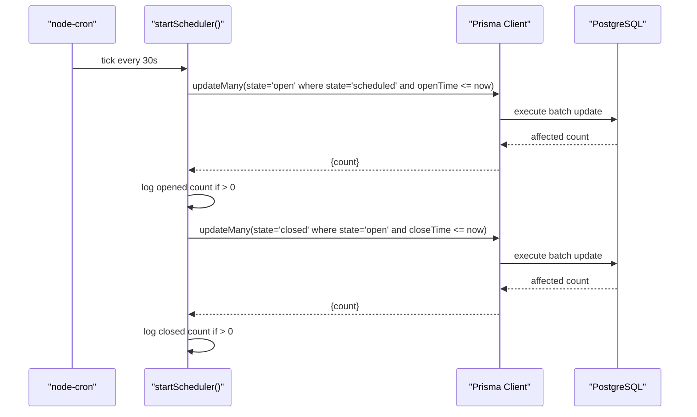
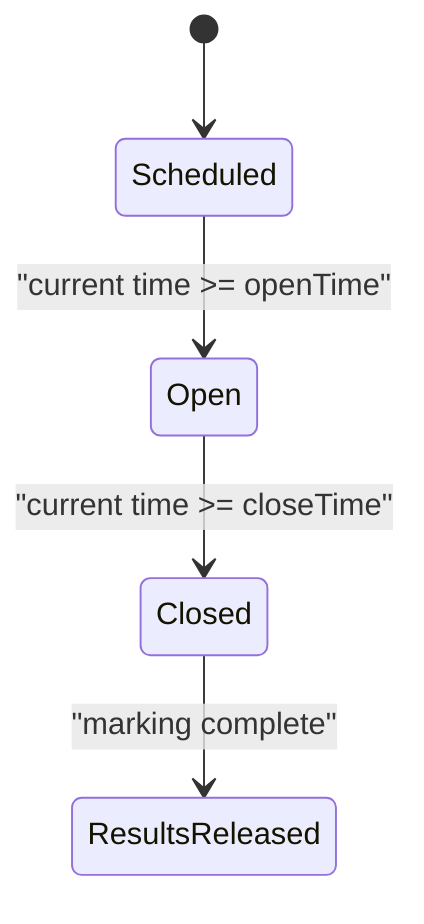
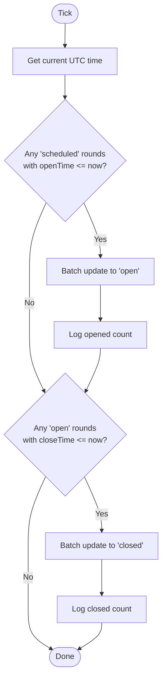
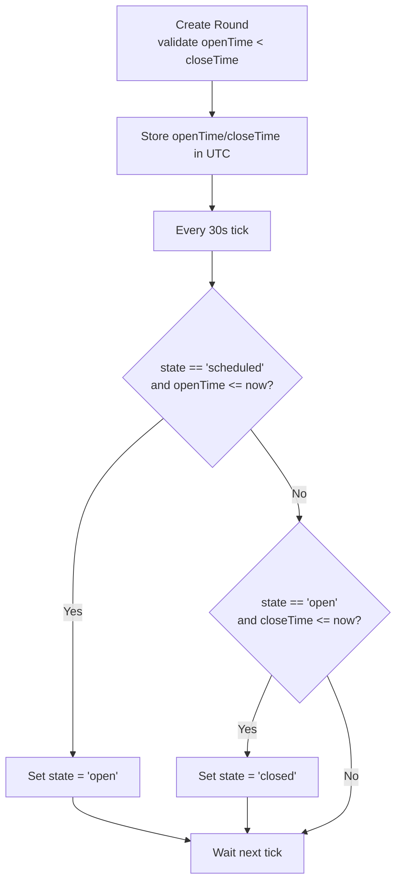
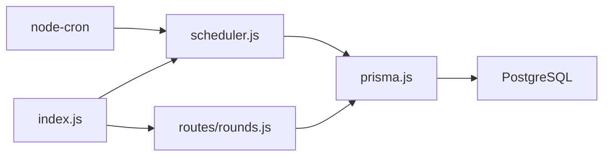

# Round Lifecycle & State Machine

<cite>
**Referenced Files in This Document**
- [scheduler.js](file://backend/src/scheduler.js)
- [index.js](file://backend/src/index.js)
- [rounds.js](file://backend/src/routes/rounds.js)
- [schema.prisma](file://backend/prisma/schema.prisma)
- [migration.sql (init_round_olympiad)](file://backend/prisma/migrations/20260806183319_init_round_olympiad/migration.sql)
- [migration.sql (add_remaining_tables)](file://backend/prisma/migrations/20260806192201_add_remaining_tables/migration.sql)
- [round-lifecycle.md](file://documents/docs/round-lifecycle.md)
- [scheduler.test.js](file://backend/src/scheduler.test.js)
- [rounds.test.js](file://backend/src/routes/rounds.test.js)
</cite>

## Table of Contents
1. Introduction
2. Project Structure
3. Core Components
4. Architecture Overview
5. Detailed Component Analysis
6. Dependency Analysis
7. Performance Considerations
8. Troubleshooting Guide
9. Conclusion

## Introduction
This document explains the round lifecycle state machine in the Olympiad Portal. It covers the four states—scheduled, open, closed, and results released—and details how automatic time-based transitions occur via a scheduler service. It also documents database schema updates during transitions, timezone handling, edge cases like clock skew, cron expressions used for scheduling, and error handling strategies for failed state transitions.

## Project Structure
The round lifecycle spans several backend modules:
- Scheduler service that runs on a fixed interval to update round states based on current time
- API routes that create rounds with openTime and closeTime and expose round data
- Database schema defining the Round model and related entities
- Documentation describing the lifecycle and design decisions

**Diagram sources**
- [index.js:1-43](file://backend/src/index.js#L1-L43)
- [scheduler.js:1-29](file://backend/src/scheduler.js#L1-L29)
- [rounds.js:1-116](file://backend/src/routes/rounds.js#L1-L116)
- [schema.prisma:11-29](file://backend/prisma/schema.prisma#L11-L29)
- [migration.sql (init_round_olympiad):11-20](file://backend/prisma/migrations/20260806183319_init_round_olympiad/migration.sql#L11-L20)

**Section sources**
- [index.js:1-43](file://backend/src/index.js#L1-L43)
- [scheduler.js:1-29](file://backend/src/scheduler.js#L1-L29)
- [rounds.js:1-116](file://backend/src/routes/rounds.js#L1-L116)
- [schema.prisma:11-29](file://backend/prisma/schema.prisma#L11-L29)
- [migration.sql (init_round_olympiad):11-20](file://backend/prisma/migrations/20260806183319_init_round_olympiad/migration.sql#L11-L20)

## Core Components
- Round state machine: The Round model stores state and time boundaries. The default state is scheduled; transitions are driven by time comparisons.
- Scheduler service: Uses node-cron to run every 30 seconds, opening rounds whose openTime has passed and closing rounds whose closeTime has passed.
- API layer: Creates rounds with validated openTime and closeTime; exposes round queries used by clients and other services.
- Database schema: Defines Round fields including state, openTime, closeTime, and relationships to Paper, Submission, and Result.

Key responsibilities:
- Validate inputs when creating rounds (e.g., closeTime must be after openTime)
- Persist times as UTC timestamps
- Automatically transition states without manual intervention
- Log transitions for observability

**Section sources**
- [schema.prisma:18-29](file://backend/prisma/schema.prisma#L18-L29)
- [scheduler.js:4-26](file://backend/src/scheduler.js#L4-L26)
- [rounds.js:32-51](file://backend/src/routes/rounds.js#L32-L51)
- [round-lifecycle.md:9-30](file://documents/docs/round-lifecycle.md#L9-L30)

## Architecture Overview
The system uses a polling-based scheduler to enforce round state transitions at precise moments defined by stored timestamps. The Express app starts the scheduler upon boot. The scheduler compares the current UTC time against each round’s openTime and closeTime to update state accordingly.

**Diagram sources**
- [scheduler.js:4-26](file://backend/src/scheduler.js#L4-L26)
- [index.js:34-39](file://backend/src/index.js#L34-L39)

**Section sources**
- [scheduler.js:4-26](file://backend/src/scheduler.js#L4-L26)
- [index.js:34-39](file://backend/src/index.js#L34-L39)

## Detailed Component Analysis

### Round Lifecycle States and Transitions
- Scheduled: Round exists with paper attached but not visible or accepting submissions yet.
- Open: openTime has passed; paper downloadable and submissions accepted.
- Closed: closeTime has passed; no new submissions accepted; marking finalises.
- Results released: Scores published to schools once marking is complete.

Automatic transitions:
- From scheduled to open when current time >= openTime
- From open to closed when current time >= closeTime
- From closed to results released when marking completes and scores are published

**Diagram sources**
- [round-lifecycle.md:11-21](file://documents/docs/round-lifecycle.md#L11-L21)

**Section sources**
- [round-lifecycle.md:9-30](file://documents/docs/round-lifecycle.md#L9-L30)

### Scheduler Service Implementation
- Scheduling expression: Runs every second using a cron expression that ticks every 30 seconds.
- Transition logic:
  - Opens all rounds in scheduled state where openTime is less than or equal to now
  - Closes all rounds in open state where closeTime is less than or equal to now
- Observability: Logs counts of opened/closed rounds per tick

**Diagram sources**
- [scheduler.js:4-26](file://backend/src/scheduler.js#L4-L26)

**Section sources**
- [scheduler.js:4-26](file://backend/src/scheduler.js#L4-L26)
- [scheduler.test.js:32-110](file://backend/src/scheduler.test.js#L32-L110)

### Business Logic for Time-Based Transitions
- Opening condition: For rounds in scheduled state, if openTime <= now, transition to open
- Closing condition: For rounds in open state, if closeTime <= now, transition to closed
- Validation on creation: Ensures closeTime is after openTime to prevent invalid intervals

**Diagram sources**
- [scheduler.js:4-26](file://backend/src/scheduler.js#L4-L26)
- [rounds.js:32-51](file://backend/src/routes/rounds.js#L32-L51)

**Section sources**
- [scheduler.js:4-26](file://backend/src/scheduler.js#L4-L26)
- [rounds.js:32-51](file://backend/src/routes/rounds.js#L32-L51)
- [rounds.test.js:82-127](file://backend/src/routes/rounds.test.js#L82-L127)

### Database Schema Updates During State Transitions
- Round.state field: Defaults to scheduled; updated by scheduler to open or closed
- Round.openTime and Round.closeTime: Stored as DateTime (UTC); used for transition checks
- Result.releasedAt: Nullable timestamp indicating when scores are published; remains empty until results are released

Schema highlights:
- Round model includes state, openTime, closeTime, and relations to Paper, Submission, and RoundEntrant
- Result model includes score and releasedAt to track publication timing

**Section sources**
- [schema.prisma:18-29](file://backend/prisma/schema.prisma#L18-L29)
- [schema.prisma:91-97](file://backend/prisma/schema.prisma#L91-L97)
- [migration.sql (init_round_olympiad):11-20](file://backend/prisma/migrations/20260806183319_init_round_olympiad/migration.sql#L11-L20)
- [migration.sql (add_remaining_tables):65-72](file://backend/prisma/migrations/20260806192201_add_remaining_tables/migration.sql#L65-L72)

### Timezone Handling and Edge Cases
- All timestamps are stored and compared in UTC to ensure consistency across timezones
- Local time is only used for display; conversion happens at presentation layer
- Clock skew tolerance: Polling every 30 seconds introduces up to a 30-second delay between actual open/close instant and state update; acceptable for project scale

Best practices:
- Always pass openTime and closeTime in UTC when creating rounds
- Avoid relying on local time for business logic
- Monitor logs for opened/closed counts to verify timely transitions

**Section sources**
- [round-lifecycle.md:32-41](file://documents/docs/round-lifecycle.md#L32-L41)
- [scheduler.js:4-26](file://backend/src/scheduler.js#L4-L26)

### Cron Expressions Used for Scheduling
- Expression: Every second pattern configured to trigger every 30 seconds
- Purpose: Ensures frequent checks for openTime and closeTime thresholds

Note: The implementation uses a single cron schedule that executes a callback every 30 seconds.

**Section sources**
- [scheduler.js:4-6](file://backend/src/scheduler.js#L4-L6)

### Error Handling Strategies for Failed State Transitions
- Scheduler does not wrap transitions in try/catch; any unhandled errors will propagate to the Node runtime
- Logging: Only successful transition counts are logged; failures may not be captured unless caught upstream
- Recommendations:
  - Wrap scheduler operations in try/catch blocks to capture and log database errors
  - Implement retry logic for transient failures
  - Add structured logging with context (round IDs, timestamps, error messages)
  - Introduce health checks to detect stuck schedulers

Current behavior:
- If Prisma calls fail, exceptions bubble up; no explicit error responses or retries are implemented in the scheduler

**Section sources**
- [scheduler.js:4-26](file://backend/src/scheduler.js#L4-L26)
- [scheduler.test.js:32-110](file://backend/src/scheduler.test.js#L32-L110)

## Dependency Analysis
The scheduler depends on node-cron and Prisma client to interact with the database. The Express app initializes the scheduler on startup. Routes depend on Prisma for CRUD operations.

**Diagram sources**
- [index.js:1-43](file://backend/src/index.js#L1-L43)
- [scheduler.js:1-29](file://backend/src/scheduler.js#L1-L29)
- [rounds.js:1-116](file://backend/src/routes/rounds.js#L1-L116)

**Section sources**
- [index.js:1-43](file://backend/src/index.js#L1-L43)
- [scheduler.js:1-29](file://backend/src/scheduler.js#L1-L29)
- [rounds.js:1-116](file://backend/src/routes/rounds.js#L1-L116)

## Performance Considerations
- Polling frequency: Every 30 seconds balances responsiveness and load; suitable for current scale
- Batch updates: Using updateMany reduces database round trips and improves throughput
- Indexes: Ensure indexes on Round.state, Round.openTime, and Round.closeTime for efficient queries
- Monitoring: Track scheduler execution time and error rates to identify bottlenecks

[No sources needed since this section provides general guidance]

## Troubleshooting Guide
Common issues and resolutions:
- Rounds not opening/closing:
  - Verify openTime and closeTime are set correctly in UTC
  - Check scheduler logs for opened/closed counts
  - Confirm cron expression is active and running
- Timezone mismatches:
  - Ensure input times are converted to UTC before storage
  - Display times should convert from UTC to user timezone at presentation layer
- Errors during transitions:
  - Add try/catch around scheduler operations to capture and log errors
  - Investigate database connectivity and query performance
  - Consider implementing retries for transient failures

Validation checks:
- Creation validation ensures closeTime is after openTime
- Tests cover expected behaviors for opening and closing rounds

**Section sources**
- [rounds.js:32-51](file://backend/src/routes/rounds.js#L32-L51)
- [rounds.test.js:82-127](file://backend/src/routes/rounds.test.js#L82-L127)
- [scheduler.test.js:32-110](file://backend/src/scheduler.test.js#L32-L110)

## Conclusion
The round lifecycle state machine in the Olympiad Portal provides a robust, time-driven mechanism for managing round states. The scheduler service uses node-cron to poll every 30 seconds and automatically transitions rounds from scheduled to open and open to closed based on stored UTC timestamps. The database schema supports these transitions with clear state fields and time boundaries. While the current implementation is simple and effective, adding error handling, retry logic, and monitoring would enhance reliability. Timezone consistency is maintained by storing and comparing all times in UTC, ensuring predictable behavior across different regions.

[No sources needed since this section summarizes without analyzing specific files]