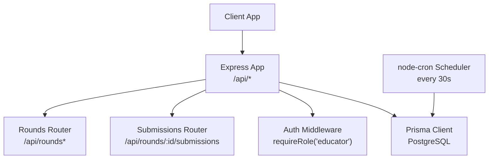
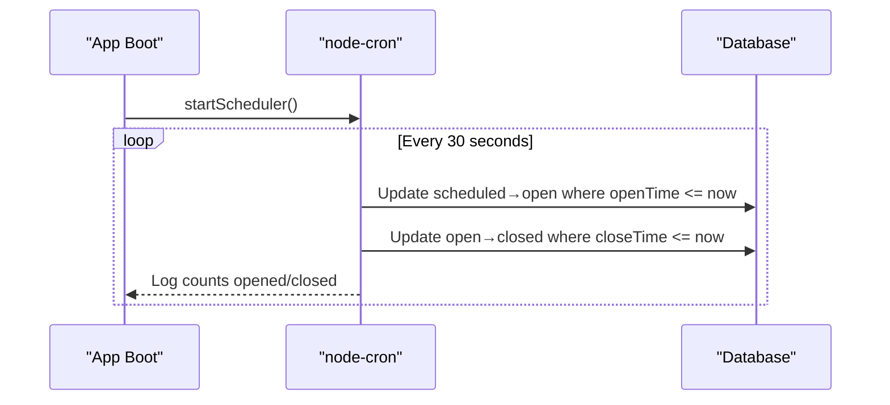
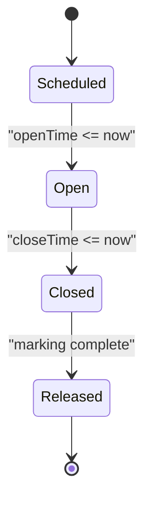
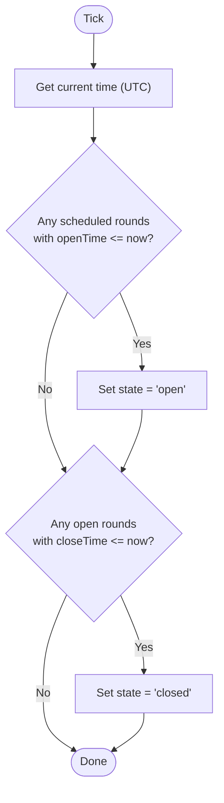
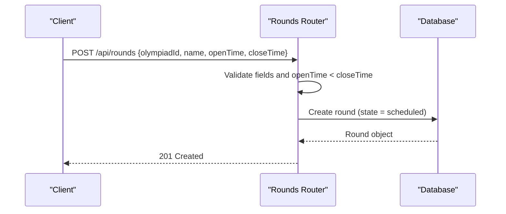
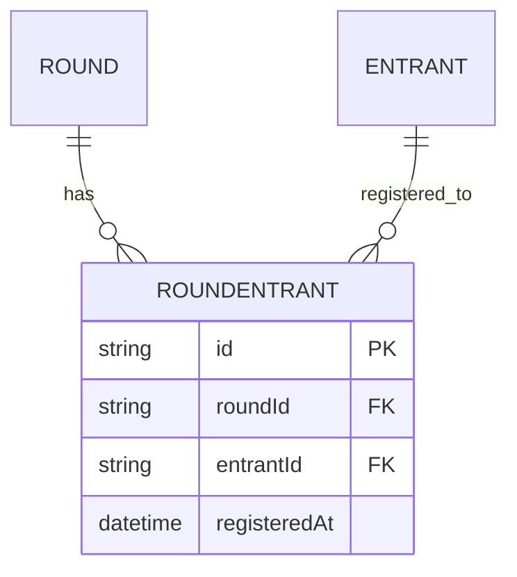
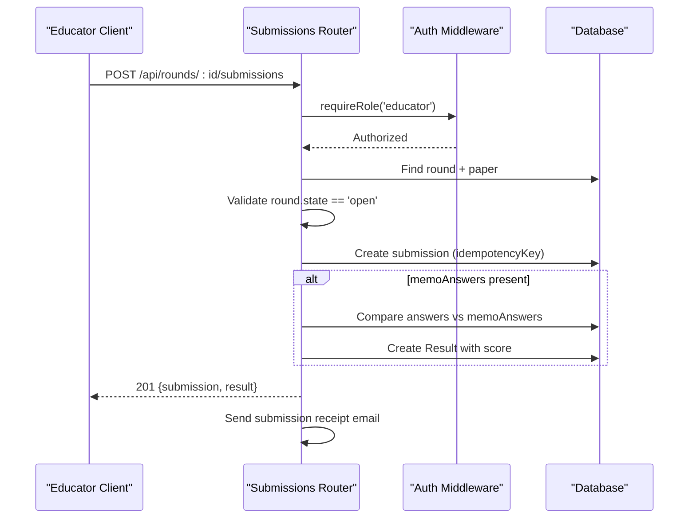
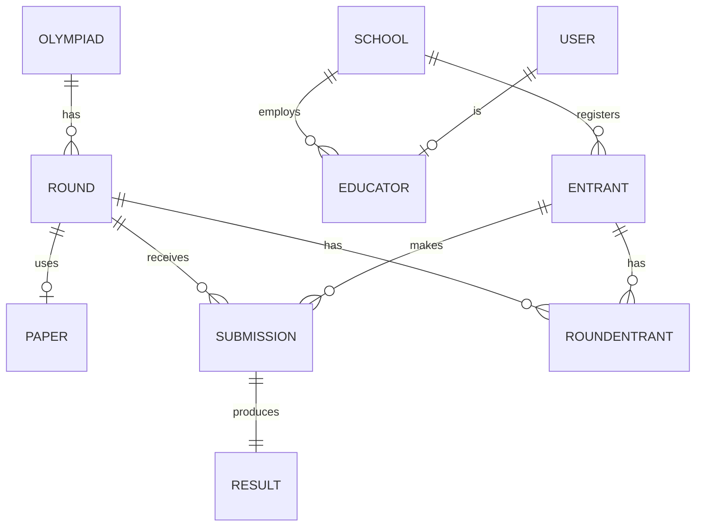
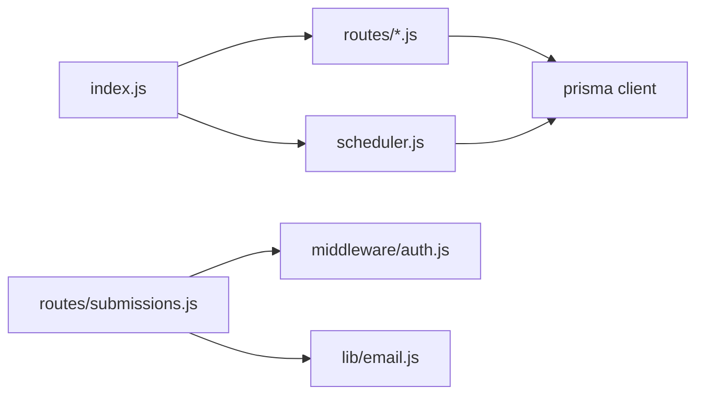

# Round Management System

<cite>
**Referenced Files in This Document**
- [index.js](file://backend/src/index.js)
- [scheduler.js](file://backend/src/scheduler.js)
- [rounds.js](file://backend/src/routes/rounds.js)
- [submissions.js](file://backend/src/routes/submissions.js)
- [auth.js](file://backend/src/middleware/auth.js)
- [schema.prisma](file://backend/prisma/schema.prisma)
- [migration.sql](file://backend/prisma/migrations/20260815093922_add_round_entrant/migration.sql)
- [round-lifecycle.md](file://documents/docs/round-lifecycle.md)
- [database-schema.md](file://documents/docs/database-schema.md)
</cite>

## Table of Contents
1. [Introduction](#introduction)
2. [Project Structure](#project-structure)
3. [Core Components](#core-components)
4. [Architecture Overview](#architecture-overview)
5. [Detailed Component Analysis](#detailed-component-analysis)
6. [Dependency Analysis](#dependency-analysis)
7. [Performance Considerations](#performance-considerations)
8. [Troubleshooting Guide](#troubleshooting-guide)
9. [Conclusion](#conclusion)
10. [Appendices](#appendices)

## Introduction
This document explains the round management system for the Olympiad Portal. It covers the complete round lifecycle state machine (scheduled, open, closed, results released), the background scheduler that drives automatic time-based transitions, round creation and enrollment flows, API endpoints for rounds and participants, database schema details, error handling, and monitoring considerations.

## Project Structure
The backend is an Express application that:
- Mounts routers under /api for rounds, submissions, papers, and auth.
- Starts a node-cron scheduler on boot to transition round states based on openTime and closeTime.
- Persists data via Prisma with PostgreSQL.

**Diagram sources**
- [index.js:29-32](file://backend/src/index.js#L29-L32)
- [scheduler.js:4-26](file://backend/src/scheduler.js#L4-L26)

**Section sources**
- [index.js:1-43](file://backend/src/index.js#L1-L43)

## Core Components
- Round lifecycle state machine: scheduled → open → closed → results released.
- Background scheduler using node-cron to update round states automatically.
- REST APIs for creating and querying rounds, listing entrants and submissions, and accepting submissions.
- Database models for Olympiad, Round, Paper, Submission, Result, School, Educator, Entrant, and RoundEntrant.

Key responsibilities:
- Scheduler: polls every 30 seconds and updates round state based on current time.
- Routes: validate inputs, enforce business rules (e.g., closeTime after openTime), and persist changes.
- Submissions: accept only when round is open; optionally automark if memo answers are present; send receipt email.
- Auth middleware: protects submission endpoint with role-based access.

**Section sources**
- [scheduler.js:4-26](file://backend/src/scheduler.js#L4-L26)
- [rounds.js:32-113](file://backend/src/routes/rounds.js#L32-L113)
- [submissions.js:9-86](file://backend/src/routes/submissions.js#L9-L86)
- [auth.js:5-32](file://backend/src/middleware/auth.js#L5-L32)
- [schema.prisma:11-108](file://backend/prisma/schema.prisma#L11-L108)

## Architecture Overview
The system uses a polling-based scheduler to manage round states. The Express app mounts routers and starts the scheduler at boot. All time comparisons use UTC.

**Diagram sources**
- [index.js:34-39](file://backend/src/index.js#L34-L39)
- [scheduler.js:4-26](file://backend/src/scheduler.js#L4-L26)

## Detailed Component Analysis

### Round Lifecycle State Machine
- States:
  - Scheduled: round exists with paper attached but not visible or accepting submissions.
  - Open: openTime reached; paper downloadable; submissions accepted.
  - Closed: closeTime reached; no new submissions; marking finalizes.
  - Results released: scores published to schools after marking completes.
- Transitions:
  - Automatic via scheduler comparing current time to openTime/closeTime.
  - No manual button press required to move between states.
- Timezone policy:
  - All timestamps stored and compared in UTC.

**Diagram sources**
- [round-lifecycle.md:11-21](file://documents/docs/round-lifecycle.md#L11-L21)
- [scheduler.js:8-22](file://backend/src/scheduler.js#L8-L22)

**Section sources**
- [round-lifecycle.md:1-41](file://documents/docs/round-lifecycle.md#L1-L41)
- [scheduler.js:4-26](file://backend/src/scheduler.js#L4-L26)

### Scheduler Service (node-cron)
- Runs every 30 seconds.
- Opens rounds: updates state from scheduled to open when openTime has passed.
- Closes rounds: updates state from open to closed when closeTime has passed.
- Logs counts of opened/closed rounds per tick.

**Diagram sources**
- [scheduler.js:4-26](file://backend/src/scheduler.js#L4-L26)

**Section sources**
- [scheduler.js:4-26](file://backend/src/scheduler.js#L4-L26)
- [scheduler.test.js:43-96](file://backend/src/scheduler.test.js#L43-L96)

### Round Creation and Time Window Management
- Create round:
  - Requires olympiadId, name, openTime, closeTime.
  - Validates that closeTime is after openTime.
  - Persists round with default state scheduled.
- Query rounds:
  - List all rounds ordered by openTime.
  - Get single round by id.
  - List rounds for an olympiad.
- Error handling:
  - Returns 400 for validation errors.
  - Returns 404 if round not found.
  - Returns 500 on database errors.

**Diagram sources**
- [rounds.js:32-51](file://backend/src/routes/rounds.js#L32-L51)

**Section sources**
- [rounds.js:32-74](file://backend/src/routes/rounds.js#L32-L74)
- [rounds.test.js:82-127](file://backend/src/routes/rounds.test.js#L82-L127)

### Participant Enrollment and Management
- RoundEntrant model links entrants to specific rounds with a unique constraint on (roundId, entrantId).
- API to list entrants for a round returns associated Entrant records.
- Enrollment flow:
  - Enrollments are managed through RoundEntrant entries.
  - Educators can see only entrants registered for the round they are submitting results for.

**Diagram sources**
- [schema.prisma:59-67](file://backend/prisma/schema.prisma#L59-L67)
- [schema.prisma:99-108](file://backend/prisma/schema.prisma#L99-L108)
- [migration.sql:1-19](file://backend/prisma/migrations/20260815093922_add_round_entrant/migration.sql#L1-L19)

**Section sources**
- [rounds.js:89-99](file://backend/src/routes/rounds.js#L89-L99)
- [schema.prisma:99-108](file://backend/prisma/schema.prisma#L99-L108)
- [migration.sql:1-19](file://backend/prisma/migrations/20260815093922_add_round_entrant/migration.sql#L1-L19)

### Submission Flow and Automarking
- Endpoint: POST /api/rounds/:id/submissions
- Protected by requireRole('educator').
- Validation:
  - Requires entrantId, answers, idempotencyKey.
  - Round must exist and be in open state.
- Processing:
  - Creates submission record with idempotencyKey.
  - If round.paper.memoAnswers exists, automarks by comparing answers to memo and creates Result with score.
  - Sends submission receipt email to requester.
- Idempotency:
  - Duplicate idempotencyKey returns existing submission and result without error.

**Diagram sources**
- [submissions.js:9-86](file://backend/src/routes/submissions.js#L9-L86)
- [auth.js:22-32](file://backend/src/middleware/auth.js#L22-L32)

**Section sources**
- [submissions.js:9-86](file://backend/src/routes/submissions.js#L9-L86)
- [auth.js:5-32](file://backend/src/middleware/auth.js#L5-L32)

### API Endpoints Summary
- Rounds
  - POST /api/rounds — create round
  - GET /api/rounds — list rounds
  - GET /api/rounds/:id — get round
  - GET /api/olympiads/:id/rounds — list rounds by olympiad
  - GET /api/rounds/:id/entrants — list entrants for round
  - GET /api/rounds/:id/submissions — list submissions for round
- Submissions
  - POST /api/rounds/:id/submissions — submit answers (requires educator role)
- Olympiads
  - POST /api/olympiads — create olympiad
  - GET /api/olympiads — list olympiads

Notes:
- All routes are mounted under /api.
- Authentication and authorization are enforced via middleware for protected endpoints.

**Section sources**
- [rounds.js:6-113](file://backend/src/routes/rounds.js#L6-L113)
- [submissions.js:9-86](file://backend/src/routes/submissions.js#L9-L86)
- [index.js:29-32](file://backend/src/index.js#L29-L32)

### Database Schema Overview
- Core entities: Olympiad, Round, Paper, Submission, Result, School, Educator, Entrant, RoundEntrant.
- Relationships:
  - Olympiad has many Rounds.
  - Round has one Paper (optional), many Submissions, many RoundEntrants.
  - Entrant has many Submissions and many RoundEntrants.
  - Submission has one Result.
  - School has many Educators and Entrants.
  - User links to Educator.

**Diagram sources**
- [database-schema.md:9-85](file://documents/docs/database-schema.md#L9-L85)
- [schema.prisma:11-108](file://backend/prisma/schema.prisma#L11-L108)

**Section sources**
- [database-schema.md:1-117](file://documents/docs/database-schema.md#L1-L117)
- [schema.prisma:11-108](file://backend/prisma/schema.prisma#L11-L108)

## Dependency Analysis
- Express app mounts routers and starts scheduler.
- Scheduler depends on node-cron and Prisma client.
- Submissions depend on auth middleware and email service.
- Rounds depend on Prisma client for CRUD operations.

**Diagram sources**
- [index.js:8-12](file://backend/src/index.js#L8-L12)
- [scheduler.js:1-2](file://backend/src/scheduler.js#L1-L2)
- [submissions.js:1-4](file://backend/src/routes/submissions.js#L1-L4)

**Section sources**
- [index.js:1-43](file://backend/src/index.js#L1-L43)
- [scheduler.js:1-29](file://backend/src/scheduler.js#L1-L29)
- [submissions.js:1-89](file://backend/src/routes/submissions.js#L1-L89)

## Performance Considerations
- Polling interval: 30 seconds balances simplicity and latency; acceptable for project scale.
- Batch updates: Scheduler uses updateMany to minimize database writes.
- Idempotency: Submission endpoint prevents duplicate processing via unique idempotencyKey.
- Automarking: Immediate scoring reduces downstream processing load when memo answers are available.

[No sources needed since this section provides general guidance]

## Troubleshooting Guide
Common issues and resolutions:
- Round does not open/close:
  - Verify openTime/closeTime are set correctly and in UTC.
  - Check scheduler logs for “Opened/Closed” messages indicating transitions.
- Submission rejected:
  - Ensure round state is open.
  - Confirm educator role and valid payload (entrantId, answers, idempotencyKey).
- Duplicate submission:
  - Use idempotencyKey; server will return existing submission on conflict.
- Database errors:
  - Inspect console logs for stack traces; check Prisma connection and constraints.

Monitoring capabilities:
- Scheduler logs counts of opened/closed rounds per tick.
- Application logs errors from route handlers and submission processing.

**Section sources**
- [scheduler.js:12-22](file://backend/src/scheduler.js#L12-L22)
- [submissions.js:75-85](file://backend/src/routes/submissions.js#L75-L85)
- [rounds.js:47-73](file://backend/src/routes/rounds.js#L47-L73)

## Conclusion
The round management system implements a robust, time-driven state machine with clear boundaries between scheduled, open, closed, and results released phases. The scheduler ensures automatic transitions, while APIs provide comprehensive control over rounds, participants, and submissions. The schema supports multi-round participation and precise tracking of enrollments and results. With idempotent submissions and automated marking, the system scales well for typical olympiad workflows.

[No sources needed since this section summarizes without analyzing specific files]

## Appendices

### API Reference Details
- Rounds
  - POST /api/rounds
    - Body: olympiadId, name, openTime, closeTime
    - Success: 201 Created
    - Errors: 400 (validation), 500 (server error)
  - GET /api/rounds
    - Success: 200 OK (list)
  - GET /api/rounds/:id
    - Success: 200 OK (single)
    - Errors: 404 (not found)
  - GET /api/olympiads/:id/rounds
    - Success: 200 OK (filtered list)
  - GET /api/rounds/:id/entrants
    - Success: 200 OK (entrant list)
  - GET /api/rounds/:id/submissions
    - Success: 200 OK (submission list)
- Submissions
  - POST /api/rounds/:id/submissions
    - Headers: cookie with JWT token
    - Body: entrantId, answers, idempotencyKey
    - Success: 201 Created
    - Errors: 400 (validation), 403 (not open or unauthorized), 404 (round not found), 500 (server error)
- Olympiads
  - POST /api/olympiads
    - Body: name, timezone
    - Success: 201 Created
  - GET /api/olympiads
    - Success: 200 OK (list)

**Section sources**
- [rounds.js:6-113](file://backend/src/routes/rounds.js#L6-L113)
- [submissions.js:9-86](file://backend/src/routes/submissions.js#L9-L86)