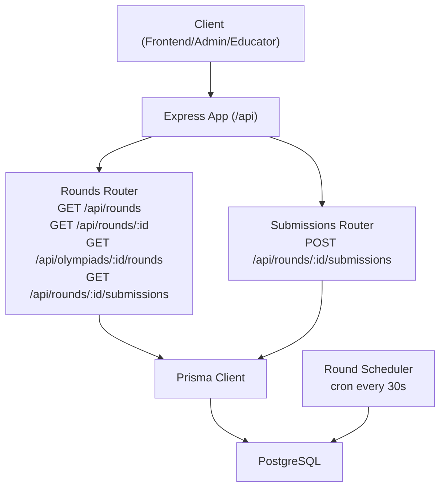
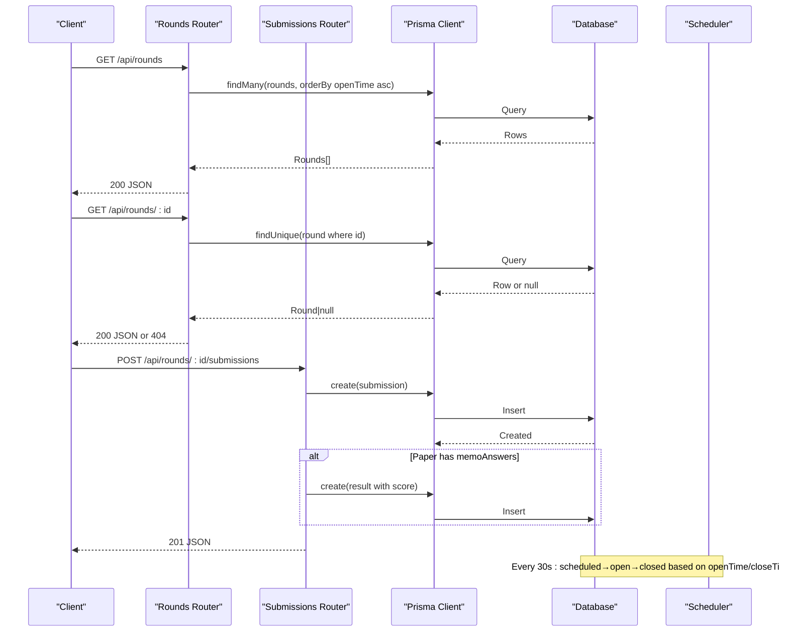
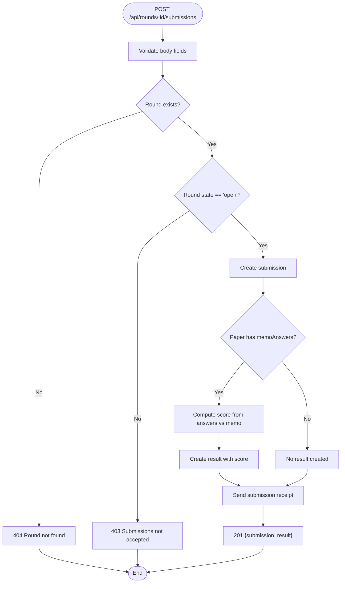
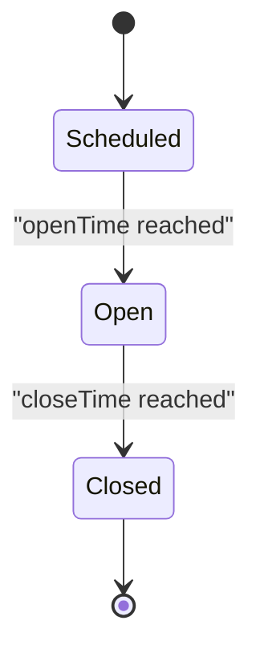
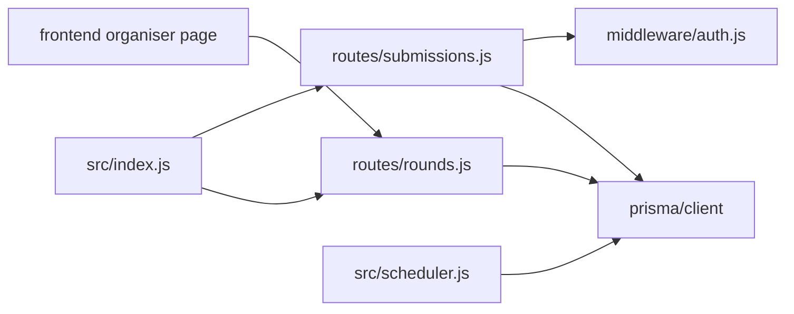

# Round Monitoring & Status APIs

<cite>
**Referenced Files in This Document**
- [rounds.js](file://backend/src/routes/rounds.js)
- [submissions.js](file://backend/src/routes/submissions.js)
- [auth.js](file://backend/src/middleware/auth.js)
- [index.js](file://backend/src/index.js)
- [schema.prisma](file://backend/prisma/schema.prisma)
- [scheduler.js](file://backend/src/scheduler.js)
- [api-reference.md](file://documents/docs/api-reference.md)
- [organiser page.js](file://frontend/src/app/organiser/page.js)
</cite>

## Table of Contents
1. [Introduction](#introduction)
2. [Project Structure](#project-structure)
3. [Core Components](#core-components)
4. [Architecture Overview](#architecture-overview)
5. [Detailed Component Analysis](#detailed-component-analysis)
6. [Dependency Analysis](#dependency-analysis)
7. [Performance Considerations](#performance-considerations)
8. [Troubleshooting Guide](#troubleshooting-guide)
9. [Conclusion](#conclusion)
10. [Appendices](#appendices)

## Introduction
This document provides detailed documentation for round monitoring and status retrieval APIs in the Olympiad Portal. It focuses on:
- Listing all rounds with sorting and filtering capabilities
- Retrieving a specific round’s details, including current state and timing information
- Fetching all rounds associated with a specific olympiad
- Monitoring round participation and progress via submissions
It also covers response schemas, error handling, pagination strategies for large datasets, and examples of monitoring dashboards and real-time status updates for administrators and educators.

## Project Structure
The backend exposes REST endpoints under /api grouped by feature:
- Rounds and Olympiads: routes/rounds.js
- Submissions: routes/submissions.js
- Authentication middleware: middleware/auth.js
- Application bootstrap and route mounting: index.js
- Data model definitions: prisma/schema.prisma
- Automated round lifecycle transitions: scheduler.js
- API reference documentation: documents/docs/api-reference.md
- Frontend organiser dashboard consuming these APIs: frontend/src/app/organiser/page.js

**Diagram sources**
- [index.js:29-32](file://backend/src/index.js#L29-L32)
- [rounds.js:53-113](file://backend/src/routes/rounds.js#L53-L113)
- [submissions.js:8-86](file://backend/src/routes/submissions.js#L8-L86)
- [scheduler.js:4-26](file://backend/src/scheduler.js#L4-L26)

**Section sources**
- [index.js:29-32](file://backend/src/index.js#L29-L32)
- [api-reference.md:140-233](file://documents/docs/api-reference.md#L140-L233)

## Core Components
- Rounds listing and lookup: GET /api/rounds, GET /api/rounds/:id
- Olympiad-scoped rounds: GET /api/olympiads/:id/rounds
- Submission tracking: GET /api/rounds/:id/submissions
- Submission creation (for context): POST /api/rounds/:id/submissions
- Round lifecycle automation: scheduler transitions scheduled → open → closed based on openTime/closeTime

Key data models involved:
- Round: id, name, openTime, closeTime, state, paper relation
- Submission: id, roundId, entrantId, answers, submittedAt, result relation
- Result: id, submissionId, score, releasedAt
- Olympiad: id, name, timezone

**Section sources**
- [schema.prisma:11-29](file://backend/prisma/schema.prisma#L11-L29)
- [schema.prisma:79-97](file://backend/prisma/schema.prisma#L79-L97)
- [scheduler.js:4-26](file://backend/src/scheduler.js#L4-L26)

## Architecture Overview
The API is implemented with Express routers mounted under /api. The rounds router handles listing and detail endpoints; the submissions router handles creating submissions and includes automarking when applicable. A background scheduler runs every 30 seconds to transition round states based on timestamps.

**Diagram sources**
- [rounds.js:53-74](file://backend/src/routes/rounds.js#L53-L74)
- [rounds.js:76-87](file://backend/src/routes/rounds.js#L76-L87)
- [submissions.js:8-86](file://backend/src/routes/submissions.js#L8-L86)
- [scheduler.js:4-26](file://backend/src/scheduler.js#L4-L26)

## Detailed Component Analysis

### GET /api/rounds — List all rounds
- Purpose: Retrieve all rounds across all olympiads.
- Sorting: Ordered by openTime ascending.
- Filtering: Not currently supported via query parameters.
- Response: Array of round objects.
- Errors: 500 on server errors.

Implementation highlights:
- Uses Prisma findMany with orderBy openTime asc.
- No authentication required.

Example usage:
- Admin dashboard lists upcoming rounds sorted chronologically.

**Section sources**
- [rounds.js:53-63](file://backend/src/routes/rounds.js#L53-L63)
- [api-reference.md:213-217](file://documents/docs/api-reference.md#L213-L217)

### GET /api/rounds/:id — Retrieve a specific round
- Purpose: Get details for a single round by ID.
- Includes: Basic round fields and related paper if present.
- State and timing: Returns state (scheduled/open/closed), openTime, closeTime.
- Errors: 404 if not found; 500 on server errors.

Implementation highlights:
- Uses Prisma findUnique by id.
- No authentication required.

Dashboard use cases:
- Show current state and countdown/timer relative to openTime/closeTime.
- Display whether paper is available based on state.

**Section sources**
- [rounds.js:65-74](file://backend/src/routes/rounds.js#L65-L74)
- [api-reference.md:220-226](file://documents/docs/api-reference.md#L220-L226)
- [schema.prisma:18-29](file://backend/prisma/schema.prisma#L18-L29)

### GET /api/olympiads/:id/rounds — Rounds for an olympiad
- Purpose: Retrieve all rounds belonging to a specific olympiad.
- Sorting: Ordered by openTime ascending.
- Response: Array of round objects.
- Errors: 500 on server errors.

Implementation highlights:
- Filters by olympiadId using Prisma findMany.
- No authentication required.

Dashboard use cases:
- Organiser view per olympiad showing chronological rounds.

**Section sources**
- [rounds.js:76-87](file://backend/src/routes/rounds.js#L76-L87)
- [api-reference.md:229-233](file://documents/docs/api-reference.md#L229-L233)

### GET /api/rounds/:id/submissions — Monitor participation and progress
- Purpose: Retrieve all submissions for a round, including results when available.
- Includes: Related result object (score).
- Response: Array of submission objects with optional result.
- Errors: 500 on server errors.

Implementation highlights:
- Uses Prisma findMany with include result.
- No authentication required.

Dashboard use cases:
- Track number of submissions per round.
- Compute completion rates and average scores.
- Identify late or missing submissions.

**Section sources**
- [rounds.js:102-113](file://backend/src/routes/rounds.js#L102-L113)
- [schema.prisma:79-97](file://backend/prisma/schema.prisma#L79-L97)

### Submission creation flow (context)
- Endpoint: POST /api/rounds/:id/submissions
- Auth: Requires educator role.
- Validation: Checks round existence and that round.state is open.
- Automarking: If paper.memoAnswers exists, computes score and creates result immediately.
- Idempotency: Duplicate idempotencyKey returns existing submission/result with 200.
- Email receipt: Sends confirmation email to submitting educator.

**Diagram sources**
- [submissions.js:8-86](file://backend/src/routes/submissions.js#L8-L86)
- [auth.js:22-32](file://backend/src/middleware/auth.js#L22-L32)

**Section sources**
- [submissions.js:8-86](file://backend/src/routes/submissions.js#L8-L86)
- [auth.js:22-32](file://backend/src/middleware/auth.js#L22-L32)
- [api-reference.md:100-138](file://documents/docs/api-reference.md#L100-L138)

### Round lifecycle and state management
- States: scheduled, open, closed.
- Transitions:
  - scheduled → open when now >= openTime
  - open → closed when now >= closeTime
- Frequency: Every 30 seconds via cron.

**Diagram sources**
- [scheduler.js:4-26](file://backend/src/scheduler.js#L4-L26)
- [schema.prisma:18-29](file://backend/prisma/schema.prisma#L18-L29)

**Section sources**
- [scheduler.js:4-26](file://backend/src/scheduler.js#L4-L26)

## Dependency Analysis
- Routes depend on Prisma client for data access.
- Submissions endpoint depends on auth middleware for role enforcement.
- Scheduler depends on Prisma to update round states.
- Frontend consumes /api/rounds and other endpoints to build dashboards.

**Diagram sources**
- [index.js:29-32](file://backend/src/index.js#L29-L32)
- [rounds.js:1-3](file://backend/src/routes/rounds.js#L1-L3)
- [submissions.js:1-4](file://backend/src/routes/submissions.js#L1-L4)
- [scheduler.js:1-3](file://backend/src/scheduler.js#L1-L3)
- [organiser page.js:1-10](file://frontend/src/app/organiser/page.js#L1-L10)

**Section sources**
- [index.js:29-32](file://backend/src/index.js#L29-L32)
- [rounds.js:1-3](file://backend/src/routes/rounds.js#L1-L3)
- [submissions.js:1-4](file://backend/src/routes/submissions.js#L1-L4)
- [scheduler.js:1-3](file://backend/src/scheduler.js#L1-L3)
- [organiser page.js:1-10](file://frontend/src/app/organiser/page.js#L1-L10)

## Performance Considerations
- Current endpoints return full datasets without pagination. For large numbers of rounds or submissions:
  - Add query parameters for page and pageSize (e.g., ?page=1&pageSize=50).
  - Use database-level pagination (skip/take) to limit result sets.
  - Consider indexing frequently filtered fields such as round.state, round.openTime, round.closeTime, and submission.roundId.
- Avoid N+1 queries by leveraging Prisma relations and includes judiciously.
- Cache read-heavy endpoints (e.g., list rounds) at the application layer or CDN for short-lived TTLs during live events.
- Offload heavy computations (e.g., scoring) to background jobs if automarking becomes complex.

[No sources needed since this section provides general guidance]

## Troubleshooting Guide
Common issues and resolutions:
- 404 Round not found: Ensure the provided round ID exists; verify routing and parameter parsing.
- 403 Submissions not accepted: Round must be in open state; check scheduler logs and timestamps.
- 401/403 Authentication/Authorization: Ensure valid JWT cookie/token and correct role for protected endpoints.
- 500 Server errors: Inspect server logs for database connectivity or constraint violations.

Monitoring tips:
- Use GET /api/rounds/:id to inspect current state and timing.
- Use GET /api/rounds/:id/submissions to track participation and compute completion metrics.
- Review scheduler logs to confirm timely state transitions.

**Section sources**
- [rounds.js:65-74](file://backend/src/routes/rounds.js#L65-L74)
- [submissions.js:17-30](file://backend/src/routes/submissions.js#L17-L30)
- [auth.js:5-20](file://backend/src/middleware/auth.js#L5-L20)
- [scheduler.js:4-26](file://backend/src/scheduler.js#L4-L26)

## Conclusion
The Olympiad Portal provides robust APIs for round monitoring and status retrieval:
- List and filter rounds (currently sorted by openTime)
- Retrieve individual round details including state and timing
- Access olympiad-specific rounds
- Monitor participation through submissions and results
Automated scheduling ensures accurate state transitions, while the frontend organisor dashboard demonstrates practical consumption of these APIs. Future enhancements should add pagination, advanced filtering, and caching to support large-scale operations.

[No sources needed since this section summarizes without analyzing specific files]

## Appendices

### API Endpoints Summary
- GET /api/rounds
  - Description: Lists all rounds, ordered by openTime ascending.
  - Response: Array of round objects.
  - Errors: 500 on server errors.
- GET /api/rounds/:id
  - Description: Retrieves a specific round by ID.
  - Response: Single round object.
  - Errors: 404 if not found; 500 on server errors.
- GET /api/olympiads/:id/rounds
  - Description: Lists rounds for a specific olympiad, ordered by openTime ascending.
  - Response: Array of round objects.
  - Errors: 500 on server errors.
- GET /api/rounds/:id/submissions
  - Description: Lists all submissions for a round, including results when available.
  - Response: Array of submission objects with optional result.
  - Errors: 500 on server errors.

**Section sources**
- [rounds.js:53-113](file://backend/src/routes/rounds.js#L53-L113)
- [api-reference.md:213-233](file://documents/docs/api-reference.md#L213-L233)

### Example Dashboard Scenarios
- Organiser console:
  - Fetches all rounds via GET /api/rounds to display upcoming and active rounds.
  - Uses GET /api/rounds/:id to show detailed timing and state for each round.
  - Optionally filters by olympiad using GET /api/olympiads/:id/rounds.
- Real-time status:
  - Poll GET /api/rounds/:id periodically to reflect state changes (scheduled → open → closed).
  - Use GET /api/rounds/:id/submissions to update participation metrics and average scores.

**Section sources**
- [organiser page.js:15-31](file://frontend/src/app/organiser/page.js#L15-L31)
- [scheduler.js:4-26](file://backend/src/scheduler.js#L4-L26)