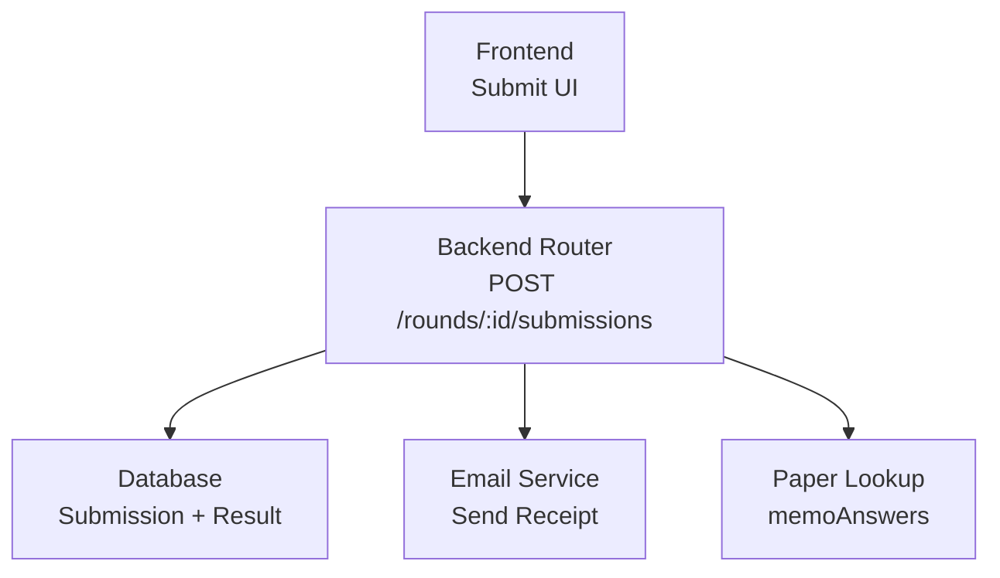
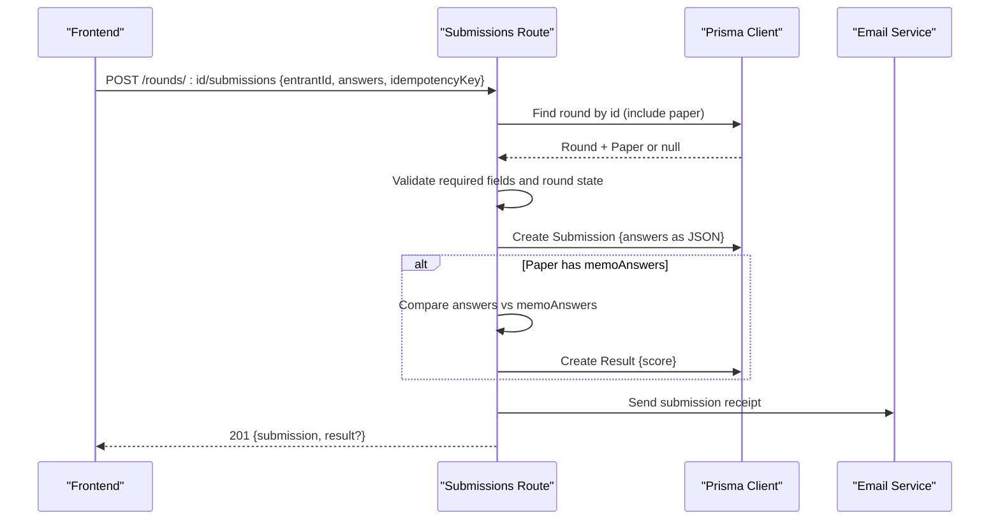
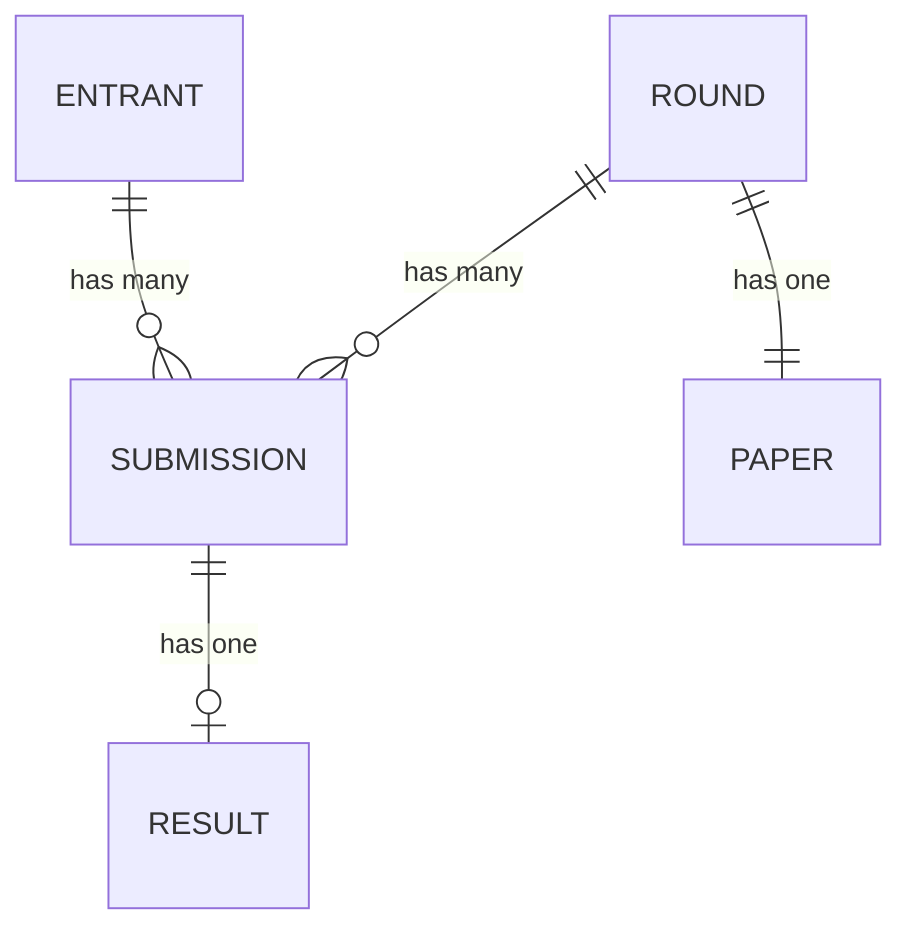
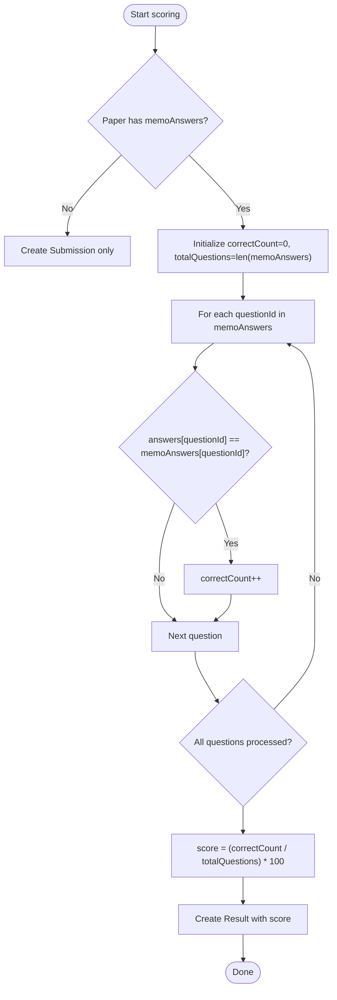
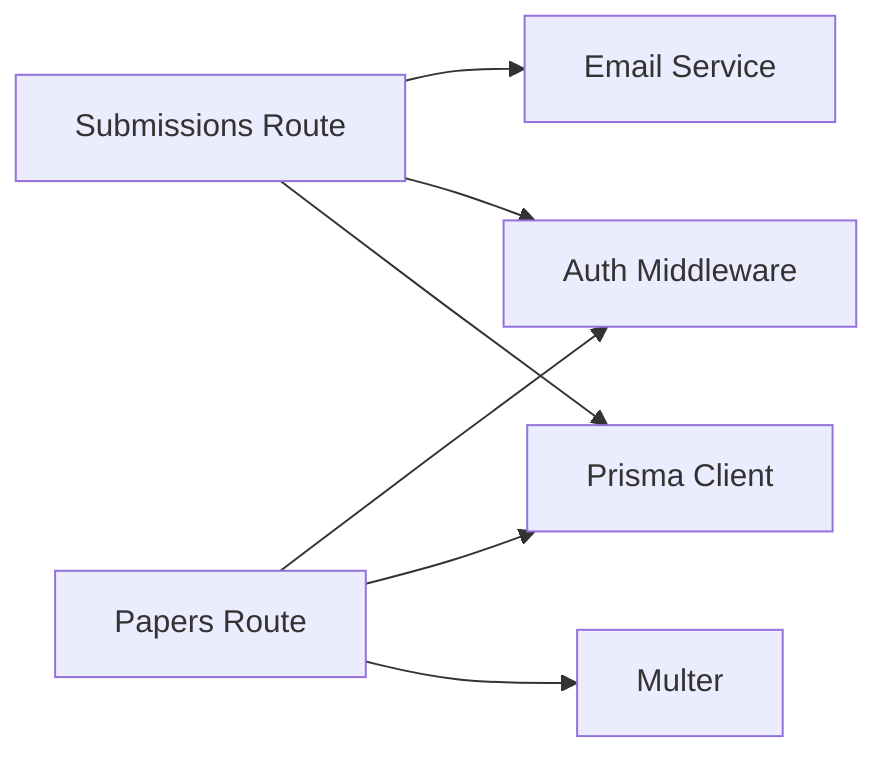

# Answer Validation

<cite>
**Referenced Files in This Document**
- [submissions.js](file://backend/src/routes/submissions.js)
- [papers.js](file://backend/src/routes/papers.js)
- [schema.prisma](file://backend/prisma/schema.prisma)
- [migration.sql](file://backend/prisma/migrations/20260811072329_add_memo_answers_to_paper/migration.sql)
- [email.js](file://backend/src/lib/email.js)
- [api.js](file://frontend/src/lib/api.js)
- [page.js (paper upload)](file://frontend/src/app/rounds/[id]/papers/page.js)
- [page.js (educator submit)](file://frontend/src/app/educator/submit/page.js)
- [submissions.test.js](file://backend/src/routes/submissions.test.js)
</cite>

## Table of Contents
1. Introduction
2. Project Structure
3. Core Components
4. Architecture Overview
5. Detailed Component Analysis
6. Dependency Analysis
7. Performance Considerations
8. Troubleshooting Guide
9. Conclusion

## Introduction
This document explains how answers are validated, processed, stored, and scored when a submission is received by the system. It covers:
- The structure of the answers object and how it maps to questions in the associated paper
- Validation rules for required fields, data types, and answer format
- How answers are persisted and related to submissions and results
- Integration with memo answer keys for automated scoring
- Examples of valid and invalid payloads and why they fail
- Performance considerations for large payloads and concurrent submissions

## Project Structure
The submission flow spans frontend UI, backend routes, database schema, and optional email notifications. Key areas:
- Frontend builds and sends the answers payload and handles errors
- Backend validates inputs, persists the submission, optionally scores it using memo answer keys, and returns a result
- Database stores answers as JSON and links them to round and entrant
- Email notification is sent after successful submission

**Diagram sources**
- [submissions.js:8-85](file://backend/src/routes/submissions.js#L8-L85)
- [papers.js:70-96](file://backend/src/routes/papers.js#L70-L96)
- [email.js:5-20](file://backend/src/lib/email.js#L5-L20)
- [api.js:78-112](file://frontend/src/lib/api.js#L78-L112)

**Section sources**
- [submissions.js:8-85](file://backend/src/routes/submissions.js#L8-L85)
- [papers.js:25-67](file://backend/src/routes/papers.js#L25-L67)
- [schema.prisma:69-97](file://backend/prisma/schema.prisma#L69-L97)
- [email.js:5-20](file://backend/src/lib/email.js#L5-L20)
- [api.js:78-112](file://frontend/src/lib/api.js#L78-L112)

## Core Components
- Submission endpoint: POST /rounds/:id/submissions
  - Validates presence of required fields
  - Checks round existence and state
  - Persists submission with answers JSON
  - Optionally automarks using memo answer keys
  - Sends receipt email
- Paper management: POST /rounds/:id/papers
  - Accepts paper and memo files plus memoAnswers JSON
  - Stores memoAnswers on the Paper record for later automarking
- Database models: Submission, Result, Paper, Round, Entrant
  - Answers stored as JSON
  - Results store computed score per submission
  - Paper.memoAnswers holds the answer key used for scoring

**Section sources**
- [submissions.js:8-85](file://backend/src/routes/submissions.js#L8-L85)
- [papers.js:25-67](file://backend/src/routes/papers.js#L25-L67)
- [schema.prisma:69-97](file://backend/prisma/schema.prisma#L69-L97)

## Architecture Overview
The end-to-end flow for a submission:

**Diagram sources**
- [submissions.js:8-85](file://backend/src/routes/submissions.js#L8-L85)
- [email.js:5-20](file://backend/src/lib/email.js#L5-L20)

## Detailed Component Analysis

### Answers Object Structure and Mapping
- Shape: A plain object keyed by question identifiers, with string values representing the selected option(s).
- Question keys: Typically numeric strings like "1", "2", etc., matching the question numbers in the paper.
- Values: Uppercase single-letter options such as "A", "B", "C", "D".
- Mapping to paper: The keys correspond to question numbers; the values are compared against memoAnswers from the Paper record for that round.

Evidence in code:
- Frontend constructs memoAnswers with question keys and uppercase values before upload.
- Submission handler compares answers[questionId] with memoAnswers[questionId].

**Section sources**
- [page.js (paper upload):59-66](file://frontend/src/app/rounds/[id]/papers/page.js#L59-L66)
- [submissions.js:40-51](file://backend/src/routes/submissions.js#L40-L51)

### Validation Rules
Required request fields:
- entrantId: string, must be present
- answers: object, must be present
- idempotencyKey: string, must be present

Round validation:
- Round must exist
- Round state must be "open"

Answer format expectations:
- answers is an object where each key is a question identifier (string)
- Each value is a string representing the chosen option (e.g., "A")
- No explicit server-side type enforcement beyond presence checks; correctness relies on client formatting and memoAnswers alignment

Idempotency:
- Duplicate idempotencyKey returns the existing submission without creating a new one

Error responses:
- 400 when required fields are missing
- 404 when round not found
- 403 when round is not open
- 200 with existing submission on idempotency conflict
- 500 on unexpected errors

**Section sources**
- [submissions.js:11-30](file://backend/src/routes/submissions.js#L11-L30)
- [submissions.js:75-85](file://backend/src/routes/submissions.js#L75-L85)
- [submissions.test.js:47-79](file://backend/src/routes/submissions.test.js#L47-L79)

### Storage and Relationships
- Submission.answers: JSON column storing the answers object
- Submission.roundId: FK to Round
- Submission.entrantId: FK to Entrant
- Submission.idempotencyKey: unique constraint ensures idempotent submissions
- Result.score: Float percentage derived from memoAnswers comparison
- Paper.memoAnswers: JSON column storing the answer key used for scoring

**Diagram sources**
- [schema.prisma:69-97](file://backend/prisma/schema.prisma#L69-L97)

**Section sources**
- [schema.prisma:69-97](file://backend/prisma/schema.prisma#L69-L97)

### Automated Scoring with Memo Answer Keys
Scoring logic:
- If the round’s Paper has memoAnswers, the system iterates over memo keys
- For each questionId, if answers[questionId] equals memoAnswers[questionId], increment correct count
- Score = (correctCount / totalQuestions) * 100
- Creates a Result linked to the Submission with the computed score

Edge cases:
- If there are no memo answers, no Result is created
- If all answers are wrong, score is 0%
- If some answers are missing, only provided answers are considered against memoAnswers

**Diagram sources**
- [submissions.js:40-58](file://backend/src/routes/submissions.js#L40-L58)

**Section sources**
- [submissions.js:40-58](file://backend/src/routes/submissions.js#L40-L58)

### Example Payloads and Validation Outcomes
Valid payload:
- Contains entrantId, answers object with question keys mapped to uppercase option strings, and a unique idempotencyKey
- Round exists and is open
- Outcome: Submission created; if memoAnswers exist, Result created with percentage score

Invalid payloads and reasons:
- Missing required field (e.g., answers or idempotencyKey): 400 error indicating required fields
- Round not found: 404 error
- Round not open: 403 error stating current round state
- Duplicate idempotencyKey: 200 returning the existing submission and its result
- Unexpected server error: 500 with generic message

Note on answer format:
- While the server does not enforce strict answer formats beyond presence checks, best practice is to send uppercase single-letter options aligned with memoAnswers keys.

**Section sources**
- [submissions.test.js:47-79](file://backend/src/routes/submissions.test.js#L47-L79)
- [submissions.test.js:108-157](file://backend/src/routes/submissions.test.js#L108-L157)
- [submissions.test.js:159-186](file://backend/src/routes/submissions.test.js#L159-L186)

### Frontend Behavior and Data Preparation
- Paper upload page constructs memoAnswers from user-entered rows, trimming whitespace and uppercasing answers
- Educator submit page reads CSV-like input, building per-entrant answers objects with uppercase trimmed values
- API client wraps requests and throws ApiError for non-2xx responses

These behaviors ensure consistent answer formatting before sending to the backend.

**Section sources**
- [page.js (paper upload):59-66](file://frontend/src/app/rounds/[id]/papers/page.js#L59-L66)
- [page.js (educator submit):174-183](file://frontend/src/app/educator/submit/page.js#L174-L183)
- [api.js:78-112](file://frontend/src/lib/api.js#L78-L112)

## Dependency Analysis
- Submissions route depends on:
  - Prisma client for Round, Submission, Result, User, Entrant queries
  - Auth middleware for role enforcement
  - Email service for receipts
- Paper route depends on:
  - Multer for file uploads
  - Prisma client for Paper creation
  - Role middleware for organiser-only access

**Diagram sources**
- [submissions.js:1-4](file://backend/src/routes/submissions.js#L1-L4)
- [papers.js:1-8](file://backend/src/routes/papers.js#L1-L8)

**Section sources**
- [submissions.js:1-4](file://backend/src/routes/submissions.js#L1-L4)
- [papers.js:1-8](file://backend/src/routes/papers.js#L1-L8)

## Performance Considerations
- Large answer payloads:
  - answers is stored as JSON; keep payloads reasonably sized to avoid large database writes and network overhead
  - Prefer minimal, well-formed objects with only necessary question keys
- Concurrent submissions:
  - IdempotencyKey prevents duplicate submissions under contention
  - Unique constraint on idempotencyKey ensures safe retries
- Automarking complexity:
  - Linear scan over memoAnswers keys; performance scales with number of questions
  - Avoid excessively large memoAnswers sets; consider batching or chunking if needed
- Email side effects:
  - Sending receipts is asynchronous in effect; failures are logged but do not block submission success
- File uploads:
  - Paper and memo files are stored on disk; ensure adequate storage and consider size limits at the application layer

[No sources needed since this section provides general guidance]

## Troubleshooting Guide
Common issues and resolutions:
- 400 Missing required fields: Ensure entrantId, answers, and idempotencyKey are included
- 404 Round not found: Verify the round ID and that the round exists
- 403 Round not open: Wait until the round state is "open"
- 200 with existing submission: Indicates duplicate idempotencyKey; use a different key or handle idempotently
- 500 Could not save submission: Check logs for underlying errors; retry with a new idempotencyKey
- Invalid memoAnswers JSON during paper upload: Ensure memoAnswers is valid JSON before sending

Relevant paths:
- Submission validation and error handling
- Paper upload memoAnswers parsing
- Email receipt logging

**Section sources**
- [submissions.js:11-30](file://backend/src/routes/submissions.js#L11-L30)
- [submissions.js:75-85](file://backend/src/routes/submissions.js#L75-L85)
- [papers.js:43-50](file://backend/src/routes/papers.js#L43-L50)
- [email.js:14-19](file://backend/src/lib/email.js#L14-L19)

## Conclusion
The submission system validates required fields, enforces round state, stores answers as JSON, and optionally automarks using memo answer keys to compute a percentage score. Idempotency keys protect against duplicates, and emails provide confirmation. For robust operation with large payloads and concurrency, rely on idempotency, keep payloads concise, and monitor automarking complexity. Properly formatted answers aligned with memoAnswers ensure accurate scoring.