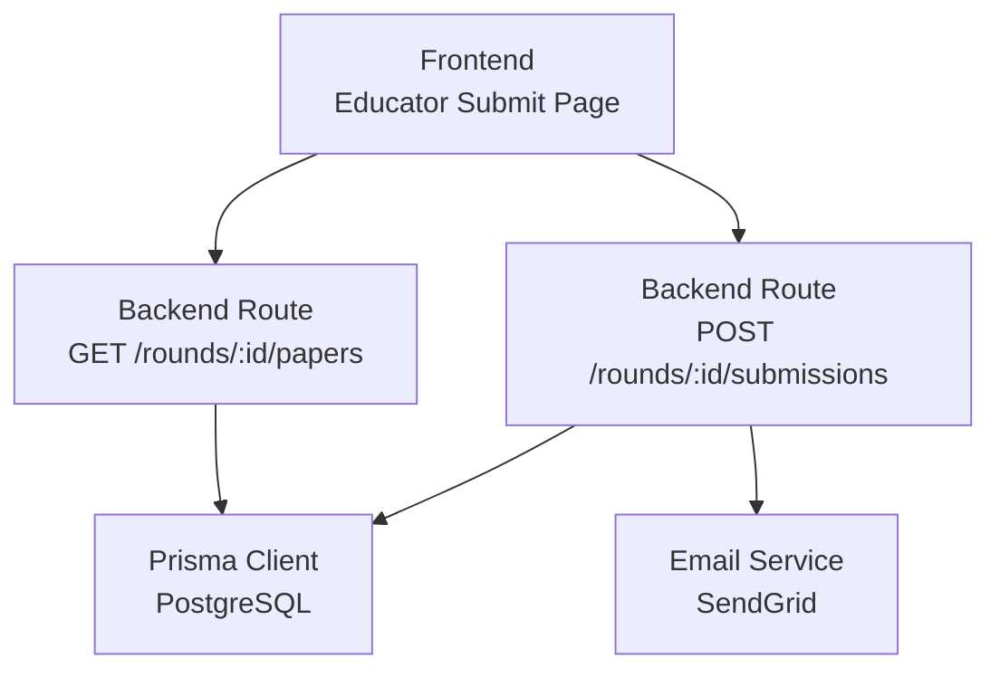
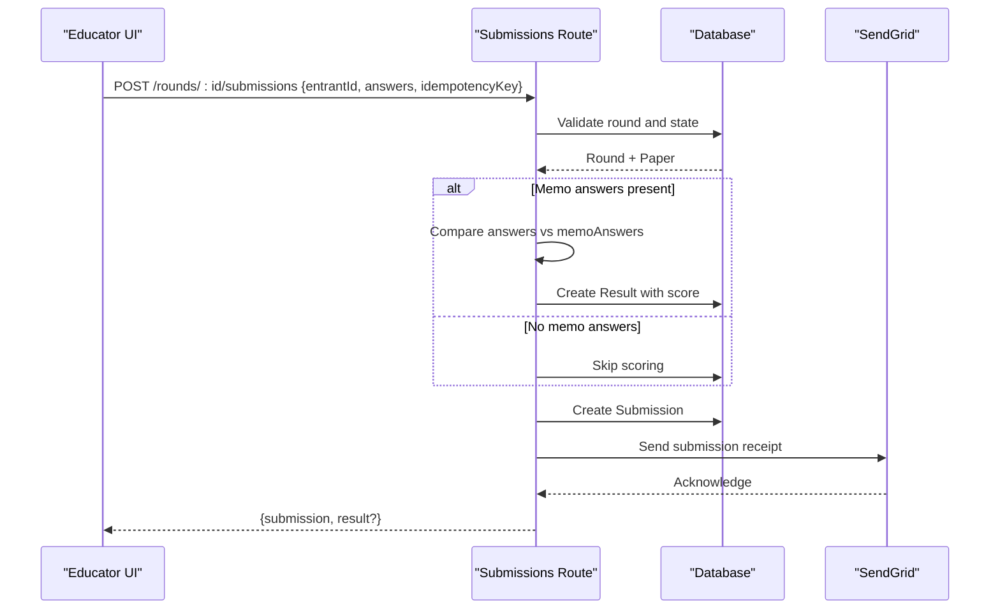
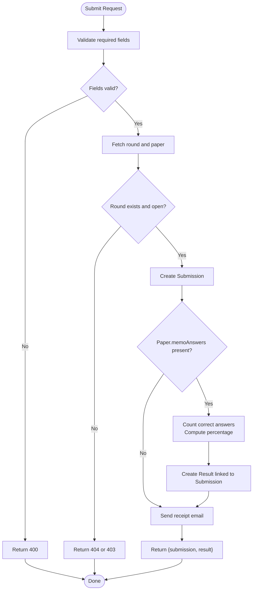
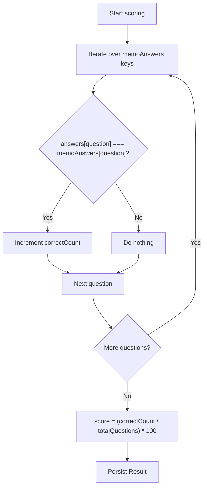
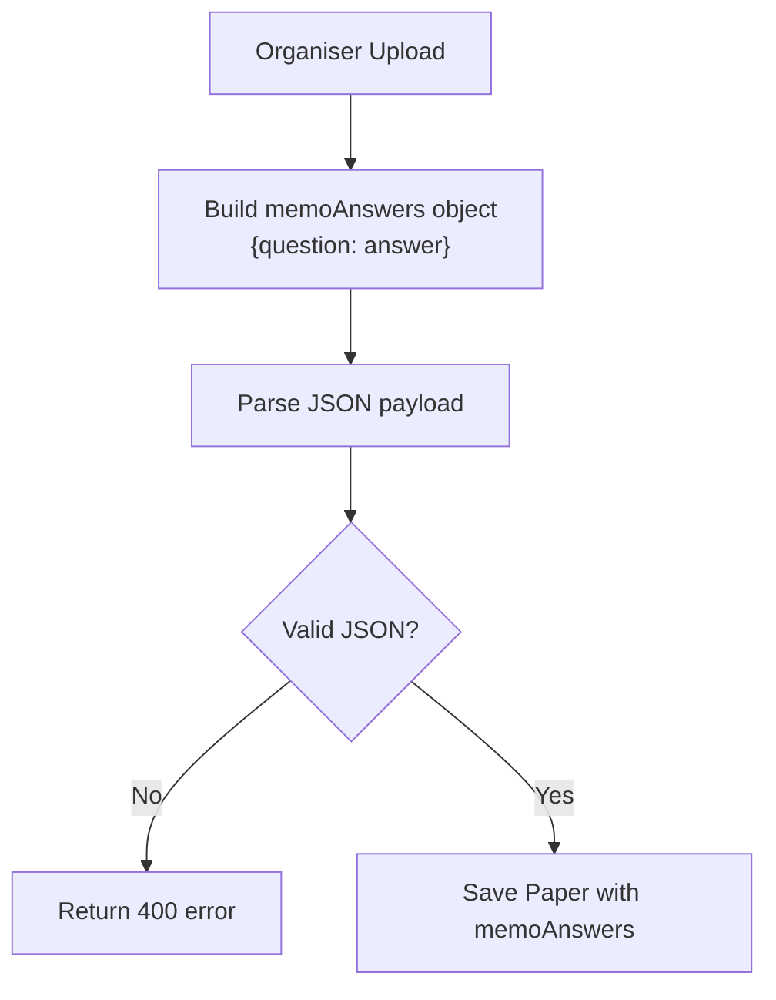
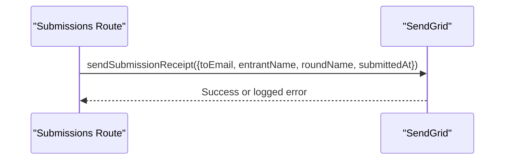
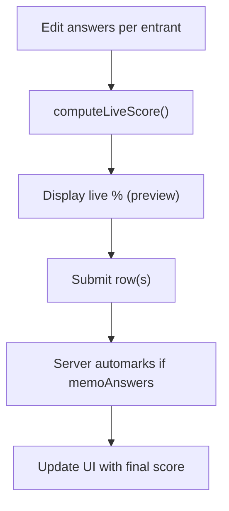
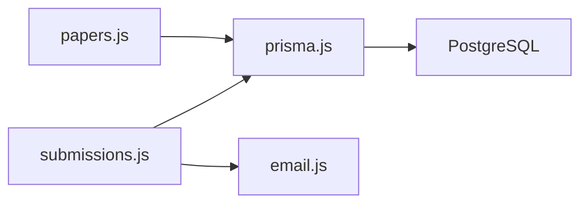

# Automated Scoring

<cite>
**Referenced Files in This Document**
- [submissions.js](file://backend/src/routes/submissions.js)
- [papers.js](file://backend/src/routes/papers.js)
- [schema.prisma](file://backend/prisma/schema.prisma)
- [email.js](file://backend/src/lib/email.js)
- [submissions.test.js](file://backend/src/routes/submissions.test.js)
- [email.test.js](file://backend/src/lib/email.test.js)
- [page.js (educator submit)](file://frontend/src/app/educator/submit/page.js)
- [migration.sql (memo answers)](file://backend/prisma/migrations/20260811072329_add_memo_answers_to_paper/migration.sql)
</cite>

## Table of Contents
1. [Introduction](#introduction)
2. [Project Structure](#project-structure)
3. [Core Components](#core-components)
4. [Architecture Overview](#architecture-overview)
5. [Detailed Component Analysis](#detailed-component-analysis)
6. [Dependency Analysis](#dependency-analysis)
7. [Performance Considerations](#performance-considerations)
8. [Troubleshooting Guide](#troubleshooting-guide)
9. [Conclusion](#conclusion)
10. [Appendices](#appendices)

## Introduction
This document explains the automated scoring system that processes student submissions when a memo answer key is available for a round. It covers how student answers are compared to memo answers, how scores are calculated and stored, how results are linked to submissions, and how educators receive submission receipts via email. It also documents edge cases such as empty memo keys, partial answers, and behavior across different question types.

## Project Structure
The automated scoring feature spans backend routes, data models, email notifications, and a frontend interface for educators to prepare and submit answers.



**Diagram sources**
- [submissions.js:8-85](file://backend/src/routes/submissions.js#L8-L85)
- [papers.js:25-96](file://backend/src/routes/papers.js#L25-L96)
- [email.js:5-20](file://backend/src/lib/email.js#L5-L20)
- [schema.prisma:69-97](file://backend/prisma/schema.prisma#L69-L97)

**Section sources**
- [submissions.js:8-85](file://backend/src/routes/submissions.js#L8-L85)
- [papers.js:25-96](file://backend/src/routes/papers.js#L25-L96)
- [schema.prisma:69-97](file://backend/prisma/schema.prisma#L69-L97)
- [email.js:5-20](file://backend/src/lib/email.js#L5-L20)

## Core Components
- Submission endpoint: Validates input, persists the submission, optionally automarks if memo answers exist, creates a result, and sends an email receipt.
- Paper management: Allows uploading paper files and memo answer keys; stores memoAnswers JSON for automarking.
- Data model: Defines Round, Paper, Submission, Result, User, Entrant relationships and fields including memoAnswers and idempotencyKey.
- Email notification: Sends a structured receipt to the educator who submitted on behalf of an entrant.
- Frontend: Provides live score preview and bulk submission with idempotency support.

**Section sources**
- [submissions.js:8-85](file://backend/src/routes/submissions.js#L8-L85)
- [papers.js:25-67](file://backend/src/routes/papers.js#L25-L67)
- [schema.prisma:69-97](file://backend/prisma/schema.prisma#L69-L97)
- [email.js:5-20](file://backend/src/lib/email.js#L5-L20)
- [page.js (educator submit):40-138](file://frontend/src/app/educator/submit/page.js#L40-L138)

## Architecture Overview
The end-to-end flow from submission to scoring and notification:



**Diagram sources**
- [submissions.js:8-85](file://backend/src/routes/submissions.js#L8-L85)
- [email.js:5-20](file://backend/src/lib/email.js#L5-L20)
- [schema.prisma:69-97](file://backend/prisma/schema.prisma#L69-L97)

## Detailed Component Analysis

### Submission Endpoint and Automark Flow
- Input validation: Requires entrantId, answers, and idempotencyKey; returns 400 if missing.
- Round check: Ensures the round exists and is open; otherwise returns 404 or 403.
- Persistence: Creates a Submission record with unique idempotencyKey to prevent duplicates.
- Automark condition: If the associated Paper has memoAnswers, the system compares each question’s answer against the memo answer.
- Score calculation: Counts exact matches and computes percentage based on total number of questions defined in memoAnswers.
- Result creation: Stores a Result linked by submissionId with the computed score.
- Notification: Retrieves requester and entrant details and sends a receipt email.
- Idempotency handling: On duplicate idempotencyKey, returns the existing submission and its result without creating a new one.



**Diagram sources**
- [submissions.js:8-85](file://backend/src/routes/submissions.js#L8-L85)

**Section sources**
- [submissions.js:8-85](file://backend/src/routes/submissions.js#L8-L85)
- [submissions.test.js:46-266](file://backend/src/routes/submissions.test.js#L46-L266)

### Scoring Algorithm
- Comparison method: Exact string match between student answer and memo answer per question ID.
- Counting: Increments a counter for each matching question.
- Percentage formula: (correctCount / totalQuestions) * 100, where totalQuestions is the number of keys in memoAnswers.
- Edge case: If memoAnswers is empty or undefined, no result is created and score remains null until memo answers are provided later.



**Diagram sources**
- [submissions.js:37-59](file://backend/src/routes/submissions.js#L37-L59)

**Section sources**
- [submissions.js:37-59](file://backend/src/routes/submissions.js#L37-L59)
- [submissions.test.js:108-157](file://backend/src/routes/submissions.test.js#L108-L157)

### Result Creation and Linkage
- The Result entity is created only when memoAnswers exist for the round’s paper.
- Linkage: Result.submissionId uniquely references the Submission.id, ensuring a one-to-one relationship.
- Fields: score is stored as a float representing percentage.

```mermaid
erDiagram
SUBMISSION {
string id PK
string roundId FK
string entrantId FK
json answers
string idempotencyKey UK
datetime submittedAt
}
RESULT {
string id PK
string submissionId UK FK
float score
datetime releasedAt
}
SUBMISSION ||--o| RESULT : "has one"
```

**Diagram sources**
- [schema.prisma:79-97](file://backend/prisma/schema.prisma#L79-L97)

**Section sources**
- [schema.prisma:79-97](file://backend/prisma/schema.prisma#L79-L97)
- [submissions.js:53-58](file://backend/src/routes/submissions.js#L53-L58)

### Memo Answer Key Format and Usage
- Storage: memoAnswers is stored as JSON in the Paper model.
- Expected structure: An object mapping question identifiers (e.g., "1", "2") to expected answers (e.g., "A", "B").
- Upload: Organisers can provide memoAnswers alongside paper uploads; the frontend builds this object from rows containing both question and answer values.
- Validation: Backend parses memoAnswers JSON and rejects invalid payloads.



**Diagram sources**
- [papers.js:25-67](file://backend/src/routes/papers.js#L25-L67)
- [migration.sql:1-2](file://backend/prisma/migrations/20260811072329_add_memo_answers_to_paper/migration.sql#L1-L2)

**Section sources**
- [papers.js:25-67](file://backend/src/routes/papers.js#L25-L67)
- [migration.sql:1-2](file://backend/prisma/migrations/20260811072329_add_memo_answers_to_paper/migration.sql#L1-L2)

### Email Notification System
- Trigger: After a successful submission (with or without automarking), a receipt email is sent to the educator who made the request.
- Content: Includes recipient email, entrant name, round name, and submission timestamp.
- Delivery: Uses SendGrid; errors are logged but do not fail the submission response.



**Diagram sources**
- [email.js:5-20](file://backend/src/lib/email.js#L5-L20)
- [submissions.js:63-73](file://backend/src/routes/submissions.js#L63-L73)

**Section sources**
- [email.js:5-20](file://backend/src/lib/email.js#L5-L20)
- [email.test.js:18-84](file://backend/src/lib/email.test.js#L18-L84)
- [submissions.js:63-73](file://backend/src/routes/submissions.js#L63-L73)

### Frontend Live Preview and Bulk Submission
- Live preview: Computes a local percentage score while editing answers using the same logic as the backend.
- Bulk upload: Supports importing answer sheets and submitting multiple entries with idempotency keys.
- Display: Shows final scores after server-side processing and preserves previous submissions.



**Diagram sources**
- [page.js (educator submit):123-138](file://frontend/src/app/educator/submit/page.js#L123-L138)
- [page.js (educator submit):410-456](file://frontend/src/app/educator/submit/page.js#L410-L456)

**Section sources**
- [page.js (educator submit):40-138](file://frontend/src/app/educator/submit/page.js#L40-L138)
- [page.js (educator submit):410-456](file://frontend/src/app/educator/submit/page.js#L410-L456)

## Dependency Analysis
- Submissions route depends on:
  - Prisma client for Round, Paper, Submission, Result, User, Entrant queries.
  - Email service for sending receipts.
  - Auth middleware to enforce educator role.
- Papers route depends on:
  - Multer for file uploads.
  - Prisma client to persist Paper records with memoAnswers.
- Data model defines relationships:
  - Paper.memoAnswers JSON used by submissions route for automarking.
  - Result links to Submission via submissionId.



**Diagram sources**
- [submissions.js:1-5](file://backend/src/routes/submissions.js#L1-L5)
- [papers.js:1-7](file://backend/src/routes/papers.js#L1-L7)
- [email.js:1-3](file://backend/src/lib/email.js#L1-L3)
- [schema.prisma:6-9](file://backend/prisma/schema.prisma#L6-L9)

**Section sources**
- [submissions.js:1-5](file://backend/src/routes/submissions.js#L1-L5)
- [papers.js:1-7](file://backend/src/routes/papers.js#L1-L7)
- [email.js:1-3](file://backend/src/lib/email.js#L1-L3)
- [schema.prisma:6-9](file://backend/prisma/schema.prisma#L6-L9)

## Performance Considerations
- Automarking complexity: O(Q) per submission where Q is the number of questions in memoAnswers; typically small and fast.
- Database writes: Single submission create plus optional result create; minimal overhead.
- Email delivery: Asynchronous side effect; failures are logged and do not block responses.
- Idempotency: Prevents duplicate submissions and redundant scoring work.

[No sources needed since this section provides general guidance]

## Troubleshooting Guide
- Missing required fields: Returns 400; ensure entrantId, answers, and idempotencyKey are included.
- Round not found or closed: Returns 404 or 403; verify round existence and state.
- Invalid memoAnswers JSON: Returns 400; ensure memoAnswers is valid JSON when uploading papers.
- Duplicate submission: IdempotencyKey conflict returns existing submission and result; use unique keys per submission attempt.
- Email failures: Errors are logged; check environment variables SENDGRID_API_KEY and SENDGRID_FROM_EMAIL.

**Section sources**
- [submissions.js:13-30](file://backend/src/routes/submissions.js#L13-L30)
- [submissions.js:75-85](file://backend/src/routes/submissions.js#L75-L85)
- [papers.js:43-50](file://backend/src/routes/papers.js#L43-L50)
- [email.js:14-20](file://backend/src/lib/email.js#L14-L20)

## Conclusion
The automated scoring system provides immediate feedback when memo answer keys are available, computing exact-match percentages and linking results to submissions. It ensures robustness through idempotent submissions and graceful email error handling. Educators benefit from live previews and receipt emails, while organisers can configure answer keys to enable automarking at scale.

[No sources needed since this section summarizes without analyzing specific files]

## Appendices

### Example Memo Answer Key Format
- Structure: JSON object mapping question IDs to expected answers.
- Example shape: {"1": "A", "2": "B", "3": "C"}
- Behavior: Only questions present in memoAnswers are considered for scoring.

**Section sources**
- [papers.js:43-50](file://backend/src/routes/papers.js#L43-L50)
- [migration.sql:1-2](file://backend/prisma/migrations/20260811072329_add_memo_answers_to_paper/migration.sql#L1-L2)

### Edge Cases Summary
- Empty memoAnswers: No automarking occurs; result is not created until memoAnswers are provided.
- Partial answers: Only answered questions are compared; unanswered questions do not affect correctness count.
- Different question types: Scoring uses exact string comparison; ensure consistent casing and formatting.

**Section sources**
- [submissions.js:37-59](file://backend/src/routes/submissions.js#L37-L59)
- [submissions.test.js:81-157](file://backend/src/routes/submissions.test.js#L81-L157)