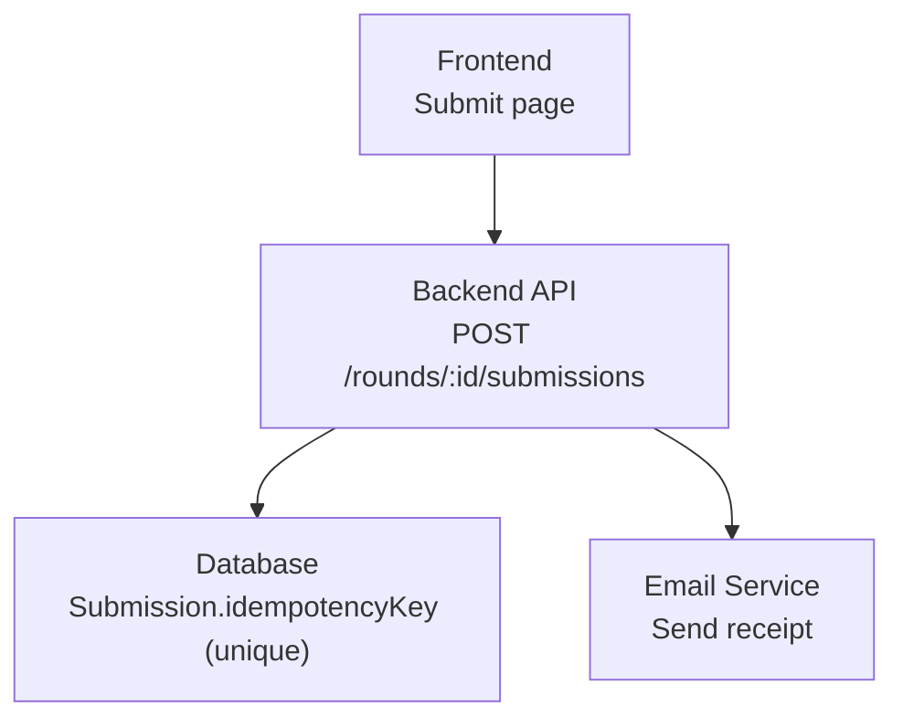
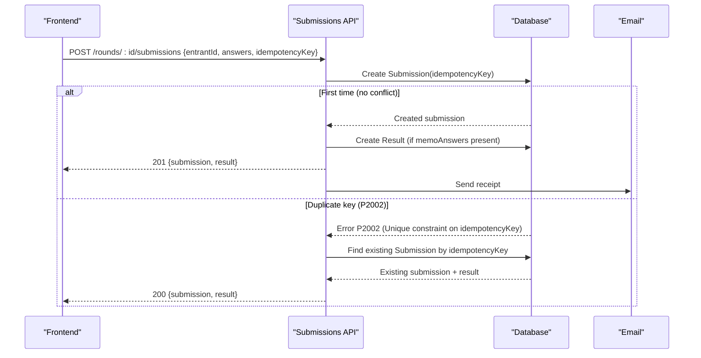
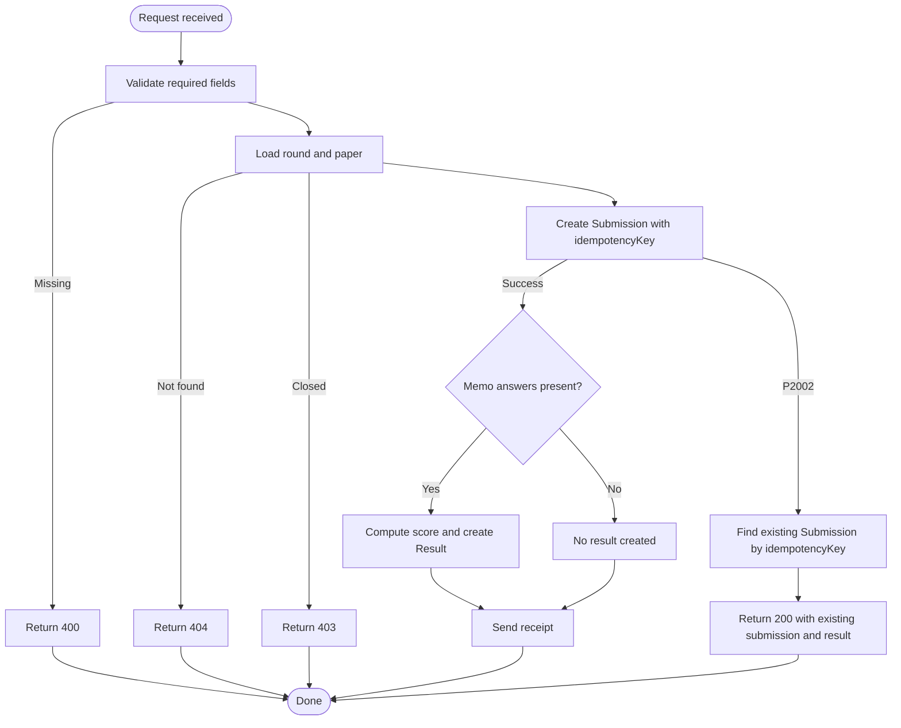
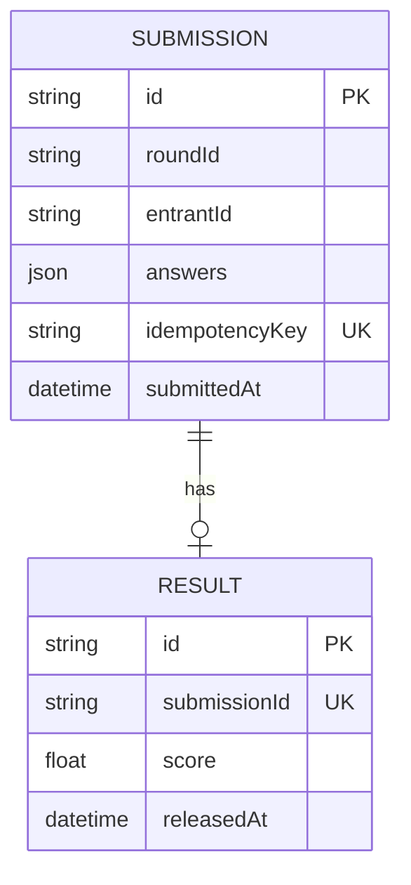
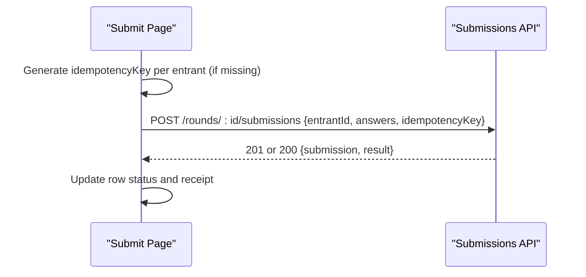
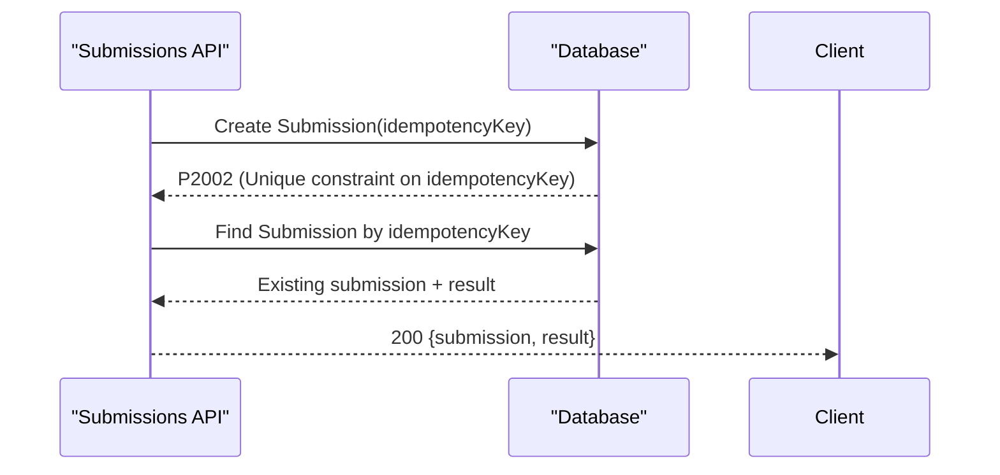
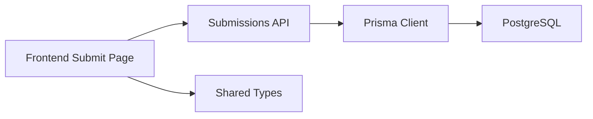

# Idempotency Handling

<cite>
**Referenced Files in This Document**
- [submissions.js](file://backend/src/routes/submissions.js)
- [schema.prisma](file://backend/prisma/schema.prisma)
- [page.js](file://frontend/src/app/educator/submit/page.js)
- [api.js](file://frontend/src/lib/api.js)
- [types.js](file://shared/types.js)
- [submissions.test.js](file://backend/src/routes/submissions.test.js)
</cite>

## Table of Contents
1. [Introduction](#introduction)
2. [Project Structure](#project-structure)
3. [Core Components](#core-components)
4. [Architecture Overview](#architecture-overview)
5. [Detailed Component Analysis](#detailed-component-analysis)
6. [Dependency Analysis](#dependency-analysis)
7. [Performance Considerations](#performance-considerations)
8. [Troubleshooting Guide](#troubleshooting-guide)
9. [Conclusion](#conclusion)
10. [Appendices](#appendices)

## Introduction
This document explains the idempotency mechanism that prevents duplicate submissions in the Olympiad Portal. It focuses on how the idempotencyKey parameter ensures identical submissions are processed only once, the database constraint that enforces uniqueness, and the graceful error handling for duplicate attempts. It also provides guidance on generating unique idempotency keys on the frontend and best practices for building reliable, idempotent APIs.

## Project Structure
The idempotency feature spans three layers:
- Frontend: Generates a unique idempotency key per submission attempt and persists it in memory to avoid accidental duplicates during retries or bulk operations.
- Backend API: Validates inputs, creates a submission with the provided idempotencyKey, and handles duplicate conflicts gracefully by returning the existing submission data.
- Database Schema: Declares a unique constraint on the idempotencyKey field to enforce uniqueness at the storage layer.

**Diagram sources**
- [page.js:195-255](file://frontend/src/app/educator/submit/page.js#L195-L255)
- [submissions.js:8-86](file://backend/src/routes/submissions.js#L8-L86)
- [schema.prisma:79-89](file://backend/prisma/schema.prisma#L79-L89)

**Section sources**
- [page.js:195-255](file://frontend/src/app/educator/submit/page.js#L195-L255)
- [submissions.js:8-86](file://backend/src/routes/submissions.js#L8-L86)
- [schema.prisma:79-89](file://backend/prisma/schema.prisma#L79-L89)

## Core Components
- Submission endpoint: POST /rounds/:id/submissions accepts entrantId, answers, and idempotencyKey. It validates the round state and then attempts to create a new submission record.
- Unique constraint: The Submission model defines idempotencyKey as unique, preventing duplicate keys from being stored.
- Duplicate handling: On a unique constraint violation (Prisma error code P2002), the endpoint returns the existing submission along with its result instead of an error.
- Frontend key generation: For each entrant, the frontend generates a unique idempotencyKey using crypto.randomUUID() if one does not already exist, and reuses it across retries.

**Section sources**
- [submissions.js:8-86](file://backend/src/routes/submissions.js#L8-L86)
- [schema.prisma:79-89](file://backend/prisma/schema.prisma#L79-L89)
- [page.js:82-112](file://frontend/src/app/educator/submit/page.js#L82-L112)
- [page.js:195-255](file://frontend/src/app/educator/submit/page.js#L195-L255)

## Architecture Overview
The idempotency flow ensures that even if the same submission is sent multiple times (e.g., due to network retries), only one submission is persisted and scored.

**Diagram sources**
- [submissions.js:32-85](file://backend/src/routes/submissions.js#L32-L85)
- [schema.prisma:79-89](file://backend/prisma/schema.prisma#L79-L89)

## Detailed Component Analysis

### Submission Endpoint Behavior
- Input validation: Requires entrantId, answers, and idempotencyKey; returns 400 if missing.
- Round checks: Returns 404 if round not found; returns 403 if round is not open.
- Submission creation: Attempts to insert a new Submission with the provided idempotencyKey.
- Auto-marking: If the round’s paper has memoAnswers, computes score and creates a Result linked to the submission.
- Receipt email: Sends a submission receipt using requester and entrant details.
- Duplicate handling: Catches Prisma error P2002 when idempotencyKey is not unique; queries the existing submission and returns it with status 200.

**Diagram sources**
- [submissions.js:8-86](file://backend/src/routes/submissions.js#L8-L86)

**Section sources**
- [submissions.js:8-86](file://backend/src/routes/submissions.js#L8-L86)

### Database Constraint on idempotencyKey
- The Submission model declares idempotencyKey as unique. This guarantees that no two submissions can share the same idempotencyKey value.
- When a duplicate key is attempted, the database rejects the write and Prisma surfaces a P2002 error indicating a unique constraint violation on idempotencyKey.

**Diagram sources**
- [schema.prisma:79-97](file://backend/prisma/schema.prisma#L79-L97)

**Section sources**
- [schema.prisma:79-89](file://backend/prisma/schema.prisma#L79-L89)

### Frontend Idempotency Key Generation and Usage
- Per-entrant keys: For each entrant, the frontend generates a unique idempotencyKey using crypto.randomUUID() if none exists. If an existing submission is found, the frontend reuses the server-provided idempotencyKey.
- Retries and bulk submit: The generated key is attached to every submission request for that entrant. If the request is retried or submitted multiple times, the backend detects the duplicate via the unique constraint and returns the existing submission data.
- UI behavior: The UI tracks row-level status and displays success/error states. Successful responses update the receipt table with submission metadata.

**Diagram sources**
- [page.js:82-112](file://frontend/src/app/educator/submit/page.js#L82-L112)
- [page.js:195-255](file://frontend/src/app/educator/submit/page.js#L195-L255)

**Section sources**
- [page.js:82-112](file://frontend/src/app/educator/submit/page.js#L82-L112)
- [page.js:195-255](file://frontend/src/app/educator/submit/page.js#L195-L255)

### Error Handling for Duplicate Submissions
- Backend catches Prisma error code P2002 where target includes idempotencyKey.
- Instead of propagating an error, it fetches the existing submission (including its result) and returns a successful response with status 200.
- Tests verify this behavior, ensuring duplicate submissions return the existing submission and result without failing the user experience.

**Diagram sources**
- [submissions.js:75-85](file://backend/src/routes/submissions.js#L75-L85)
- [submissions.test.js:159-186](file://backend/src/routes/submissions.test.js#L159-L186)

**Section sources**
- [submissions.js:75-85](file://backend/src/routes/submissions.js#L75-L85)
- [submissions.test.js:159-186](file://backend/src/routes/submissions.test.js#L159-L186)

## Dependency Analysis
- Frontend depends on the backend submission endpoint contract: expects {submission, result} in both success and duplicate cases.
- Backend depends on Prisma client and database constraints to enforce uniqueness and handle errors consistently.
- Shared types define the shape of Submission including idempotencyKey, aiding consistency across frontend and backend expectations.

**Diagram sources**
- [page.js:195-255](file://frontend/src/app/educator/submit/page.js#L195-L255)
- [submissions.js:1-86](file://backend/src/routes/submissions.js#L1-L86)
- [types.js:18-26](file://shared/types.js#L18-L26)

**Section sources**
- [types.js:18-26](file://shared/types.js#L18-L26)

## Performance Considerations
- Unique constraint enforcement occurs at the database level, which is efficient and avoids redundant processing.
- Duplicate detection triggers an additional read to fetch the existing submission; this is acceptable given the low frequency of duplicates and the benefit of idempotency.
- Auto-marking runs only when memoAnswers are present, minimizing unnecessary computation.

[No sources needed since this section provides general guidance]

## Troubleshooting Guide
- Missing fields: If entrantId, answers, or idempotencyKey are missing, the endpoint returns 400. Ensure your frontend sends all required fields.
- Round not open: If the round is closed or not yet open, the endpoint returns 403. Verify round state before submitting.
- Duplicate submissions: If you receive a 200 response containing an existing submission, it indicates a duplicate idempotencyKey. This is expected and safe; do not retry with a different key.
- Unexpected errors: Any other error results in a 500 response. Inspect server logs and ensure database connectivity and schema integrity.

**Section sources**
- [submissions.js:13-30](file://backend/src/routes/submissions.js#L13-L30)
- [submissions.js:75-85](file://backend/src/routes/submissions.js#L75-L85)

## Conclusion
The Olympiad Portal implements robust idempotency for submissions through a combination of frontend key generation, backend validation and error handling, and a database-level unique constraint. This design prevents duplicate processing, improves reliability under retries, and delivers a smooth user experience by returning existing submission data on duplicates. Following the recommended practices below will help maintain correctness and resilience.

[No sources needed since this section summarizes without analyzing specific files]

## Appendices

### Best Practices for Implementing Idempotent APIs
- Always require an idempotencyKey on mutating endpoints and enforce uniqueness at the database level.
- On duplicate key conflicts, return the original operation’s result rather than an error.
- Generate stable, unique keys on the client side (e.g., using crypto.randomUUID()) and persist them locally to support retries.
- Validate inputs early and fail fast with clear error messages.
- Keep business logic idempotent: avoid side effects that could run multiple times for the same key.
- Monitor and log constraint violations to detect anomalies or misuse.

[No sources needed since this section provides general guidance]

### Example Scenarios

- Generating unique idempotency keys on the frontend:
  - Use crypto.randomUUID() to generate a unique key per entrant before submission.
  - If an existing submission is detected, reuse the server-provided idempotencyKey to ensure idempotency across retries.

- Handling duplicate submission scenarios:
  - If the backend returns an existing submission with status 200, treat it as success and update UI accordingly.
  - Do not retry with a new key; use the same idempotencyKey to preserve idempotency.

[No sources needed since this section provides general guidance]