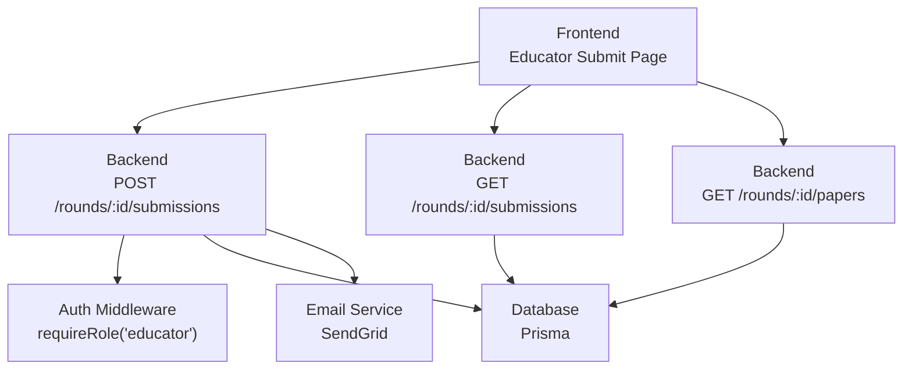
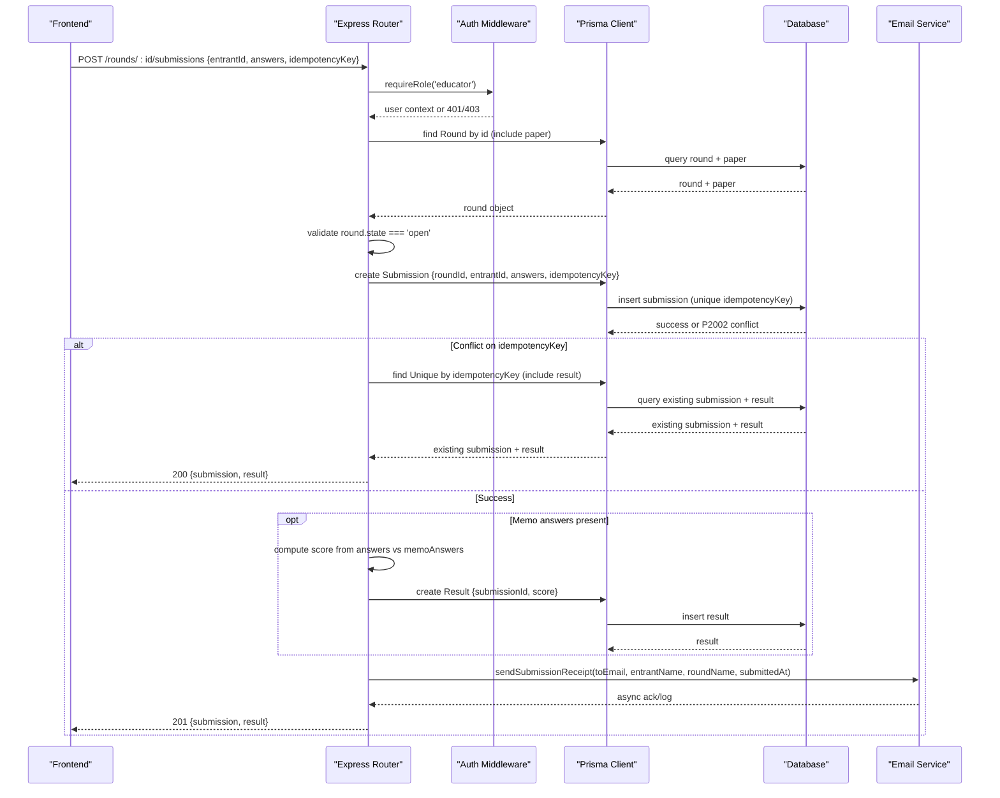
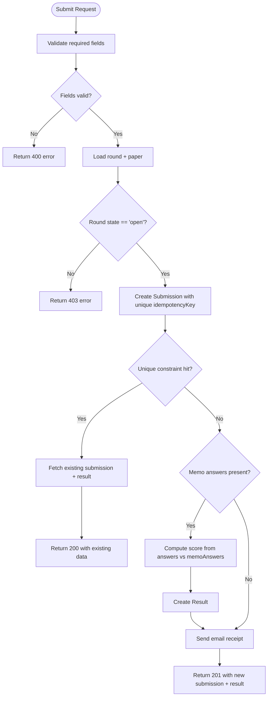
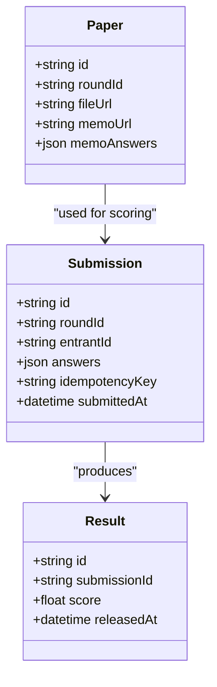
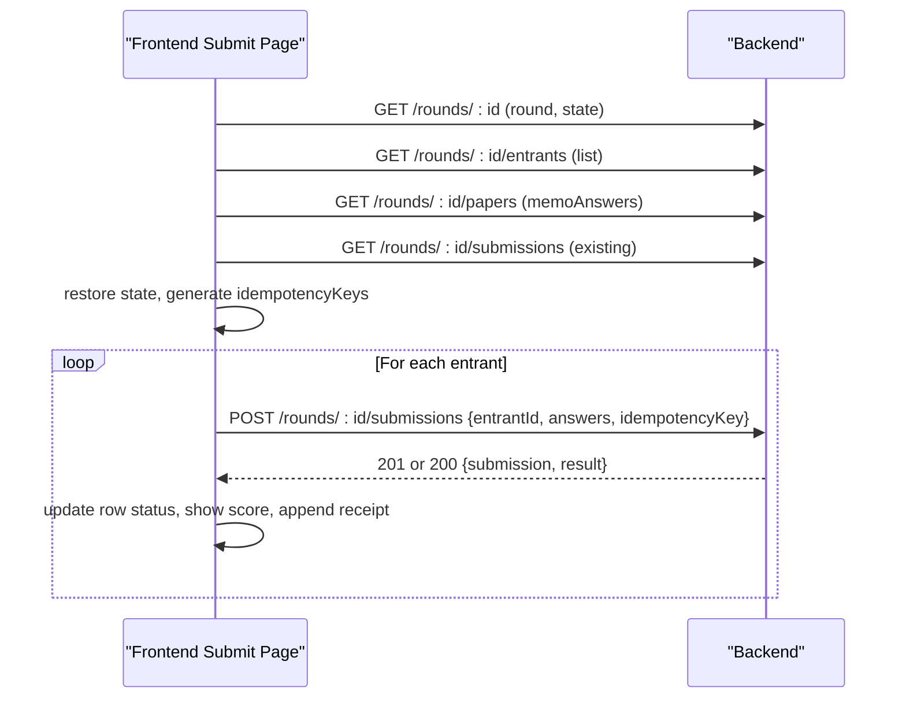
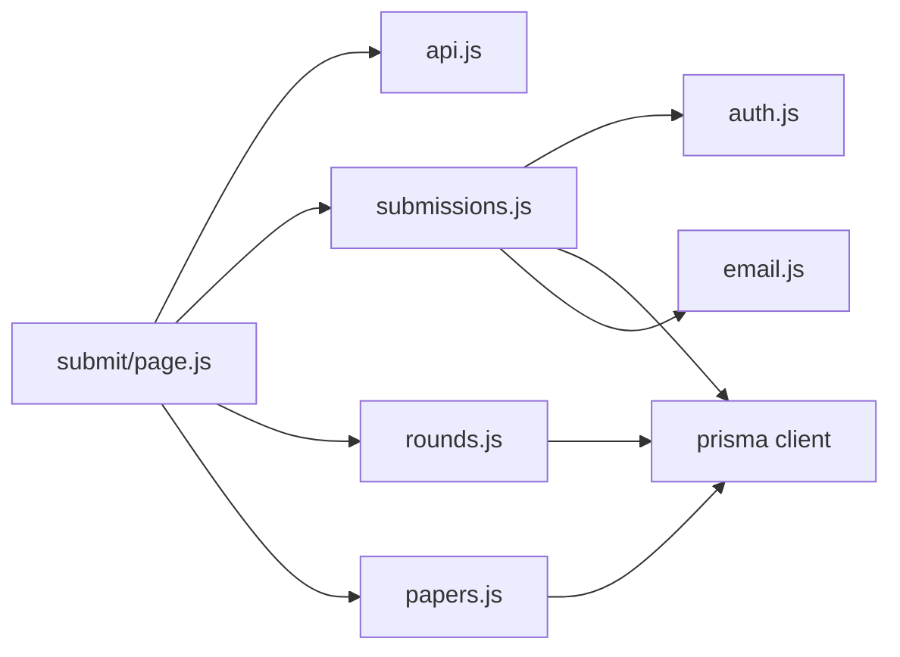

# Submission Processing

<cite>
**Referenced Files in This Document**
- [submissions.js](file://backend/src/routes/submissions.js)
- [rounds.js](file://backend/src/routes/rounds.js)
- [papers.js](file://backend/src/routes/papers.js)
- [auth.js](file://backend/src/middleware/auth.js)
- [email.js](file://backend/src/lib/email.js)
- [schema.prisma](file://backend/prisma/schema.prisma)
- [database-schema.md](file://documents/docs/database-schema.md)
- [api-reference.md](file://documents/docs/api-reference.md)
- [submit/page.js](file://frontend/src/app/educator/submit/page.js)
- [api.js](file://frontend/src/lib/api.js)
</cite>

## Table of Contents
1. [Introduction](#introduction)
2. [Project Structure](#project-structure)
3. [Core Components](#core-components)
4. [Architecture Overview](#architecture-overview)
5. [Detailed Component Analysis](#detailed-component-analysis)
6. [Dependency Analysis](#dependency-analysis)
7. [Performance Considerations](#performance-considerations)
8. [Troubleshooting Guide](#troubleshooting-guide)
9. [Conclusion](#conclusion)
10. [Appendices](#appendices)

## Introduction
This document explains how the Olympiad Portal processes submissions from educators, ensuring idempotency, validating answers, storing data safely, and generating results when possible. It covers the submission API endpoints, retrieval of submission status and results, database schema for submissions and related entities, error handling and validation rules, performance considerations for concurrent submissions and large payloads, and frontend integration patterns for submission workflows and real-time status updates.

## Project Structure
The submission processing spans backend routes, middleware, database schema, email notifications, and a frontend submission UI:
- Backend routes handle submission creation, retrieval, and paper management.
- Middleware enforces authentication and role-based access.
- The Prisma schema defines the database models and constraints that enforce data integrity and idempotency.
- The frontend provides an educator-facing interface to enter, upload, and submit answers with live scoring previews and receipt tracking.



**Diagram sources**
- [submissions.js:9-85](file://backend/src/routes/submissions.js#L9-L85)
- [rounds.js:102-113](file://backend/src/routes/rounds.js#L102-L113)
- [papers.js:70-96](file://backend/src/routes/papers.js#L70-L96)
- [auth.js:22-32](file://backend/src/middleware/auth.js#L22-L32)
- [email.js:5-20](file://backend/src/lib/email.js#L5-L20)

**Section sources**
- [submissions.js:9-85](file://backend/src/routes/submissions.js#L9-L85)
- [rounds.js:102-113](file://backend/src/routes/rounds.js#L102-L113)
- [papers.js:70-96](file://backend/src/routes/papers.js#L70-L96)
- [auth.js:22-32](file://backend/src/middleware/auth.js#L22-L32)
- [email.js:5-20](file://backend/src/lib/email.js#L5-L20)

## Core Components
- Idempotent submission endpoint: POST /rounds/:id/submissions
  - Validates required fields (entrantId, answers, idempotencyKey).
  - Checks round state is open before accepting submissions.
  - Creates a unique submission record using a unique idempotency key.
  - If memo answer keys exist, computes score immediately and creates a result.
  - Sends an email receipt asynchronously.
  - On duplicate idempotency key, returns existing submission and result instead of failing.
- Submission listing endpoint: GET /rounds/:id/submissions
  - Returns all submissions for a round, including associated results.
- Paper management endpoints:
  - Upload paper and memo with optional memoAnswers JSON.
  - Retrieve paper metadata for download based on round state.
- Authentication and authorization:
  - JWT-based authentication and role checks ensure only authorized educators can submit.

**Section sources**
- [submissions.js:9-85](file://backend/src/routes/submissions.js#L9-L85)
- [rounds.js:102-113](file://backend/src/routes/rounds.js#L102-L113)
- [papers.js:25-67](file://backend/src/routes/papers.js#L25-L67)
- [papers.js:70-96](file://backend/src/routes/papers.js#L70-L96)
- [auth.js:5-32](file://backend/src/middleware/auth.js#L5-L32)

## Architecture Overview
The submission pipeline ensures safe, idempotent storage and immediate scoring when possible.



**Diagram sources**
- [submissions.js:9-85](file://backend/src/routes/submissions.js#L9-L85)
- [auth.js:22-32](file://backend/src/middleware/auth.js#L22-L32)
- [email.js:5-20](file://backend/src/lib/email.js#L5-L20)

## Detailed Component Analysis

### Idempotent Submission Handling
- Unique identifier strategy:
  - Each submission includes an idempotencyKey stored as a unique field in the Submission model.
  - Database-level uniqueness prevents duplicate submissions even under concurrency.
- Duplicate detection and recovery:
  - On unique constraint violation (P2002), the handler fetches the existing submission and its result and returns it with a 200 status, making retries safe.
- Validation and gating:
  - Required fields are validated at the route level.
  - Submissions are only accepted when the round state is open; otherwise, a 403 is returned.



**Diagram sources**
- [submissions.js:9-85](file://backend/src/routes/submissions.js#L9-L85)
- [schema.prisma:79-89](file://backend/prisma/schema.prisma#L79-L89)

**Section sources**
- [submissions.js:9-85](file://backend/src/routes/submissions.js#L9-L85)
- [schema.prisma:79-89](file://backend/prisma/schema.prisma#L79-L89)

### Answer Validation, Storage, and Processing Pipeline
- Answer payload:
  - Answers are stored as JSON in the Submission.answers field.
  - Frontend normalizes answers to uppercase per question cell.
- Immediate automarking:
  - When memoAnswers exist for the round’s paper, the backend compares each answer against the memo key and calculates percentage score.
  - A Result record is created linked to the submission.
- Email receipt:
  - After successful submission, an asynchronous email receipt is sent to the submitting educator.



**Diagram sources**
- [schema.prisma:69-97](file://backend/prisma/schema.prisma#L69-L97)

**Section sources**
- [submissions.js:32-59](file://backend/src/routes/submissions.js#L32-L59)
- [papers.js:25-67](file://backend/src/routes/papers.js#L25-L67)
- [email.js:5-20](file://backend/src/lib/email.js#L5-L20)

### API Endpoints for Submissions and Results
- POST /rounds/:id/submissions
  - Purpose: Submit answers for an entrant in a specific round.
  - Auth: Requires educator role via JWT.
  - Body: entrantId, answers (JSON), idempotencyKey (unique string).
  - Responses:
    - 201 Created: New submission with optional result.
    - 200 OK: Existing submission and result on idempotency conflict.
    - 400 Bad Request: Missing required fields.
    - 403 Forbidden: Round not open.
    - 401 Unauthorized: Invalid or missing token.
    - 500 Internal Server Error: Unexpected errors.
- GET /rounds/:id/submissions
  - Purpose: Retrieve all submissions for a round, including results.
  - Response: Array of submission objects with associated result if present.
- GET /rounds/:id/papers
  - Purpose: Retrieve paper metadata for download when round is open or released.
  - Response: Paper object with fileUrl, memoUrl, and memoAnswers.

**Section sources**
- [submissions.js:9-85](file://backend/src/routes/submissions.js#L9-L85)
- [rounds.js:102-113](file://backend/src/routes/rounds.js#L102-L113)
- [papers.js:70-96](file://backend/src/routes/papers.js#L70-L96)
- [api-reference.md:229-283](file://documents/docs/api-reference.md#L229-L283)

### Database Schema for Submissions, Answers, and Metadata
- Submission:
  - Fields: id (PK), roundId (FK), entrantId (FK), answers (JSON), idempotencyKey (unique), submittedAt (default now), result (optional one-to-one).
- Result:
  - Fields: id (PK), submissionId (unique FK), score (float), releasedAt (nullable).
- Paper:
  - Fields: id (PK), roundId (unique FK), fileUrl, memoUrl, memoAnswers (optional JSON).
- Relationships:
  - Round has many Submissions and one Paper.
  - Entrant has many Submissions.
  - Submission produces one Result.

```mermaid
erDiagram
ROUND ||--o{ SUBMISSION : receives
ROUND ||--o| PAPER : uses
ENTRANT ||--o{ SUBMISSION : makes
SUBMISSION ||--|| RESULT : produces
SUBMISSION {
string id PK
string roundId FK
string entrantId FK
json answers
string idempotencyKey UK
datetime submittedAt
}
RESULT {
string id PK
string submissionId FK UK
float score
datetime releasedAt
}
PAPER {
string id PK
string roundId FK UK
string fileUrl
string memoUrl
json memoAnswers
}
```

**Diagram sources**
- [schema.prisma:69-97](file://backend/prisma/schema.prisma#L69-L97)
- [database-schema.md:58-85](file://documents/docs/database-schema.md#L58-L85)

**Section sources**
- [schema.prisma:69-97](file://backend/prisma/schema.prisma#L69-L97)
- [database-schema.md:58-85](file://documents/docs/database-schema.md#L58-L85)

### Error Handling, Validation Rules, and Data Integrity Checks
- Input validation:
  - Route-level checks for required fields (entrantId, answers, idempotencyKey).
  - Round state check ensures submissions are only accepted when open.
- Idempotency enforcement:
  - Unique constraint on idempotencyKey prevents duplicates.
  - Conflict handling returns existing submission and result gracefully.
- Authentication and authorization:
  - JWT verification and role checks prevent unauthorized submissions.
- Asynchronous operations:
  - Email sending is fire-and-forget; failures are logged but do not affect submission response.

**Section sources**
- [submissions.js:9-85](file://backend/src/routes/submissions.js#L9-L85)
- [auth.js:5-32](file://backend/src/middleware/auth.js#L5-L32)
- [email.js:5-20](file://backend/src/lib/email.js#L5-L20)

### Performance Considerations for Concurrent Submissions and Large Payloads
- Concurrency safety:
  - Database-level unique constraint on idempotencyKey ensures atomicity under concurrent requests.
  - Minimal critical section: only submission creation and optional result creation occur within transactional boundaries provided by Prisma.
- Payload size:
  - Answers are stored as JSON; consider limiting number of questions per round or chunking large answer sets at the frontend if needed.
- I/O bottlenecks:
  - Email sending is asynchronous and non-blocking; avoid synchronous waits.
- Query efficiency:
  - Retrieval endpoints include minimal relations (result) to reduce overhead.
- Scalability tips:
  - Use connection pooling configured via Prisma client.
  - Monitor database locks during peak submission windows.
  - Consider rate-limiting per educator IP or session to mitigate abuse.

[No sources needed since this section provides general guidance]

### Frontend Integration for Submission Workflows and Real-Time Status Updates
- Submission workflow:
  - Load round, entrants, paper metadata, and existing submissions concurrently.
  - Restore existing submissions into local state with scores and receipts.
  - Generate unique idempotency keys per entrant using crypto.randomUUID().
  - Allow manual entry or bulk upload via XLSX templates.
  - Submit individual rows or all at once; track per-row status (idle, submitting, success, error).
- Real-time status updates:
  - Live score preview computed locally against memoAnswers.
  - Row-level status reflects submission progress and outcomes.
  - Receipt table shows accepted submissions with answers, scores, timestamps, and IDs.
- Error handling:
  - Network errors and non-JSON responses handled uniformly.
  - User-friendly messages displayed via toast notifications.



**Diagram sources**
- [submit/page.js:45-121](file://frontend/src/app/educator/submit/page.js#L45-L121)
- [submit/page.js:195-255](file://frontend/src/app/educator/submit/page.js#L195-L255)
- [submit/page.js:257-286](file://frontend/src/app/educator/submit/page.js#L257-L286)

**Section sources**
- [submit/page.js:45-121](file://frontend/src/app/educator/submit/page.js#L45-L121)
- [submit/page.js:195-255](file://frontend/src/app/educator/submit/page.js#L195-L255)
- [submit/page.js:257-286](file://frontend/src/app/educator/submit/page.js#L257-L286)
- [api.js:17-45](file://frontend/src/lib/api.js#L17-L45)

## Dependency Analysis
- Routes depend on:
  - Prisma client for database operations.
  - Auth middleware for role-based access control.
  - Email service for receipts.
- Frontend depends on:
  - Shared API client utilities for consistent error handling.
  - XLSX library for bulk uploads.
- Database dependencies:
  - Unique constraints enforce data integrity and idempotency.
  - Relations between Round, Paper, Submission, and Result enable efficient queries.



**Diagram sources**
- [submissions.js:1-5](file://backend/src/routes/submissions.js#L1-L5)
- [rounds.js:1-3](file://backend/src/routes/rounds.js#L1-L3)
- [papers.js:1-7](file://backend/src/routes/papers.js#L1-L7)
- [auth.js:1-32](file://backend/src/middleware/auth.js#L1-L32)
- [email.js:1-20](file://backend/src/lib/email.js#L1-L20)
- [submit/page.js:45-121](file://frontend/src/app/educator/submit/page.js#L45-L121)
- [api.js:17-45](file://frontend/src/lib/api.js#L17-L45)

**Section sources**
- [submissions.js:1-5](file://backend/src/routes/submissions.js#L1-L5)
- [rounds.js:1-3](file://backend/src/routes/rounds.js#L1-L3)
- [papers.js:1-7](file://backend/src/routes/papers.js#L1-L7)
- [auth.js:1-32](file://backend/src/middleware/auth.js#L1-L32)
- [email.js:1-20](file://backend/src/lib/email.js#L1-L20)
- [submit/page.js:45-121](file://frontend/src/app/educator/submit/page.js#L45-L121)
- [api.js:17-45](file://frontend/src/lib/api.js#L17-L45)

## Performance Considerations
- Idempotency via unique constraints avoids duplicate writes and reduces contention.
- Asynchronous email sending prevents blocking request-response cycles.
- Local live scoring minimizes server load during editing.
- Bulk submission loops should be throttled to avoid overwhelming the backend.
- Consider pagination or filtering for large submission lists if needed.

[No sources needed since this section provides general guidance]

## Troubleshooting Guide
- Common errors:
  - 400 Bad Request: Missing required fields in submission payload.
  - 401 Unauthorized: Invalid or expired JWT token.
  - 403 Forbidden: Round not open or insufficient role.
  - 404 Not Found: Round or paper not found.
  - 500 Internal Server Error: Unexpected database or server errors.
- Idempotency conflicts:
  - Duplicate idempotencyKey triggers a graceful fallback returning existing submission and result.
- Email delivery issues:
  - SendGrid configuration errors log failures but do not block submissions.
- Frontend network errors:
  - Centralized error handling surfaces user-friendly messages and statuses.

**Section sources**
- [submissions.js:9-85](file://backend/src/routes/submissions.js#L9-L85)
- [auth.js:5-32](file://backend/src/middleware/auth.js#L5-L32)
- [email.js:5-20](file://backend/src/lib/email.js#L5-L20)
- [api.js:17-45](file://frontend/src/lib/api.js#L17-L45)

## Conclusion
The Olympiad Portal’s submission processing pipeline ensures robust, idempotent handling of educator submissions through unique identifiers and database constraints. It validates inputs, gates submissions by round state, stores answers securely, and generates results immediately when memo answers are available. The frontend provides a responsive, real-time experience with live scoring previews, bulk upload support, and clear status feedback. Proper error handling and asynchronous operations maintain reliability and performance under concurrent loads.

[No sources needed since this section summarizes without analyzing specific files]

## Appendices
- API reference details for rounds and entrants:
  - See additional endpoints and notes in the documentation.

**Section sources**
- [api-reference.md:229-283](file://documents/docs/api-reference.md#L229-L283)