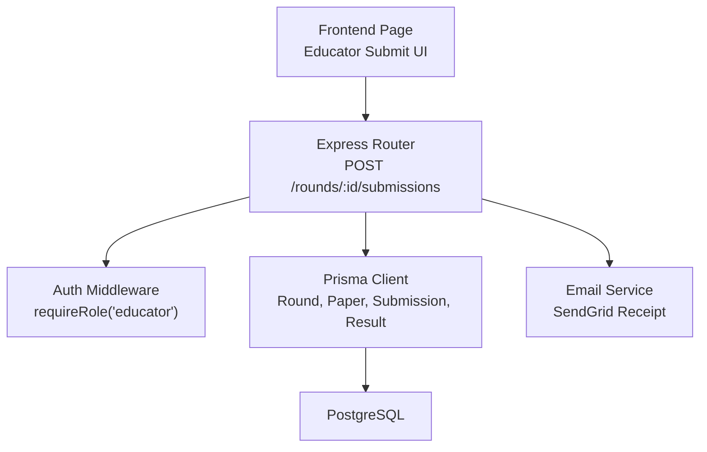
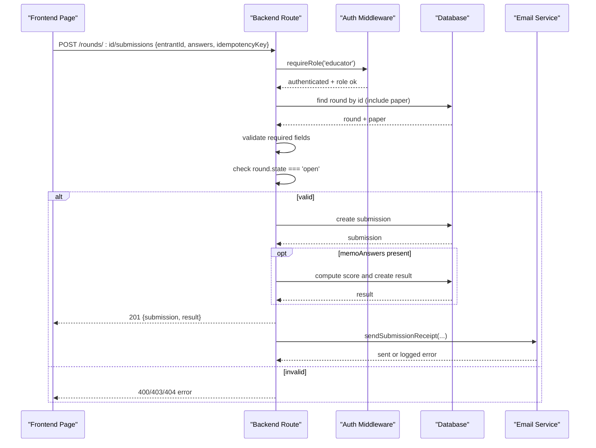
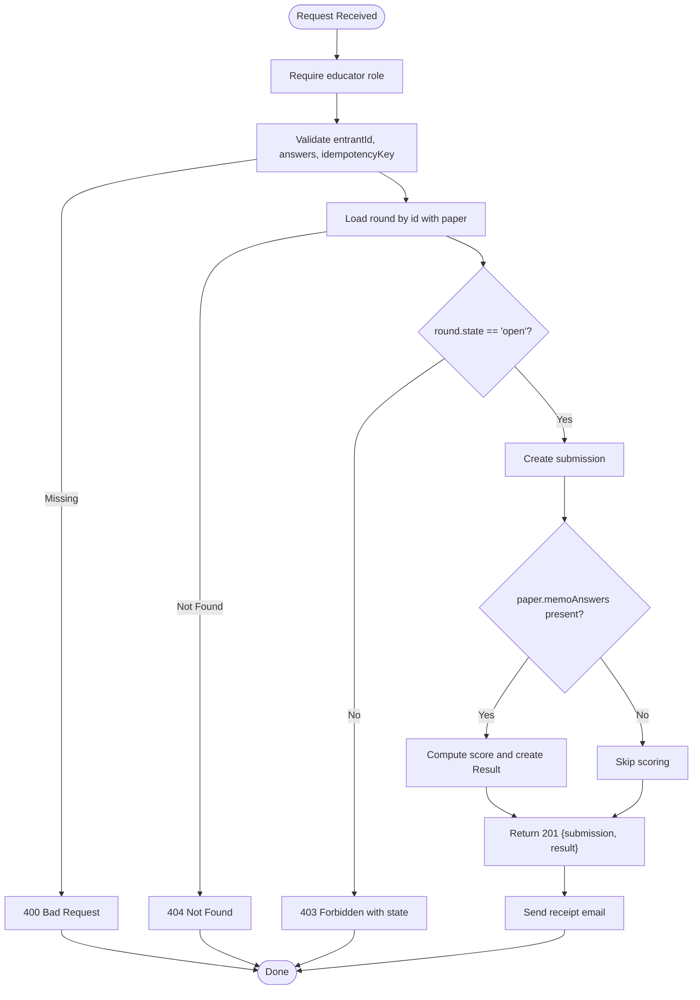
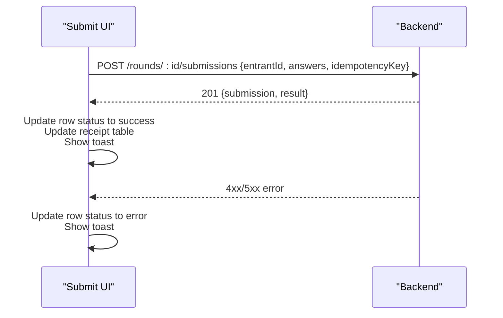
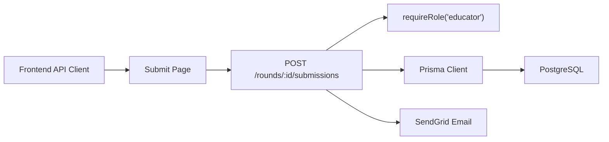

# Submission Workflow

<cite>
**Referenced Files in This Document**
- [submissions.js](file://backend/src/routes/submissions.js)
- [rounds.js](file://backend/src/routes/rounds.js)
- [auth.js](file://backend/src/middleware/auth.js)
- [email.js](file://backend/src/lib/email.js)
- [schema.prisma](file://backend/prisma/schema.prisma)
- [api.js](file://frontend/src/lib/api.js)
- [page.js](file://frontend/src/app/educator/submit/page.js)
- [types.js](file://shared/types.js)
</cite>

## Table of Contents
1. [Introduction](#introduction)
2. [Project Structure](#project-structure)
3. [Core Components](#core-components)
4. [Architecture Overview](#architecture-overview)
5. [Detailed Component Analysis](#detailed-component-analysis)
6. [Dependency Analysis](#dependency-analysis)
7. [Performance Considerations](#performance-considerations)
8. [Troubleshooting Guide](#troubleshooting-guide)
9. [Conclusion](#conclusion)
10. [Appendices](#appendices)

## Introduction
This document explains the complete submission workflow for the Olympiad Portal, from the educator-facing frontend to backend processing and storage. It focuses on the POST /rounds/:id/submissions endpoint, required parameters (entrantId, answers, idempotencyKey), validation rules, round state enforcement, error handling patterns, and frontend integration examples with user feedback.

## Project Structure
The submission feature spans both frontend and backend:
- Frontend Next.js page collects answers per entrant, generates idempotency keys, and calls the submission API.
- Backend Express route enforces authentication, validates inputs, checks round state, persists submissions, optionally auto-scores when a memo answer key exists, sends an email receipt, and handles idempotent retries.



**Diagram sources**
- [page.js:195-255](file://frontend/src/app/educator/submit/page.js#L195-L255)
- [submissions.js:8-86](file://backend/src/routes/submissions.js#L8-L86)
- [auth.js:22-31](file://backend/src/middleware/auth.js#L22-L31)
- [email.js:5-20](file://backend/src/lib/email.js#L5-L20)
- [schema.prisma:18-97](file://backend/prisma/schema.prisma#L18-L97)

**Section sources**
- [page.js:1-530](file://frontend/src/app/educator/submit/page.js#L1-L530)
- [submissions.js:1-89](file://backend/src/routes/submissions.js#L1-L89)
- [auth.js:1-35](file://backend/src/middleware/auth.js#L1-L35)
- [email.js:1-23](file://backend/src/lib/email.js#L1-L23)
- [schema.prisma:1-109](file://backend/prisma/schema.prisma#L1-L109)

## Core Components
- Frontend submit page: loads round metadata, entrants, existing submissions, and memo answers; builds per-entrant answers; submits via POST; shows live score previews and receipts.
- Backend submission route: requires educator role, validates request body, verifies round existence and open state, creates submission, optionally computes score, returns result, and sends receipt email.
- Data model: Round, Paper, Submission, Result, Entrant, User relationships defined in Prisma schema.
- Email service: sends submission receipt using SendGrid.

**Section sources**
- [page.js:45-121](file://frontend/src/app/educator/submit/page.js#L45-L121)
- [page.js:195-255](file://frontend/src/app/educator/submit/page.js#L195-L255)
- [submissions.js:8-86](file://backend/src/routes/submissions.js#L8-L86)
- [schema.prisma:18-97](file://backend/prisma/schema.prisma#L18-L97)
- [email.js:5-20](file://backend/src/lib/email.js#L5-L20)

## Architecture Overview
The submission flow ensures only authorized educators can submit results for rounds that are currently open. The system supports idempotent submissions and optional automatic scoring based on memo answers.



**Diagram sources**
- [submissions.js:8-86](file://backend/src/routes/submissions.js#L8-L86)
- [auth.js:22-31](file://backend/src/middleware/auth.js#L22-L31)
- [email.js:5-20](file://backend/src/lib/email.js#L5-L20)
- [schema.prisma:18-97](file://backend/prisma/schema.prisma#L18-L97)

## Detailed Component Analysis

### Backend Submission Endpoint
- Authentication and authorization:
  - Requires educator role via middleware.
- Input validation:
  - Required fields: entrantId, answers, idempotencyKey. Missing fields return 400.
- Round validation:
  - Fetches round by id with associated paper. Returns 404 if not found.
  - Enforces round.state must be 'open'; otherwise returns 403 with current state.
- Persistence:
  - Creates a submission record with roundId, entrantId, answers, and idempotencyKey.
- Auto-scoring:
  - If the round’s paper has memoAnswers, compares each answer to compute percentage score and creates a Result linked to the submission.
- Idempotency:
  - On unique constraint violation for idempotencyKey, returns the existing submission and its result with 200 status.
- Notification:
  - Sends a submission receipt email to the requesting educator with entrant name, round name, and timestamp.



**Diagram sources**
- [submissions.js:8-86](file://backend/src/routes/submissions.js#L8-L86)
- [auth.js:22-31](file://backend/src/middleware/auth.js#L22-L31)
- [email.js:5-20](file://backend/src/lib/email.js#L5-L20)
- [schema.prisma:18-97](file://backend/prisma/schema.prisma#L18-L97)

**Section sources**
- [submissions.js:8-86](file://backend/src/routes/submissions.js#L8-L86)
- [auth.js:22-31](file://backend/src/middleware/auth.js#L22-L31)
- [email.js:5-20](file://backend/src/lib/email.js#L5-L20)
- [schema.prisma:18-97](file://backend/prisma/schema.prisma#L18-L97)

### Frontend Integration
- Data loading:
  - Loads round details, entrants, paper memo answers, and existing submissions to restore prior answers and statuses.
- Answer editing:
  - Per-entrant answers stored as question-to-answer mapping; live score preview computed against memo answers.
- Submission:
  - For each entrant, posts to POST /rounds/:id/submissions with entrantId, answers, and idempotencyKey.
  - Handles success by updating row status and appending to receipt list; shows toast notifications.
  - Handles errors by marking row status as error and showing toast.
- Bulk submission:
  - Iterates over entrants, submitting silently and aggregating success/failure counts.
- UI state:
  - Displays disabled states during submission, highlights failed rows, and provides “Resubmit” for previously successful entries.



**Diagram sources**
- [page.js:195-255](file://frontend/src/app/educator/submit/page.js#L195-L255)
- [page.js:257-286](file://frontend/src/app/educator/submit/page.js#L257-L286)
- [submissions.js:8-86](file://backend/src/routes/submissions.js#L8-L86)

**Section sources**
- [page.js:45-121](file://frontend/src/app/educator/submit/page.js#L45-L121)
- [page.js:195-255](file://frontend/src/app/educator/submit/page.js#L195-L255)
- [page.js:257-286](file://frontend/src/app/educator/submit/page.js#L257-L286)

### Data Model Relationships
```mermaid
erDiagram
ROUND {
string id PK
string olympiadId FK
string name
datetime openTime
datetime closeTime
enum state
}
PAPER {
string id PK
string roundId UK FK
string fileUrl
string memoUrl
json memoAnswers
datetime uploadedAt
}
SUBMISSION {
string id PK
string roundId FK
string entrantId FK
json answers
string idempotencyKey UK
datetime submittedAt
}
RESULT {
string id PK
string submissionId UK FK
float score
datetime releasedAt
}
ENTRANT {
string id PK
string schoolId FK
string name
string grade
}
ROUND ||--o{ SUBMISSION : "has many"
ROUND ||--|| PAPER : "has one"
SUBMISSION ||--|| RESULT : "has one"
ENTRANT ||--o{ SUBMISSION : "has many"
```

**Diagram sources**
- [schema.prisma:18-97](file://backend/prisma/schema.prisma#L18-L97)

**Section sources**
- [schema.prisma:18-97](file://backend/prisma/schema.prisma#L18-L97)

## Dependency Analysis
- Frontend depends on:
  - Environment variable for API base URL.
  - Existing endpoints for round, entrants, papers, and submissions to build context and restore state.
- Backend depends on:
  - Auth middleware for role-based access control.
  - Prisma client for data operations.
  - Email service for sending receipts.
- Shared types define expected structures for Round, Submission, and Paper.



**Diagram sources**
- [api.js:1-146](file://frontend/src/lib/api.js#L1-L146)
- [page.js:195-255](file://frontend/src/app/educator/submit/page.js#L195-L255)
- [submissions.js:8-86](file://backend/src/routes/submissions.js#L8-L86)
- [auth.js:22-31](file://backend/src/middleware/auth.js#L22-L31)
- [email.js:5-20](file://backend/src/lib/email.js#L5-L20)
- [schema.prisma:18-97](file://backend/prisma/schema.prisma#L18-L97)

**Section sources**
- [api.js:1-146](file://frontend/src/lib/api.js#L1-L146)
- [page.js:195-255](file://frontend/src/app/educator/submit/page.js#L195-L255)
- [submissions.js:8-86](file://backend/src/routes/submissions.js#L8-L86)
- [auth.js:22-31](file://backend/src/middleware/auth.js#L22-L31)
- [email.js:5-20](file://backend/src/lib/email.js#L5-L20)
- [types.js:8-26](file://shared/types.js#L8-L26)

## Performance Considerations
- Idempotency prevents duplicate submissions and reduces redundant work on retries.
- Auto-scoring is performed synchronously only when memo answers exist; consider offloading heavy scoring to background jobs if scales increase.
- Batch submission in the frontend uses sequential requests; for large cohorts, consider concurrency limits or server-side bulk endpoints to avoid overwhelming the server.
- Caching round and paper metadata on the frontend reduces repeated fetches during editing sessions.

[No sources needed since this section provides general guidance]

## Troubleshooting Guide
Common scenarios and how they are handled:

- Missing parameters:
  - Backend returns 400 with an error message indicating required fields.
  - Frontend should display a user-friendly message and prevent submission until all fields are provided.
- Invalid round state:
  - Backend returns 403 with the current round state.
  - Frontend disables submission UI and informs users when the round is not open.
- Network errors:
  - Frontend catches network failures and throws a descriptive ApiError; show toast and allow retry.
- Duplicate submission:
  - Backend detects unique constraint on idempotencyKey and returns 200 with the existing submission and result; frontend treats this as success.
- Database or service errors:
  - Backend logs and returns 500; frontend shows error toast and allows retry after a delay.

**Section sources**
- [submissions.js:13-30](file://backend/src/routes/submissions.js#L13-L30)
- [submissions.js:75-85](file://backend/src/routes/submissions.js#L75-L85)
- [page.js:195-255](file://frontend/src/app/educator/submit/page.js#L195-L255)
- [api.js:17-45](file://frontend/src/lib/api.js#L17-L45)

## Conclusion
The submission workflow enforces strict validation and role-based access, ensuring only educators can submit results for rounds in the open state. It leverages idempotency keys to safely handle retries, supports automatic scoring when memo answers are available, and notifies educators via email. The frontend provides a responsive interface with live scoring previews, robust error handling, and clear user feedback.

[No sources needed since this section summarizes without analyzing specific files]

## Appendices

### API Contract Summary
- Endpoint: POST /rounds/:id/submissions
- Authorization: Educator role required
- Request body:
  - entrantId: string (required)
  - answers: object mapping question IDs to answers (required)
  - idempotencyKey: string (required, unique)
- Success response: 201 with submission and optional result
- Error responses:
  - 400: missing required fields
  - 403: round not open
  - 404: round not found
  - 500: server error

**Section sources**
- [submissions.js:8-86](file://backend/src/routes/submissions.js#L8-L86)
- [types.js:8-26](file://shared/types.js#L8-L26)

### Frontend Usage Examples
- Successful submission:
  - Build payload with entrantId, answers, and idempotencyKey.
  - Call POST /rounds/:id/submissions.
  - On success, update UI to show accepted status and append to receipt table.
- Error cases:
  - Handle 400 by prompting for missing fields.
  - Handle 403 by informing users the round is not open.
  - Handle network errors by displaying toast and enabling retry.

**Section sources**
- [page.js:195-255](file://frontend/src/app/educator/submit/page.js#L195-L255)
- [page.js:257-286](file://frontend/src/app/educator/submit/page.js#L257-L286)